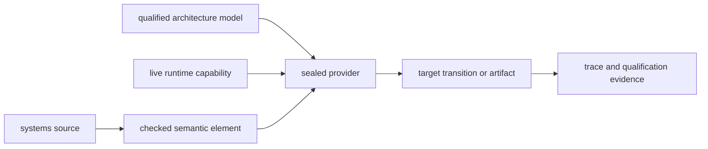

# Freestanding systems-profile semantics

## Formal text

### TOPAL-SYSTEMS-FEATURE-001 — Feature and artifact boundary

`systems` SHALL be a revisioned language feature selected through
`TOPAL-SYN-CONTEXT-001`. It SHALL add the sealed `lang systems` namespace and
SHALL add no grammar production. A source context selecting it SHALL be valid
only within one qualified freestanding systems root artifact. The same root
SHALL NOT use an ordinary hosted-process artifact profile.

A dependency which does not select `systems` SHALL retain its portable
semantics and vocabulary when composed into a systems artifact. Selection,
import, name lookup, or architecture-model access SHALL NOT itself grant
runtime authority.

### TOPAL-SYSTEMS-AUTHORITY-001 — Unforgeable systems authority

An entry, processor, privilege, address-space, mapping, interrupt, preemption,
fault-recovery, device, DMA, context, placement, or artifact capability SHALL
be an opaque resource identity constructed only by a qualified artifact or
provider transition. Ordinary or generated source SHALL NOT construct, copy,
widen, serialize, deserialize, compare for underlying identity, or derive such
authority from a numeric value, model fact, layout, or diagnostic projection.

Every systems operation SHALL consume or borrow the exact live capability for
its subject and SHALL record its effects, context, lifetime, failure, and
provider evidence. A target model SHALL establish legality facts only and
SHALL NOT satisfy runtime authority.

### TOPAL-SYSTEMS-VOCABULARY-001 — Initial sealed root construction

The initial systems source profile SHALL use ordinary application, function,
product, and binding syntax under the sealed `lang systems` namespace. A root
SHALL construct exactly one `lang systems artifact` whose `bootstrap-storage`
member is one `lang systems bounded-bootstrap-storage`, whose `bootstrap`
member is one `lang systems bootstrap-entry`, and whose `debug-break` member is
one `lang systems synchronous-exception-entry`, and whose
`local-notification` member is one `lang systems external-interrupt-entry`.
It SHALL also contain exactly one `deadline-notification` member constructed as
one `lang systems external-interrupt-entry`.
It SHALL also contain exactly one `kernel-thread` member constructed as one
`lang systems resumed-thread-entry`.
The storage constructor SHALL
contain exactly positive `capacity-bytes` and `alignment-bytes` natural-number
fields. Alignment SHALL be a power of two and SHALL NOT exceed capacity. The
bootstrap entry SHALL have one handler from `BootstrapContext` to
`BootstrapDisposition`; the debug-break entry SHALL have one handler from
`DebugBreakContext` to `DebugBreakDisposition`; and the local-notification
entry SHALL have one handler from `LocalNotificationInterruptContext` to
`LocalNotificationInterruptDisposition`; and the deadline-notification entry
SHALL have one handler from `DeadlineInterruptContext InitialMonotonicClock` to
`DeadlineInterruptDisposition InitialMonotonicClock`; and the kernel-thread
entry SHALL have one handler accepting `KernelThreadContext InitialProcessor`
and `SuspendedKernelContext InitialProcessor` and producing
`KernelThreadDisposition InitialProcessor`.

The only admitted initial handler operations SHALL be context-qualified
`console write`, `debug break`, local-notification completion,
deadline-notification completion, kernel-context terminal retirement, `resume`,
and `fatal`. Console write SHALL
borrow the live board console capability and this increment SHALL accept only a
static text value. Debug break SHALL borrow the bootstrap context and declare
one synchronous debug-break observation. Resume SHALL consume one live
completed entry context and resume exactly its interrupted continuation. Fatal
SHALL consume its live entry context and SHALL NOT return.

Every handler SHALL end in one disposition admitted by its context. The
context SHALL occur only as the receiver of an admitted operation, SHALL be
consumed exactly once by the final disposition, and SHALL NOT be rebound,
captured, stored, passed, returned, or used after consumption. Unknown
namespace members, extra artifact entries, mismatched handler classifiers,
duplicate roots, and ordinary-source use of any systems classifier or member
SHALL be rejected before lowering.

The bounded bootstrap pool SHALL be monotonic and SHALL NOT acquire a host
service. Each allocation request SHALL name a positive byte count, a
power-of-two alignment no greater than the pool alignment, and a closed
semantic placement. It SHALL return either one affine `BootstrapRegion` or one
sealed `BootstrapStorageErrorCode`: `invalid-request` for a malformed or
phase-invalid request and `exhausted` when aligned capacity is insufficient.
Releasing a region SHALL consume it without making its bytes available for a
later bootstrap allocation. Bootstrap completion SHALL require no live region
and SHALL make the complete pool reclaimable. No source operation SHALL expose
the model offset as a machine or physical address.

A live `BootstrapRegion` SHALL admit plain byte store and load only while
borrowed by its originating bootstrap execution. An access SHALL use a
zero-based offset strictly below the region byte count; a stored value SHALL be
a `Nat` no greater than 255, and a load SHALL return such a `Nat`. The initial
executable slice SHALL accept only statically known requests and offsets whose
alignment, capacity, value range, and bounds are proven before lowering.
Dynamic access SHALL remain unavailable until it carries a proof or an
explicitly specified failure result. It SHALL NOT be unchecked.

Allocation SHALL use the ordinary exhaustive `Result` decision, with an affine
region bound only in the `Ok` action and a sealed storage error bound only in
the `Error` action. Every reachable success action SHALL release its region
exactly once before the bootstrap context is consumed. Load and store SHALL
borrow rather than consume the region; release SHALL consume it. A region SHALL
NOT escape through return, storage, capture, message, task, foreign,
serialization, another entry, or an allocation-error action.

Plain region access SHALL NOT acquire volatile, atomic, device, DMA, firmware,
or user-memory semantics. Those domains SHALL require their separately typed
protocols. A provider MAY choose a target-specific concrete location and
instruction sequence only when it preserves the region's bounds, byte
contents, ownership, lifetime, and failure behavior without exposing its
address or allocation metadata to source.

The first semantic target profile SHALL record target
`x86_64-unknown-none`, board `topal-qemu-pc-q35-10.2`, and profile
`topal.systems.x86_64-qemu-pc-q35-10.2/1`. Executable qualification SHALL apply
only to the closed operation, provider, artifact, option, board, and physical-
evidence set recorded for that profile. Any unqualified extension SHALL fail
before producing an artifact.

### TOPAL-SYSTEMS-ENTRY-001 — Static special entry

`SystemEntry K` SHALL classify a static artifact declaration rather than an
ordinary callable function. `K` SHALL be one of `Bootstrap`, `SecondaryCpu`,
`SynchronousException`, `ExternalInterrupt`, `UserSyscall`,
`MachineCritical`, or `ResumeThread` in the initial profile.

An entry declaration SHALL identify one target profile, handler, opaque
context classifier, legal capability bundle, execution restrictions, and
closed disposition set. The context and capabilities SHALL be affine, SHALL
exist only for the dynamic entry extent, and SHALL NOT escape through return,
storage, capture, message, task, foreign, serialization, or another entry.

The backend SHALL own physical entry symbols, sections, alignment, machine
frames, stack transitions, saved state, security transitions, unwind/debug
information, and return sequences. Source SHALL NOT select or observe those
representations.

### TOPAL-SYSTEMS-DISPOSITION-001 — Complete entry disposition

An entry handler SHALL end in exactly one disposition admitted by its entry
kind. A disposition SHALL name the semantic continuation, such as resume,
return to validated user state, schedule, deliver a user exception, or fatal
transition. It SHALL consume the entry context and every outstanding affine
entry obligation.

The checker SHALL reject a disposition unless required interrupt
acknowledgement, masking/preemption restoration or transfer, address-space and
user-state validation, resource release/transfer, and recovery obligations are
proved. A disposition SHALL NOT be represented as an ordinary function return
in checked semantics.

### TOPAL-SYSTEMS-OBSERVATION-001 — Declared observation and linearization

A systems external observation SHALL have event
`Observe(s,q,p)`, where `s` is one live source capability, `q` is that source's
monotonic event identity, and `p` is a value or declared error satisfying its
selected layout. Its contract SHALL state ordering, duplication, loss,
acknowledgement, and completion rules.

A concurrent protocol MAY expose `Linearize(d,t)` for transition `t` in domain
`d` when several invariant-preserving transitions are enabled without an
ordering edge. Every permitted linearization SHALL preserve the protocol
invariant and external contract. The resulting events SHALL participate in the
observable trace and replay evidence.

Absent `Observe` or `Linearize` input/effects, systems code SHALL retain the
portable schedule-equivalence requirement. These events SHALL NOT authorize a
data race, arbitrary random choice, invented event, or removal, duplication,
merging, or speculation of a required observation.

### TOPAL-SYSTEMS-LOCAL-INTERRUPT-001 — Local-notification interrupt lifecycle

`local notification send` SHALL consume one admitted processor context and
produce one affine pending session with source identity `s`, the source's next
monotonic event identity `q`, and the exact prior local maskable-interrupt
state. The consumed context SHALL be invalid until the matching wait completes.
A second send, ordinary use of the consumed context, escape, duplication, or
ordinary completion while the session is live SHALL be rejected.

`local notification wait` SHALL consume that pending session. Successful wait
completion SHALL require, in order, `Observe(s,q)`, entry through the declared
local-notification external-interrupt entry, consumption of its completion
obligation, resumption of the interrupted continuation, and restoration of the
recorded prior maskable-interrupt state. Another event SHALL NOT satisfy the
wait. The provider MAY temporarily change local mask state inside the sealed
wait transition but source SHALL NOT observe or retain that state.

The external entry SHALL receive one affine
`LocalNotificationInterruptContext(s,q)`. `local notification complete` SHALL
consume it and produce one completed context admitting only the declared
resume or fatal disposition. Resume before completion, completion outside the
matching entry, duplicate completion, context escape, or ordinary return SHALL
be rejected. Completion SHALL discharge the target acknowledgement or pending-
state obligation; a zero-instruction completion SHALL require target evidence
that the complete obligation is otherwise satisfied.

The initial profile SHALL admit exactly one local-notification handler and one
send/wait event. It SHALL make no timer, bounded-latency, fairness, nested-entry,
SMP-delivery, shared-device-routing, or scheduler-disposition guarantee.

### TOPAL-SYSTEMS-MONOTONIC-CLOCK-001 — Monotonic-clock observation

The initial systems profile SHALL provide one opaque provider-created
`Clock InitialMonotonicClock` borrowed through each admitted processor context.
`monotonic clock now` SHALL borrow that context and clock and SHALL return one
immutable `Instant InitialMonotonicClock`. Neither authority SHALL be consumed
or widened by observation.

For clock identity `c`, its next observation identity `q`, and provider value
`t`, a successful observation SHALL record
`Observe(c,q,Instant(c,t))`. Observation identities SHALL increase in source
order. An accepted value SHALL be greater than or equal to the preceding value
accepted from `c`; equality SHALL be permitted. A decreasing value SHALL fail
closed and SHALL NOT be clamped, replaced, or exposed as an accepted instant.

Instants SHALL retain exact clock identity and SHALL NOT compare, subtract, or
substitute across clocks. The provider SHALL own counter selection, scale,
resolution, enablement, access, wrap extension, regression detection, and the
target state required for monotonicity. Source SHALL NOT observe a counter
address, register, instruction, width, frequency, calibration mechanism, or
wrap state. The compiler SHALL NOT invent, predict, merge, duplicate, remove,
or speculate a required clock observation.

The initial executable slice SHALL admit exactly two observations after its
local-notification wait and before its time-success marker. It SHALL make no
wall-clock, periodic-release, sleep, timeout,
bounded-latency, rate-accuracy, SMP, suspend, migration, userspace-ABI, or
real-time guarantee.

### TOPAL-SYSTEMS-DEADLINE-EVENT-001 — One-shot deadline event

Constructing `Deadline c` from `Instant c` and an exact positive `Duration`
SHALL preserve the absolute same-clock instant and SHALL fail on range
overflow. It SHALL NOT observe the clock. A deadline from another clock SHALL
NOT substitute, arm, or satisfy the event.

`deadline notification arm` SHALL borrow one admitted processor context,
consume one deadline, and produce one affine `ArmedDeadline c` with one new
monotonic event identity `q`. The deadline, armed event, and temporarily
consumed context SHALL NOT be duplicated, escaped, or used by another event.
`deadline notification wait` SHALL consume the armed event and return the
processor context only after the matching observation, typed entry, consuming
completion, and resumption have occurred.

Delivery SHALL record `DeadlineEvent(c,q,scheduled,observed)`, where scheduled
is the deadline's instant and observed is one newly accepted `Instant c`.
Observed SHALL be greater than or equal to scheduled. Late delivery SHALL
retain both values. If the deadline is already expired when armed, the event
SHALL become immediately deliverable against the original scheduled instant;
the provider SHALL NOT restart the relative duration.

The entry SHALL receive one affine `DeadlineInterruptContext(c,q,scheduled,
observed)`. `deadline notification complete` SHALL consume that context and
produce one completed context admitting only resume or fatal disposition.
Resume before completion, completion outside the matching entry, duplicate
completion, an early observation, or ordinary completion with a live deadline
authority SHALL be rejected.

A queued raw target notification for an already completed event SHALL NOT
construct another typed deadline context. The target adapter SHALL acknowledge
and filter that notification before source-handler dispatch, preserving the
interrupted frame and registers and performing no second completion or context
preemption. Completion SHALL close the event's target source and route; a
notification already queued in a controller SHALL still be filtered on entry.
Qualification SHALL inject such delivery at suspended-worker resumption and
prove exactly-once typed completion and complete context/resource reclamation.

The initial executable slice SHALL admit exactly one deadline constructed from
the second qualified monotonic observation and `1[ms]`, one arm/wait lifecycle,
and one declared handler. Comparator, timer, route, vector, controller,
acknowledgement, wait, frame, and return representation SHALL remain private to
the provider. Cancellation, rearming, periodic release, scheduler integration,
multiple outstanding events, bounded latency, rate accuracy, SMP delivery,
suspend/migration guarantees, and userspace timer ABI SHALL remain unavailable.

### TOPAL-SYSTEMS-MACHINE-001 — Closed machine-provider transition

A machine-provider operation SHALL have a stable closed identity and specify:
consumed and produced semantic state; privilege and resource identities;
legal execution contexts; fault and recovery behavior; ordering and visibility
relations; required architecture evidence; and an abstract model transition or
explicit unavailable-model result.

Only a language revision SHALL introduce a common machine-operation identity.
A common identity SHALL have one architecture-independent contract. A facility
without that contract SHALL use a target-qualified identity. No provider or
source package SHALL introduce an arbitrary instruction, register, clobber,
intrinsic, or opaque privileged transition.

### TOPAL-SYSTEMS-ADDRESS-001 — Disjoint address families

Systems address families SHALL include `Physical`, `KernelVirtual`,
`UserVirtual A`, `Device D`, `Dma I`, and `Firmware F`, each qualified by its
owning resource identity where shown. Numeric equality across families or
owners SHALL establish neither aliasing nor authority.

An address range SHALL record a target-qualified width and half-open
mathematical-natural interval whose endpoint calculation does not overflow
that width. Checked subrange and offset derivation SHALL preserve family,
owner, bounds, and no stronger authority. Decoding an external number SHALL
produce only an untrusted candidate until validated against one live range.
There SHALL be no general integer-to-address or cross-family cast.

### TOPAL-SYSTEMS-BOOT-MEMORY-001 — Affine boot-memory refinement

`describe memory` SHALL consume exactly one entered bootstrap context and its
opaque provider-private handoff. It SHALL be handled through an exhaustive
`Result` decision. The `Ok` action SHALL bind one `MemoryDescribedContext`; the
`Error` action SHALL bind one `BootMemoryFailureContext` which admits only a
fatal disposition. The consumed entered context SHALL be invalid on both
paths, and neither result context SHALL escape its entry extent.

A successful provider SHALL produce disjoint, nonempty, nonwrapping,
page-qualified `Physical` ranges classified as `Allocatable`, `Reclaimable`,
`Persistent`, `Reserved`, `Unusable`, or `Unknown`. Each range SHALL retain its
source classification and provider provenance. An unknown classification
SHALL NOT be allocatable. Overlapping claims SHALL be split and resolved so
that any non-allocatable claim prevents allocation and `Unusable` dominates.
Incomplete page-edge fragments SHALL remain reserved.

Before an `Allocatable` capability is produced, the provider SHALL subtract
every live bootstrap reservation, including applicable adapter, transition,
stack, kernel-image, bootstrap-storage, handoff, command-line, initramfs, and
firmware ranges. Each reservation SHALL retain an owner and reclamation
condition. Portable source SHALL NOT inspect a native handoff record, derive a
numeric physical address, or regain the entered context.

Malformed, overflowing, cyclic, contradictory, unsupported, or allocation-
empty input SHALL select the failure action. A provider SHALL NOT approximate
such input with host memory, fabricated RAM, or an unchecked range.

### TOPAL-SYSTEMS-FRAMES-001 — Affine physical-frame allocation

`create frame allocator` SHALL consume exactly one memory-described bootstrap
context through an exhaustive `Result` decision. Its `Ok` action SHALL bind one
`FrameAllocatorContext` retaining the preceding bootstrap capabilities and
exclusively owning the normalized allocatable-frame authority. Its `Error`
action SHALL bind one `FrameAllocatorFailureContext` which admits only a fatal
disposition. The consumed context SHALL be invalid on both paths, and neither
result context SHALL escape its entry extent.

An allocation SHALL borrow one live allocator and request a nonzero frame count
and power-of-two alignment in target-profile base-frame units. Success SHALL
produce one affine `PhysicalFrameExtent` carrying allocator identity, extent
identity, count, alignment, and provider provenance. Its base SHALL remain
opaque. The extent SHALL grant neither byte access nor mapping, device, DMA,
firmware, or user-memory authority. Malformed or exhausted allocation SHALL
select an explicit failure without invalidating the allocator.

Live extents SHALL NOT overlap each other, non-allocatable ranges, or retained
reservations. `release` SHALL consume an extent into exactly its originating
allocator. Cross-allocator release, double release, use after release, extent
escape, and a bootstrap disposition with a live extent SHALL be invalid.
Allocation choice and coalescing MAY vary only when success, failure, alignment,
non-overlap, ownership, and provenance observations remain equivalent.

The initial x86-64 executable profile SHALL admit only the static allocation
shapes `(frame-count: 1, alignment-frames: 1)`, `(frame-count: 2,
alignment-frames: 1)`, `(frame-count: 3, alignment-frames: 1)`,
`(frame-count: 5, alignment-frames: 1)`,
`(frame-count: 34, alignment-frames: 1)`, and
`(frame-count: 503, alignment-frames: 1)`. Every successful request SHALL
produce one indivisible extent and SHALL require release of that complete
extent. The profile SHALL reject every other count or alignment, a dynamic
request, extent splitting, and simultaneously live source-owned extents except
the exact refinements specified below before artifact publication.

### TOPAL-SYSTEMS-STATIC-ELF-FRAMES-001 — Exact static-image frame extent

The initial x86-64 root SHALL request the exact `(503, 1)` frame extent only
after releasing the preceding three-frame qualification extent. Success SHALL
return one opaque indivisible `PhysicalFrameExtent`. The provider SHALL derive
the complete byte extent with checked arithmetic and select it wholly inside
one normalized E820 RAM range, disjoint from the boot resource and retained
reservations, page aligned, and below the qualified first-GiB bootstrap mapping
ceiling.

Source SHALL emit exactly one `TOPAL_KERNEL_STATIC_ELF_FRAME_EXTENT_OK`
observation while the exact extent remains live and SHALL then release it whole
before any later bootstrap transition. The observation SHALL grant no access,
mapping, split, address, or reuse authority. A partial interval, wrong count or
alignment, overlap, arithmetic overflow, missing or duplicate observation,
release before observation, continuation before release, or recoverable
disposition with the extent live SHALL be invalid. This rule SHALL NOT map,
read, write, execute, or make the planned static image runtime-selectable.

### TOPAL-SYSTEMS-STATIC-ELF-MAPPING-RESOURCES-001 — Disjoint mapping resources

After the exact 503-frame static-ELF payload allocation and its required
payload observation, the initial x86-64 root SHALL keep that complete extent
live and MAY request exactly one `(1, 1)` translation-metadata extent. The
provider SHALL receive the complete opaque payload interval as exclusion
evidence and SHALL prove that the metadata interval is aligned and disjoint
from the payload, every retained reservation, the boot resource, and every
non-allocatable range before returning success. Both complete intervals SHALL
remain within the qualified first-GiB bootstrap mapping ceiling.

Success SHALL create two distinct affine owners and SHALL emit exactly one
`TOPAL_KERNEL_STATIC_ELF_MAPPING_RESOURCES_OK` observation while both remain
live. Source SHALL then release the complete metadata extent followed by the
complete payload extent before any later bootstrap transition. Either failure
SHALL select the fatal action. A hidden allocation, overlap, partial interval,
arithmetic overflow, wrong request order or shape, missing or duplicate
observation, reversed or partial release, extent combination or splitting, or
disposition while either owner remains live SHALL be invalid. This rule SHALL
grant no byte access, table-entry construction, mapping publication, target
address, or runtime image-selection authority.

### TOPAL-SYSTEMS-STATIC-ELF-LEAVES-001 — Initial inactive leaf publication

`static image construction prepare` SHALL consume the exact simultaneous
503-frame payload extent and one-frame metadata extent specified by
`TOPAL-SYSTEMS-STATIC-ELF-MAPPING-RESOURCES-001`. Success SHALL produce one
opaque affine `StaticImageConstruction` and SHALL leave neither input directly
releasable. The operation SHALL publish exactly 503 adjacent mappings in the
checked page-plan order such that payload frame ordinal `i` backs virtual page
ordinal `i`, every published mapping has semantic initial rights RW/NX, and all
unused capacity in the provider's bounded inactive translation object is
absent. No partial construction SHALL become observable.

The initial x86-64 provider SHALL realize this object using the separately
owned aligned metadata frame, 512 bounded leaf entries, 503 present/user/
writable/NX entries, and nine absent entries. It SHALL revalidate the complete
payload and metadata intervals, zero the complete metadata frame before use,
verify every constructed and absent entry, and complete target publication
ordering before returning success. The object SHALL remain unreachable from
every active address space in this increment.

Source SHALL emit exactly one
`TOPAL_KERNEL_STATIC_ELF_INITIAL_LEAVES_OK` observation while the construction
is live. `static image construction revoke metadata` SHALL clear and verify the
complete inactive object, complete target ordering, refine the construction to
revoked state, and return exactly the original metadata extent. Source SHALL
release that extent before `static image construction reclaim payload`
consumes the revoked owner and returns exactly the original indivisible
503-frame payload extent for whole release.

Wrong input or construction identity, wrong count, order, rights, or absent
capacity, arithmetic overflow, overlap, partial publication, missing or
duplicate observation, release before return, reclaim before complete
revocation and metadata release, duplicate revoke or reclaim, reversed return,
or disposition with any live construction state SHALL be invalid. This rule
SHALL grant no payload byte access, active-address-space attachment, final
permission, executable entry, or runtime image-selection authority.

### TOPAL-SYSTEMS-STATIC-ELF-ZERO-001 — Complete inactive payload initialization

`static image construction zero payload` SHALL consume the exact live
`StaticImageConstruction` produced by
`TOPAL-SYSTEMS-STATIC-ELF-LEAVES-001`. Success SHALL produce one affine
`ZeroedStaticImageConstruction` owning the same 503-frame payload and
one-frame metadata extents. The operation SHALL write zero to every byte of
the complete `503 * 4096` byte payload and SHALL independently verify that
complete result before success. It SHALL preserve all 503 initial RW/NX leaves
in their original order and all nine absent entries. The construction SHALL
remain unreachable from every active address space.

The initial x86-64 provider SHALL revalidate the complete input intervals and
exact live leaf table before modifying payload contents. It SHALL perform the
complete zeroing and readback through provider-private target access, SHALL
reject any mismatch, and SHALL NOT expose an address, byte, mapping, loop, or
target coherence operation to source. No partial initialization SHALL become
observable and failure SHALL select the fatal action.

Source SHALL emit exactly one `TOPAL_KERNEL_STATIC_ELF_PAYLOAD_ZEROED_OK`
observation while the zeroed construction is live. A later construction rule
MAY consume that refinement. When `TOPAL-SYSTEMS-STATIC-ELF-COPY-001` is
selected, revocation SHALL NOT accept the zeroed owner before copy succeeds.

Wrong owner or extent, duplicate zeroing, revocation before complete zeroing,
missing or duplicate observation, any nonzero verified byte, leaf-table
change, release before return, or disposition with either uninitialized or
zeroed construction state live SHALL be invalid. This rule SHALL NOT copy file
bytes, grant ordinary payload access, apply final permissions, attach an active
address space, publish an entry, or make an image runtime-selectable.

### TOPAL-SYSTEMS-STATIC-ELF-COPY-001 — Verified inactive payload population

`static image construction copy payload` SHALL consume the exact live
`ZeroedStaticImageConstruction` produced by
`TOPAL-SYSTEMS-STATIC-ELF-ZERO-001`. It SHALL accept only source
`retained-static-user-elf` and plan `bounded-static-elf-four-loads`. Success
SHALL produce one affine `PopulatedStaticImageConstruction` owning the same
503-frame payload and one-frame metadata extents.

The initial x86-64 provider SHALL revalidate both construction extents, all
503 ordered initial RW/NX leaves, nine absent entries, the complete retained
boot-resource handoff, and the approved static ELF metadata before reading the
member payload. It SHALL copy exactly these
`(source-offset, destination-offset, byte-count)` triples:
`(0, 0, 0x6e0)`, `(0x1000, 0x1000, 0x18b285)`,
`(0x18d000, 0x18d000, 0x57040)`, and
`(0x1e4660, 0x1e5660, 0x9728)`. Destination offsets SHALL be relative to the
503-frame payload corresponding to virtual base `0x400000`.

Before success, the provider SHALL compare every destination byte in all four
intervals with its immutable source byte, verify that every other byte in
`[0, 0x1f7000)` remains zero, and verify the unchanged 503 live leaves and nine
absent entries. The construction SHALL remain unreachable from every active
address space. The operation SHALL expose no member name, offset, address,
byte, loop, archive representation, or target coherence mechanism to source.

Source SHALL emit exactly one `TOPAL_KERNEL_STATIC_ELF_PAYLOAD_COPIED_OK`
observation while the populated construction is live. Absent a later selected
construction refinement, `static image construction revoke metadata` SHALL
accept only the populated refinement. When
`TOPAL-SYSTEMS-STATIC-ELF-PERMISSIONS-001` is selected, revocation SHALL NOT
accept the populated owner before permission sealing succeeds. The complete
metadata-release, payload-reclaim, and whole-release obligations of
`TOPAL-SYSTEMS-STATIC-ELF-LEAVES-001` apply unchanged after the last selected
construction refinement.

Wrong owner, source, plan, resource, interval, order, copied byte, preserved-
zero byte, or leaf state; duplicate copy; copy before complete zeroing;
revocation before copy; missing or duplicate observation; or disposition with
an uninitialized, zeroed, or populated construction live SHALL be invalid.
This rule SHALL NOT apply final permissions, attach an active address space,
publish an entry, initialize TLS or stack state, or make the image runtime-
selectable.

### TOPAL-SYSTEMS-STATIC-ELF-PERMISSIONS-001 — Verified inactive final permissions

`static image construction seal permissions` SHALL consume the exact live
`PopulatedStaticImageConstruction` produced by
`TOPAL-SYSTEMS-STATIC-ELF-COPY-001`. It SHALL accept only plan
`bounded-static-elf-wx-relro`. Success SHALL produce one affine
`SealedStaticImageConstruction` owning the same 503-frame payload and
one-frame metadata extents.

The initial x86-64 provider SHALL revalidate both construction extents, all
503 ordered initial RW/NX leaves, nine absent entries, and the complete
populated payload before changing any leaf. It SHALL atomically publish these
entry-stage ordinal roles over the inactive construction: header `[0, 1)` as
user RO/NX; executable `[1, 397)` as user RO/X; immutable data `[397, 485)` as
user RO/NX; and writable data and BSS `[485, 503)`, including GNU RELRO
`[485, 493)`, as user RW/NX. Thus the entry-stage table SHALL contain exactly
89 RO/NX, 396 RO/X, and 18 RW/NX leaves, with no writable-executable leaf. The
GNU RELRO leaves SHALL remain writable only until the exact checked transition
required by `TOPAL-SYSTEMS-STATIC-ELF-RELRO-MPROTECT-001`.

Before success, the provider SHALL read back every leaf, verify the original
payload-frame identity and ordinal order with its exact final role, and verify
that all nine remaining entries are absent. The construction SHALL remain
unreachable from every active address space. Target permission bits,
page-table entries, page ordinals, addresses, loops, publication barriers,
cache maintenance, and translation invalidation SHALL remain provider-private.

Source SHALL emit exactly one `TOPAL_KERNEL_STATIC_ELF_PERMISSIONS_OK`
observation while the sealed construction is live. In this profile,
`static image construction revoke metadata` SHALL accept only the sealed
refinement; the complete metadata-release, payload-reclaim, and whole-release
obligations of `TOPAL-SYSTEMS-STATIC-ELF-LEAVES-001` then apply unchanged.

Wrong owner, plan, resource, interval, ordinal, frame identity, role, count,
W+X state, absent entry, or order; duplicate sealing; sealing before complete
population; revocation before sealing; missing or duplicate observation; or
disposition with an uninitialized, zeroed, populated, or sealed construction
live SHALL be invalid. This rule SHALL NOT attach an active address space,
construct upper translation levels, publish an entry, initialize TLS or stack
state, or make the image runtime-selectable.

### TOPAL-SYSTEMS-STATIC-ELF-HIERARCHY-EXTENT-001 — Affine upper translation metadata

While the exact `SealedStaticImageConstruction` from
`TOPAL-SYSTEMS-STATIC-ELF-PERMISSIONS-001` remains live, the initial x86-64
profile SHALL admit exactly one typed
`static image construction reserve hierarchy` operation with request
`(frame-count: 5, alignment-frames: 1)`. Success SHALL produce one indivisible
opaque `PhysicalFrameExtent` reserved for the future static-image upper
translation hierarchy. The allocation SHALL preserve the sealed construction
and every authority, frame identity, byte, and final leaf role that it owns.

The provider SHALL derive the complete 20,480-byte candidate with checked
arithmetic and select it wholly inside one normalized E820 RAM interval,
page-aligned, below the first-GiB bootstrap ceiling, and disjoint from the
503-frame payload, one-frame leaf table, retained boot resource, active
translation metadata, and every other live allocation. The qualified x86-64
selection SHALL place it after the leaf-table extent. It SHALL grant no byte
access, mapping, hierarchy-construction, attachment, activation, entry, or
execution authority.

Source SHALL emit exactly one
`TOPAL_KERNEL_STATIC_ELF_HIERARCHY_EXTENT_OK` observation while the hierarchy
extent and sealed construction are simultaneously live. It SHALL then release
the complete five-frame extent to its originating allocator before revoking
the sealed construction. Whole release SHALL restore the exact sealed-only
ownership state, after which the existing metadata-then-payload revocation
and release obligations apply unchanged.

A wrong count or alignment, allocation before permission sealing, overlap,
overflow, split, partial or substituted release, release before observation,
revocation while the hierarchy is live, missing or duplicate observation, or
recoverable disposition with either authority live SHALL be invalid. This
operation's provider failure SHALL enter the fatal disposition without
publishing an extent or witness. This
rule SHALL NOT initialize a page-table level, link the existing leaf table,
attach or activate an address space, initialize TLS or a stack, publish an
entry, retain the hierarchy extent, or execute the static image.

### TOPAL-SYSTEMS-STATIC-ELF-ADDRESS-SPACE-001 — Verified inactive attachment and detach

`static image construction attach address space` SHALL consume the exact live
`SealedStaticImageConstruction` from
`TOPAL-SYSTEMS-STATIC-ELF-PERMISSIONS-001` and the exact live five-frame
hierarchy extent from `TOPAL-SYSTEMS-STATIC-ELF-HIERARCHY-EXTENT-001`. It
SHALL accept only layout `bounded-static-elf-inactive-address-space`. Success
SHALL produce one affine `AttachedStaticImageConstruction` owning the same
payload, leaf metadata, and hierarchy extents.

Before construction, the initial x86-64 provider SHALL revalidate all three
extents, their exact qualified adjacency and disjointness, all 503 final leaves
and nine absent entries, and that the hierarchy root differs from the active
translation root. It SHALL zero and read back all 20,480 hierarchy bytes. It
SHALL then construct one complete inactive hierarchy comprising PML4, PDPT,
low-memory directory, qualified-MMIO directory, and high user leaf-table
frames in that order.

PML4 entry zero and PDPT entry zero SHALL provide present/write/user traversal
to the next level. PDPT entry three SHALL provide supervisor present/write
traversal to the MMIO directory. The low-memory directory SHALL contain the
qualified 512 supervisor 2 MiB bootstrap identity mappings except entry two,
which SHALL reference the existing final static leaf table through
present/write/user traversal. The MMIO directory SHALL contain only the
qualified HPET and local-APIC 2 MiB mappings at entries 502 and 503. Every
other PML4, PDPT, and MMIO-directory entry SHALL remain absent. Low-memory
directory entry three SHALL reference the high user leaf table through
present/write/user traversal, and every high-table leaf SHALL initially be
absent.

The provider SHALL publish the complete inactive hierarchy atomically, read
back every present entry and every required absent interval, revalidate the
unchanged final leaf table, and again prove the root inactive before success.
Target levels, entries, flags, addresses, loops, root-register observation,
publication barriers, cache maintenance, and fences SHALL remain
provider-private. Attachment SHALL change no payload byte, frame identity,
leaf role, or absent leaf.

Source SHALL emit exactly one `TOPAL_KERNEL_STATIC_ELF_ADDRESS_SPACE_OK`
observation while the attached owner is live. It SHALL then invoke
`static image construction detach address space` with that exact owner.
Detach SHALL revalidate the complete hierarchy, final leaves, and inactive
root, clear and publish all five hierarchy frames, verify all 20,480 bytes
zero, and produce one affine `DetachedStaticImageConstruction`. Source SHALL
then emit exactly one
`TOPAL_KERNEL_STATIC_ELF_ADDRESS_SPACE_DETACHED_OK` observation.

`static image construction reclaim` with resource `hierarchy` SHALL consume
that resource from the detached owner exactly once and return the complete
five-frame extent. Source SHALL release it whole before invoking the existing
metadata then payload revocation and release sequence with the same detached
owner. A wrong owner, layout, extent, adjacency, hierarchy entry, leaf, role,
active root, byte, operation order, witness, return order, partial release,
duplicate transition, or disposition with any construction authority live
SHALL be invalid.

This rule SHALL NOT activate the hierarchy, expose or publish a root or entry
token, initialize TLS or a process stack, enter user mode, retain the address
space after its witness, or execute the static image.

### TOPAL-SYSTEMS-STATIC-ELF-ACTIVATION-001 — Bounded active root and restoration

`static image construction activate address space` SHALL consume the exact
live `AttachedStaticImageConstruction` from
`TOPAL-SYSTEMS-STATIC-ELF-ADDRESS-SPACE-001`. It SHALL accept only policy
`bounded-static-elf-kernel-continuation` and SHALL produce one affine
`ActiveStaticImageConstruction` owning the unchanged payload, leaf metadata,
hierarchy, and restoration authority.

Before switching roots, the provider SHALL revalidate the complete attached
hierarchy, all 503 final leaves and nine absent entries, the qualified
bootstrap and static root identities, and that the bootstrap root is active
while the static root is inactive. It SHALL select the static root atomically
with every target-required translation barrier, invalidation, and instruction
synchronization, then read back that exact root as active before success.

Source SHALL perform no operation while the active owner is live except the
bounded supervisor kernel continuation needed to emit exactly one
`TOPAL_KERNEL_STATIC_ELF_ADDRESS_SPACE_ACTIVE_OK` observation and invoke
`static image construction restore address space`. Restore SHALL consume that
exact active owner, accept only policy
`bounded-bootstrap-kernel-continuation`, revalidate that the static root is
active and the bootstrap root is distinct, atomically restore the bootstrap
root with every target-required synchronization, and read back the exact
bootstrap root as active and the static root as inactive.

Successful restoration SHALL reproduce one affine
`AttachedStaticImageConstruction` owning byte-for-byte unchanged payload,
leaf, and hierarchy resources. Source SHALL then emit exactly one
`TOPAL_KERNEL_STATIC_ELF_ADDRESS_SPACE_RESTORED_OK` observation and invoke the
existing detach, hierarchy reclaim, and metadata/payload return sequence from
`TOPAL-SYSTEMS-STATIC-ELF-ADDRESS-SPACE-001` with that restored owner.

A wrong owner, policy, root identity, active-root precondition or readback,
hierarchy entry, leaf, operation order, witness, nested activation, detach or
return while active, duplicate transition, partial authority, or recoverable
disposition with activation authority live SHALL be invalid. Root registers,
numeric root identities, barriers, invalidations, and target synchronization
SHALL remain provider-private.

This rule SHALL NOT derive or publish the static entry point, branch to a
static-image byte, create a persistent process address space, initialize TLS
or a stack, enter user mode, handle a user fault or syscall, retain the static
root after its witness, or run BusyBox.

### TOPAL-SYSTEMS-STATIC-ELF-ENTRY-AUTHORITY-001 — Opaque executable entry authority

`static image construction authorize entry` SHALL consume only the exact
restored `AttachedStaticImageConstruction` produced by
`TOPAL-SYSTEMS-STATIC-ELF-ACTIVATION-001`. It SHALL accept only policy
`validated-static-elf-entry` and SHALL produce one affine
`EntryAuthorizedStaticImageConstruction` owning the unchanged payload, leaf
metadata, hierarchy, and one opaque entry authority.

Before authorization, the provider SHALL prove the static root inactive and
the qualified bootstrap root active; revalidate the complete hierarchy, all
503 final leaves and nine absent entries; revalidate the copied ELF entry
identity; and prove that entry contained in an immutable executable load
interval and its final user read/execute, non-writable leaf. Numeric virtual or
physical addresses, page-table encodings, and entry registers SHALL remain
provider-private.

Source SHALL emit exactly one `TOPAL_KERNEL_STATIC_ELF_ENTRY_AUTHORITY_OK`
observation while the authorized owner is live, then invoke
`static image construction revoke entry` with that exact owner and policy
`bounded-entry-qualification-rollback`. Revocation SHALL revalidate the same
inactive entry mapping, consume the entry authority, reproduce the restored
attached construction with byte-for-byte unchanged resources, and be followed
by exactly one `TOPAL_KERNEL_STATIC_ELF_ENTRY_AUTHORITY_REVOKED_OK` observation
before the existing detach and return sequence.

A wrong owner, policy, root state, hierarchy entry, final or absent leaf, ELF
entry, executable containment, operation order, witness, duplicate authority,
detach or resource return while authorized, partial authority, or recoverable
disposition with entry authority live SHALL be invalid. Authorization and
revocation SHALL modify no hierarchy, leaf, payload, or root-register byte.

This rule SHALL NOT publish a numeric entry, create a thread or process,
allocate or initialize a stack, initialize TLS, enter user mode, fetch or
execute a static-image instruction, handle a user fault or syscall, or retain
entry authority after its bounded witness.

### TOPAL-SYSTEMS-STATIC-ELF-STACK-SLOT-001 — Guarded opaque stack slot

`static image construction authorize stack slot` SHALL consume only the exact
`EntryAuthorizedStaticImageConstruction` produced by
`TOPAL-SYSTEMS-STATIC-ELF-ENTRY-AUTHORITY-001`. It SHALL accept only policy
`bounded-linux-initial-stack-slot` and SHALL produce one affine
`StackSlotAuthorizedStaticImageConstruction` owning the unchanged payload,
leaf metadata, hierarchy, entry authority, and one opaque absent stack-slot
authority.

Before authorization, the provider SHALL prove the static root inactive and
the qualified bootstrap root active; revalidate the complete hierarchy, all
503 final image leaves, and the executable entry authority; and prove one
page-aligned absent stack slot disjoint from every image mapping with at least
one absent guard page in the target stack-growth direction. Numeric virtual or
physical addresses, page-table indices and encodings, stack direction, stack
pointer, pointer width, and target alignment SHALL remain provider-private.

For qualified x86-64 realization, all nine non-image leaves 503 through 511
in the low image table and all 512 high-table leaves SHALL remain absent.
High-table leaf ordinal 511 SHALL denote the one-page slot, ordinal 510 SHALL
remain its immediate guard, and the provider-private initial top
SHALL be `0x00800000`, aligned to both 4096 bytes and the 16-byte process-entry
convention. Authorization and revocation SHALL modify no hierarchy, leaf,
payload, or root-register byte.

Source SHALL emit exactly one
`TOPAL_KERNEL_STATIC_ELF_STACK_SLOT_AUTHORITY_OK` observation while the slot
owner is live, then invoke `static image construction revoke stack slot` with
that exact owner and policy `bounded-stack-slot-qualification-rollback`.
Revocation SHALL revalidate the same inactive slot, consume only the slot
authority, reproduce the entry-authorized construction, and be followed by
exactly one `TOPAL_KERNEL_STATIC_ELF_STACK_SLOT_AUTHORITY_REVOKED_OK`
observation before entry revocation.

A wrong owner, policy, root state, hierarchy entry, image leaf, entry
authority, slot, guard, alignment, operation order, witness, duplicate
authority, entry revocation or teardown while slot-authorized, partial
authority, or recoverable disposition with slot authority live SHALL be
invalid.

This rule SHALL NOT publish a numeric stack address, allocate or map stack
backing, install a leaf, initialize stack contents or TLS, construct a user
context, enter user mode, fetch or execute a static-image instruction, handle
a user fault or syscall, or retain slot authority after its bounded witness.

### TOPAL-SYSTEMS-STATIC-ELF-STACK-BACKING-001 — Opaque stack-backing extent

`static image construction reserve stack backing` SHALL be admitted only under
the exact `StackSlotAuthorizedStaticImageConstruction` produced by
`TOPAL-SYSTEMS-STATIC-ELF-STACK-SLOT-001`. It SHALL accept only that owner,
`frame-count` one, and `alignment-frames` one, and SHALL produce one affine
page-sized physical extent nested beneath the unchanged stack-slot owner.

The allocator/provider SHALL prove the complete returned frame allocatable,
page-aligned, and disjoint from the static ELF payload, leaf metadata,
translation hierarchy, boot resources, every earlier reservation, and every
non-allocatable firmware interval. Numeric physical and virtual addresses,
frame descriptors, allocation metadata, and target placement SHALL remain
provider-private.

Source SHALL emit exactly one
`TOPAL_KERNEL_STATIC_ELF_STACK_BACKING_EXTENT_OK` observation, then release the
exact whole extent before invoking stack-slot revocation. Whole release SHALL
restore the unchanged slot-authorized construction. An alternative request,
partial or duplicate release, second live backing extent, wrong order or
witness, slot or entry revocation while backing is live, reuse of a construction
frame, or recoverable disposition with the extent live SHALL be invalid.

For qualified x86-64 realization, the allocation floor SHALL be the first frame
after the exact five-frame static hierarchy. The existing bounded E820
allocator SHALL validate the complete candidate and boot reservations. The
checked root SHALL retain the hierarchy identity separately while the backing
identity is live, then clear the backing identity and restore the hierarchy
identity on whole release.

Reservation and release SHALL NOT modify the static hierarchy, leaf metadata,
payload, or root register. This rule SHALL NOT zero or initialize the frame,
install a stack leaf, publish a stack pointer, initialize process-entry state
or TLS, construct a user context, enter user mode, execute BusyBox, or add a
syscall.

### TOPAL-SYSTEMS-STATIC-ELF-STACK-ZERO-001 — Complete stack-backing zeroing

`static image construction zero stack backing` SHALL require the exact live
`StackSlotAuthorizedStaticImageConstruction` and nested one-frame extent from
`TOPAL-SYSTEMS-STATIC-ELF-STACK-BACKING-001`. It SHALL accept only that owner,
that backing identity, and `extent` equal to `complete`, borrow the live extent,
and produce one affine `ZeroedStackBackingStaticImageConstruction` retaining
the unchanged entry and slot authorities plus a complete-zero invariant.

Before success, the provider SHALL revalidate a nonzero, page-aligned, bounded
frame identity, clear every byte of the 4096-byte extent, perform every
target-required visibility operation, and read back every byte as zero. Frame
addresses, access mechanics, barriers, cache operations, tags, and verification
loops SHALL remain provider-private.

Source SHALL emit exactly one
`TOPAL_KERNEL_STATIC_ELF_STACK_BACKING_ZEROED_OK` observation, release the exact
whole backing extent, and only then revoke stack-slot authority using the
zeroed construction owner. Whole release SHALL clear the backing identity and
restore the slot-authorized construction. Release before zeroing, partial
clear or readback, sampled verification, a wrong owner/backing/extent/witness,
duplicate zeroing, slot or entry revocation while backing is live, or
recoverable disposition with zeroed backing live SHALL be invalid.

For qualified x86-64 realization, the provider SHALL clear and verify exactly
512 forward qwords, use one store fence between clear and readback, and alter
no hierarchy, leaf, payload, root-register, or boot-resource byte.

This rule SHALL NOT retain or map the frame after its witness, install a stack
leaf, publish a stack pointer, initialize process-entry contents or TLS,
construct a user context, enter user mode, execute BusyBox, or add a syscall.

### TOPAL-SYSTEMS-STATIC-ELF-STACK-LEAF-001 — Inactive stack-leaf publication

`static image construction publish stack leaf` SHALL require the exact live
`ZeroedStackBackingStaticImageConstruction` and nested one-frame extent from
`TOPAL-SYSTEMS-STATIC-ELF-STACK-ZERO-001`. It SHALL accept only that owner,
that backing identity, `access` equal to `writable-non-executable`, and
`extent` equal to `complete`, borrow the live extent, and produce one affine
`PublishedStackLeafStaticImageConstruction` retaining the unchanged entry and
slot authorities, complete-zero invariant, and exact published-leaf invariant.

Before success, the provider SHALL revalidate the complete inactive address
space and final image leaves, the absent selected slot and guard, the qualified
bootstrap root as current, the static hierarchy as inactive, and every byte of
the backing as zero. It SHALL publish exactly one user-accessible RW/NX leaf
binding that slot to that backing, perform every target-required visibility
operation, and completely read back the selected leaf, guard, neighboring
absence, final image leaves, hierarchy, and current-root obligations. Numeric
addresses, leaf indices and encodings, permission bits, barriers, cache or
translation operations, and verification loops SHALL remain provider-private.

Source SHALL emit exactly one
`TOPAL_KERNEL_STATIC_ELF_STACK_LEAF_PUBLISHED_OK` observation and then invoke
`static image construction revoke stack leaf` with the exact published owner,
backing identity, and policy `bounded-stack-leaf-qualification-rollback`.
Revocation SHALL remove exactly the selected leaf, perform every target-
required visibility and invalidation operation, completely revalidate the
slot and guard as absent and the backing as zero, and reproduce the exact
`ZeroedStackBackingStaticImageConstruction`. Source SHALL emit exactly one
`TOPAL_KERNEL_STATIC_ELF_STACK_LEAF_REVOKED_OK` observation before whole
backing release.

Publication from a wrong owner or backing, another access or extent, duplicate
publication, partial or executable mapping, active-hierarchy mutation, wrong
witness order, backing release, slot or entry revocation, teardown, or
recoverable disposition while the leaf is live SHALL be invalid. Only exact
leaf revocation SHALL restore the state admitted by whole backing release.

For qualified x86-64 realization, leaf ordinal 511 SHALL equal the exact
backing identity combined with present, user, writable, and NX attributes.
Ordinal 510 SHALL remain absent; all 503 final image leaves and the seven other
absent entries SHALL remain byte-identical. Publication and revocation SHALL
each execute one store fence before complete readback. No active-address-space
invalidation is required because the qualified hierarchy remains inactive and
the leaf has never been active.

This rule SHALL NOT retain the mapping after its revocation witness, publish a
stack pointer, initialize process-entry contents or TLS, construct a user
context, enter user mode, execute BusyBox, or add a syscall.

### TOPAL-SYSTEMS-STATIC-ELF-STACK-ENTRY-001 — Bounded stack-entry construction

`static image construction initialize stack entry` SHALL require the exact
live `PublishedStackLeafStaticImageConstruction` and nested one-frame extent
from `TOPAL-SYSTEMS-STATIC-ELF-STACK-LEAF-001`. It SHALL accept only that
owner, that backing identity, profile `bounded-static-elf-busybox-echo`, and
`extent` equal to `complete`, borrow the live extent, and produce one affine
`InitializedStackEntryStaticImageConstruction` retaining the unchanged entry,
slot, published-leaf, and backing authorities.

The semantic entry block SHALL contain argument count two; immutable arguments
`busybox` and `echo` in that order; an argument-vector terminator; an empty,
terminated environment; exactly one `AT_NULL` auxiliary-vector pair; and both
null-terminated strings within the same bounded stack backing. The entry
position and all pointer-bearing fields SHALL be valid for the target Linux
process-entry ABI and SHALL designate only the exact in-stack objects.

Before success, the provider SHALL revalidate the complete inactive address
space and final image leaves, exact RW/NX stack leaf, absent guard, qualified
bootstrap root as current, static hierarchy as inactive, and every backing
byte as zero. It SHALL construct the complete target-aligned entry block,
perform every target-required visibility operation, and read back every word,
string byte, terminator, pointer relation, and otherwise-zero byte. Numeric
addresses, stack pointers, word encodings, offsets, alignment values, byte
order, barriers, cache operations, and verification loops SHALL remain
provider-private.

Source SHALL emit exactly one
`TOPAL_KERNEL_STATIC_ELF_STACK_ENTRY_INITIALIZED_OK` observation and then
invoke `static image construction clear stack entry` with the exact initialized
owner, backing identity, and policy
`bounded-stack-entry-qualification-rollback`. Clearing SHALL zero the complete
frame, perform every target-required visibility operation, completely read it
back as zero, preserve the hierarchy and exact published leaf, and reproduce
the exact `PublishedStackLeafStaticImageConstruction`. Source SHALL emit
exactly one `TOPAL_KERNEL_STATIC_ELF_STACK_ENTRY_CLEARED_OK` observation before
leaf revocation.

Initialization from a wrong owner or backing, another profile or extent,
duplicate initialization, malformed content or pointers, partial or
misaligned construction, active-hierarchy mutation, wrong witness order,
leaf revocation, backing release, teardown, or recoverable disposition while
the entry block is live SHALL be invalid. Only exact complete clearing SHALL
restore the state admitted by leaf revocation.

For qualified x86-64 realization, the provider SHALL use eight-byte little-
endian words, a downward-growing stack, and a 16-byte-aligned entry pointer.
The entry words SHALL be `2`, pointers to the in-leaf `busybox` and `echo`
strings, zero `argv` terminator, zero `envp` terminator, `AT_NULL`, and zero.
Initialization and clearing SHALL each execute one store fence before complete
readback. No active-address-space invalidation is permitted because the
qualified hierarchy remains inactive.

This rule SHALL NOT retain initialized contents after its clearing witness,
add a nonterminating auxiliary-vector entry, initialize TLS, expose a stack
pointer or representation, construct a user context, enter user mode, execute
BusyBox, or add a syscall.

### TOPAL-SYSTEMS-STATIC-ELF-AUXV-PAGESZ-001 — Provider base-page fact

`static image construction add stack pagesz` SHALL require the exact live
`InitializedStackEntryStaticImageConstruction` and nested backing from
`TOPAL-SYSTEMS-STATIC-ELF-STACK-ENTRY-001`. It SHALL accept only that owner,
that backing identity, `value` equal to `provider-base-page`, and policy
`bounded-linux-auxv-before-null`, and SHALL produce one affine
`PageSizeStackEntryStaticImageConstruction` retaining every prior entry-block
and translation fact while adding one provider-consistent `AT_PAGESZ` fact
immediately before `AT_NULL`.

Before success, the provider SHALL completely revalidate the minimal entry
block, exact RW/NX leaf, absent guard, final image leaves, inactive hierarchy,
and current bootstrap root. It SHALL clear the complete backing, reconstruct
the complete target-aligned block with the page-size fact, perform every
target-required visibility operation, and read back every word, pointer
relation, string byte, terminator, and otherwise-zero byte. Source SHALL emit
exactly one `TOPAL_KERNEL_STATIC_ELF_AUXV_PAGESZ_OK` observation.

Source SHALL invoke `static image construction remove stack pagesz` with the
exact extended owner, backing identity, and policy
`bounded-stack-pagesz-qualification-rollback`. Removal SHALL completely
revalidate the extended block, clear the complete backing, reconstruct and
completely revalidate the exact minimal block, preserve every translation
obligation, and reproduce the exact
`InitializedStackEntryStaticImageConstruction`. Source SHALL emit exactly one
`TOPAL_KERNEL_STATIC_ELF_AUXV_PAGESZ_REVOKED_OK` observation before ordinary
stack-entry clearing.

A wrong owner, backing, value or policy, duplicate addition, partial mutation
or readback, wrong entry ordering, clearing or leaf revocation while extended,
backing release, activation, teardown, or recoverable disposition SHALL be
invalid. Only exact page-size removal SHALL restore the state admitted by
ordinary stack-entry clearing.

For qualified x86-64 realization, the provider SHALL encode native tag 6 with
value 4096 after the empty environment terminator and before `AT_NULL`, retain
the exact `busybox` and `echo` string relations, and retain 16-byte entry
alignment. Addition and removal SHALL each clear all 512 qwords before
reconstruction, execute one store fence, and completely read back the result.
They SHALL preserve the exact inactive hierarchy and issue no active-address
invalidation.

This rule SHALL NOT retain the page-size fact after its removal witness, expose
its numeric representation, add another auxiliary-vector fact, initialize
TLS, construct a user context, enter user mode, execute BusyBox, or add a
syscall.

### TOPAL-SYSTEMS-STATIC-ELF-AUXV-ENTRY-001 — Executable-entry fact

`static image construction add stack entry fact` SHALL require the exact live
`PageSizeStackEntryStaticImageConstruction` and nested backing from
`TOPAL-SYSTEMS-STATIC-ELF-AUXV-PAGESZ-001`. It SHALL accept only that owner,
that backing identity, `value` equal to `authorized-static-elf-entry`, and
policy `bounded-linux-auxv-before-null`, and SHALL produce one affine
`ExecutableEntryStackEntryStaticImageConstruction` retaining every prior
entry-block and translation fact while adding one `AT_ENTRY` fact immediately
after `AT_PAGESZ` and before `AT_NULL`.

Before success, the provider SHALL completely revalidate the page-size block,
exact RW/NX stack leaf, absent guard, final image leaves, inactive hierarchy,
current bootstrap root, resident static ELF header, exact executable leaf, and
opaque executable-entry authority. It SHALL prove that the authorized entry is
contained by the executable leaf, clear the complete backing, reconstruct the
complete target-aligned block with the executable-entry fact, perform every
target-required visibility operation, and read back every word, pointer
relation, string byte, terminator, executable-entry relation, and otherwise-
zero byte. Source SHALL emit exactly one
`TOPAL_KERNEL_STATIC_ELF_AUXV_ENTRY_OK` observation.

Source SHALL invoke `static image construction remove stack entry fact` with
the exact extended owner, backing identity, and policy
`bounded-stack-entry-fact-qualification-rollback`. Removal SHALL completely
revalidate the extended block, clear the complete backing, reconstruct and
completely revalidate the exact page-size block, preserve every translation
and entry-authority obligation, and reproduce the exact
`PageSizeStackEntryStaticImageConstruction`. Source SHALL emit exactly one
`TOPAL_KERNEL_STATIC_ELF_AUXV_ENTRY_REVOKED_OK` observation before page-size
removal.

A wrong owner, backing, value, policy, resident header, executable leaf, or
containment relation; duplicate addition; partial mutation or readback; wrong
entry ordering; page-size removal, ordinary clearing, or leaf revocation while
extended; backing release; activation; teardown; or recoverable disposition
SHALL be invalid. Only exact entry-fact removal SHALL restore the state admitted
by page-size removal.

For qualified x86-64 realization, the provider SHALL encode native tag 9 with
the exact retained ELF entry `0x4a6580` after `AT_PAGESZ=(6,4096)` and before
`AT_NULL`, retain the exact `busybox` and `echo` string relations, and retain
16-byte entry alignment. Addition and removal SHALL each clear all 512 qwords
before reconstruction, execute one store fence, and completely read back the
result. They SHALL preserve the exact inactive hierarchy and issue no active-
address invalidation.

This rule SHALL NOT retain the executable-entry fact after its removal witness,
expose its numeric representation or an address, add another auxiliary-vector
fact, initialize TLS, construct a user context, enter user mode, execute
BusyBox, or add a syscall.

### TOPAL-SYSTEMS-STATIC-ELF-AUXV-PHDR-001 — Resident program-header facts

`static image construction add stack program headers` SHALL require the exact
live `ExecutableEntryStackEntryStaticImageConstruction` and nested backing
from `TOPAL-SYSTEMS-STATIC-ELF-AUXV-ENTRY-001`. It SHALL accept only that owner,
that backing identity, `value` equal to
`resident-static-elf-program-headers`, and policy
`bounded-linux-auxv-before-null`, and SHALL produce one affine
`ProgramHeaderStackEntryStaticImageConstruction` retaining every prior fact
while adding one coherent `AT_PHDR`, `AT_PHENT`, and `AT_PHNUM` group after
`AT_ENTRY` and before `AT_NULL`.

Before success, the provider SHALL completely revalidate the entry-qualified
block, resident static ELF header and complete program-header table, exact
immutable header leaf, final image leaves, inactive hierarchy, and current
bootstrap root. It SHALL prove that the table identity, entry size, and count
match the header and validated static ELF plan, clear the complete backing,
reconstruct the complete target-aligned block with the group, perform every
target-required visibility operation, and read back every word, pointer
relation, string byte, terminator, resident-table relation, and otherwise-zero
byte. Source SHALL emit exactly one
`TOPAL_KERNEL_STATIC_ELF_AUXV_PROGRAM_HEADERS_OK` observation.

Source SHALL invoke `static image construction remove stack program headers`
with the exact extended owner, backing identity, and policy
`bounded-stack-program-headers-qualification-rollback`. Removal SHALL
completely revalidate the extended block, clear the complete backing,
reconstruct and completely revalidate the exact entry-qualified block,
preserve every translation, entry, and resident-metadata obligation, and
reproduce the exact `ExecutableEntryStackEntryStaticImageConstruction`.
Source SHALL emit exactly one
`TOPAL_KERNEL_STATIC_ELF_AUXV_PROGRAM_HEADERS_REVOKED_OK` observation before
entry-fact removal.

A wrong owner, backing, value, policy, resident header, table identity, entry
size, entry count, header leaf, or bounds relation; duplicate addition;
partial mutation or readback; wrong ordering; prior-fact removal, ordinary
clearing, or leaf revocation while extended; backing release; activation;
teardown; or recoverable disposition SHALL be invalid. Only exact group
removal SHALL restore the state admitted by entry-fact removal.

For qualified x86-64 realization, the provider SHALL derive native
`AT_PHDR=(3,0x400040)`, encode `AT_PHENT=(4,56)` and `AT_PHNUM=(5,11)`, and
place them after `AT_ENTRY=(9,0x4a6580)` and before `AT_NULL`. The complete
eleven-row table SHALL begin at header-declared `e_phoff=64`, use
`e_phentsize=56`, fit the exact immutable header leaf, and agree with the
validated plan. Addition and removal SHALL each clear all 512 qwords before
reconstruction, execute one store fence, and completely read back the result.
They SHALL preserve the exact inactive hierarchy and issue no active-address
invalidation.

This rule SHALL NOT retain the program-header group after its removal witness,
expose any numeric representation or address, add another auxiliary-vector
fact, initialize TLS, construct a user context, enter user mode, execute
BusyBox, or add a syscall.

### TOPAL-SYSTEMS-STATIC-ELF-AUXV-EXECFN-001 — Executable-name fact

`static image construction add stack executable name` SHALL require the exact
live `ProgramHeaderStackEntryStaticImageConstruction` and nested backing from
`TOPAL-SYSTEMS-STATIC-ELF-AUXV-PHDR-001`. It SHALL accept only that owner, that
backing identity, `value` equal to `initial-executable-name`, and policy
`bounded-linux-auxv-before-null`, and SHALL produce one affine
`ExecutableNameStackEntryStaticImageConstruction` retaining every prior fact
while adding one `AT_EXECFN` fact after the program-header group and before
`AT_NULL`.

Before success, the provider SHALL completely revalidate the program-header-
qualified block, exact RW/NX stack leaf, absent guard, final image leaves,
inactive hierarchy, current bootstrap root, and the complete `busybox` and
`echo` string objects. It SHALL prove that the executable-name fact designates
the exact existing `argv[0]` string, clear the complete backing, reconstruct
the complete target-aligned block, perform every target-required visibility
operation, and read back every word, pointer relation, string byte, terminator,
alias relation, and otherwise-zero byte. Source SHALL emit exactly one
`TOPAL_KERNEL_STATIC_ELF_AUXV_EXECFN_OK` observation.

Source SHALL invoke `static image construction remove stack executable name`
with the exact extended owner, backing identity, and policy
`bounded-stack-executable-name-qualification-rollback`. Removal SHALL
completely revalidate the extended block, clear the complete backing,
reconstruct and completely revalidate the exact program-header-qualified
block, preserve every prior obligation, and reproduce the exact
`ProgramHeaderStackEntryStaticImageConstruction`. Source SHALL emit exactly
one `TOPAL_KERNEL_STATIC_ELF_AUXV_EXECFN_REVOKED_OK` observation before
program-header removal.

A wrong owner, backing, value, policy, string identity, alias, or bounds
relation; duplicate addition; partial mutation or readback; wrong ordering;
prior-fact removal, ordinary clearing, or leaf revocation while extended;
backing release; activation; teardown; or recoverable disposition SHALL be
invalid. Only exact executable-name removal SHALL restore the state admitted
by program-header removal.

For qualified x86-64 realization, the provider SHALL encode native
`AT_EXECFN=(31,0x7fffe0)` after `AT_PHNUM=(5,11)` and before `AT_NULL`. Its
value SHALL equal `argv[0]`, designate all eight bytes of `busybox\0` within
the same leaf, and remain distinct from `echo\0`. Addition and removal SHALL
each clear all 512 qwords before reconstruction, execute one store fence, and
completely read back the result. They SHALL preserve the exact inactive
hierarchy and issue no active-address invalidation.

This rule SHALL NOT retain the executable-name fact after its removal witness,
expose its pointer or representation, add another auxiliary-vector fact,
initialize TLS, construct a user context, enter user mode, execute BusyBox, or
add a syscall.

### TOPAL-SYSTEMS-STATIC-ELF-AUXV-CREDENTIALS-001 — Process credential facts

`static image construction add stack credentials` SHALL require the exact live
`ExecutableNameStackEntryStaticImageConstruction` and nested backing from
`TOPAL-SYSTEMS-STATIC-ELF-AUXV-EXECFN-001`. It SHALL accept only that owner,
that backing identity, `value` equal to `initial-process-credentials`, and
policy `bounded-linux-auxv-before-null`, and SHALL produce one affine
`CredentialStackEntryStaticImageConstruction` retaining every prior fact while
adding one coherent real/effective user/group identity group after `AT_EXECFN`
and before `AT_NULL`.

Before success, the provider SHALL completely revalidate the executable-name-
qualified block, exact RW/NX stack leaf, absent guard, final image leaves,
inactive hierarchy, current bootstrap root, and complete argument strings. It
SHALL prove that all four credential facts agree with the provider-sealed
initial PID-one process profile, clear the complete backing, reconstruct the
complete target-aligned block, perform every target-required visibility
operation, and read back every word, pointer relation, string byte, terminator,
credential relation, and otherwise-zero byte. Source SHALL emit exactly one
`TOPAL_KERNEL_STATIC_ELF_AUXV_CREDENTIALS_OK` observation.

Source SHALL invoke `static image construction remove stack credentials` with
the exact extended owner, backing identity, and policy
`bounded-stack-credentials-qualification-rollback`. Removal SHALL completely
revalidate the extended block, clear the complete backing, reconstruct and
completely revalidate the exact executable-name-qualified block, preserve
every prior obligation, and reproduce the exact
`ExecutableNameStackEntryStaticImageConstruction`. Source SHALL emit exactly
one `TOPAL_KERNEL_STATIC_ELF_AUXV_CREDENTIALS_REVOKED_OK` observation before
executable-name removal.

A wrong owner, backing, value, policy, credential identity or agreement;
duplicate addition; partial mutation or readback; wrong ordering; prior-fact
removal, ordinary clearing, or leaf revocation while extended; backing release;
activation; teardown; or recoverable disposition SHALL be invalid. Only exact
credential removal SHALL restore the state admitted by executable-name
removal.

For qualified x86-64 realization, the provider SHALL encode native
`AT_UID=(11,0)`, `AT_EUID=(12,0)`, `AT_GID=(13,0)`, and `AT_EGID=(14,0)` in
that order after `AT_EXECFN=(31,0x7fffe0)` and before `AT_NULL`. Addition and
removal SHALL each clear all 512 qwords before reconstruction, execute one
store fence, and completely read back the result. They SHALL preserve the
exact executable-name alias and inactive hierarchy and issue no active-address
invalidation.

This rule SHALL NOT retain the credential group after its removal witness,
expose numeric credentials or representation, add another auxiliary-vector
fact, initialize TLS, construct a user context, enter user mode, execute
BusyBox, or add a syscall.

### TOPAL-SYSTEMS-STATIC-ELF-AUXV-SECURE-001 — Non-secure execution fact

`static image construction add stack secure mode` SHALL require the exact live
`CredentialStackEntryStaticImageConstruction` and nested backing from
`TOPAL-SYSTEMS-STATIC-ELF-AUXV-CREDENTIALS-001`. It SHALL accept only that
owner, that backing identity, `value` equal to `initial-execution-security`,
and policy `bounded-linux-auxv-before-null`, and SHALL produce one affine
`SecureModeStackEntryStaticImageConstruction` retaining every prior fact while
adding one non-secure execution fact after the credential group and before
`AT_NULL`.

Before success, the provider SHALL completely revalidate the credential-
qualified block, exact RW/NX stack leaf, absent guard, final image leaves,
inactive hierarchy, current bootstrap root, and complete argument strings. It
SHALL prove that the security fact agrees with equal real/effective credentials
and the sealed absence of a privilege-changing executable transition, clear
the complete backing, reconstruct the complete target-aligned block, perform
every target-required visibility operation, and read back every word, pointer
relation, string byte, terminator, security relation, and otherwise-zero byte.
Source SHALL emit exactly one `TOPAL_KERNEL_STATIC_ELF_AUXV_SECURE_OK`
observation.

Source SHALL invoke `static image construction remove stack secure mode` with
the exact extended owner, backing identity, and policy
`bounded-stack-secure-mode-qualification-rollback`. Removal SHALL completely
revalidate the extended block, clear the complete backing, reconstruct and
completely revalidate the exact credential-qualified block, preserve every
prior obligation, and reproduce the exact
`CredentialStackEntryStaticImageConstruction`. Source SHALL emit exactly one
`TOPAL_KERNEL_STATIC_ELF_AUXV_SECURE_REVOKED_OK` observation before credential
removal.

A wrong owner, backing, value, policy, security result or credential agreement;
duplicate addition; partial mutation or readback; wrong ordering; prior-fact
removal, ordinary clearing, or leaf revocation while extended; backing release;
activation; teardown; or recoverable disposition SHALL be invalid. Only exact
security-fact removal SHALL restore the state admitted by credential removal.

For qualified x86-64 realization, the provider SHALL encode native
`AT_SECURE=(23,0)` after `AT_EGID=(14,0)` and before `AT_NULL`. Addition and
removal SHALL each clear all 512 qwords before reconstruction, execute one
store fence, and completely read back the result. They SHALL preserve the
exact credential group, executable-name alias, and inactive hierarchy and
issue no active-address invalidation.

This rule SHALL NOT retain the security fact after its removal witness, expose
its numeric value or representation, add another auxiliary-vector fact,
initialize TLS, construct a user context, enter user mode, execute BusyBox, or
add a syscall.

### TOPAL-SYSTEMS-STATIC-ELF-AUXV-CLKTCK-001 — Userspace accounting tick rate

`static image construction add stack clock tick rate` SHALL require the exact
live `SecureModeStackEntryStaticImageConstruction` and nested backing from
`TOPAL-SYSTEMS-STATIC-ELF-AUXV-SECURE-001`. It SHALL accept only that owner,
that backing identity, `value` equal to `linux-user-hz`, and policy
`bounded-linux-auxv-before-null`, and SHALL produce one affine
`ClockTickRateStackEntryStaticImageConstruction` retaining every prior fact
while adding one userspace accounting-rate fact after `AT_SECURE` and before
`AT_NULL`.

Before success, the provider SHALL completely revalidate the secure-mode-
qualified block, exact RW/NX stack leaf, absent guard, final image leaves,
inactive hierarchy, current bootstrap root, and complete argument strings. It
SHALL prove that the accounting-rate fact denotes Linux's baseline `USER_HZ`
contract and is distinct from every hardware-clock and scheduler-frequency
fact, clear the complete backing, reconstruct the complete target-aligned
block, perform every target-required visibility operation, and read back every
word, pointer relation, string byte, terminator, clock identity, and otherwise-
zero byte. Source SHALL emit exactly one
`TOPAL_KERNEL_STATIC_ELF_AUXV_CLKTCK_OK` observation.

Source SHALL invoke `static image construction remove stack clock tick rate`
with the exact extended owner, backing identity, and policy
`bounded-stack-clock-tick-rate-qualification-rollback`. Removal SHALL
completely revalidate the extended block, clear the complete backing,
reconstruct and completely revalidate the exact secure-mode-qualified block,
preserve every prior obligation, and reproduce the exact
`SecureModeStackEntryStaticImageConstruction`. Source SHALL emit exactly one
`TOPAL_KERNEL_STATIC_ELF_AUXV_CLKTCK_REVOKED_OK` observation before secure-mode
removal.

A wrong owner, backing, value, policy, accounting-rate identity, or clock
separation; duplicate addition; partial mutation or readback; wrong ordering;
prior-fact removal, ordinary clearing, or leaf revocation while extended;
backing release; activation; teardown; or recoverable disposition SHALL be
invalid. Only exact accounting-rate removal SHALL restore the state admitted
by secure-mode removal.

For qualified x86-64 realization, the provider SHALL encode native
`AT_CLKTCK=(17,100)` after `AT_SECURE=(23,0)` and before `AT_NULL`. Addition and
removal SHALL each clear all 512 qwords before reconstruction, execute one
store fence, and completely read back the result. They SHALL preserve the
exact security and credential facts, executable-name alias, and inactive
hierarchy and issue no active-address invalidation.

This rule SHALL NOT retain the accounting-rate fact after its removal witness,
expose its numeric value or representation, add another auxiliary-vector fact,
initialize TLS, construct a user context, enter user mode, execute BusyBox, or
add a syscall.

### TOPAL-SYSTEMS-STATIC-ELF-AUXV-PLATFORM-001 — Native platform fact

`static image construction add stack platform` SHALL require the exact live
`ClockTickRateStackEntryStaticImageConstruction` and nested backing from
`TOPAL-SYSTEMS-STATIC-ELF-AUXV-CLKTCK-001`. It SHALL accept only that owner,
that backing identity, `value` equal to `native-userspace-platform`, and policy
`bounded-linux-auxv-before-null`, and SHALL produce one affine
`PlatformStackEntryStaticImageConstruction` retaining every prior fact while
adding one provider-consistent platform fact after `AT_CLKTCK` and before
`AT_NULL`.

Before success, the provider SHALL completely revalidate the clock-rate-
qualified block, exact RW/NX stack leaf, absent guard, final image leaves,
inactive hierarchy, current bootstrap root, and complete argument strings. It
SHALL prove the native platform identity, complete bounded string and
termination, pointer containment, and separation from the executable-name
object; clear the complete backing; reconstruct the complete target-aligned
block; perform every target-required visibility operation; and read back every
word, pointer relation, string byte, terminator, identity relation, and
otherwise-zero byte. Source SHALL emit exactly one
`TOPAL_KERNEL_STATIC_ELF_AUXV_PLATFORM_OK` observation.

Source SHALL invoke `static image construction remove stack platform` with the
exact extended owner, backing identity, and policy
`bounded-stack-platform-qualification-rollback`. Removal SHALL completely
revalidate the extended block, clear the complete backing, reconstruct and
completely revalidate the exact clock-rate-qualified block, preserve every
prior obligation, and reproduce the exact
`ClockTickRateStackEntryStaticImageConstruction`. Source SHALL emit exactly one
`TOPAL_KERNEL_STATIC_ELF_AUXV_PLATFORM_REVOKED_OK` observation before clock-
rate removal.

A wrong owner, backing, value, policy, platform identity, pointer, string,
termination, containment, or alias relation; duplicate addition; partial
mutation or readback; wrong ordering; prior-fact removal, ordinary clearing,
or leaf revocation while extended; backing release; activation; teardown; or
recoverable disposition SHALL be invalid. Only exact platform-fact removal
SHALL restore the state admitted by clock-rate removal.

For qualified x86-64 realization, the provider SHALL encode native
`AT_PLATFORM=(15,pointer-to-"x86_64\0")` after `AT_CLKTCK=(17,100)` and before
`AT_NULL`. Addition and removal SHALL each clear all 512 qwords before
reconstruction, execute one store fence, and completely read back the result.
They SHALL preserve the exact prior facts and inactive hierarchy, retain exact
`argv[0]`/`AT_EXECFN` alias identity only with `busybox`, keep the platform
string distinct, and issue no active-address invalidation.

This rule SHALL NOT retain the platform fact after its removal witness, expose
its string, pointer, or representation, add another auxiliary-vector fact,
initialize TLS, construct a user context, enter user mode, execute BusyBox, or
add a syscall.

### TOPAL-SYSTEMS-STATIC-ELF-AUXV-HWCAP-001 — Native hardware capabilities

`static image construction add stack hardware capabilities` SHALL require the
exact live `PlatformStackEntryStaticImageConstruction` and nested backing from
`TOPAL-SYSTEMS-STATIC-ELF-AUXV-PLATFORM-001`. It SHALL accept only that owner,
that backing identity, `value` equal to
`native-userspace-hardware-capabilities`, and policy
`bounded-linux-auxv-before-null`, and SHALL produce one affine
`HardwareCapabilitiesStackEntryStaticImageConstruction` retaining every prior
fact while atomically adding provider-consistent `AT_HWCAP` and `AT_HWCAP2`
facts after `AT_PLATFORM` and before `AT_NULL`.

Before success, the provider SHALL completely revalidate the platform-
qualified block, exact RW/NX stack leaf, absent guard, final image leaves,
inactive hierarchy, current bootstrap root, complete argument strings, and
platform string. It SHALL prove that both masks describe only capabilities
enabled for the selected native userspace on the pinned guest profile; clear
the complete backing; reconstruct the complete target-aligned block; perform
every target-required visibility operation; and read back every word, pointer
relation, string byte, capability mask, terminator, identity relation, and
otherwise-zero byte. Source SHALL emit exactly one
`TOPAL_KERNEL_STATIC_ELF_AUXV_HWCAP_OK` observation.

Source SHALL invoke
`static image construction remove stack hardware capabilities` with the exact
extended owner, backing identity, and policy
`bounded-stack-hardware-capabilities-qualification-rollback`. Removal SHALL
completely revalidate the extended block, clear the complete backing,
reconstruct and completely revalidate the exact platform-qualified block,
preserve every prior obligation, and reproduce the exact
`PlatformStackEntryStaticImageConstruction`. Source SHALL emit exactly one
`TOPAL_KERNEL_STATIC_ELF_AUXV_HWCAP_REVOKED_OK` observation before platform
removal.

A wrong owner, backing, value, policy, mask, tag, capability set, or ordering;
duplicate or partial addition; partial mutation or readback; prior-fact
removal, ordinary clearing, or leaf revocation while extended; backing release;
activation; teardown; or recoverable disposition SHALL be invalid. Only exact
capability-group removal SHALL restore the state admitted by platform removal.

For qualified x86-64 realization on the pinned `qemu64-v1` profile, the
provider SHALL encode `AT_HWCAP=(16,0x178bfbfd)` and `AT_HWCAP2=(26,0)` after
`AT_PLATFORM` and before `AT_NULL`. Addition and removal SHALL each clear all
512 qwords before reconstruction, execute one store fence, and completely read
back the result. They SHALL preserve the exact prior facts and inactive
hierarchy, retain the complete bounded platform and executable-name strings and
their identity relations, and issue no active-address invalidation.

This rule SHALL NOT retain the capability facts after their removal witness,
expose masks, CPUID leaves, feature bits, or representation, add random data or
a vDSO, initialize TLS, construct a user context, enter user mode, execute
BusyBox, or add a syscall.

### TOPAL-SYSTEMS-STATIC-ELF-AUXV-LOAD-METADATA-001 — Static load metadata

`static image construction add stack load metadata` SHALL require the exact
live `HardwareCapabilitiesStackEntryStaticImageConstruction` and nested backing
from `TOPAL-SYSTEMS-STATIC-ELF-AUXV-HWCAP-001`. It SHALL accept only that owner,
that backing identity, `value` equal to `static-executable-load-metadata`, and
policy `bounded-linux-auxv-before-null`, and SHALL produce one affine
`LoadMetadataStackEntryStaticImageConstruction` retaining every prior fact
while atomically adding coherent `AT_BASE` and `AT_FLAGS` facts after
`AT_HWCAP2` and before `AT_NULL`.

Before success, the provider SHALL completely revalidate the capability-
qualified block, exact RW/NX stack leaf, absent guard, final image leaves,
inactive hierarchy, current bootstrap root, complete argument and platform
strings, and the validated absence of an interpreter and accepted ELF flags.
It SHALL clear the complete backing; reconstruct the complete target-aligned
block; perform every target-required visibility operation; and read back every
word, pointer relation, string byte, metadata fact, terminator, identity
relation, and otherwise-zero byte. Source SHALL emit exactly one
`TOPAL_KERNEL_STATIC_ELF_AUXV_LOAD_METADATA_OK` observation.

Source SHALL invoke `static image construction remove stack load metadata` with
the exact extended owner, backing identity, and policy
`bounded-stack-load-metadata-qualification-rollback`. Removal SHALL completely
revalidate the extended block, clear the complete backing, reconstruct and
completely revalidate the exact capability-qualified block, preserve every
prior obligation, and reproduce the exact
`HardwareCapabilitiesStackEntryStaticImageConstruction`. Source SHALL emit
exactly one `TOPAL_KERNEL_STATIC_ELF_AUXV_LOAD_METADATA_REVOKED_OK` observation
before capability removal.

A wrong owner, backing, value, policy, tag, metadata value, or ordering;
duplicate or partial addition; partial mutation or readback; prior-fact
removal, ordinary clearing, or leaf revocation while extended; backing release;
activation; teardown; or recoverable disposition SHALL be invalid. Only exact
load-metadata removal SHALL restore the state admitted by capability removal.

For qualified x86-64 realization of the accepted static `ET_EXEC`, the provider
SHALL encode `AT_BASE=(7,0)` and `AT_FLAGS=(8,0)` after `AT_HWCAP2=(26,0)` and
before `AT_NULL`. The nonzero tags SHALL remain explicit despite both zero
values. Addition and removal SHALL each clear all 512 qwords before
reconstruction, execute one store fence, and completely read back the result.
They SHALL preserve the exact prior facts, strings, and inactive hierarchy,
enlarge the aligned block without overlap, and issue no active-address
invalidation.

This rule SHALL NOT retain the metadata facts after their removal witness,
expose values, header fields, or representation, admit an interpreter or
dynamic loading, add random data or a vDSO, initialize TLS, construct a user
context, enter user mode, execute BusyBox, or add a syscall.

### TOPAL-SYSTEMS-STATIC-ELF-RANDOM-SLOT-001 — Random-delivery slot authority

`static image construction authorize stack random slot` SHALL require the
exact live `LoadMetadataStackEntryStaticImageConstruction` and nested backing
from `TOPAL-SYSTEMS-STATIC-ELF-AUXV-LOAD-METADATA-001`. It SHALL accept only
that owner, that backing identity, `value` equal to
`initial-auxv-random-object`, `extent-bytes` equal to 16, and policy
`bounded-linux-auxv-random-before-null`. It SHALL produce one affine
`RandomSlotAuthorizedStackEntryStaticImageConstruction` retaining every prior
fact and authorizing one future atomic native `AT_RANDOM` entry and distinct
16-byte in-stack object.

Before success, the provider SHALL completely revalidate the load-metadata-
qualified block, exact RW/NX stack leaf, absent guard, final image leaves,
inactive hierarchy, current bootstrap root, complete argument and platform
strings, and all prior facts. It SHALL prove a target-aligned 16-byte future
object and one future auxiliary entry fit wholly inside the stack leaf without
overlap with any current object, vector entry, string, guard, or mapping. It
SHALL completely read back the unchanged backing, including both zero qwords
of the future object. It SHALL perform no store. Source SHALL emit exactly one
`TOPAL_KERNEL_STATIC_ELF_RANDOM_SLOT_AUTHORIZED_OK` observation.

Source SHALL invoke `static image construction revoke stack random slot` with
the exact authorized owner, backing identity, and policy
`bounded-stack-random-slot-qualification-rollback`. Revocation SHALL completely
revalidate the unchanged extended obligations and reproduce the exact
`LoadMetadataStackEntryStaticImageConstruction`. Source SHALL emit exactly one
`TOPAL_KERNEL_STATIC_ELF_RANDOM_SLOT_REVOKED_OK` observation before load-
metadata removal.

A wrong owner, backing, value, extent, policy, placement, alignment, content,
or ordering; duplicate or partial authorization; stack mutation; prior-fact
removal, ordinary clearing, or leaf revocation while authorized; backing
release; activation; teardown; or recoverable disposition SHALL be invalid.
Only exact revocation SHALL restore the state admitted by load-metadata
removal.

For qualified x86-64 realization, the provider SHALL reserve one naturally
aligned 16-byte destination below the fixed platform and executable-name
strings and enough downward space for one future native `(25,pointer)` entry
before `AT_NULL`. Authorization and revocation SHALL each read back all 512
backing qwords and prove the deterministic entry block remains byte-for-byte
unchanged, both future object qwords remain zero, the future enlarged aligned
block remains in bounds, every identity relation and non-overlap obligation
holds, and no active-address invalidation is issued.

This rule SHALL NOT retain the authority after its revocation witness, write a
placeholder, consume entropy, publish `AT_RANDOM`, expose an address, byte,
offset, tag, pointer, or representation, add a vDSO, initialize TLS, construct
a user context, enter user mode, execute BusyBox, or add a syscall.

### TOPAL-SYSTEMS-STATIC-ELF-PREPARED-RETENTION-001 — Prepared-process retention

`static image construction retain prepared process` SHALL require the exact
live `RandomSlotAuthorizedStackEntryStaticImageConstruction` and nested backing
from `TOPAL-SYSTEMS-STATIC-ELF-RANDOM-SLOT-001`. It SHALL accept only that
owner, that backing identity, `value` equal to
`bounded-static-elf-initial-process`, and policy
`bounded-static-elf-pre-entropy-retention`. It SHALL consume the construction-
facing owners and produce one affine `RetainedStaticElfInitialProcess`
containing the sealed image, inactive hierarchy, entry authority, guarded
RW/NX stack, deterministic process table, and random-slot authority.

Before success, the provider SHALL completely revalidate the random-slot-
authorized construction and bind its opaque resource tuple to the retained
owner. It SHALL close construction-facing allocator state without releasing,
aliasing, activating, exposing, or mutating any resource. Subsequent unrelated
kernel operations MAY own disjoint resources but SHALL gain no access to the
retained process. Source SHALL emit exactly one
`TOPAL_KERNEL_STATIC_ELF_PREPARED_PROCESS_RETAINED_OK` observation.

For qualification, source SHALL immediately invoke
`static image construction restore prepared process` with the exact retained
owner and policy `bounded-static-elf-retention-qualification-rollback`.
Restoration SHALL prove every retained resource and byte unchanged, consume the
retained owner, reopen only the exact random-slot-authorized construction and
nested one-frame backing, and emit exactly one
`TOPAL_KERNEL_STATIC_ELF_PREPARED_PROCESS_RESTORED_OK` observation before
random-slot revocation.

A wrong owner, backing, value, policy, resource tuple, content, translation
state, or ordering; duplicate or partial retention; construction mutation,
backing release, activation, teardown, or bootstrap completion while retained;
or recoverable disposition SHALL be invalid. Only exact restoration or a later
approved retained-process consumer may consume the retained owner.

For qualified x86-64 realization, compiler-controlled root state SHALL retain
the provider-private payload, metadata, hierarchy, leaf, entry, and stack-
backing identities across ordinary provider calls. Retention SHALL clear the
construction allocator channel without returning frames; restoration SHALL
recreate its exact one-frame nested backing obligation. Both transitions SHALL
completely validate the inactive root, hierarchy, leaves, resident ELF
metadata, deterministic process table, future random-object zeros, strings,
guard, and otherwise-zero stack bytes. They SHALL perform no store, fence,
active-address invalidation, release, or activation.

This rule SHALL NOT retain the process beyond its restoration witness in this
increment, consume entropy, publish `AT_RANDOM`, expose resource representation,
add a vDSO, initialize TLS, construct a user context, enter user mode, execute
BusyBox, or add a syscall.

### TOPAL-SYSTEMS-STATIC-ELF-RETAINED-DISJOINT-WORK-001 — Retained-process disjoint work

`static image construction qualify retained disjoint work` SHALL require and
consume the exact `RetainedStaticElfInitialProcess` produced by
`TOPAL-SYSTEMS-STATIC-ELF-PREPARED-RETENTION-001`. It SHALL accept only that
owner, `frame-count` one, `alignment-frames` one, and policy
`bounded-static-elf-retained-disjoint-work`.

The provider SHALL use the same sealed allocator to select one fresh frame,
prove its complete physical extent disjoint from the retained payload, leaf
metadata, upper hierarchy, and stack backing, release only the fresh frame,
completely revalidate every retained resource and byte, and return the same
opaque affine retained-process owner. It SHALL NOT expose either extent,
allocator state, or any representation; mutate, release, alias, activate, or
invalidate retained resources; or retain the fresh frame.

Source SHALL emit exactly one
`TOPAL_KERNEL_STATIC_ELF_RETAINED_DISJOINT_WORK_OK` observation after successful
fresh-frame release and before prepared-process restoration. Another owner,
request, policy, allocator, overlapping selection, incomplete exclusion,
partial or wrong release, changed retained byte or identity, duplicate work,
early restoration, or recoverable disposition SHALL be invalid.

For qualified x86-64 realization, compiler-controlled root state SHALL keep the
retained process tuple private while the existing E820-backed allocator advances
through a fresh one-frame selection. Complete unsigned interval exclusion and
the same retained-process validations required on restoration SHALL precede
success. No retained-process store, fence, active-address invalidation,
activation, or release is permitted.

This rule SHALL NOT perform DMA or device work, consume entropy, publish
`AT_RANDOM`, initialize TLS, construct a user context, enter user mode, execute
BusyBox, or add a syscall.

### TOPAL-SYSTEMS-STATIC-ELF-ENTROPY-HANDOFF-001 — Entropy-handoff authority

`static image construction authorize entropy handoff` SHALL require and
consume the exact retained-process owner returned by
`TOPAL-SYSTEMS-STATIC-ELF-RETAINED-DISJOINT-WORK-001`. It SHALL accept only that
owner, process identity `bounded-static-elf-initial-process`, and policy
`bounded-static-elf-initial-random-delivery`, and SHALL produce one affine
`EntropyPendingStaticElfInitialProcess`.

Before success, the provider SHALL completely revalidate every retained
resource and byte. The resulting owner SHALL preserve the payload, metadata,
inactive hierarchy, entry authority, guarded stack, deterministic process
table, and random-slot authority while granting only future acceptance of one
qualified entropy output. Source SHALL emit exactly one
`TOPAL_KERNEL_STATIC_ELF_ENTROPY_HANDOFF_AUTHORIZED_OK` observation and SHALL
receive no address, byte, resource tuple, or representation.

For qualification, `static image construction revoke entropy handoff` SHALL
immediately consume the exact entropy-pending owner under policy
`bounded-static-elf-entropy-handoff-qualification-rollback`, prove all retained
state unchanged, return the exact retained-process owner, and emit exactly one
`TOPAL_KERNEL_STATIC_ELF_ENTROPY_HANDOFF_REVOKED_OK` observation before retained-
process restoration.

Another owner, process identity, policy, resource tuple, byte, translation
state, or ordering; duplicate or partial transfer; allocation, release,
mutation, activation, output use, early restoration, or recoverable disposition
SHALL be invalid. Qualified x86-64 transitions SHALL perform complete retained-
process validation and no store, fence, active-address invalidation, allocation,
release, activation, entropy extraction, or delivery.

This rule SHALL NOT retain the entropy-pending owner beyond its rollback witness
in this increment, consume or expose entropy, publish `AT_RANDOM`, initialize
TLS, construct a user context, enter user mode, execute BusyBox, or add a
syscall.

### TOPAL-SYSTEMS-STATIC-ELF-ENTROPY-ACQUISITION-AUTHORITY-001 — Entropy-acquisition authority

`static image construction authorize entropy acquisition` SHALL require and
consume the exact `EntropyPendingStaticElfInitialProcess` produced by
`TOPAL-SYSTEMS-STATIC-ELF-ENTROPY-HANDOFF-001`. It SHALL accept only output
identity one, resulting generator generation two, and policy
`bounded-static-elf-initial-entropy-acquisition`, and SHALL produce one affine
`EntropyAcquiringStaticElfInitialProcess`.

Before success, the provider SHALL completely revalidate every retained
resource and byte. The resulting owner SHALL preserve the complete prepared
process while granting only future acceptance of the named qualified output.
Source SHALL emit exactly one
`TOPAL_KERNEL_STATIC_ELF_ENTROPY_ACQUISITION_AUTHORIZED_OK` observation and
SHALL receive no address, byte, resource tuple, device state, allocator state,
or representation.

For qualification, `static image construction revoke entropy acquisition`
SHALL immediately consume the exact acquisition owner under policy
`bounded-static-elf-entropy-acquisition-qualification-rollback`, prove all
retained state unchanged, return the exact entropy-pending owner, and emit
exactly one `TOPAL_KERNEL_STATIC_ELF_ENTROPY_ACQUISITION_REVOKED_OK`
observation before entropy-handoff revocation.

Another owner, output identity, generation, policy, resource tuple, byte,
translation state, or ordering; duplicate or partial transfer; mutation;
device access; allocation; release; extraction; output use; early handoff
revocation; or recoverable disposition SHALL be invalid. Qualified x86-64
transitions SHALL perform complete retained-process validation and no store,
fence, active-address invalidation, allocation, release, activation,
extraction, output copy, or delivery.

This rule SHALL NOT span the entropy pipeline, acquire, consume, or expose
entropy, publish `AT_RANDOM`, initialize TLS, construct a user context, enter
user mode, execute BusyBox, or add a syscall.

### TOPAL-SYSTEMS-STATIC-ELF-ENTROPY-DEVICE-COEXISTENCE-001 — Entropy-device coexistence

`static image construction qualify entropy device` SHALL require, consume, and
return the exact `EntropyAcquiringStaticElfInitialProcess` produced by
`TOPAL-SYSTEMS-STATIC-ELF-ENTROPY-ACQUISITION-AUTHORITY-001`. It SHALL accept
only device identity `initial-virtio-rng-device` and policy
`bounded-static-elf-entropy-device-coexistence`.

The provider SHALL first completely revalidate every retained process resource
and byte. The qualified x86-64 transition SHALL then perform exactly one
read-only PCI configuration observation of pinned function `0000:00:05.0`,
aligned register zero, and require dword `0x1044_1af4`. It SHALL reuse the
generic checked PCI-configuration boundary, return the same acquisition owner,
and permit exactly one `TOPAL_KERNEL_STATIC_ELF_ENTROPY_DEVICE_OK` observation
only after both process and device proofs succeed.

Another owner, device, policy, coordinate, value, ordering, or duplicate
observation; incomplete process validation; process mutation, release, alias,
activation, or exposure; configuration write; BAR or DMA access; negotiation;
entropy use; or recoverable disposition SHALL be invalid. Source SHALL receive
no process resource, PCI coordinate, configuration value, address, port,
allocator state, output byte, or provider representation.

This rule SHALL NOT negotiate or drive the device, span the entropy pipeline,
consume or expose entropy, publish `AT_RANDOM`, initialize TLS, construct a
user context, enter user mode, execute BusyBox, or add a syscall.

### TOPAL-SYSTEMS-STATIC-ELF-ENTROPY-TRANSPORT-DISCOVERY-001 — Entropy-transport discovery

`static image construction qualify entropy transport` SHALL require, consume,
and return the exact `EntropyAcquiringStaticElfInitialProcess` accepted by
`TOPAL-SYSTEMS-STATIC-ELF-ENTROPY-DEVICE-COEXISTENCE-001`. It SHALL accept only
transport identity `initial-virtio-rng-pci-transport` and policy
`bounded-static-elf-entropy-transport-discovery`.

The provider SHALL first completely revalidate every retained process resource
and byte. The qualified x86-64 transition SHALL then perform the remaining 23
read-only PCI configuration observations of the existing exact 24-dword pinned
Q35 virtio-rng discovery sequence. Together with the immediately preceding
device-identity observation, the sequence SHALL prove the sealed capability
list, BAR roles, offsets, lengths, and notification multiplier. It SHALL use
the generic checked PCI-configuration boundary, return the same acquisition
owner, and permit exactly one
`TOPAL_KERNEL_STATIC_ELF_ENTROPY_TRANSPORT_OK` observation only after complete
process and transport proofs succeed.

Another owner, transport, policy, coordinate, value, ordering, omission,
duplication, or observation; incomplete process validation; process mutation,
release, alias, activation, or exposure; configuration write; BAR or DMA
access; negotiation; entropy use; or recoverable disposition SHALL be invalid.
Source SHALL receive no process resource, PCI coordinate, capability field,
configuration value, address, port, allocator state, output byte, or provider
representation.

This rule SHALL NOT negotiate or drive the device, span the entropy pipeline,
consume or expose entropy, publish `AT_RANDOM`, initialize TLS, construct a
user context, enter user mode, execute BusyBox, or add a syscall.

### TOPAL-SYSTEMS-STATIC-ELF-ENTROPY-TRANSPORT-NEGOTIATION-001 — Reversible entropy-transport negotiation

`static image construction qualify entropy negotiation` SHALL require,
consume, and return the exact `EntropyAcquiringStaticElfInitialProcess`
accepted by
`TOPAL-SYSTEMS-STATIC-ELF-ENTROPY-TRANSPORT-DISCOVERY-001`. It SHALL accept
only transport identity `initial-virtio-rng-pci-transport` and policy
`bounded-static-elf-entropy-transport-negotiation`.

The provider SHALL first completely revalidate every retained process resource
and byte. The qualified x86-64 transition SHALL then execute the exact 16
ordered accesses of `TOPAL-SYSTEMS-VIRTIO-PCI-NEGOTIATION-001`, select only
`VIRTIO_F_VERSION_1`, and prove retained `FEATURES_OK`. Before returning the
owner, it SHALL write device status zero and read back zero through the same
generic checked PCI-region boundary. After every region access, the x86-64
provider SHALL restore and read back the discovered zero BAR, offset, and
length fields of its private PCI configuration-access gateway. It SHALL leave
the later ordinary transport sequence unconsumed and permit exactly one
`TOPAL_KERNEL_STATIC_ELF_ENTROPY_NEGOTIATION_OK` observation only after the
complete process, negotiation, and reset proofs succeed.

Another owner, transport, policy, capability, BAR role, region, register,
width, direction, value, feature selection, ordering, omission, duplication,
or final status; incomplete gateway restoration or process validation; process mutation, release,
alias, activation, or exposure; queue access; bus mastering; DMA; entropy use;
or recoverable disposition SHALL be invalid. Source SHALL receive no process
resource, PCI coordinate, capability field, BAR, register, address, port,
feature word, allocator state, output byte, or provider representation.

This rule SHALL NOT discover or configure a queue, authorize bus mastering,
allocate DMA, notify the device, span the entropy pipeline, consume or expose
entropy, publish `AT_RANDOM`, initialize TLS, construct a user context, enter
user mode, execute BusyBox, or add a syscall.

### TOPAL-SYSTEMS-STATIC-ELF-ENTROPY-QUEUE-DISCOVERY-001 — Reversible entropy-queue discovery

`static image construction qualify entropy queue` SHALL require, consume, and
return the exact `EntropyAcquiringStaticElfInitialProcess` accepted by
`TOPAL-SYSTEMS-STATIC-ELF-ENTROPY-TRANSPORT-NEGOTIATION-001`. It SHALL accept
only transport identity `initial-virtio-rng-pci-transport`, queue identity
`initial-virtio-rng-queue-zero`, and policy
`bounded-static-elf-entropy-queue-discovery`.

The provider SHALL first completely revalidate every retained process resource
and byte. The qualified x86-64 transition SHALL replay the exact 16 ordered
negotiation accesses and then execute the exact five ordered queue-discovery
accesses of `TOPAL-SYSTEMS-VIRTIO-QUEUE-DISCOVERY-001`. It SHALL prove queue
zero exists with size eight, is disabled, and has notification identity zero.
Before returning the owner, it SHALL write device status zero and read back
zero through the same generic checked PCI-region boundary. After every region
access, the provider SHALL restore and read back the discovered zero BAR,
offset, and length fields of its private PCI configuration-access gateway. It
SHALL leave the later ordinary transport sequence unconsumed and permit
exactly one `TOPAL_KERNEL_STATIC_ELF_ENTROPY_QUEUE_OK` observation only after
the complete process, negotiation, queue, reset, and gateway proofs succeed.

Another owner, transport, queue, policy, capability, BAR role, region,
register, width, direction, value, feature selection, ordering, omission,
duplication, or final state; incomplete gateway restoration or process
validation; process mutation, release, alias, activation, or exposure; bus
mastering; DMA; entropy use; or recoverable disposition SHALL be invalid.
Source SHALL receive no process resource, PCI coordinate, capability field,
BAR, register, address, port, feature word, queue size, notification offset,
allocator state, output byte, or provider representation.

This rule SHALL NOT authorize bus mastering, allocate DMA, construct or enable
a queue, notify the device, span the entropy pipeline, consume or expose
entropy, publish `AT_RANDOM`, initialize TLS, construct a user context, enter
user mode, execute BusyBox, or add a syscall.

### TOPAL-SYSTEMS-STATIC-ELF-ENTROPY-BUS-MASTER-001 — Reversible entropy bus-master qualification

`static image construction qualify entropy bus master` SHALL require, consume,
and return the exact `EntropyAcquiringStaticElfInitialProcess` accepted by
`TOPAL-SYSTEMS-STATIC-ELF-ENTROPY-QUEUE-DISCOVERY-001`. It SHALL accept only
device identity `initial-virtio-rng-device` and policy
`bounded-static-elf-entropy-bus-master`.

The provider SHALL first completely revalidate every retained process resource
and byte. The qualified x86-64 transition SHALL replay the exact 16 ordered
negotiation and five ordered queue-discovery accesses, perform the exact masked
command-word transition of `TOPAL-SYSTEMS-PCI-CONFIG-UPDATE-001`, and then
perform its exact inverse. Both masked transitions SHALL preserve every
unmasked command bit and prove their post-state by readback. The provider SHALL
then write device status zero and read back zero through the same generic
checked PCI-region boundary. After every region access, it SHALL restore and
read back the discovered zero BAR, offset, and length fields of its private PCI
configuration-access gateway. It SHALL leave the later ordinary transport
sequence unconsumed and permit exactly one
`TOPAL_KERNEL_STATIC_ELF_ENTROPY_BUS_MASTER_OK` observation only after complete
process, prerequisite, bus-master, reset, and gateway proofs succeed.

Another owner, device, policy, capability, BAR role, region, register, width,
direction, mask, value, ordering, omission, duplication, unmasked-bit change,
or final state; incomplete gateway restoration or process validation; process
mutation, release, alias, activation, or exposure; DMA allocation or use;
entropy use; or recoverable disposition SHALL be invalid. Source SHALL receive
no process resource, PCI coordinate, capability field, BAR, register, address,
port, command word, allocator state, output byte, or provider representation.

This rule SHALL NOT allocate or bind DMA, construct or enable a queue, notify
the device, span the entropy pipeline, consume or expose entropy, publish
`AT_RANDOM`, initialize TLS, construct a user context, enter user mode, execute
BusyBox, or add a syscall.

### TOPAL-SYSTEMS-STATIC-ELF-ENTROPY-DMA-BUFFER-COEXISTENCE-001 — Reversible entropy DMA-buffer coexistence

`static image construction qualify entropy dma buffers` SHALL require,
consume, and return the exact `EntropyAcquiringStaticElfInitialProcess`
accepted by `TOPAL-SYSTEMS-STATIC-ELF-ENTROPY-BUS-MASTER-001`. It SHALL accept
only device identity `initial-virtio-rng-device`, translation-domain identity
`initial-dma-domain`, and policy
`bounded-static-elf-entropy-dma-buffer-coexistence`.

The provider SHALL first completely revalidate every retained process resource
and byte. The qualified x86-64 transition SHALL replay the exact negotiation
and queue-discovery sequences, perform the exact masked bus-master enable, and
qualify the exact two requests of `TOPAL-SYSTEMS-DMA-BUFFER-001` in order. The
transaction SHALL prove both provider backing objects are 4,096-byte aligned,
disjoint, initially zero, and exactly match their sealed device, translation
domain, direction, visibility, and control/payload roles. No DMA identity SHALL
escape. It SHALL then perform the exact inverse bus-master transition, reset
device status, verify configuration-gateway rollback after every region
access, and leave the later ordinary sequence unconsumed. Exactly one
`TOPAL_KERNEL_STATIC_ELF_ENTROPY_DMA_BUFFERS_OK` observation is permitted only
after every proof and rollback succeeds.

Another owner, device, domain, policy, request, role, direction, visibility,
order, omission, duplication, alignment, overlap, initial byte, masked or
unmasked command state, or final state; an escaped DMA identity; incomplete
gateway restoration or process validation; process mutation, release, alias,
activation, or exposure; entropy use; or recoverable disposition SHALL be
invalid. Source SHALL receive no process resource, buffer identity, address,
PCI coordinate, register, command word, allocator state, output byte, or
provider representation.

This rule SHALL NOT construct or enable a queue, grant device ownership, notify
the device, span the entropy pipeline, consume or expose entropy, publish
`AT_RANDOM`, initialize TLS, construct a user context, enter user mode, execute
BusyBox, or add a syscall.

### TOPAL-SYSTEMS-STATIC-ELF-ENTROPY-SPLIT-RING-COEXISTENCE-001 — Reversible entropy split-ring coexistence

`static image construction qualify entropy split ring` SHALL require, consume,
and return the exact `EntropyAcquiringStaticElfInitialProcess` accepted by
`TOPAL-SYSTEMS-STATIC-ELF-ENTROPY-DMA-BUFFER-COEXISTENCE-001`. It SHALL accept
only device identity `initial-virtio-rng-device`, translation-domain identity
`initial-dma-domain`, queue identity `initial-virtio-rng-queue-zero`, and policy
`bounded-static-elf-entropy-split-ring-coexistence`.

The provider SHALL first completely revalidate every retained process resource
and byte. The qualified x86-64 transition SHALL replay exact negotiation,
queue-discovery, bus-master, and two-buffer creation sequences. It SHALL then
perform the exact reference binding and four ordered integer stores of
`TOPAL-SYSTEMS-DMA-CONSTRUCTION-001`, including available-index publication
last, without exposing the bound address or either buffer identity.

Before return, the transaction SHALL erase the available index, available slot,
descriptor flags, descriptor length, and opaque descriptor reference in reverse
publication order using naturally aligned exact-width zero stores. An 8-byte
zero store used to erase the opaque reference SHALL remain inside provider
lowering and SHALL NOT convert the reference into a source-visible integer. The
transition SHALL then perform the exact inverse bus-master update, reset device
status, verify configuration-gateway rollback after every region access, prove
all transaction-scoped control bytes are restored to zero, and leave the later
ordinary sequence unconsumed. Exactly one
`TOPAL_KERNEL_STATIC_ELF_ENTROPY_SPLIT_RING_OK` observation is permitted only
after every proof and rollback succeeds.

Another owner, device, domain, queue, policy, buffer, reference, field, width,
offset, value, order, omission, duplication, final byte, masked or unmasked
command state, or final device state; an exposed address or identity; incomplete
gateway restoration or process validation; process mutation, release, alias,
activation, or exposure; entropy use; or recoverable disposition SHALL be
invalid. Source SHALL receive no process resource, buffer identity, address,
PCI coordinate, register, command word, queue field, output byte, or provider
representation.

This rule SHALL NOT prepare or publish DMA, enable or notify the queue, grant
device ownership, span the entropy pipeline, consume or expose entropy, publish
`AT_RANDOM`, initialize TLS, construct a user context, enter user mode, execute
BusyBox, or add a syscall.

### TOPAL-SYSTEMS-STATIC-ELF-ENTROPY-DMA-PREPARATION-COEXISTENCE-001 — Reversible entropy DMA preparation

`static image construction qualify entropy dma preparation` SHALL require,
consume, and return the exact `EntropyAcquiringStaticElfInitialProcess`
accepted by `TOPAL-SYSTEMS-STATIC-ELF-ENTROPY-SPLIT-RING-COEXISTENCE-001`. It
SHALL accept only device identity `initial-virtio-rng-device`, translation-
domain identity `initial-dma-domain`, queue identity
`initial-virtio-rng-queue-zero`, and policy
`bounded-static-elf-entropy-dma-preparation-coexistence`.

The provider SHALL completely revalidate every retained process resource and
byte, replay the exact prerequisite sequence through split-ring construction,
and perform the exact payload-first, control-second preparation of
`TOPAL-SYSTEMS-DMA-PREPARE-001`. Since no queue address is published, it SHALL
cancel that unexposed ownership in reverse control-then-payload order before
any device access is possible. It SHALL then erase and exactly read back all
ring fields, reverse bus mastering, reset device status, verify configuration-
gateway rollback, and leave the later ordinary sequence unconsumed. Exactly one
`TOPAL_KERNEL_STATIC_ELF_ENTROPY_DMA_PREPARATION_OK` observation is permitted
only after every proof and rollback succeeds.

Another owner, device, domain, queue, policy, buffer, direction, visibility,
role, preparation or cancellation order, omission, duplication, escaped
identity, final ownership or byte state, incomplete process/device/gateway
restoration, process mutation or exposure, entropy use, or recoverable
disposition SHALL be invalid. Source SHALL receive no process resource, buffer
identity, address, cache fact, mapping, PCI coordinate, queue field, output
byte, or provider representation.

This rule SHALL NOT publish queue addresses, enable or notify the queue, permit
device access, span the entropy pipeline, consume or expose entropy, publish
`AT_RANDOM`, initialize TLS, construct a user context, enter user mode, execute
BusyBox, or add a syscall.

### TOPAL-SYSTEMS-STATIC-ELF-ENTROPY-QUEUE-ADDRESS-COEXISTENCE-001 — Reversible entropy queue-address publication

`static image construction qualify entropy queue addresses` SHALL require,
consume, and return the exact `EntropyAcquiringStaticElfInitialProcess`
accepted by
`TOPAL-SYSTEMS-STATIC-ELF-ENTROPY-DMA-PREPARATION-COEXISTENCE-001`. It SHALL
accept only device identity `initial-virtio-rng-device`, translation-domain
identity `initial-dma-domain`, queue identity
`initial-virtio-rng-queue-zero`, transport identity
`initial-virtio-rng-pci-transport`, and policy
`bounded-static-elf-entropy-queue-address-coexistence`.

The provider SHALL completely revalidate every retained process resource and
byte, replay the exact prerequisite sequence through payload-then-control DMA
preparation, and perform the exact descriptor-first, driver-second,
device-area-third opaque-reference publication of
`TOPAL-SYSTEMS-DMA-PUBLISH-001`. Since the queue remains disabled, it SHALL
then clear the device-area, driver, and descriptor address registers in reverse
order and read every complete logical 64-bit register back as zero before
cancelling control and payload preparation. Target-required access-width
decomposition SHALL remain private provider representation.

The transaction SHALL then erase and exactly read back all ring fields,
reverse bus mastering, reset device status, verify configuration-gateway
rollback, and leave the later ordinary sequence unconsumed. Exactly one
`TOPAL_KERNEL_STATIC_ELF_ENTROPY_QUEUE_ADDRESSES_OK` observation is permitted
only after every proof and rollback succeeds.

Another owner, device, domain, queue, transport, policy, buffer, reference,
region, register, width, offset, publication or clearing order, omission,
duplication, escaped identity, nonzero final register, final ownership or byte
state, incomplete process/device/gateway restoration, process mutation or
exposure, entropy use, or recoverable disposition SHALL be invalid. Source
SHALL receive no process resource, buffer identity, address, mapping, PCI
coordinate, queue field, output byte, or provider representation.

This rule SHALL NOT enable or notify the queue, permit device access, span the
entropy pipeline, consume or expose entropy, publish `AT_RANDOM`, initialize
TLS, construct a user context, enter user mode, execute BusyBox, or add a
syscall.

### TOPAL-SYSTEMS-STATIC-ELF-ENTROPY-QUEUE-ACTIVATION-COEXISTENCE-001 — Reversible empty entropy-queue activation

`static image construction qualify entropy queue activation` SHALL require,
consume, and return the exact `EntropyAcquiringStaticElfInitialProcess`
accepted by
`TOPAL-SYSTEMS-STATIC-ELF-ENTROPY-QUEUE-ADDRESS-COEXISTENCE-001`. It SHALL
accept only device identity `initial-virtio-rng-device`, translation-domain
identity `initial-dma-domain`, queue identity
`initial-virtio-rng-queue-zero`, transport identity
`initial-virtio-rng-pci-transport`, and policy
`bounded-static-elf-entropy-empty-queue-activation-coexistence`.

The provider SHALL completely revalidate every retained process resource and
byte and replay the exact prerequisite sequence through split-ring
construction. While the control buffer remains CPU-owned, it SHALL change the
available index from one to zero and read zero back without changing the
descriptor or available slot. It SHALL then prepare payload before control,
publish the exact three queue references, and perform the exact enable/readback
then `DRIVER_OK`/readback sequence of
`TOPAL-SYSTEMS-VIRTIO-PCI-QUEUE-ACTIVATE-001`. The zero available index SHALL
remain device-visible throughout activation and no notification is permitted.

The transaction SHALL reset device status to zero, read status and queue enable
back as zero, and read all three complete logical 64-bit queue-address
registers back as zero before cancelling control and payload preparation.
Target-required access-width decomposition SHALL remain private provider
representation. It SHALL then erase and exactly read back all ring fields,
reverse bus mastering, verify configuration-gateway rollback, and leave the
later ordinary sequence unconsumed. Exactly one
`TOPAL_KERNEL_STATIC_ELF_ENTROPY_QUEUE_ACTIVATION_OK` observation is permitted
only after every proof and rollback succeeds.

Another owner, device, domain, queue, transport, policy, buffer, reference,
available index, activation or reset operation, register, width, offset, value,
order, omission, duplication, notification, escaped identity, nonzero final
transport state, final ownership or byte state, incomplete process/device/
gateway restoration, process mutation or exposure, entropy use, or recoverable
disposition SHALL be invalid. Source SHALL receive no process resource, buffer
identity, address, mapping, PCI coordinate, queue field, output byte, or
provider representation.

This rule SHALL NOT submit work, observe completion, span the entropy pipeline,
consume or expose entropy, publish `AT_RANDOM`, initialize TLS, construct a user
context, enter user mode, execute BusyBox, or add a syscall.

### TOPAL-SYSTEMS-STATIC-ELF-ENTROPY-REQUEST-COMPLETION-COEXISTENCE-001 — Completed and erased entropy request

`static image construction qualify entropy request completion` SHALL require,
consume, and return the exact `EntropyAcquiringStaticElfInitialProcess`
accepted by
`TOPAL-SYSTEMS-STATIC-ELF-ENTROPY-QUEUE-ACTIVATION-COEXISTENCE-001`. It SHALL
accept only device identity `initial-virtio-rng-device`, translation-domain
identity `initial-dma-domain`, queue identity
`initial-virtio-rng-queue-zero`, transport identity
`initial-virtio-rng-pci-transport`, and policy
`bounded-static-elf-entropy-request-completion-coexistence`.

The provider SHALL completely revalidate every retained process resource and
byte and replay the exact ordinary prerequisite sequence through activated
queue zero with descriptor zero available. It SHALL perform the exact queue
notification of `TOPAL-SYSTEMS-VIRTIO-PCI-QUEUE-NOTIFY-001`, the bounded signal
observation and acknowledgement of
`TOPAL-SYSTEMS-VIRTIO-PCI-COMPLETION-SIGNAL-001`, control-buffer ownership
return and all four used-ring reads of
`TOPAL-SYSTEMS-VIRTIO-PCI-USED-RING-001`, then payload ownership return under
`TOPAL-SYSTEMS-VIRTIO-PAYLOAD-COMPLETE-001`. It SHALL NOT capture a sample,
attribute entropy, or expose a payload byte.

After both buffers are CPU-owned, the transaction SHALL reset device status to
zero and read status, queue enable, and all three complete logical 64-bit queue
addresses back as zero. It SHALL overwrite all 32 payload bytes with zero using
naturally aligned exact-width stores and read every byte back as zero. It SHALL
erase and read back descriptor reference, length, flags, available index and
slot, used flags and index, and used element identity and length. It SHALL then
reverse bus mastering, verify configuration-gateway rollback, and leave the
later ordinary sequence structurally unconsumed. Exactly one
`TOPAL_KERNEL_STATIC_ELF_ENTROPY_REQUEST_COMPLETION_OK` observation is permitted
only after every proof and rollback succeeds.

Another owner, device, domain, queue, transport, policy, buffer, reference,
notification, completion signal, used-ring fact, result length, ownership
order, register, width, offset, value, operation order, omission, duplication,
early CPU access, captured or credited sample, escaped identity or byte,
nonzero final transport/buffer state, incomplete process/device/gateway
restoration, process mutation or exposure, or recoverable disposition SHALL be
invalid. Source SHALL receive no process resource, buffer identity, address,
mapping, PCI coordinate, queue field, entropy byte, or provider representation.

This rule SHALL NOT retain or credit entropy, initialize an entropy pool or
generator, publish `AT_RANDOM`, initialize TLS, construct a user context, enter
user mode, execute BusyBox, or add a syscall.

### TOPAL-SYSTEMS-STATIC-ELF-ENTROPY-SAMPLE-CAPTURE-COEXISTENCE-001 — Captured and erased raw entropy sample

`static image construction qualify entropy sample capture` SHALL require,
consume, and return the exact `EntropyAcquiringStaticElfInitialProcess`
accepted by
`TOPAL-SYSTEMS-STATIC-ELF-ENTROPY-REQUEST-COMPLETION-COEXISTENCE-001`. It SHALL
accept only device identity `initial-virtio-rng-device`, translation-domain
identity `initial-dma-domain`, queue identity
`initial-virtio-rng-queue-zero`, transport identity
`initial-virtio-rng-pci-transport`, sample identity
`initial-virtio-rng-sample`, and policy
`bounded-static-elf-entropy-sample-capture-coexistence`.

The provider SHALL completely revalidate every retained process resource and
byte and replay the exact ordinary prerequisite sequence through payload
ownership return. It SHALL capture exactly sample identity one from all 32
payload bytes with zero credited entropy bits as required by
`TOPAL-SYSTEMS-ENTROPY-SAMPLE-001`, preserve CPU ownership of the payload, and
expose no sample address, byte, comparison, branch, or provider representation.
It SHALL NOT assess, condition, mix, trust, or credit the sample.

The transaction SHALL reset and read back all transport state, overwrite and
read back the complete DMA payload and every source- or device-written ring
field, then overwrite and read back every byte of all provider-private storage
owned by the raw sample. It SHALL reverse bus mastering, verify configuration-
gateway rollback, and leave the later ordinary sequence structurally
unconsumed. Exactly one
`TOPAL_KERNEL_STATIC_ELF_ENTROPY_SAMPLE_CAPTURE_OK` observation is permitted
only after every copy, proof, destruction, and rollback succeeds.

Another owner, device, domain, queue, transport, sample, range, credit, policy,
capture order, omission, duplication, assessment, escaped byte or identity,
early or partial erase, nonzero final transport/buffer/sample state,
incomplete process/device/gateway restoration, process mutation or exposure,
or recoverable disposition SHALL be invalid. Source SHALL receive no process
resource, buffer or sample identity, address, mapping, PCI coordinate, queue
field, entropy byte, or provider representation.

This rule SHALL NOT assess or credit entropy, initialize an entropy pool or
generator, publish `AT_RANDOM`, initialize TLS, construct a user context, enter
user mode, execute BusyBox, or add a syscall.

### TOPAL-SYSTEMS-STATIC-ELF-ENTROPY-SAMPLE-QUALITY-COEXISTENCE-001 — Assessed and erased entropy sample

`static image construction qualify entropy sample quality` SHALL require,
consume, and return the exact `EntropyAcquiringStaticElfInitialProcess`
accepted by
`TOPAL-SYSTEMS-STATIC-ELF-ENTROPY-SAMPLE-CAPTURE-COEXISTENCE-001`. It SHALL
accept only the sealed initial virtio-rng device, DMA domain, queue and
transport, sample identity one, source identity one, trust-evidence identity
one, and policy `bounded-static-elf-entropy-sample-quality-coexistence`.

The provider SHALL completely revalidate every retained process resource and
byte and replay the exact ordinary prerequisite sequence through zero-credit
opaque sample capture. Target-independent kernel policy SHALL then perform the
exact `TOPAL-SYSTEMS-ENTROPY-QUALITY-001` transition for 32 bytes, quality 1024
parts per 1024, and 256 credited bits under the initial Q35 deployment
evidence. Assessment SHALL neither inspect nor change sample bytes and SHALL
invoke no target-provider trust decision.

The transaction SHALL reset and read back all transport state, overwrite and
read back the complete DMA payload, every source- or device-written ring field,
and every provider-private byte owned by the assessed sample. It SHALL reverse
bus mastering, verify gateway rollback, and leave the later ordinary sequence
structurally unconsumed. Exactly one
`TOPAL_KERNEL_STATIC_ELF_ENTROPY_SAMPLE_QUALITY_OK` observation is permitted
only after assessment, destruction, and rollback succeed.

Another owner, device, domain, queue, transport, sample, source, evidence,
extent, quality, credit, policy, order, omission, duplication, provider-
selected trust, escaped byte or authority, partial erase, nonzero final state,
process mutation or exposure, or recoverable disposition SHALL be invalid.

This rule SHALL NOT create or mix a pool, initialize or extract a generator,
publish `AT_RANDOM`, initialize TLS, construct a user context, enter user mode,
execute BusyBox, or add a syscall.

### TOPAL-SYSTEMS-STATIC-ELF-ENTROPY-POOL-LIFECYCLE-COEXISTENCE-001 — Complete entropy-pool lifecycle

`static image construction qualify entropy pool lifecycle` SHALL require,
consume, and return the exact `EntropyAcquiringStaticElfInitialProcess`
accepted by
`TOPAL-SYSTEMS-STATIC-ELF-ENTROPY-SAMPLE-QUALITY-COEXISTENCE-001`. It SHALL
accept only the sealed initial transport resources and Q35 quality evidence,
sample identity one, pool identity one, conditioner identity one, contribution
identity one, and policy
`bounded-static-elf-entropy-pool-lifecycle-coexistence`.

The provider SHALL completely revalidate every retained process resource and
byte and replay the exact ordinary prerequisite sequence through the assessed
32-byte, 256-credit sample. Kernel policy SHALL perform exact empty 256-bit-
capacity pool creation under `TOPAL-SYSTEMS-ENTROPY-POOL-001`, exact BLAKE2s
first-contribution mixing under `TOPAL-SYSTEMS-ENTROPY-MIX-001`, and exact
zero-to-256 credit transfer under `TOPAL-SYSTEMS-ENTROPY-CREDIT-001`. Creation
and credit SHALL require no target lowering; only the qualified opaque
conditioner may receive target lowering. Credit SHALL NOT become available
before complete mixing succeeds.

The transaction SHALL reset and read back all transport state, overwrite and
read back the complete DMA payload and ring, and overwrite and read back every
provider-private byte owned by the assessed sample and credited pool. It SHALL
reverse bus mastering, verify gateway rollback, and leave the later ordinary
sequence structurally unconsumed. Exactly one
`TOPAL_KERNEL_STATIC_ELF_ENTROPY_POOL_LIFECYCLE_OK` observation is permitted
only after creation, mixing, credit transfer, destruction, and rollback
succeed.

Another owner or transport resource, sample, pool, conditioner, contribution,
capacity, credit fact, policy, order, omission, duplication, early credit,
escaped byte or authority, partial erase, nonzero final state, process mutation
or exposure, or recoverable disposition SHALL be invalid.

This rule SHALL NOT initialize or extract a generator, publish `AT_RANDOM`,
initialize TLS, construct a user context, enter user mode, execute BusyBox, or
add a syscall.

### TOPAL-SYSTEMS-STATIC-ELF-ENTROPY-GENERATOR-LIFECYCLE-COEXISTENCE-001 — Complete entropy-generator lifecycle

`static image construction qualify entropy generator lifecycle` SHALL require,
consume, and return the exact `EntropyAcquiringStaticElfInitialProcess`
accepted by
`TOPAL-SYSTEMS-STATIC-ELF-ENTROPY-POOL-LIFECYCLE-COEXISTENCE-001`. It SHALL
accept only the sealed preceding entropy resources, generator identity one,
algorithm identity one, output identity one, and policy
`bounded-static-elf-entropy-generator-lifecycle-coexistence`.

The provider SHALL completely revalidate every retained process resource and
byte and replay the exact ordinary prerequisite sequence through the credited
pool. It SHALL initialize the exact generation-one 32-byte ChaCha20 key under
`TOPAL-SYSTEMS-ENTROPY-GENERATOR-001`, then perform the exact first extraction
under `TOPAL-SYSTEMS-ENTROPY-EXTRACT-001`: prior generation one, resulting
generation two, counter zero, nonce identity zero, a 64-byte block, and only
range `[32, 64)` retained as opaque output identity one. Source and the retained
process SHALL observe neither key nor output.

The transaction SHALL reset and read back all transport state, overwrite and
read back the complete payload and ring, and overwrite and read back every
provider-private byte owned by sample, pool, generator key, and output. It SHALL
reverse bus mastering, verify gateway rollback, and leave the later ordinary
sequence structurally unconsumed. Exactly one
`TOPAL_KERNEL_STATIC_ELF_ENTROPY_GENERATOR_LIFECYCLE_OK` observation is
permitted only after initialization, extraction, destruction, and rollback
succeed.

Another owner or prerequisite resource, generator, algorithm, generation,
counter, nonce, block, selected range, output, policy, order, omission,
duplication, delivery, escaped byte or authority, partial erase, nonzero final
state, process mutation or exposure, or recoverable disposition SHALL be
invalid.

This rule SHALL NOT deliver `AT_RANDOM`, initialize TLS, construct a user
context, enter user mode, execute BusyBox, or add a syscall.

### TOPAL-SYSTEMS-STATIC-ELF-INITIAL-RANDOM-DELIVERY-COEXISTENCE-001 — Persistent initial-random delivery

`static image construction deliver entropy initial random` SHALL require and
consume the exact `EntropyAcquiringStaticElfInitialProcess` accepted by
`TOPAL-SYSTEMS-STATIC-ELF-ENTROPY-GENERATOR-LIFECYCLE-COEXISTENCE-001` and
produce one affine `RandomizedStaticElfInitialProcess`. It SHALL accept only
the sealed preceding entropy resources, generator and output identity one,
Linux interface identity one, auxiliary tag 25, exact 32-byte source range,
selected range `[0, 16)`, discarded range `[16, 32)`, single-use delivery, and
policy `bounded-static-elf-initial-random-delivery-coexistence`. A later
static-process refinement MAY replace the discarded range with one opaque
affine reservation governed by `TOPAL-SYSTEMS-ENTROPY-RESERVE-001`, provided
the reservation remains bound to the same process and output identity.

The provider SHALL completely revalidate every retained process resource and
byte and replay the exact ordinary entropy sequence through first extraction.
It SHALL atomically publish one provider-chosen native `AT_RANDOM` pointer and
one distinct aligned 16-byte object inside the previously authorized stack
slot, copy and verify the selected output without exposing its value, MAY move
an approved reserved range into the process-private affine reservation, wipe
and verify the complete provider output, and retain the stack result while
destroying and verifying every sample, pool, key, DMA, ring, transport, bus-
master, and gateway resource. Exactly one
`TOPAL_KERNEL_STATIC_ELF_INITIAL_RANDOM_DELIVERED_OK` observation is permitted
only after the randomized owner remains live with no ungoverned entropy
resource.

For reversible qualification, `static image construction revoke entropy
initial random` SHALL consume that exact randomized owner, verify and erase the
complete native object and auxiliary-vector pair, restore the exact preceding
acquisition owner, and permit exactly one
`TOPAL_KERNEL_STATIC_ELF_INITIAL_RANDOM_REVOKED_OK` observation before the
existing nested rollback. Production entry SHALL consume the randomized owner
without invoking this inverse.

Another owner, prerequisite resource, identity, interface, tag, extent,
partition, policy, order, omission, duplicate, premature delivery, overlap,
escaped byte or authority, partial copy, incomplete output/resource/object
erase, nonzero inverse state, source-visible representation, or recoverable
disposition SHALL be invalid. This rule SHALL NOT construct a user context,
enter user mode, execute BusyBox, add a syscall, or provide `getrandom`.

### TOPAL-SYSTEMS-STATIC-ELF-PROCESS-ENTRY-001 — Static process entry and terminal return

`static image process enter` SHALL require and consume the exact
`RandomizedStaticElfInitialProcess` produced by
`TOPAL-SYSTEMS-STATIC-ELF-INITIAL-RANDOM-DELIVERY-COEXISTENCE-001` and produce
one affine `CompletedStaticElfInitialProcess`. It SHALL accept only the sealed
Linux process ABI identity, terminal result `exit-group-zero`, and policy
`bounded-static-elf-process-entry`.

The provider SHALL completely revalidate the retained process, derive the
native entry and initial stack from its opaque authorities, install a private
kernel continuation and syscall entry, activate the process address space,
enter the least-privileged application context, and return only after that
context requests the selected terminal result. It SHALL restore the exact
kernel address space, privilege-local state, stack, and continuation before
returning. The completed owner SHALL retain the unchanged process mappings,
payload, canonical initial-stack block, and delivered initial-random result.
Provider-owned writable stack space below that block MAY be used during the
bounded execution but SHALL be completely zeroed and verified before return.
Exactly one
`TOPAL_KERNEL_STATIC_ELF_PROCESS_EXITED_OK` observation is permitted after the
completed owner is live.

For an x86-64 process that uses scalar or SIMD instructions, the provider SHALL
require `CR0.EM` and `CR0.TS` clear, retain the prior `CR4`, enable the
architected OSFXSR and OSXMMEXCPT controls, initialize a fresh x87 state and
MXCSR `0x1f80`, and zero all 16 XMM registers before application entry. Before
return it SHALL scrub that process-owned SIMD state, restore exact prior `CR4`,
and clear the private saved values. This target lowering SHALL NOT expose raw
register, control-register, or assembly authority to portable source.

Every accepted x86-64 `SYSCALL` SHALL return only its result in `rax`, preserve
the syscall-boundary values of all other general registers under the Linux
ABI, and use the saved `rcx` and `r11` values for `SYSRETQ`. The complete process
transition SHALL separately preserve the provider caller's System V callee-
saved registers. All saved user and caller registers, resident-header variant
state, and stack-local output shall remain provider-private and SHALL be cleared
before the completed owner is exposed. Hardware-maintained Accessed and Dirty
bits MAY change while the process is active but SHALL be normalized across the
complete bounded leaf set before exact mapping readback.

For reversible qualification, `static image process restore entry` SHALL
consume that exact completed owner, prove and clear the private terminal
context without entering user mode, restore the exact randomized-process
owner, and permit exactly one
`TOPAL_KERNEL_STATIC_ELF_PROCESS_ENTRY_RESTORED_OK` observation before the
existing initial-random inverse.

Another owner, ABI, terminal result, policy, entry, stack, address space,
privilege level, syscall, status, ordering, duplicate entry, escaped native
state, failed restoration, changed process byte or mapping, nonzero private
context after inverse, source-visible representation, or recoverable
disposition SHALL be invalid. The x86-64 qualification SHALL cover both the
clean-room payload and the digest-pinned external BusyBox executable with the
exact `busybox echo` initial argument vector, final initial stack pointer
`0x007ffe90`, coherent external resident-header variant, and already selected
bounded startup syscall sequence. External bytes SHALL NOT be committed or
redistributed. This rule SHALL NOT accept another executable or argument vector,
provide a prompt, or claim general application support.

The disjoint-live-extent refinement SHALL permit one exception to that last
restriction: after one `PreparedUserAddressSpace` owns the exact `(3, 1)`
extent, the same allocator MAY return one additional `(1, 1)` extent with fresh
identity. The complete returned interval SHALL be disjoint from the prepared
space's complete backing interval, all reservations, and all non-allocatable
ranges. The additional extent SHALL be released before user-state preparation.
No third live extent, alternative shape, split, address observation, or
recoverable disposition with the additional extent live SHALL be admitted.

The initial `PreparedUserAddressSpace` MAY consume that additional extent in
one `probe-guard` verification transaction. The transaction SHALL derive only
RW/NX user mapping authority, SHALL confirm one fixed byte store/load through
that mapping, SHALL revoke all derived access, SHALL complete the target
translation-invalidation contract, and SHALL return the exact input extent.
Success SHALL NOT be observable before revocation and completion. The prepared
address-space identity and backing SHALL remain unchanged, and user-state
preparation SHALL remain invalid until source releases the returned extent.

The affine refinement SHALL represent that transaction with four closed
operations. `user address space map` SHALL consume the additional extent and
produce one fresh opaque `LiveUserMapping`; `user mapping store byte` SHALL
consume it and produce `StoredUserMapping`; `user mapping load byte` SHALL
consume that refinement, compare the fixed byte, and produce
`VerifiedUserMapping`; and `user address space unmap` SHALL consume the
verified mapping and return exactly the original extent. Publication SHALL
complete before map success, and revocation plus target translation completion
SHALL precede unmap success. The prepared address-space identity and original
backing SHALL be invariant across all four operations.

Skipping, reordering, duplicating, or using a consumed refinement; releasing
the extent or preparing user state while a mapping is live; using another
address space, extent, layout, right, or byte; and recoverable disposition
after publication failure SHALL be invalid. The initial refinement SHALL admit
only the sealed `probe-guard` layout, RW/NX rights, and one fixed byte. A
bounded reuse refinement MAY admit exactly two explicit sequential lifecycles
over the same returned extent. Each map SHALL create a fresh opaque mapping
identity, and the second map SHALL begin only after first-generation revocation
and target translation completion. No first-generation access or refinement
SHALL survive or be accepted by the second generation. Release SHALL follow
the second unmap. Identity reuse, cross-generation substitution, release
between generations, a third generation, simultaneous mappings, and user-state
preparation before final release SHALL be invalid. The refinement SHALL expose
no address or descriptor value and SHALL NOT constitute a general user-mapping
or image-construction API.

The permission-tightening refinement SHALL insert `user mapping protect read
only` between store and load in each admitted generation. The operation SHALL
consume `StoredUserMapping` and SHALL produce a `ProtectedUserMapping` with the
same provider, address-space, mapping, backing, placement, memory-kind,
user-access, non-executable, and content identities but without write
authority. Revocation of writable authority and target translation completion
SHALL precede observable success. Load SHALL consume only that protected
refinement.

Store through protected authority, load or unmap through a stale stored
refinement, skipped or duplicate protection, permission widening, executable
authority, identity substitution, and recoverable failure after permission
publication begins SHALL be invalid. The initial profile SHALL admit only the
sealed RW/NX-to-RO/NX transition and SHALL expose no permission bit or
invalidation mechanism.

The executable-promotion refinement SHALL insert `user mapping permit execute`
between load verification and unmap in each admitted generation. The operation
SHALL consume `VerifiedUserMapping` and SHALL produce an
`ExecutableUserMapping` with the same provider, address-space, mapping,
backing, placement, memory-kind, user-access, content, and read-only identities
but with executable authority replacing non-executable authority. Executable
publication and target translation and instruction-observation completion
SHALL precede observable success. Unmap SHALL consume only that executable
refinement.

Promotion from writable, stored, protected, or otherwise unverified authority;
write-authority restoration; W+X authority; skipped or duplicate promotion;
stale refinement use; identity substitution; and recoverable failure after
publication begins SHALL be invalid. The initial profile SHALL admit only the
sealed RO/NX-to-RO/X transition and SHALL expose no permission bit, cache,
barrier, or invalidation mechanism.

The sealed image-role refinement SHALL classify generation one as
`ExecutableCodeMapping` through executable promotion. For generation two,
`user mapping seal immutable data` SHALL consume `VerifiedUserMapping` and
produce `ImmutableDataMapping` while preserving provider, address-space,
mapping, backing, placement, memory-kind, user-access, content, read-only, and
non-executable identities. The provider SHALL prove that no permission or
content changed. Unmap SHALL consume the exact role-specific final refinement.

Executable promotion of generation two, data sealing of generation one,
cross-role substitution, unclassified unmap, unauthorized write-authority
restoration, and W+X authority SHALL be invalid. The refinement SHALL expose no role encoding,
permission representation, or target validation mechanism.

The bounded resident-image refinement SHALL consume a separately allocated
two-frame extent and one-frame extent into distinct sealed `probe-code` and
`probe-data` mappings.
`ExecutableCodeMapping` SHALL remain live while the data mapping advances to
`ImmutableDataMapping` or `WritableDataMapping`; the provider SHALL prove the address-space backing and
both mapping extents are pairwise disjoint. The two finalized mappings SHALL
coexist with RO/X and role-appropriate RO/NX or RW/NX authority respectively.

Source SHALL unmap and release finalized data before unmapping and releasing
executable code. Each unmap SHALL revoke only its exact mapping, complete the
target-required observation boundary, and return its exact original extent.
User-context preparation SHALL require both mappings revoked and both extents
released. A third mapping, backing reuse, swapped placement or role, cross-role
unmap, code-first teardown, release while mapped, or recoverable exit with live
construction authority SHALL be invalid. This refinement SHALL NOT constitute
a general mapping collection, layout API, application image, or loader.

### TOPAL-SYSTEMS-MULTIPAGE-EXECUTABLE-001 — Bounded multipage executable role

The sealed `probe-code` mapping SHALL consume the exact `(2, 1)` physical-frame
extent as one affine object and SHALL publish two virtually adjacent base-page
leaves. Both leaves SHALL begin writable and non-executable for construction.
Complete external-segment copy SHALL precede removal of write authority from
both leaves; complete content verification SHALL precede executable promotion
of either leaf. Translation and instruction-observation completion for both
leaves SHALL precede observable promotion success. No leaf SHALL possess write
and execute authority concurrently.

The initial x86-64 executable segment SHALL have equal file and memory sizes,
eight-byte alignment, a size greater than 4096 and no greater than 8192 bytes,
and an entry contained in its second page. Its successful terminal
`exit_group` path SHALL execute from that page. After exact kernel-continuation
restoration, source SHALL emit exactly one
`TOPAL_KERNEL_USER_IMAGE_MULTIPAGE_EXEC_OK` observation before image teardown.

Unmap SHALL revoke both leaves, complete target observation for both virtual
pages, and return the exact original two-frame extent. Partial publication,
protection, verification, promotion, invalidation, revocation, or return;
nonadjacent placement; split backing ownership; out-of-extent entry; missing or
early observation; and W+X authority SHALL be invalid. This rule SHALL NOT
admit arbitrary segment counts or sizes, sparse mappings, demand paging,
relocations, or dynamic loading.

The resident-image readiness qualification SHALL emit exactly one
`TOPAL_KERNEL_USER_IMAGE_READY` console observation after
the generation-two data role is produced and before either finalized mapping is
unmapped. At emission, the exact generation-one `ExecutableCodeMapping` and
generation-two final data mapping SHALL both remain live. Emission SHALL
preserve their identities, backing, placements, contents, permissions, and
affine ownership and SHALL produce no mapping or access authority.

Emission before both mappings are finalized, after either unmap begins, with
substituted roles or identities, or with a missing, duplicate, or renamed
marker SHALL be invalid. The observation SHALL expose no address, permission
encoding, page-table representation, or target completion mechanism and SHALL
NOT imply readiness for user entry or constitute an application-image or
loader interface.

The bounded execution-residency refinement SHALL preserve the exact
generation-one `ExecutableCodeMapping` and generation-two
final data mapping across preparation, entry, syscall dispatch, contained
user-copy faults, terminal exit, and kernel-continuation restoration of the
sealed initial probe. Probe execution SHALL borrow but SHALL NOT consume,
duplicate, transfer, mutate, access, or execute either mapping.

After the probe returns, source SHALL emit exactly one
`TOPAL_KERNEL_USER_IMAGE_RETAINED` console observation while both finalized
mappings remain live. Source SHALL then unmap and release immutable data before
unmapping and releasing executable code. User-execution completion and address-
space reclaim SHALL require both mappings absent and both returned extents
released.

The provider SHALL prove that construction placements do not alias probe code,
stack, user-transfer candidates, or the deliberate fault-guard range. Entry
without both roles, teardown before exact return, mutation or substitution
during execution, missing or early retained-image observation, completion with
either mapping live, and recoverable exit with live construction authority
SHALL be invalid. This refinement SHALL NOT authorize execution of constructed
contents or define a loader or general process-image interface.

### TOPAL-SYSTEMS-STATIC-ELF-PLAN-001 — Bounded static ELF load plan

Before artifact construction consumes any supplied static-executable fact, the
x86-64 compiler SHALL validate a complete ELF64, little-endian, current-version
`ET_EXEC`/`EM_X86_64` header and its complete 56-byte program-header table.
The table SHALL contain at most 16 entries, exactly four ordered `PT_LOAD`
entries with final roles R, R/X, R, and R/W, no `PT_INTERP`, exactly one
non-executable `PT_GNU_STACK`, at most one `PT_TLS`, and at most one
`PT_GNU_RELRO`.

Every load entry SHALL have `p_filesz <= p_memsz`, an overflow-free file range
inside the complete input, an overflow-free user virtual range, power-of-two
alignment of at least 4096, congruent file and virtual offsets modulo 4096,
and a nonempty, disjoint page-rounded interval. No load role SHALL combine W
and X. Entry SHALL lie inside the R/X memory interval. A present TLS file and
memory interval SHALL lie inside the R/W load memory interval. A present RELRO
page interval SHALL be nonempty and lie inside the page-rounded R/W interval.
The combined x86-64 load span SHALL contain at most 512 pages and SHALL lie
inside one aligned 2 MiB leaf-table window.

Success SHALL produce an immutable plan containing only the validated header
identity, entry, four file/memory/page intervals and permission roles, total
page span, optional TLS extents, optional RELRO pages, and non-executable stack
fact. The plan SHALL contain no borrowed input pointer and SHALL grant no
allocation, mapping, copy, permission, entry, or source-visible address
authority. Any failed condition SHALL reject the complete plan before artifact
publication. This rule SHALL NOT make the image runtime-selectable or admit
PIE, relocation, dynamic loading, overlapping load pages, executable stacks,
or more than one leaf-table window.

### TOPAL-SYSTEMS-STATIC-ELF-PAGE-PLAN-001 — Bounded page realization

A bounded static-ELF page-realization plan SHALL consume only a successful
`TOPAL-SYSTEMS-STATIC-ELF-PLAN-001` result and SHALL NOT reparse input bytes.
The four page intervals SHALL be exactly adjacent and completely cover the
combined span. Success SHALL name one future affine physical-frame request
whose frame count equals the span page count and whose alignment is one frame,
plus exactly one ordered record for each virtual page with a distinct
zero-based frame ordinal.

Every page SHALL begin with RW/NX construction permission. Header and immutable
data pages SHALL enter execution RO/NX, executable pages SHALL enter execution
RO/X, and writable-data pages, including every RELRO page, SHALL enter execution
RW/NX. RELRO SHALL become RO/NX only through the exact checked transition in
`TOPAL-SYSTEMS-STATIC-ELF-RELRO-MPROTECT-001`. No construction, entry-stage, or
sealed permission SHALL combine W and X. The plan
SHALL require zeroing the complete frame extent before four ordered copies from
the exact validated file intervals to their corresponding memory starts.

Success SHALL retain the entry, TLS, RELRO, zero, copy, page-role, and extent
facts without borrowed input pointers. It SHALL grant no frame, mapping, copy,
permission-publication, entry, or source-visible address authority. Missing,
duplicate, unordered, uncovered, or multiply covered pages; nonadjacent roles;
wrong ordinals or request count; copy outside a declared role; RELRO outside
the writable role; and any W+X state SHALL reject the complete realization
before artifact publication. This rule SHALL NOT make the image runtime-
selectable or require one physically contiguous extent outside the current
x86-64 qualification profile.

### TOPAL-SYSTEMS-STATIC-ELF-ARTIFACT-001 — Caller-owned static image publication

Qualified x86-64 systems publication MAY accept exactly one caller-selected
static executable through `--static-user-image PATH`. The compiler SHALL read
the complete file and derive successful
`TOPAL-SYSTEMS-STATIC-ELF-PLAN-001` and
`TOPAL-SYSTEMS-STATIC-ELF-PAGE-PLAN-001` results before creating publication
state. The admitted qualification shape SHALL additionally require exactly
2,024,544 file bytes, eleven program headers, entry `0x4a6580`, four exact
load tuples `(offset, virtual, file-size, memory-size, alignment)` of
`(0, 0x400000, 0x6e0, 0x6e0, 0x1000)`,
`(0x1000, 0x401000, 0x18b285, 0x18b285, 0x1000)`,
`(0x18d000, 0x58d000, 0x57040, 0x57040, 0x1000)`, and
`(0x1e4660, 0x5e5660, 0x9728, 0x10b68, 0x1000)`. Those loads SHALL produce
503 adjacent pages from `0x400000` through `0x5f7000`, and each load physical
address field SHALL equal its virtual address field. TLS SHALL have file
tuple `(0x1e4660, 0x40)`, memory tuple `(0x5e5660, 0x82)`, and alignment
eight. The remaining rows SHALL be the three exact `PT_NOTE` tuples
`(0x2a8, 0x4002a8, 0x20, 0x20, 8)`,
`(0x2c8, 0x4002c8, 0x24, 0x24, 4)`, and
`(0x1e4020, 0x5e4020, 0x20, 0x20, 4)`; one `PT_GNU_PROPERTY` row equal to
the first note tuple; one non-executable `PT_GNU_STACK` row with alignment
`0x10`; and one `PT_GNU_RELRO` tuple
`(0x1e4660, 0x5e5660, 0x79a0, 0x79a0, 1)`. Address-bearing rows SHALL have
equal virtual and physical address fields. Page-rounded GNU RELRO SHALL be
`[0x5e5000, 0x5ed000)`.

Success SHALL atomically publish the complete input bytes as the sole
`static-user.elf` output and SHALL bind that canonical filename and SHA-256
digest in artifact provenance. No host input path SHALL enter an artifact or
its provenance. Omitting the option SHALL preserve the existing canonical
output set; selecting it SHALL add exactly one output. The distinct
`--initial-user-image` input and `initial-user.elf` output SHALL retain their
existing boot-resource meaning and MAY coexist with the static image without
substitution.

Unreadable input, duplicate selection, use outside qualified systems
publication, failed plan derivation, any noncanonical shape fact, write or
digest failure, destination collision, or an output not bound by provenance
SHALL fail before the destination directory becomes visible. This rule SHALL
NOT require repository possession or redistribution of the external binary,
package the static image for boot, expose its bytes to source, copy it into a
construction, publish final permissions or entry authority, or make it
runtime-selectable.

### TOPAL-SYSTEMS-STATIC-ELF-RESIDENT-HEADER-VARIANTS-001 — Sealed resident-header forms

The qualified x86-64 supplied-static-image path MAY admit exactly two complete
ELF-header forms whose runtime identity and complete eleven-row program-header
table agree with `TOPAL-SYSTEMS-STATIC-ELF-ARTIFACT-001`. The clean-room form
SHALL have `e_shoff`, `e_shentsize`, `e_shnum`, and `e_shstrndx` all zero. The
pinned external form SHALL have `e_shoff=0x1edea0`, `e_shentsize=64`,
`e_shnum=23`, and `e_shstrndx=22`; its complete section-directory interval
SHALL end exactly at the 2,024,544-byte input boundary.

Artifact validation SHALL reject a mixed tuple, a third tuple, arithmetic
overflow, a section-name index outside the declared count, or a directory
interval outside the complete input before publication. Runtime resident-
header qualification SHALL compare every other ELF-header byte, every byte of
the selected coherent tuple, and every byte of the complete program-header
table before deriving or revalidating program-header auxiliary-vector facts.
The runtime provider SHALL NOT parse, map, retain, or expose the non-loadable
section directory.

Qualification SHALL preserve the clean-room gate and SHALL separately require
the exact pinned external SHA-256
`7ae95c260622412ceba6eb9f45d68f616cdc091a1d71d6c0a08b5875bb2c31dd`
before compiling caller-supplied bytes. Artifact and boot provenance SHALL bind
those exact bytes without recording the host path or committing the image.

An unverified external digest, incomplete comparison, arbitrary header or
program-header acceptance, runtime section access, source-visible field,
redistributed executable, or successful qualification without complete
existing process and rollback evidence SHALL be invalid. This rule SHALL NOT
add a general ELF loader, dynamic linking, PIE, ASLR, filesystem lookup, a
prompt, containers, or virtualization hosting.

### TOPAL-SYSTEMS-STATIC-ELF-BOOT-001 — Immutable static-image boot transport

The qualified x86-64 boot adapter SHALL require both canonical
`initial-user.elf` and `static-user.elf` outputs and SHALL verify each SHA-256
digest against artifact provenance before creating boot publication state. It
SHALL construct exactly one deterministic uncompressed `newc` resource using
schema `topal.boot-resource.x86_64-initial-newc/2`: regular executable member
`init`, regular executable member `static-user.elf`, then `TRAILER!!!`, with
canonical zero ownership, timestamp, device, checksum, and padding fields.

The `init` payload interval SHALL remain `[116, 12404)`. The static member
header SHALL begin at byte 12404, its exact 2,024,544-byte payload SHALL occupy
`[12532, 2037076)`, and the terminal record SHALL produce a total archive size
of 2,037,200 bytes. The adapter SHALL copy both canonical inputs exactly and
SHALL bind the complete resource digest plus both member names, byte counts,
and payload digests in boot provenance. Missing, duplicate, changed, unbound,
renamed, reordered, truncated, or overflowing input SHALL fail before the boot
directory becomes visible.

The initial x86-64 provider SHALL validate the complete Linux initrd handoff,
the exact total size, both archive headers and padding, terminal record, and
the complete approved ELF header and eleven program-header rows at static
payload offset 12532. It SHALL retain the whole immutable resource extent as
reserved and frame allocation SHALL exclude that complete extent. Provider
code SHALL NOT embed or compare caller-owned static payload bytes beyond the
approved metadata. Existing `TOPAL_KERNEL_BOOT_RESOURCE_OK` success SHALL
require this extended validation.

The static member SHALL remain provider-private and inactive. This rule SHALL
NOT expose an archive member, byte, address, or file lookup to source, copy
static payload bytes into a construction, apply final permissions, attach an
address space, publish an entry, replace `init`, or make the static image
runtime-selectable.

### TOPAL-SYSTEMS-WRITABLE-DATA-001 — Verified writable user-data role

`user mapping permit writable data` SHALL consume only the generation-two
`VerifiedUserMapping` and SHALL produce one `WritableDataMapping`. Provider,
address-space, mapping, backing, placement, memory-kind, user-access, content,
and non-executable identities SHALL be unchanged. The transition SHALL restore
write authority only for the declared data role, and target translation
completion SHALL precede observable success.

The operation SHALL be invalid for generation one, a mapping which has not
passed the read-only verification boundary, a stale or substituted identity,
an executable mapping, or a transition that can produce W+X authority. Unmap
SHALL consume the exact writable-data refinement and return its original
backing only after revocation and target completion. Source SHALL observe no
permission bit, address, page-table representation, invalidation instruction,
or barrier.

The initial x86-64 qualification SHALL use `WritableDataMapping` for the ELF
`PF_R | PF_W` data/BSS segment. Constructed user code SHALL write and read back
one byte inside the memory-only BSS extent before terminal success. The exact
`TOPAL_KERNEL_USER_IMAGE_WRITABLE_DATA_OK` observation SHALL occur once after
successful user return and before retained-image teardown. A missing, renamed,
duplicate, early, or late observation SHALL be invalid.

### TOPAL-SYSTEMS-USER-WRITE-001 — Bounded initial standard output

The initial-process profile MAY dispatch Linux-compatible `write` for
descriptor one when the return continuation lies in the finalized executable
mapping, length is from one through 256 bytes, and the complete overflow-free
candidate extent lies in a provider-proved readable user mapping. Dispatch
SHALL reject invalid descriptor, length, or candidate with the personality's
Linux-compatible error before dereference or output.

For a valid request, dispatch SHALL copy the complete caller-selected extent
into private kernel staging before any byte becomes externally observable and
SHALL retain no user pointer after the copy. It SHALL publish exactly the staged
prefix through the target's checked console effect and return the requested
length to the same revalidated user continuation. The provider SHALL NOT
require a single embedded payload or call-site address. A wrong entry state,
non-executable return, cross-hole or wrapping extent, partial or faulted copy,
short result, early output, retained pointer, duplicate output, or output after
terminal disposition SHALL be invalid.

This rule SHALL NOT expose a syscall number, register convention, instruction,
address, serial mechanism, arbitrary descriptor, descriptor table, VFS object,
partial-write policy, or unbounded output interface to source.

### TOPAL-SYSTEMS-USER-READ-001 — Bounded initial standard input

The initial-process profile MAY dispatch Linux-compatible `read` for descriptor
zero when the return continuation lies in the finalized executable mapping,
length is from one through 256 bytes, and the complete overflow-free
destination extent lies in a provider-proved writable user mapping. Dispatch
SHALL reject an invalid descriptor, length, wrapped or cross-hole extent, or
read-only destination with the personality's Linux-compatible error before
input consumption or user-memory access.

For a valid request, dispatch SHALL receive exactly the requested bounded count
into private kernel staging before beginning user publication. It SHALL then
perform one fault-contained copy of the complete staged prefix, retain no user
pointer, and return the requested length to the same revalidated continuation.
The provider SHALL NOT require a single input value, candidate, or call-site
address. Constructed qualification code SHALL validate its deterministic bytes
and result before releasing its bounded stack region. Source SHALL emit exactly
one `TOPAL_KERNEL_USER_READ_OK` observation after exact terminal return and
before the constructed-image entry witness. Wrong state, non-executable return,
partial reception, early publication, faulted or partial transfer, short
result, retained pointer, unbalanced stack, or missing, duplicate, early,
renamed, or late witness SHALL be invalid.

This rule SHALL NOT expose a syscall number, register convention, instruction,
address, serial mechanism, arbitrary descriptor, end-of-file, partial-read or
signal policy, line discipline, terminal interface, or unbounded input buffer
interface to source.

### TOPAL-SYSTEMS-USER-CLOSE-001 — Initial standard-descriptor close

Before initial user entry, the Linux personality SHALL create exactly three
live process-private descriptor entries numbered zero through two. The source
dispatch policy SHALL name descriptor count three and Linux `EBADF` value nine.
Provider storage and encoding SHALL remain private and SHALL NOT be observable
as a Topal reference, address, register, bitset, or target object.

Linux-compatible `close` SHALL accept a live descriptor in the closed initial
set, atomically make that entry unavailable, and return zero. A negative,
out-of-range, or already closed descriptor SHALL return `-EBADF` without
changing any entry. The signal-free one-thread profile SHALL NOT fabricate
`EINTR` or an ambiguous post-close result. The bounded `read` and `write`
adapters SHALL consult the same state before input consumption, user-memory
access, staging, or external output and SHALL return `-EBADF` for a closed
entry without those effects.

The constructed ring-3 image SHALL preserve all prior calls, close descriptor
zero after its final successful input, require return zero, require `-EBADF`
from a following one-byte read without consuming input, require `-EBADF` from
repeated close, and then terminate normally. Process completion SHALL clear
the complete descriptor state before restoring the registered kernel
continuation, and source SHALL emit exactly one
`TOPAL_KERNEL_USER_CLOSE_OK` observation after exact return and before later
image-lifecycle witnesses.

The profile SHALL reject stateless close success, another initial bound or
error policy, missing initial entries, state change on failure, later I/O
through a closed entry, early input or memory access, missing or reordered
qualification calls, or live descriptor state after process return. This rule
SHALL NOT define `open`, `openat`, `dup`, `fcntl`, descriptor allocation,
open-file-description sharing, filesystem objects, sockets, pipes, polling,
close-on-exec, fork or exec inheritance, concurrent close, signals,
cancellation, device-specific release, or deferred writeback errors.

### TOPAL-SYSTEMS-USER-DUP-001 — Bounded initial descriptor duplication

The three-entry initial descriptor state SHALL refine each live entry into a
mapping to one fixed open-description identity and access mode. Initially,
descriptor zero SHALL reference a readable console-input description,
descriptor one SHALL reference a writable console-output description, and
descriptor two SHALL reference a distinct writable console-error description.
`read` and `write` SHALL authorize the referenced description rather than the
integer slot. Closing one mapping SHALL NOT invalidate another mapping to the
same description.

Linux-compatible `dup` SHALL return `-EBADF` for a negative, out-of-range, or
closed source without state change. Given a live source, it SHALL install the
same description in the lowest closed slot and return that slot, or return
`-EMFILE` with unchanged state when no slot is closed. Source SHALL name Linux
`EMFILE` value 24 in addition to the existing count and `EBADF` policy.

Linux-compatible `dup2` SHALL validate the source before modifying an existing
destination. An invalid or closed source or out-of-range destination SHALL
return `-EBADF` without changing any mapping. Equal live source and destination
SHALL return that number unchanged. Otherwise dispatch SHALL atomically replace
the destination mapping with the source description and return the destination
number. No allocation failure SHALL occur after validation in this fixed table.

The constructed ring-3 image SHALL prove `dup(1)` returns `-EMFILE` while the
table is full. After the existing close of zero, it SHALL require `dup(1)` to
return zero, close one, use `dup2(0, 1)` to restore the alias, and require a
read through zero to return `-EBADF` without consuming input because the shared
description is write-only. It SHALL then close zero, prove `dup2(-1, 0)` leaves
zero closed, install descriptor two at zero with `dup2(2, 0)`, close zero, and
terminate with only one and two live. Source SHALL emit exactly one
`TOPAL_KERNEL_USER_DUP_OK` observation after exact returns and before later
image-lifecycle witnesses. Terminal completion SHALL clear every mapping.

The profile SHALL reject a live-bit-only duplicate, non-lowest `dup` result,
destination mutation after invalid-source `dup2`, close of all aliases through
one slot, access-mode change, missing or reordered qualification calls, or a
mapping retained after process return. This rule SHALL NOT define `dup3`,
`fcntl`, close-on-exec, descriptors above two, dynamic open descriptions, VFS
paths, general reference counts, pipes, sockets, polling, fork or exec
inheritance, concurrent lookup/close, signals, cancellation, or final device
release.

### TOPAL-SYSTEMS-USER-FCNTL-001 — Bounded initial descriptor metadata

Each initial descriptor slot SHALL retain one private close-on-exec bit,
initially clear, separately from its optional open-description mapping.
Closing a slot SHALL clear both states. `dup` and non-identity `dup2` SHALL
clear the destination bit while preserving the source bit. Identity
`dup2(old, old)` SHALL preserve the bit because it changes no mapping.

Linux-compatible `fcntl` command `F_GETFD` SHALL return either zero or
`FD_CLOEXEC` for a live slot. `F_SETFD` SHALL set that bit from the argument
masked by `FD_CLOEXEC`, ignore every other argument bit, and return zero.
`F_GETFL` SHALL return `O_RDONLY` for the input open description and
`O_WRONLY` for the output and error descriptions, independent of the slot
number. A negative, out-of-range, or closed descriptor SHALL return `-EBADF`
before command decoding; an unsupported command on a live descriptor SHALL
return `-EINVAL` without changing state.

The constructed ring-3 image SHALL observe `O_WRONLY`, observe clear flags,
set and observe `FD_CLOEXEC`, and reject an unsupported command on output. Its
existing duplication sequence SHALL additionally prove the duplicate flag is
clear while the source remains set and that `dup2` clears the replaced
destination flag. A query after the final close of zero SHALL return `-EBADF`.
Source SHALL emit exactly one `TOPAL_KERNEL_USER_FCNTL_OK` observation after
exact returns and before later image-lifecycle witnesses. Terminal completion
SHALL require clear flags on the remaining live slots and clear all flag state.

The profile SHALL reject open-description-owned close-on-exec, slot-derived
access mode, copied flags on duplication, command-first error precedence,
unsupported-command mutation, or retained flag state. This rule SHALL NOT
define `F_DUPFD`, `F_DUPFD_CLOEXEC`, `F_SETFL`, status flags beyond access mode,
locks, leases, ownership, asynchronous notification, seals, pipe sizing, exec-
time close, fork inheritance, dynamically opened descriptions, or concurrent
`fcntl`.

### TOPAL-SYSTEMS-USER-FSTAT-001 — Bounded initial console metadata

The three fixed initial open descriptions SHALL reference one immutable console
device object with stable identity one, character-device kind, owner UID/GID
zero, permissions `0600`, link count one, zero size and allocated blocks,
preferred I/O size 4096, and zero access/modification/change timestamps. Every
alias SHALL publish the same object and special-device identity. Open access
mode SHALL remain separate and SHALL NOT alter permission bits.

The x86-64 personality SHALL encode that value as the complete native 144-byte
`struct stat`: `st_dev=0`, `st_ino=1`, `st_nlink=1`,
`st_mode=S_IFCHR|0600`, root UID/GID, zero padding, `st_rdev=0x4400` for Linux
ttyS0 major 4 minor 64, zero size, `st_blksize=4096`, zero blocks and timestamp
components, and three zero unused words.

Linux-compatible `fstat` SHALL look up a live descriptor before user access,
construct the complete native value in private staging, validate one overflow-
free writable 144-byte extent, and publish it completely under fault recovery.
Success SHALL return zero and retain no user pointer. Invalid or closed
descriptors SHALL return `-EBADF` without candidate access. Invalid, read-only,
wrapping, or cross-hole candidates SHALL return `-EFAULT` without partial
publication.

The constructed ring-3 image SHALL validate every defined field and padding
byte for output, duplicate that description into slot zero, and prove the
alias returns identical object/device/mode metadata. After closing the final
temporary alias, `fstat(0, …)` SHALL return `-EBADF`. Source SHALL emit exactly
one `TOPAL_KERNEL_USER_FSTAT_OK` observation after exact returns and before
later image-lifecycle witnesses.

The profile SHALL reject slot-derived object identity, regular-file kind,
access-mode-derived permissions, partial publication, lookup after memory
access, nonzero padding, host-derived timestamps, or retained user pointers.
This rule SHALL NOT define path lookup, `stat`, `lstat`, `newfstatat`, `statx`,
mounts, mutable inode metadata, terminal ioctls, dynamic device registration,
or general VFS state.

### TOPAL-SYSTEMS-USER-TCGETS-001 — Bounded initial console attributes

The console object shared by the three fixed initial open descriptions SHALL
own one immutable raw terminal-attribute value. Every description and alias
SHALL expose identical attributes independently of access mode and descriptor
flags.

The x86-64 personality SHALL implement Linux `ioctl` request `TCGETS=0x5401`
with the complete native 36-byte `struct termios`: zero input, output, and
local flag words; control flags `B38400|CS8|CREAD|CLOCAL` (`0x8bf`); line
discipline zero; and 19 control bytes all zero except `VMIN=1`. The value SHALL
describe the current exact-fill raw serial path and SHALL NOT advertise
canonical processing, echo, signal generation, or output conversion.

Dispatch SHALL look up a live descriptor before request decoding and decode
the request before candidate access. Invalid or closed descriptors SHALL
return `-EBADF`. Unsupported requests on the live console SHALL return
`-ENOTTY` without candidate access. `TCGETS` SHALL construct the whole value in
private staging, validate one overflow-free complete writable 36-byte extent,
publish it under fault recovery, return zero only after complete visibility,
and retain no user pointer. Invalid, read-only, wrapping, cross-hole, or
incomplete candidates SHALL return `-EFAULT` without partial publication.

The constructed ring-3 image SHALL query standard input and output into
disjoint writable extents, validate every byte, prove both values identical,
reject an unsupported live-console request with `-ENOTTY`, and reject `TCGETS`
on slot zero after its final close with `-EBADF`. Source SHALL emit exactly one
`TOPAL_KERNEL_USER_TCGETS_OK` observation after exact returns and before later
image-lifecycle witnesses.

The profile SHALL reject fabricated cooked flags, slot-derived terminal state,
command decoding before descriptor lookup, pointer access before accepted
request, partial publication, wrong errno, or retained user pointers. This
rule SHALL NOT define `TCSETS*`, `termios2`, window size, sessions, process
groups, job control, canonical input, echo, signal generation, ptys, polling,
dynamically opened ttys, or a general ioctl registry.

### TOPAL-SYSTEMS-USER-WINSIZE-001 — Bounded initial console geometry

The console object shared by the three fixed initial open descriptions SHALL
own one immutable window-size value shared by every description and alias.
Because the qualified serial transport provides no geometry source, rows,
columns, horizontal pixels, and vertical pixels SHALL each be zero, meaning
unspecified rather than a fabricated display size.

The x86-64 personality SHALL implement Linux `ioctl` request
`TIOCGWINSZ=0x5413` with the complete native eight-byte `struct winsize`: four
little-endian unsigned 16-bit zero values. Dispatch SHALL retain descriptor-
before-request-before-pointer precedence. Invalid or closed descriptors SHALL
return `-EBADF`; unsupported live-console requests SHALL retain `-ENOTTY`;
accepted requests with invalid, read-only, wrapping, cross-hole, or incomplete
eight-byte candidates SHALL return `-EFAULT` without partial publication.

A valid query SHALL construct the complete value in private staging, validate
one overflow-free complete writable extent, publish it under fault recovery,
return zero only after complete visibility, and retain no pointer. The ring-3
image SHALL query input and output into disjoint extents, validate every byte,
prove both values identical, and reject a query on slot zero after its final
close with `-EBADF`. Source SHALL emit exactly one
`TOPAL_KERNEL_USER_WINSIZE_OK` observation before later lifecycle witnesses.

The profile SHALL reject invented or host-derived geometry, slot-derived
values, pointer access before accepted request, partial publication, wrong
errno, or retained pointers. This rule SHALL NOT define `TIOCSWINSZ`, geometry
import, `SIGWINCH`, job control, ptys, displays, or a general ioctl registry.

### TOPAL-SYSTEMS-USER-LSEEK-001 — Bounded initial console seek classification

Every description and alias of the shared initial console SHALL have stream
semantics and SHALL own no file-position state. The Linux personality SHALL
implement `lseek` for the fixed initial descriptor table with descriptor-
before-mode-before-object precedence.

An invalid or closed descriptor SHALL return `-EBADF` before inspecting the
seek mode. For a live console description, an unsigned `whence` from
`SEEK_SET=0` through `SEEK_HOLE=4` SHALL return `-ESPIPE` independently of the
signed 64-bit offset. A live description with `whence` greater than four SHALL
return `-EINVAL` before object dispatch. No result path SHALL create, observe,
or mutate a file position.

The constructed ring-3 image SHALL require `-ESPIPE` for `SEEK_CUR` on input
and output, `-EINVAL` for an unsupported mode on live output, and `-EBADF` for
the same unsupported mode on slot zero after its final close. Source SHALL
emit exactly one `TOPAL_KERNEL_USER_LSEEK_OK` observation before later
lifecycle witnesses.

The profile SHALL reject zero-position success, offset-dependent results for
the console, mode validation before descriptor lookup, shared or per-slot
position state, wrong errno, or state surviving close. This rule SHALL NOT
define seekable files, shared offsets, positioned I/O, directories, block
devices, pipes, sockets, or a general VFS seek operation.

### TOPAL-SYSTEMS-USER-BRK-001 — Bounded initial program break

The initial-process profile MAY dispatch Linux-compatible `brk` when the user
context is live and the return continuation lies in the finalized executable
mapping. The provider SHALL derive the immutable initial break from the
validated runtime ELF data-memory extent and SHALL prove it lies within the
owned 4096-byte writable, non-executable data page. It SHALL zero the complete
page tail beginning at the runtime file-data end before user entry and SHALL
retain one current break in private process state.

A zero request SHALL return the current break without changing it. A byte-
granular request in the closed interval from initial break through data-page
end SHALL atomically become and return the new break. Any other request SHALL
leave state unchanged and return the prior break. Dispatch SHALL NOT return a
negative errno for an unsupported break. Data-role teardown SHALL clear the
private break before mapping revocation and backing release.

Compile-time initial-size authority, arithmetic wrap, page-tail allocator
residue, state publication before successful image construction, wrong entry
state, non-executable return, a result other than requested or prior break as
applicable, or live break state after data teardown SHALL be invalid. This rule
SHALL NOT expose a virtual address, page-table representation, state location,
syscall number, register convention, instruction, VMA collection, additional
page allocation, resource-limit policy, overcommit, `mmap`, `mprotect`, or
`munmap` interface to source.

### TOPAL-SYSTEMS-USER-IDENTITY-001 — Initial scalar identity coherence

The initial-process profile MAY dispatch Linux-compatible scalar process,
thread, parent, user, and group identity queries only while the user context is
live and the return continuation lies in the finalized executable mapping.
`getpid` and `gettid` SHALL return one, `getppid` SHALL return zero, and
`getuid`, `geteuid`, `getgid`, and `getegid` SHALL return zero. The credential
results SHALL agree with the initial `AT_UID`, `AT_EUID`, `AT_GID`, and
`AT_EGID` facts.

Dispatch SHALL retain no argument, pointer, or mutable identity state and SHALL
return to the same revalidated continuation. A missing family member, wrong or
incoherent result, wrong entry state, non-executable return, duplicate result,
or return after terminal disposition SHALL be invalid. This rule SHALL NOT
expose syscall numbers, register conventions, instructions, task structures,
namespace representations, credential storage, mutation, lookup, or general
process-management authority to source.

### TOPAL-SYSTEMS-X64-FS-BASE-001 — Initial x86-64 user FS base

The initial x86-64 profile MAY dispatch Linux-compatible
`arch_prctl(ARCH_SET_FS)` and `arch_prctl(ARCH_GET_FS)` only while the initial
user context is live and the return continuation lies in the finalized
executable mapping. `ARCH_SET_FS` SHALL accept zero or a canonical candidate whose
complete one-byte extent lies in an already-owned readable user mapping. On
success the provider SHALL retain that exact value as private thread state,
install it as the user FS base before return, and return zero.

`ARCH_GET_FS` SHALL accept only a complete writable eight-byte destination in
an already-owned user mapping, copy the retained value through a fault-
contained user-output scope, and return zero. Unsupported operation codes SHALL
return `-EINVAL`, an invalid base SHALL return `-EPERM`, and an invalid output
candidate SHALL return `-EFAULT`; these failures SHALL NOT change the retained
base. Data-role teardown SHALL clear private FS-base state before mapping
revocation and backing release.

Wrong set/get identity, noncanonical or unmapped bases, partial output, wrong
entry state, non-executable return, retained user pointers, duplicate result,
or live private state after teardown SHALL be invalid. This rule SHALL NOT
expose a syscall number, operation-code representation, instruction, register,
MSR, saved-frame layout, private state address, TLS layout, allocator, cloning,
or general architecture-control authority to source.

### TOPAL-SYSTEMS-USER-CLEAR-TID-001 — Initial thread exit word

The initial-process profile MAY dispatch Linux-compatible `set_tid_address`
only while the initial user context is live and its return continuation lies
in the finalized executable mapping. A nonnull candidate SHALL name a complete
writable four-byte extent in an already-owned user mapping; null SHALL disable
registration. Successful dispatch SHALL retain the candidate as private
thread state without dereference and SHALL return TID one.

Terminal user exit SHALL, for a nonnull retained candidate, write zero under a
fault-contained user-output scope. It SHALL clear private candidate state
after that store and before completing the user context or revoking any user
mapping. A clear fault SHALL fail closed. The one-thread profile SHALL NOT emit
a futex wake because no waiter can exist.

Invalid candidates, wrong results, retained user access outside terminal
clearing, partial stores, terminal transition before clear, duplicate result,
or live candidate state at mapping teardown SHALL be invalid. This rule SHALL
NOT expose a syscall number, user address, task structure, futex key or queue,
clone service, or general thread-lifecycle authority to source.

### TOPAL-SYSTEMS-USER-ROBUST-EMPTY-001 — Initial empty robust list

The initial-process profile MAY dispatch Linux-compatible `set_robust_list`
only while the initial user context is live and its return continuation lies
in the finalized executable mapping. The declared length SHALL equal the
native 24-byte head size and the candidate SHALL name a complete readable
24-byte extent in an already-owned user mapping. Successful dispatch SHALL
retain the candidate as private thread state without dereference and return
zero.

Terminal user exit SHALL copy the complete head into private staging under a
fault-contained user-input scope. The native list link SHALL equal the head
candidate and the pending-operation pointer SHALL be null. The provider MAY
ignore the opaque futex offset only because no entry is visited. It SHALL clear
private candidate state after validation and before completing the user context
or revoking a user mapping. A copy fault or nonempty state SHALL fail closed.

Wrong size, incomplete extent, registration-time access, partial copy,
nonempty terminal state, clearing before validation, duplicate result, or live
candidate state at mapping teardown SHALL be invalid. This rule SHALL NOT
expose a syscall number, user address, native field offset, futex word, list
walker, wake queue, clone service, or general robust-list authority to source.

### TOPAL-SYSTEMS-USER-AUXV-SECURE-001 — Non-secure initial execution

The sole initial process MAY receive one native `AT_SECURE` auxiliary-vector
entry. It SHALL follow the validated program-header fact group, SHALL precede
the unique `AT_NULL` terminator, and SHALL contain value zero. The value SHALL
agree with the sealed real/effective credential facts and the absence of any
set-user-ID, set-group-ID, file-capability, or security-module execution
transition.

The provider SHALL own the native tag, word layout, placement, and initial
stack construction. Constructed user code SHALL validate the exact ordered tag
and value, the following terminator, and complete bounded-block consumption
before continuing. Existing `argv[0]` and `AT_EXECFN` SHALL retain exact alias
identity after the stack layout grows.

A nonzero or missing value, wrong ordering, duplicate fact or terminator,
credential disagreement, broken alias, incomplete consumption, or unbounded
stack access SHALL be invalid. This rule SHALL NOT add privilege transitions,
capabilities, security modules, environment filtering, `AT_RANDOM`, or a
general auxiliary-vector builder.

### TOPAL-SYSTEMS-USER-AUXV-CLKTCK-001 — Userspace accounting tick rate

The sole initial process MAY receive one native `AT_CLKTCK` auxiliary-vector
entry. It SHALL immediately follow `AT_SECURE`, SHALL precede the unique
`AT_NULL` terminator, and SHALL contain Linux `USER_HZ` value 100. The value
SHALL NOT be derived from or interpreted as the qualified hardware clock period
or scheduler timer frequency.

The provider SHALL own the native tag, word layout, placement, and initial
stack construction. Constructed user code SHALL validate the exact ordered tag
and value, the following terminator, preserved `argv[0]`/`AT_EXECFN` alias, and
complete bounded-block consumption before continuing.

A missing, duplicate, reordered, or different value, confused clock identity,
broken alias, incomplete consumption, or unbounded access SHALL be invalid.
This rule SHALL NOT add process accounting, CPU-time clocks, interval timers,
scheduler ticks, `times`, or a general auxiliary-vector builder.

### TOPAL-SYSTEMS-USER-AUXV-PLATFORM-001 — Native platform string

The sole initial process MAY receive one native `AT_PLATFORM` auxiliary-vector
entry. It SHALL immediately follow `AT_CLKTCK`, SHALL precede the unique
`AT_NULL`, and SHALL point to a complete NUL-terminated platform string inside
the initialized bounded stack block. The initial x86-64 profile SHALL publish
exactly `x86_64`.

The platform string SHALL be a distinct object from the executable-name string.
`argv[0]` and `AT_EXECFN` SHALL retain exact alias identity only with the latter.
Constructed user code SHALL validate the tag, exact pointer, all platform bytes,
termination, following `AT_NULL`, alias separation, and complete bounded-block
consumption before continuing.

An invalid, cross-boundary, unterminated, aliased, missing, duplicate, or
reordered string, broken executable-name alias, incomplete consumption, or
using the fact to select a provider SHALL be invalid. This rule SHALL NOT add
hardware-capability masks, personalities, compatibility ABIs, runtime target
selection, or a general auxiliary-vector builder.

### TOPAL-SYSTEMS-USER-RLIMIT-STACK-001 — Initial stack-limit query

The initial-process profile MAY dispatch Linux-compatible
`getrlimit(RLIMIT_STACK)` and query-only
`prlimit64(self, RLIMIT_STACK, null, old-limit)` while the user context is live
and the return continuation lies in the finalized executable mapping. Self
SHALL admit PID zero or the sealed PID one. The old-limit candidate SHALL name
a complete writable 16-byte extent in an already-owned user mapping.

Both forms SHALL copy one native pair containing an 8 MiB soft limit and
`RLIM_INFINITY` hard limit through a fault-contained user-output scope, retain
no pointer, and return zero. Another process SHALL return `-ESRCH`; another
resource selector or a nonnull new-limit candidate SHALL return `-EINVAL`; an
invalid output candidate SHALL return `-EFAULT`, all without partial output.

Wrong values, partial publication, wrong entry state, non-executable return,
mutation acceptance, retained candidates, or duplicate result SHALL be
invalid. This rule SHALL NOT expose syscall numbers, selector encodings,
native field offsets, resource storage, accounting, enforcement, mutation,
inheritance, cgroups, or general resource-limit authority to source.

### TOPAL-SYSTEMS-USER-SIGNAL-MASK-001 — Initial thread signal mask

The initial-thread profile MAY dispatch Linux-compatible
`rt_sigprocmask(how, set, old-set, set-size)` while the user context is live
and the return continuation lies in the finalized executable mapping. Set size
SHALL be the native eight bytes. A nonnull set candidate SHALL name a complete
readable eight-byte extent and a nonnull old-set candidate SHALL name a
complete writable eight-byte extent in already-owned user mappings.

The private blocked-signal word SHALL begin at zero. For nonnull input the
adapter SHALL copy the complete word under fault recovery, remove the native
`SIGKILL` and `SIGSTOP` bits, and admit only block, unblock, or replacement.
It SHALL retain the prior word, commit the resulting private word atomically,
then publish the complete prior word through a nonnull old-set candidate under
fault recovery. Null input SHALL leave state unchanged and ignore `how`; null
output SHALL perform no user write. Terminal teardown SHALL clear private mask
state.

Wrong size or operation SHALL return `-EINVAL`; an invalid user extent SHALL
return `-EFAULT`. Partial input, partial output, wrong update ordering, failure
to remove either unblockable bit, state change after rejected input, wrong
entry state, non-executable return, retained candidates, or nonzero state at
mapping teardown SHALL be invalid. This rule SHALL NOT expose the syscall
number, operation encodings, bit positions, native layout, pending queues,
actions, delivery, signal frames, restart policy, or general signal authority
to source.

### TOPAL-SYSTEMS-USER-ANON-PAGE-001 — Bounded runtime anonymous page

`user address space reserve anonymous` SHALL consume one owned single-frame
extent and a matching prepared address-space authority, SHALL produce one
opaque affine reservation tied to both identities, and SHALL leave its
provider-selected user translation non-present. It SHALL NOT expose a numeric
address, target entry, page-table representation, or retained source copy of
the frame authority.

While the sole initial user context is live, the profile MAY admit
Linux-compatible `mmap` only for a null address, nonzero length no greater than
one base page, read-write protection, private anonymous flags, descriptor
minus one, and offset zero. If the reservation is non-present, the provider
SHALL zero the complete frame before ordered RW/NX publication, create one
fresh active generation, and return its page-aligned provider-selected user
address. Activation while already active SHALL return `-ENOMEM`; unsupported
arguments SHALL return `-EINVAL` without changing reservation state.

Matching Linux-compatible `munmap` with the selected address and nonzero
length no greater than one base page SHALL completely revoke an active
translation with ordered target completion and return zero. The same valid
call while non-present SHALL be a successful no-op. Terminal user completion
SHALL revoke any active generation. `user address space release anonymous`
SHALL require and consume the terminally non-present reservation, SHALL return
the exact original single-frame extent, and SHALL preserve the separately
owned address-space authority.

Pre-publication user access, incomplete zeroing, writable-and-executable
publication, overlapping active generations, stale access after revocation,
identity change, duplicate release, active release, or wrong frame return
SHALL be invalid. This rule SHALL NOT expose syscall numbers, native flags,
selected addresses, translation formats or instructions, VMA collections,
multiple pages, file backing, page-fault policy, sharing, overcommit,
concurrent edits, or general mapping authority to source.

### TOPAL-SYSTEMS-USER-ANON-PROTECT-001 — Bounded anonymous-page protection

While the sole initial user context is live and its bounded anonymous mapping
generation is active, the profile MAY admit Linux-compatible `mprotect` only
for the exact provider-selected page address, a nonzero length no greater than
one base page, and protection equal to none, read-only, or read-write. Any
executable or unsupported protection bit, different address, excessive or zero
length, or non-active reservation SHALL return the declared Linux error without
changing reservation, protection, or contents.

On success the provider SHALL replace the active translation with the requested
abstract permission, SHALL preserve the mapping generation and every backing
byte, SHALL retain non-executability, SHALL complete the target-qualified
publication and invalidation protocol before user return, SHALL record the new
private protection state, and SHALL return zero. None SHALL make the user
translation non-present while the reservation remains active; a later admitted
protection change SHALL restore access to the same generation and contents.

`munmap` and terminal cleanup SHALL revoke an active generation from any of the
three protection states. A second `mmap` while protection is none SHALL still
return `-ENOMEM`; only complete unmap makes the reservation available for a
fresh zero-filled generation.

Executable publication, writable-and-executable state, state or content change
after rejected input, access contradicting the recorded permission, generation
change, incomplete invalidation, duplicate result, or stale access SHALL be
invalid. This rule SHALL NOT expose syscall numbers, native protection bits,
selected addresses, page-table formats or instructions, protection keys,
multiple pages, partial splitting, concurrent edits, or general VMA authority
to source.

### TOPAL-SYSTEMS-USER-ANON-ADVISE-001 — Bounded anonymous-page advice

While the sole initial user context is live and its bounded anonymous mapping
generation is active, the profile MAY admit Linux-compatible `madvise` only
for the exact provider-selected page address, a nonzero length no greater than
one base page, and `MADV_DONTNEED`. A different address, excessive or zero
length, unsupported advice, or non-active reservation SHALL return the declared
Linux error without changing reservation, protection, or contents.

On success the provider SHALL zero every byte of the backing frame through
kernel authority, SHALL preserve the active generation and its current none,
read-only, or read-write non-executable protection, and SHALL return zero. The
operation SHALL remain valid while protection is none. A later admitted access
after restoring permission SHALL observe zero throughout the advised page.

Partial zeroing, generation or protection change, executable publication,
state or content change after rejected input, stale contents after success,
duplicate result, or dependence on user access SHALL be invalid. This rule
SHALL NOT expose syscall or advice numbers, backing addresses, zeroing
instructions, page-table formats, lazy faults, other advice classes, reclaim
pressure, or general VMA authority to source.

### TOPAL-SYSTEMS-USER-CLOCK-MONOTONIC-001 — Bounded monotonic clock query

While the sole initial user context is live and its return continuation lies in
the finalized executable mapping, the profile MAY admit Linux-compatible
`clock_gettime` only for `CLOCK_MONOTONIC` and one complete writable native
16-byte timespec in an already-owned user mapping.

The provider SHALL obtain exactly one observation from its qualified monotonic
source, convert it to nonnegative seconds and nanoseconds less than one billion,
publish the complete pair under fault recovery, retain no candidate, and return
zero. Successive successfully published pairs SHALL be lexicographically
nondecreasing. Unsupported clock identity SHALL return `-EINVAL`; an invalid
candidate SHALL return `-EFAULT` without reporting partial output as success.

Constant fabricated time, negative or unnormalized fields, regression, partial
publication, retained pointers, duplicate results, wrong lifecycle state, or
non-executable return SHALL be invalid. This rule SHALL NOT expose syscall or
clock encodings, counters, frequencies, MMIO, rollover state, realtime epochs,
vDSO, timers, adjustment, namespaces, or general clock authority to source.

### TOPAL-SYSTEMS-USER-CLOCK-RESOLUTION-001 — Bounded monotonic resolution

While the sole initial user context is live and its return continuation lies in
the finalized executable mapping, the profile MAY admit Linux-compatible
`clock_getres` only for `CLOCK_MONOTONIC`. A null result candidate SHALL return
zero without output. A nonnull candidate SHALL name a complete writable native
16-byte timespec in an already-owned user mapping.

The provider SHALL publish the exact normalized resolution of the same
qualified source used for monotonic observations, retain no candidate, and
return zero. The initial x86-64 Q35 profile SHALL publish zero seconds and ten
nanoseconds under fault recovery. Unsupported clock identity SHALL return
`-EINVAL`; invalid output SHALL return `-EFAULT` without reporting partial
output as success.

Inconsistent, negative, or unnormalized resolution, partial publication,
retained pointers, duplicate results, wrong lifecycle state, or non-executable
return SHALL be invalid. This rule SHALL NOT expose clock encodings, counters,
frequencies, MMIO, realtime policy, vDSO, timers, or adjustment to source.

### TOPAL-SYSTEMS-USER-ENOSYS-001 — Unsupported syscall fallback

While the sole initial user context is live and its return continuation lies in
the finalized executable mapping, any syscall number not selected by an
implemented dispatch arm SHALL return the native Linux `-ENOSYS` result through
the ordinary syscall return path.

The fallback SHALL NOT read or validate unused arguments, access user memory,
mutate kernel or process state, consume an observation, or terminate the user
context. After receiving the result, the same context SHALL remain able to
invoke an implemented syscall. Adding an implementation for a syscall SHALL
replace fallback selection for that number with the implementation's own
validated contract.

Success, a fabricated result, argument-dependent behavior, state mutation,
provider-owned syscall selection, non-executable return, or terminal
disposition SHALL be invalid. This rule SHALL NOT add syscall reflection,
seccomp, audit, tracing, or a general Topal error mechanism.

### TOPAL-SYSTEMS-SOURCE-LIBRARY-001 — Checked freestanding source-library import

An artifact MAY declare one `kernel-library` using
`lang systems source-library (source is PATH, export is NAME, interface is
boot-open-decision-v1, stack-limit-bytes is 1024)`. PATH SHALL identify a
relative `.t` source unit within the explicitly selected library root. NAME
SHALL be one structural identifier naming a public ordinary function in that
unit. Duplicate fields, missing/unknown interface fields, escaping paths or
unselected inputs SHALL be invalid. An in-memory publisher SHALL receive the
matching source snapshot explicitly. A declared import SHALL NOT fall back to
another implementation when source loading, checking or qualification fails.
Artifacts without this import SHALL retain their existing closed-profile
contracts.

The ordinary shared language frontend SHALL check the selected export and its
complete reachable helper graph. The first profile SHALL admit only Boolean
and nominal Enum data, ordinary local bindings, finite decisions and direct
acyclic calls. Effects, resource/address values, allocation, foreign calls,
dynamic callable values, recursion, imports and other unqualified forms SHALL
produce a profile diagnostic. This admission boundary SHALL NOT change valid
core-language meaning, overload selection, type identity, exhaustiveness,
visibility or termination rules. Unchecked source-body reinterpretation SHALL
be invalid.

Native lowering SHALL reuse ordinary checked function lowering, retain source
names and ordinary helper calls, and emit a separate freestanding library
object with a generated private interface adapter. No hosted entry/runtime,
allocator, foreign dependency, TLS, writable library data or unchecked object
input SHALL be admitted. The x86-64 profile SHALL disable red-zone and implicit
floating-point use and preserve its caller's native non-result state.

Publication SHALL inspect the actual target object and LLVM stack-size evidence.
The closed acyclic call graph, adapter and return-address costs SHALL prove a
maximum additional stack requirement of at most 1024 bytes. Missing, dynamic,
inconsistent or excessive stack evidence SHALL be invalid. The initial native
caller SHALL own that reserve in its validated bootstrap stack. Another target
SHALL provide its own ABI, frame and caller-reserve evidence.

Atomic publication SHALL bind the exact source snapshot, public export,
semantic interface, checked instantiation, private representation adaptation,
LLVM tool identity, object digests and stack evidence. Qualification SHALL
execute the complete finite input domain, source/helper frames, source-body and
Enum-order variants, malformed/escape inputs and full artifact/runtime rollback.
This rule SHALL NOT establish arbitrary-type, allocating or general module
support merely from the first profile.

### TOPAL-SYSTEMS-KERNEL-POLICY-BINDING-001 — Owned pure boot-open policy binding

The initial `boot-open-decision-v1` interface SHALL select a public ordinary
function with three Boolean semantic facts: write intent, directory object and
directory-only requirement. Its result SHALL be the checked nominal
`BootOpenDecision` Enum with exactly `ReadDescription`, `NotDirectory`,
`DirectoryWrite` and `ReadOnlyView`. Source declaration order SHALL NOT become
a native ABI. The private adapter SHALL translate the checked source
representation to versioned semantic choices and reject impossible results.
The kernel source unit SHALL implement the existing
`TOPAL-SYSTEMS-STATIC-PROCESS-PATH-OPEN-ACCESS-001` policy. No native flag,
selector, errno or numeric address SHALL be required in that source policy.

The artifact SHALL own the immutable code/interface binding. Source-bound
static process entry SHALL borrow it from the root, retain its identity across
exec and erase/read back the private witness before terminal return. Numeric
application data SHALL NOT select privileged code or grant binding authority.
The native caller SHALL complete normal flag/name/free-slot/lookup processing
before invoking policy, translate semantic choices at the ABI boundary, and
preserve the existing publication/error ordering and erasure. An allowed policy
result SHALL NOT grant rights absent from the owned filesystem/object view;
this immutable namespace SHALL publish no writable description.

The source function SHALL receive no privileged context, resource, pointer or
ambient machine authority and SHALL perform only its qualified pure call graph.
The target adapter SHALL preserve caller ABI/alignment and enforce its checked
stack reserve. Invalid binding, lifetime, result, resource right or incomplete
terminal erasure SHALL fail closed.

Tests SHALL execute all eight Boolean combinations, actual native policy/helper
calls, existing access/error/copy boundaries, exec retention and complete
reclamation. Reordered Enum declarations SHALL preserve semantic behavior.
A deliberately changed denial SHALL change library execution while root/provider
objects remain independent of that body, and the Linux behavior witness SHALL
reject the wrong result. Such counterexamples SHALL remain separate from
successful qualification. Core-language semantics and source assembly SHALL
remain unchanged.

### TOPAL-SYSTEMS-STATIC-PROCESS-MONOTONIC-001 — Borrowed clock observations

A qualified prepared static process SHALL borrow the bootstrap owner's initial
monotonic clock view for its complete execution lifetime. The binding SHALL
originate from the live root capability, remain private, survive exec and be
erased on terminal return. The clock owner and legitimate observation history
SHALL return intact to the bootstrap context. Observations SHALL use the same
source, scale, wrap extension and regression checks as ordinary kernel clock
observations; an independently invented process timeline SHALL be invalid.

The initial native adapter SHALL implement `clock_gettime(CLOCK_MONOTONIC)`
and `clock_getres(CLOCK_MONOTONIC)` under the existing native clock policy.
Clock IDs SHALL use native integer width. Unsupported clock IDs SHALL return
`EINVAL` before user publication. Gettime SHALL validate the complete writable
native 16-byte destination before observing and publishing normalized
nonnegative seconds and nanoseconds. Successive observations SHALL be
nondecreasing. Getres SHALL publish the source's exact normalized resolution,
SHALL permit null output, and SHALL NOT fabricate a clock observation. Invalid
nonnull destinations SHALL return `EFAULT` without output. Private output
staging SHALL be erased/read back and no user pointer SHALL survive return.

Tests SHALL cover integer widths, exact/null resolution, normalization/order,
complete mapping boundaries and fault canaries, exec retention, shared clock
history, terminal binding erasure and later kernel clock/deadline use. Other
clocks, adjustment, vDSO, namespaces and SMP migration SHALL remain separately
qualified; source SHALL receive no counter or address representation.

### TOPAL-SYSTEMS-STATIC-PROCESS-RELATIVE-SLEEP-001 — Relative interval completion

A qualified static process MAY implement native `nanosleep` and relative
`clock_nanosleep` using its borrowed monotonic clock. The initial clock-nanosleep
profile SHALL admit native CLOCK_REALTIME/CLOCK_MONOTONIC and flags zero after
native integer-width normalization. Absolute sleeps and other profiles SHALL
remain unqualified. The adapter SHALL copy a complete native timespec before
waiting. Invalid input extent SHALL return `EFAULT`; negative seconds or
nanoseconds, or nanoseconds at least one billion, SHALL return `EINVAL`.

Native interval conversion SHALL retain the pinned Linux ktime policy: seconds
at least `9223372036` SHALL saturate to `9223372036854775807` nanoseconds;
otherwise the validated seconds/nanoseconds pair SHALL convert exactly.
Relative deadline addition SHALL saturate at that same maximum. The resulting
deadline SHALL round upward to the qualified clock resolution. Arithmetic SHALL
NOT wrap to an earlier deadline. Success SHALL occur only after a same-clock
observation reaches the resulting deadline. A zero interval SHALL succeed;
normal completion SHALL leave the remaining-time candidate untouched, including
an invalid candidate. Saturation SHALL NOT imply waiting beyond the pinned
native representable deadline.

Complete input staging SHALL be erased/read back. Declared input errors SHALL
preserve process resources and clock history; success MAY advance only legitimate
clock observations. Descriptors/positions, cwd, signal state, startup phase,
image and execution authority SHALL remain unchanged. Native non-result
registers SHALL obey the existing syscall return contract. The sole-thread
provider MAY poll its clock while waiting, without implying fairness, signal
interruption or a runnable-peer scheduler.

Independent executed witnesses SHALL check input/field boundaries, native
widths, zero/nonzero waits, elapsed observations, resolution rounding, resource
preservation, exec lifetime and terminal owner return. Qualification SHALL
review and test conversion/addition saturation without physically waiting for
an unrepresentable duration. Unmodified standard utility runs SHALL exercise
changed nonzero intervals. Core-language meaning and ordinary blocking effects
SHALL remain unchanged.

### TOPAL-SYSTEMS-STATIC-PROCESS-ENOSYS-001 — Recoverable unknown static-process selectors

A qualified live static process SHALL return native Linux `-ENOSYS` for every
selector not selected by an implemented dispatch arm. Implemented-arm selection
SHALL precede fallback. Native selector-width normalization SHALL apply; the
initial x86-64 adapter SHALL use the low 32 bits for selection. Unselected ABI
tag values SHALL receive fallback rather than select a native implementation.

Fallback SHALL use the ordinary retained syscall continuation before and after
image replacement. It SHALL NOT inspect unused arguments, access user memory,
change startup phase, mutate process resources, consume execution authority or
terminate the context. It SHALL preserve native non-result registers under the
existing syscall contract and clear saved entry registers before return.
Subsequent implemented calls, exec and terminal reclamation SHALL remain usable.

Qualification SHALL execute repeated negative, large, upper-bit and unselected
ABI-tag selectors with invalid unused pointer values, unchanged user canaries
and non-result register observations before and after replacement. Independent
fixture encoders SHALL bind the executed bytes. An implemented selector's
unqualified argument profiles SHALL remain outside that arm's qualification;
this fallback SHALL NOT fabricate results or claim an interface is available.
Syscall reflection, other ABI implementations and core-language changes SHALL
remain outside this refinement.

### TOPAL-SYSTEMS-USER-SCHED-YIELD-001 — Sole-runnable scheduling point

While the sole initial user context is live and its return continuation lies in
the finalized executable mapping, the profile MAY dispatch Linux-compatible
`sched_yield`. With no other eligible user context, dispatch SHALL preserve the
same context, address-space and thread identities and all private process state,
and SHALL return zero through the ordinary syscall continuation.

The syscall SHALL have an implemented dispatch arm and SHALL NOT be selected by
the unsupported-call fallback. The kernel SHALL own the no-peer scheduling
decision; the provider SHALL NOT fabricate a context transfer or result.

A nonzero result, state change, provider callback, terminal disposition,
fallback selection, wrong context identity, or non-executable return SHALL be
invalid. This rule SHALL NOT add runnable collections, priorities, affinity,
multiple user threads, preemption, migration, or SMP scheduling.

### TOPAL-SYSTEMS-STATIC-ELF-INITIAL-BRK-QUERY-001 — Initial static-process break query

The bounded static-process entry refinement MAY add the exact named parameter
`startup is initial-brk-query` and replace its policy with
`bounded-static-elf-initial-brk-query`. When selected, the provider SHALL derive
the initial program break as the checked base-page ceiling of the validated
writable load segment's memory end. Source SHALL NOT name or observe the
segment boundary, page size, rounded address, native syscall selector, or
physical process-state representation.

After entering the exact randomized process under
`TOPAL-SYSTEMS-STATIC-ELF-PROCESS-ENTRY-001`, the provider SHALL accept exactly
one Linux-compatible program-break request with requested address zero. The
request SHALL occur from the sealed executable mapping, SHALL return the exact
derived initial break through the native process ABI, and SHALL leave the
initial and current break, all mappings, bytes, stack facts, random material,
and private privileged state unchanged. Only after that successful query MAY
the same entry accept the existing terminal `exit-group-zero` result and
produce the completed-process owner.

The initial x86-64 qualification SHALL derive `0x005f7000` from the checked
writable memory end `0x005f61c8`, accept native syscall 12 with zero in its
first argument, return the derived result in `rax`, and then accept native
syscall 231 with status zero. Its clean-room entry payload SHALL compare the
complete query result before requesting terminal return. Exactly one
`TOPAL_KERNEL_STATIC_ELF_INITIAL_BRK_QUERY_OK` observation SHALL be permitted
after completion and before the existing process-exited observation.

The qualification-only process-entry inverse SHALL additionally prove and
clear the private query-completion state. Another owner, service, policy,
request, result, order, duplicate query, non-executable continuation, changed
process state, source-visible representation, nonzero inverse state, or
recoverable disposition SHALL be invalid. This rule SHALL NOT admit program-
break growth or shrink, another nonterminal syscall, TLS initialization,
BusyBox execution, a prompt, or general memory-management compatibility.

### TOPAL-SYSTEMS-STATIC-ELF-INITIAL-BRK-GROWTH-001 — Initial static-process break growth

The bounded static-process entry refinement MAY replace
`startup is initial-brk-query` with
`startup is initial-brk-query-growth` and select policy
`bounded-static-elf-initial-brk-growth`. The provider SHALL own one distinct,
base-page-aligned, initially zero, artifact-provided anonymous reserve for the
complete live-entry interval. That reserve SHALL alias neither the static ELF
payload, stack, translation metadata, bootstrap storage, entropy/DMA storage,
nor another live resource.

After the exact zero-request query required by
`TOPAL-SYSTEMS-STATIC-ELF-INITIAL-BRK-QUERY-001`, the provider SHALL accept
exactly one later Linux-compatible program-break request for the sealed next
startup boundary. It SHALL atomically publish one user-readable, user-writable,
non-executable mapping backed only by the reserve, complete the target
translation-publication contract, set and return the requested byte-granular
break, and preserve all other process state. The process SHALL be able to store
and reload the first newly admitted byte before terminal return.

The initial x86-64 qualification SHALL accept request `0x005f7d80`, publish one
RW/NX leaf for virtual page `0x005f7000`, invalidate that page, and return the
request in `rax`. `exit_group(0)` SHALL be accepted only after both the query
and growth complete. Terminal handling SHALL restore the kernel address space,
remove and verify the complete leaf, reset private break and mapping authority,
clear and verify all 4,096 reserve bytes, and retain no runtime heap state in
the completed owner.

Exactly one `TOPAL_KERNEL_STATIC_ELF_INITIAL_BRK_GROWTH_OK` observation SHALL
follow the existing query observation and precede the process-exited
observation. The qualification-only inverse SHALL prove and clear the complete
query/growth completion state. Another reserve, request, result, order,
duplicate call, early exit, permission, alias, partial publication, missing
invalidation, inaccessible admitted byte, retained mapping or byte, incomplete
erase, source-visible representation, nonzero inverse state, or recoverable
disposition SHALL be invalid. This rule SHALL NOT admit another request,
shrink, multiple pages, lazy faults, general VMAs, `mmap`, `munmap`, `mprotect`,
TLS initialization, BusyBox execution, or a prompt.

### TOPAL-SYSTEMS-STATIC-ELF-INITIAL-X64-FS-BASE-001 — Initial static-process x86-64 FS base

The bounded static-process entry refinement MAY replace
`startup is initial-brk-query-growth` with
`startup is initial-brk-query-growth-x64-fs-base` and select policy
`bounded-static-elf-initial-x64-fs-base`. After the exact query and growth
required by `TOPAL-SYSTEMS-STATIC-ELF-INITIAL-BRK-GROWTH-001`, the provider MAY
accept exactly one target-qualified initial-thread-pointer install. The complete
selected byte SHALL lie inside an already-owned readable process mapping, and
the provider SHALL retain the selection as private live-thread state, install
it for user return, report success, and preserve all other process state.

The initial x86-64 qualification SHALL accept native syscall 158 only with
operation `0x1002`, candidate `0x005f7400`, and a continuation inside the
sealed executable mapping. The candidate SHALL lie in the live anonymous break
reserve. The provider SHALL install it as the physical FS base, return zero in
`rax` through `SYSRETQ`, and permit the process to reload a known byte through
FS-relative addressing. `exit_group(0)` SHALL be accepted only after the
install completes.

Terminal handling SHALL restore the exact pre-entry physical FS base and clear
the private selected value before the existing heap leaf and backing are
revoked. Exactly one `TOPAL_KERNEL_STATIC_ELF_INITIAL_X64_FS_BASE_OK`
observation SHALL follow the break-growth observation and precede the process-
exited observation. The qualification-only inverse SHALL prove and clear the
query/growth/install completion state. Another operation, candidate, result,
order, duplicate install, early exit, unreadable candidate, non-executable
continuation, wrong physical base, failed FS-relative access, retained private
or physical state, source-visible native representation, nonzero inverse state,
or recoverable disposition SHALL be invalid. This rule SHALL NOT admit
`ARCH_GET_FS`, another architecture-control operation, general TLS allocation
or initialization, multiple threads, cloning, context-switch restoration,
signals, BusyBox execution, or a prompt.

### TOPAL-SYSTEMS-STATIC-ELF-INITIAL-CLEAR-TID-001 — Initial static-process exit word

The bounded static-process entry refinement MAY replace
`startup is initial-brk-query-growth-x64-fs-base` with
`startup is initial-brk-query-growth-x64-fs-base-clear-tid` and select policy
`bounded-static-elf-initial-clear-tid`. After the exact thread-pointer install
required by `TOPAL-SYSTEMS-STATIC-ELF-INITIAL-X64-FS-BASE-001`, the provider MAY
accept exactly one initial-thread exit-word registration under
`TOPAL-SYSTEMS-USER-CLEAR-TID-001`.

The initial x86-64 qualification SHALL accept native syscall 218 only with
candidate `0x005f76d0` and a continuation inside the sealed executable mapping.
The complete writable four-byte candidate SHALL lie in the live anonymous
break reserve. The provider SHALL retain it without dereference and return TID
one through `SYSRETQ`. `exit_group(0)` SHALL be accepted only after registration.
While the process address space remains active, terminal handling SHALL store
zero to the retained word, verify it, clear the private candidate, and only
then restore kernel state and revoke the heap. No futex wake SHALL be emitted.

Exactly one `TOPAL_KERNEL_STATIC_ELF_INITIAL_CLEAR_TID_OK` observation SHALL
follow the FS-base observation and precede the process-exited observation. The
qualification inverse SHALL prove and clear complete startup state. Another
candidate, result, order, duplicate registration, early exit, incomplete or
unwritable word, failed clear, retained state, futex wake, source-visible native
representation, or recoverable disposition SHALL be invalid. This rule SHALL
NOT admit robust lists, cloning, multiple threads, futex waiters, signals,
BusyBox execution, or a prompt.

### TOPAL-SYSTEMS-STATIC-ELF-INITIAL-EMPTY-ROBUST-LIST-001 — Initial static-process robust list

The bounded static-process entry MAY replace startup
`initial-brk-query-growth-x64-fs-base-clear-tid` with
`initial-brk-query-growth-x64-fs-base-clear-tid-empty-robust-list` and select
policy `bounded-static-elf-initial-empty-robust-list`. After the exact exit-word
registration, the provider MAY accept one registration under
`TOPAL-SYSTEMS-USER-ROBUST-LIST-001`.

The initial x86-64 qualification SHALL accept native syscall 273 only with
candidate `0x005f76e0`, length 24, and a sealed executable continuation. The
complete readable head SHALL lie in the anonymous break reserve. Registration
SHALL retain it without dereference and return zero. Before terminal address-
space restoration, the provider SHALL copy and validate self-link `0x005f76e0`,
futex offset `-32`, and null pending pointer, then clear private registration.
It SHALL walk no entry and perform no futex operation.

Exactly one `TOPAL_KERNEL_STATIC_ELF_INITIAL_EMPTY_ROBUST_LIST_OK` observation
SHALL precede process exit. Another candidate, length, head, result, order,
duplicate, early exit, partial copy, retained state, futex action, source-native
detail, or recoverable disposition SHALL be invalid. This rule SHALL NOT admit
nonempty recovery, cloning, multiple threads, signals, BusyBox execution, or a
prompt.

### TOPAL-SYSTEMS-STATIC-ELF-INITIAL-RSEQ-FALLBACK-001 — Initial static-process optional `rseq` probe

The bounded static-process entry MAY replace startup
`initial-brk-query-growth-x64-fs-base-clear-tid-empty-robust-list` with
`initial-brk-query-growth-x64-fs-base-clear-tid-empty-robust-list-rseq-fallback`
and select policy `bounded-static-elf-initial-rseq-fallback`. After the exact
empty robust-list registration, the process MAY issue one optional-feature
probe through `TOPAL-SYSTEMS-USER-ENOSYS-001`.

The initial x86-64 qualification SHALL issue native syscall 334 with candidate
`0x005f7300`, length 33, flags zero, signature `0x53053053`, and a continuation
inside the sealed executable mapping. Because syscall 334 is not selected by an
implemented dispatch arm, the adapter SHALL return exact native `-ENOSYS`
without reading or validating any argument, accessing user memory, retaining
state, consuming an observation, or changing prior process state. The same
context SHALL remain able to invoke implemented `exit_group(0)`.

Exactly one `TOPAL_KERNEL_STATIC_ELF_INITIAL_RSEQ_FALLBACK_OK` observation SHALL
follow the empty-robust-list observation and precede process exit. Another
request, result, order, duplicate, argument access, state change, terminal
fallback, source-visible native detail, or recoverable process-entry failure
SHALL be invalid. This rule SHALL NOT implement restartable sequences, expose
CPU identity, add scheduler or signal semantics, execute BusyBox, or provide a
prompt.

### TOPAL-SYSTEMS-STATIC-ELF-INITIAL-STACK-LIMIT-001 — Initial static-process stack-limit query

The bounded static-process entry MAY replace startup
`initial-brk-query-growth-x64-fs-base-clear-tid-empty-robust-list-rseq-fallback`
with
`initial-brk-query-growth-x64-fs-base-clear-tid-empty-robust-list-rseq-fallback-stack-limit`
and select policy `bounded-static-elf-initial-stack-limit`. After the exact
recoverable `rseq` fallback, the process MAY issue one query under
`TOPAL-SYSTEMS-USER-RLIMIT-STACK-001`.

The initial x86-64 qualification SHALL issue native syscall 302 with PID zero,
resource selector 3, null new-limit candidate, output candidate `0x007ffe60`,
and a continuation inside the sealed executable mapping. The complete writable
16-byte candidate SHALL lie in the live initial stack mapping. The provider
SHALL publish soft limit `0x0000000000800000` and hard limit
`0xffffffffffffffff`, retain no candidate or mutable resource state, and return
zero. The process SHALL validate both words and restore its prior stack pointer
before terminal dispatch.

Exactly one `TOPAL_KERNEL_STATIC_ELF_INITIAL_STACK_LIMIT_OK` observation SHALL
follow the `rseq` observation and precede process exit. Another request, result,
order, duplicate, output pair, incomplete or unwritable destination, retained
state, stack imbalance, source-visible native detail, or recoverable process-
entry failure SHALL be invalid. This rule SHALL NOT add limit mutation or
enforcement, another resource, accounting, inheritance, multiple processes,
cgroups, BusyBox execution, or a prompt.

### TOPAL-SYSTEMS-STATIC-ELF-INITIAL-READLINKAT-FALLBACK-001 — Initial static-process executable-name probe

The bounded static-process entry MAY replace startup
`initial-brk-query-growth-x64-fs-base-clear-tid-empty-robust-list-rseq-fallback-stack-limit`
with
`initial-brk-query-growth-x64-fs-base-clear-tid-empty-robust-list-rseq-fallback-stack-limit-readlinkat-fallback`
and select policy `bounded-static-elf-initial-readlinkat-fallback`. After the
exact stack-limit query, the process MAY issue one optional executable-name
probe through `TOPAL-SYSTEMS-USER-ENOSYS-001`.

The initial x86-64 qualification SHALL issue native syscall 267 with native
`AT_FDCWD`, path candidate `0x005bfdda`, output candidate `0x005fe000`, length
4096, and a continuation inside the sealed executable mapping. Because syscall
267 is not selected by an implemented static-process arm, the adapter SHALL
return exact native `-ENOSYS` without reading or validating any argument,
accessing path or output memory, retaining state, consuming an observation, or
changing prior process state. The same context SHALL remain able to invoke
implemented `exit_group(0)`.

Exactly one `TOPAL_KERNEL_STATIC_ELF_INITIAL_READLINKAT_FALLBACK_OK`
observation SHALL follow the stack-limit observation and precede process exit.
Another request, result, order, duplicate, argument access, output mutation,
state change, terminal fallback, source-visible native detail, or recoverable
process-entry failure SHALL be invalid. This rule SHALL NOT add procfs, VFS
lookup, symbolic links, path resolution, executable-name publication, BusyBox
execution, or a prompt.

### TOPAL-SYSTEMS-STATIC-ELF-INITIAL-GETRANDOM-001 — Initial static-process random request

The bounded static-process entry MAY replace startup
`initial-brk-query-growth-x64-fs-base-clear-tid-empty-robust-list-rseq-fallback-stack-limit-readlinkat-fallback`
with
`initial-brk-query-growth-x64-fs-base-clear-tid-empty-robust-list-rseq-fallback-stack-limit-readlinkat-fallback-getrandom`
and select policy `bounded-static-elf-initial-getrandom`. After the exact
`readlinkat` fallback, the process MAY consume the private affine reservation
derived under
`TOPAL-SYSTEMS-STATIC-ELF-INITIAL-RANDOM-DELIVERY-COEXISTENCE-001` through one
bounded request.

The initial x86-64 qualification SHALL issue native syscall 318 with output
candidate `0x005f5e68`, length eight, native nonblocking flag one, and a
continuation inside the sealed executable mapping. The complete candidate
SHALL lie in the validated writable static mapping. The adapter SHALL publish
the exact eight-byte prefix of the reservation, verify complete publication,
wipe all 16 reserved bytes, mark the reservation consumed, retain no candidate
or random value, and return eight. Terminal handling SHALL require the
consumed marker and zero reserved storage, then clear the marker before
restoration, unless an approved reusable-service refinement consumes that
state and assumes terminal destruction.

Exactly one `TOPAL_KERNEL_STATIC_ELF_INITIAL_GETRANDOM_OK` observation SHALL
follow the `readlinkat` fallback observation and precede process exit. Another
request, size, flag, result, order, duplicate, incomplete or unwritable
destination, exposed value, partial wipe, available reservation at terminal
completion, source-visible native detail, or recoverable process-entry failure
SHALL be invalid. This rule SHALL NOT retain the generator, admit a second
nonempty request, implement blocking or reseeding, expose random bytes to
source, execute BusyBox, or provide a prompt. A later refinement MAY retain
the ready generator exclusively under `TOPAL-SYSTEMS-ENTROPY-USER-SERVICE-001`
without changing the first-call result.

### TOPAL-SYSTEMS-STATIC-ELF-REUSABLE-GETRANDOM-001 — Reusable static-process random service

The bounded static-process entry MAY replace startup
`initial-brk-query-growth-x64-fs-base-clear-tid-empty-robust-list-rseq-fallback-stack-limit-readlinkat-fallback-getrandom`
with
`initial-brk-query-growth-x64-fs-base-clear-tid-empty-robust-list-rseq-fallback-stack-limit-readlinkat-fallback-getrandom-repeated`
and select policy `bounded-static-elf-reusable-getrandom`. Initial-random
delivery MAY bind the reserved output and generation-two ChaCha20 key into one
process-private affine service under
`TOPAL-SYSTEMS-ENTROPY-USER-SERVICE-001` before wiping the provider-global key
and output. Every other entropy, device, DMA, transport, pool, and sample
resource SHALL still be destroyed before process entry.

The service SHALL accept zero without state change; one through 16 bytes with
supported Linux flag mask seven except incompatible mask six; and a complete
overflow-free destination in the validated writable static mapping. An unknown
flag bit, incompatible flag combination, or excessive length SHALL return
`-EINVAL`; an invalid extent SHALL return `-EFAULT`; neither SHALL consume
output, evolve the key, or change delivery state. The first successful
nonempty call SHALL preserve
`TOPAL-SYSTEMS-STATIC-ELF-INITIAL-GETRANDOM-001`. Every later success SHALL
first perform the key-replacing extraction of
`TOPAL-SYSTEMS-ENTROPY-EXTRACT-001`, copy and verify only the requested prefix,
wipe and verify the complete 32-byte temporary output, and retain only the
successor key.

The initial x86-64 qualification SHALL next issue native syscall 318 with
output candidate `0x005f5e70`, length eight, native nonblocking flag one, and a
sealed executable continuation. It SHALL observe but not constrain the opaque
result, clear its scratch destination, and then invoke terminal dispatch.
Exactly one `TOPAL_KERNEL_STATIC_ELF_REUSABLE_GETRANDOM_OK` observation SHALL
follow the initial-getrandom observation and precede process exit.

Terminal handling SHALL wipe and verify the live key, any reserved output, the
complete temporary output, delivery state, provider-private references, and
privileged stack scratch before clearing the service marker. It SHALL normalize
hardware Accessed/Dirty status for every leaf of the accepted writable static
mapping before reversible qualification continues. Another owner, identity,
generation, extent, flag policy, request order, result, duplicate, output
reuse, evolution before validation, partial key replacement, copy or wipe,
retained secret, user-stack extraction, source-visible native detail, or
recoverable process-entry failure SHALL be invalid. This rule SHALL NOT add
requests larger than 16 bytes, pre-readiness blocking, signals, concurrency,
fork or exec inheritance, reseeding, random device files, vDSO delivery,
BusyBox redistribution, or a prompt.

### TOPAL-SYSTEMS-STATIC-ELF-POST-RANDOM-BRK-QUERY-001 — Post-random current-break query

The bounded static-process entry MAY replace startup
`initial-brk-query-growth-x64-fs-base-clear-tid-empty-robust-list-rseq-fallback-stack-limit-readlinkat-fallback-getrandom-repeated`
with
`initial-brk-query-growth-x64-fs-base-clear-tid-empty-robust-list-rseq-fallback-stack-limit-readlinkat-fallback-getrandom-repeated-brk-query`
and select policy `bounded-static-elf-post-random-brk-query`. After the exact
reusable-random observation, the process MAY issue one zero request under the
read-only query behavior of
`TOPAL-SYSTEMS-STATIC-ELF-INITIAL-BRK-QUERY-001`.

The provider SHALL require the live post-growth process state, a zero request,
and a continuation in the sealed executable mapping. It SHALL return the
current byte-granular break established by
`TOPAL-SYSTEMS-STATIC-ELF-INITIAL-BRK-GROWTH-001`, preserve the anonymous
reserve and its mapping, and change no break, random-service, or other process
state. The initial x86-64 qualification SHALL return exact `0x005f7d80` from
native syscall 12.

Exactly one `TOPAL_KERNEL_STATIC_ELF_POST_RANDOM_BRK_QUERY_OK` observation
SHALL follow the reusable-random observation and precede process exit. Another
request, state, result, order, duplicate, mutation, source-visible native
detail, or recoverable process-entry failure SHALL be invalid. This rule SHALL
NOT add another nonzero request, shrink, allocation, multiple heap pages, VMA
collections, accounting, concurrency, BusyBox redistribution, or a prompt.

### TOPAL-SYSTEMS-STATIC-ELF-POST-RANDOM-BRK-GROWTH-001 — Post-random static-process break growth

The bounded static-process entry MAY replace startup
`initial-brk-query-growth-x64-fs-base-clear-tid-empty-robust-list-rseq-fallback-stack-limit-readlinkat-fallback-getrandom-repeated-brk-query`
with
`initial-brk-query-growth-x64-fs-base-clear-tid-empty-robust-list-rseq-fallback-stack-limit-readlinkat-fallback-getrandom-repeated-brk-query-growth`
and select policy `bounded-static-elf-post-random-brk-growth`. After the exact
post-random query, the process MAY issue one exact monotonic nonzero growth
under the byte-granular behavior refined from
`TOPAL-SYSTEMS-STATIC-ELF-INITIAL-BRK-GROWTH-001`.

The provider SHALL require the live post-query process state, the exact old
current break, an executable continuation in the sealed mapping, exclusively
owned zero anonymous backing for the complete admitted range, and sufficient
provider-private translation resources before mutation. It SHALL publish
usable user-writable, non-executable, zero-filled backing for every newly
admitted page before updating the current break and returning success. Failure
before publication SHALL preserve the prior break and all process resources.

The initial x86-64 qualification SHALL accept native syscall 12 request
`0x00618d80` after current break `0x005f7d80`. Its target-qualified anonymous
reserve SHALL comprise 34 zero data frames, while the separately owned fifth
hierarchy frame SHALL provide the already-published high leaf table. The
initial growth SHALL use the first data frame. The later growth SHALL retain
the prior leaf and disjoint high stack leaf, add eight leaves to the existing
low table, add 25 leaves to the high table, invalidate
the admitted virtual range, return `0x00618d80`, and permit a write/read at
last admitted byte `0x00618d7f`.

Terminal completion SHALL retain the high-table parent and stack leaf, remove all 34
anonymous leaves, reset the break, clear and verify the complete 34-frame
extent, and return the exact affine extent through the existing inverse.
Exactly one `TOPAL_KERNEL_STATIC_ELF_POST_RANDOM_BRK_GROWTH_OK` observation
SHALL follow the post-random query observation and precede process exit.
Another request, old break, extent, page state, result, order, duplicate,
partial publication, retained mapping or byte, source-visible native detail,
or recoverable process-entry failure SHALL be invalid. This rule SHALL NOT add
another nonzero request, shrink, lazy faults, arbitrary mapping, VMA
collections, overcommit, concurrency, BusyBox redistribution, or a prompt.

### TOPAL-SYSTEMS-STATIC-ELF-POST-RANDOM-BRK-PAGE-ALIGNMENT-001 — Post-random static-process break page alignment

The bounded static-process entry MAY replace startup
`initial-brk-query-growth-x64-fs-base-clear-tid-empty-robust-list-rseq-fallback-stack-limit-readlinkat-fallback-getrandom-repeated-brk-query-growth`
with
`initial-brk-query-growth-x64-fs-base-clear-tid-empty-robust-list-rseq-fallback-stack-limit-readlinkat-fallback-getrandom-repeated-brk-query-growth-page-alignment`
and select policy `bounded-static-elf-post-random-brk-page-alignment`. After the
exact cross-boundary growth, the process MAY issue one exact monotonic nonzero
growth within its already-backed anonymous reserve.

The provider SHALL require the live post-growth process state, exact current
break, executable continuation in the sealed mapping, complete live anonymous
extent, unchanged heap and stack leaves, and reusable-random service before
mutation. It SHALL allocate no storage, edit no translation entry, update the
byte-granular current break to the exact request, and return that value. Failure
SHALL preserve the prior break and every process resource.

The initial x86-64 qualification SHALL accept native syscall 12 request
`0x00619000` after current break `0x00618d80`, return `0x00619000`, and permit a
write/read at final newly admitted byte `0x00618fff`. The existing 34-frame
anonymous extent and all 34 heap leaves SHALL remain unchanged.

Terminal completion SHALL require the aligned-break state and then perform the
complete heap, random-service, stack, hierarchy, and storage rollback required
by `TOPAL-SYSTEMS-STATIC-ELF-POST-RANDOM-BRK-GROWTH-001`. Exactly one
`TOPAL_KERNEL_STATIC_ELF_POST_RANDOM_BRK_PAGE_ALIGNMENT_OK` observation SHALL
follow the growth observation and precede process exit. Another request, old
break, extent, leaf state, result, order, duplicate, allocation, translation
edit, retained state, source-visible native detail, or recoverable
process-entry failure SHALL be invalid. This rule SHALL NOT add another
request, shrink, lazy faults, arbitrary mapping, VMA collections, overcommit,
concurrency, BusyBox redistribution, or a prompt.

### TOPAL-SYSTEMS-STATIC-ELF-RELRO-MPROTECT-001 — Static-process GNU RELRO sealing

The bounded static-process entry MAY replace startup
`initial-brk-query-growth-x64-fs-base-clear-tid-empty-robust-list-rseq-fallback-stack-limit-readlinkat-fallback-getrandom-repeated-brk-query-growth-page-alignment`
with
`initial-brk-query-growth-x64-fs-base-clear-tid-empty-robust-list-rseq-fallback-stack-limit-readlinkat-fallback-getrandom-repeated-brk-query-growth-page-alignment-relro-mprotect`
and select policy `bounded-static-elf-relro-mprotect`. After the exact aligned
break witness, the process MAY issue one exact read-only protection request for
the page-rounded GNU RELRO role of its validated static image.

The provider SHALL require the live aligned-break process state, sealed
executable continuation, active address-space hierarchy, exact checked RELRO
interval, complete eight-leaf role, original affine frame identities, complete
heap and disjoint stack state, and reusable-random service before publication.
Each RELRO leaf SHALL be present, user-readable, writable, and non-executable.
The provider SHALL replace exactly those eight leaves with present,
user-readable, non-writable, non-executable leaves while preserving every frame
identity, publish the complete edit, invalidate exactly the eight target pages,
and read back every sealed leaf before advancing only its private startup phase
and returning zero. Failure before publication SHALL preserve the prior phase
and every process resource. A provider failure during or after publication
SHALL select the existing fatal disposition and SHALL NOT expose partial success
or a recoverable partially sealed process.

The initial x86-64 qualification SHALL accept native syscall 10 only for
address `0x005e5000`, length `0x8000`, and protection `PROT_READ` (`1`). Those
eight pages SHALL retain their sealed RO/NX leaves and original frames. The
current break SHALL remain `0x00619000`; all 34 heap leaves and the separate
stack leaf SHALL remain unchanged.

Terminal completion SHALL require the RELRO-confirmed phase and then perform
the complete heap, random-service, stack, hierarchy, and storage rollback
required by
`TOPAL-SYSTEMS-STATIC-ELF-POST-RANDOM-BRK-PAGE-ALIGNMENT-001`. Exactly one
`TOPAL_KERNEL_STATIC_ELF_RELRO_MPROTECT_OK` observation SHALL follow the
page-alignment observation and precede process exit. Another address, length,
protection, phase, interval, entry-stage or sealed leaf role, frame identity,
result, order, duplicate, incomplete translation edit, incomplete or extra
invalidation, writable retained RELRO state, source-visible native detail, or
recoverable process-entry failure SHALL
be invalid. This rule SHALL NOT add general `mprotect`, multiple roles,
executable permission, splitting, protection keys, VMA collections, dynamic
linking, concurrency, BusyBox redistribution, or a prompt.

### TOPAL-SYSTEMS-STATIC-ELF-INITIAL-PROCESS-NAME-001 — Static-process immutable name query

The bounded static-process entry MAY replace startup
`initial-brk-query-growth-x64-fs-base-clear-tid-empty-robust-list-rseq-fallback-stack-limit-readlinkat-fallback-getrandom-repeated-brk-query-growth-page-alignment-relro-mprotect`
with
`initial-brk-query-growth-x64-fs-base-clear-tid-empty-robust-list-rseq-fallback-stack-limit-readlinkat-fallback-getrandom-repeated-brk-query-growth-page-alignment-relro-mprotect-process-name`
and select policy `bounded-static-elf-initial-process-name`. After the exact
RELRO-protection witness, the process MAY query its immutable sealed name into
one complete provider-approved writable output extent.

The provider SHALL require the live RELRO-confirmed process state, sealed
executable continuation, active address-space hierarchy, exact writable stack
leaf, complete output extent, and reusable-random service before publication.
It SHALL publish the complete native name field atomically from sealed process
metadata, retain no user pointer or mutable name state, advance only its private
startup phase, and return zero. Failure SHALL preserve the prior phase, output,
and every process resource.

The initial x86-64 qualification SHALL accept native syscall 157 only for
`PR_GET_NAME` (`16`) and the complete 16-byte stack interval beginning at
`0x007ffe60`. It SHALL publish bytes `busybox` followed by nine zero bytes and
return zero. The clean-room process SHALL verify both native words, clear the
scratch field, restore its stack pointer, and continue.

Terminal completion SHALL require the process-name phase and then perform the
complete heap, random-service, stack, hierarchy, and storage rollback required
by `TOPAL-SYSTEMS-STATIC-ELF-RELRO-MPROTECT-001`. Exactly one
`TOPAL_KERNEL_STATIC_ELF_INITIAL_PROCESS_NAME_OK` observation SHALL follow the
RELRO observation and precede process exit. Another operation, candidate,
extent, phase, name, result, order, duplicate, partial output, retained pointer,
mutable name state, source-visible native detail, or recoverable process-entry
failure SHALL be invalid. This rule SHALL NOT add name mutation, other `prctl`
operations, arbitrary candidates, multiple processes, threads, signals, procfs,
BusyBox redistribution, or a prompt.

### TOPAL-SYSTEMS-STATIC-ELF-INITIAL-GETUID-001 — Static-process real user identity query

The bounded static-process entry MAY replace startup
`initial-brk-query-growth-x64-fs-base-clear-tid-empty-robust-list-rseq-fallback-stack-limit-readlinkat-fallback-getrandom-repeated-brk-query-growth-page-alignment-relro-mprotect-process-name`
with
`initial-brk-query-growth-x64-fs-base-clear-tid-empty-robust-list-rseq-fallback-stack-limit-readlinkat-fallback-getrandom-repeated-brk-query-growth-page-alignment-relro-mprotect-process-name-getuid`
and select policy `bounded-static-elf-initial-getuid`. After the exact
process-name witness, the process MAY query its sealed real user identity.

The provider SHALL require the live process-name phase, sealed executable
continuation, active checked address-space hierarchy, exact retained
initial-stack leaf, and complete coherent `AT_UID`, `AT_EUID`, `AT_GID`, and
`AT_EGID` fact group before success. It SHALL return the sealed real UID, which
is zero for the approved PID-one root profile, retain no argument, pointer,
mutable identity, or identity cache, and advance only its private startup
phase. Failure SHALL preserve the prior phase and every process resource.

The initial x86-64 qualification SHALL accept native syscall 102 in the
process-name phase, ignore its argument registers, and return zero. The
clean-room process SHALL require that exact result and continue.

Terminal completion SHALL require the real-user-identity phase and then
perform the complete heap, random-service, stack, hierarchy, and storage
rollback required by
`TOPAL-SYSTEMS-STATIC-ELF-INITIAL-PROCESS-NAME-001`. Exactly one
`TOPAL_KERNEL_STATIC_ELF_INITIAL_GETUID_OK` observation SHALL follow the
process-name observation and precede process exit. Another query, credential
fact, phase, result, order, duplicate, retained argument or state,
source-visible native detail, or recoverable process-entry failure SHALL be
invalid. This rule SHALL NOT add the remaining scalar identity family,
credential mutation, supplementary groups, user namespaces, capabilities,
multiple processes or threads, BusyBox redistribution, or a prompt.

### TOPAL-SYSTEMS-STATIC-ELF-INITIAL-CONFIG-STAT-MISS-001 — Static-process optional configuration absence

The bounded static-process entry MAY replace startup
`initial-brk-query-growth-x64-fs-base-clear-tid-empty-robust-list-rseq-fallback-stack-limit-readlinkat-fallback-getrandom-repeated-brk-query-growth-page-alignment-relro-mprotect-process-name-getuid`
with
`initial-brk-query-growth-x64-fs-base-clear-tid-empty-robust-list-rseq-fallback-stack-limit-readlinkat-fallback-getrandom-repeated-brk-query-growth-page-alignment-relro-mprotect-process-name-getuid-config-stat-miss`
and select policy `bounded-static-elf-initial-config-stat-miss`. After the exact
real-user-identity witness, the process MAY query the sealed optional
configuration object at `/etc/busybox.conf`.

The provider SHALL require the live real-user-identity phase, sealed executable
continuation, active checked address-space hierarchy, exact retained initial-
stack leaf, complete immutable NUL-terminated pathname, exact current-directory
selection, zero lookup flags, and a complete writable native metadata extent.
It SHALL report absence without publishing any output byte, retain no pathname,
destination, or lookup state, and advance only its private startup phase.
Failure SHALL preserve the prior phase, destination bytes, and every process
resource.

The initial x86-64 qualification SHALL bind the request to native syscall 262
(`newfstatat`), `AT_FDCWD` (`-100`), the complete 18-byte pathname, a complete
144-byte writable `struct stat` extent inside the retained stack page, flags
zero, and result `-ENOENT` (`-2`). The clean-room process SHALL place the path
in its sealed executable role, reserve scratch below the initial vector, require
the exact result, restore its stack pointer, and continue. The pinned external
resident-header variant SHALL admit only the corresponding immutable path in
the digest-verified executable, but its sealed root `echo` branch MAY skip from
the real-user-identity phase directly to the later output phase. Neither header
variant may terminate before its complete selected startup profile.

Exactly one `TOPAL_KERNEL_STATIC_ELF_INITIAL_CONFIG_STAT_PROFILE_OK`
observation SHALL follow the real-user-identity observation and precede process
exit. Together with the selected qualification input, it SHALL certify either
the clean-room absence witness or the external sealed-root shortcut to output.
Another path, base directory, flag, metadata extent, phase, result, order,
duplicate, output mutation, retained pointer or lookup state, source-visible
native detail, or recoverable process-entry failure SHALL be invalid. This rule
SHALL NOT add a VFS, mount or inode model, pathname traversal, symlinks,
descriptor allocation, successful metadata publication, mutable filesystem,
another process or thread, BusyBox redistribution, command output, shell, or a
prompt.

### TOPAL-SYSTEMS-STATIC-ELF-INITIAL-CREDENTIAL-TAIL-001 — Static-process credential normalization tail

The bounded static-process entry MAY replace startup
`initial-brk-query-growth-x64-fs-base-clear-tid-empty-robust-list-rseq-fallback-stack-limit-readlinkat-fallback-getrandom-repeated-brk-query-growth-page-alignment-relro-mprotect-process-name-getuid-config-stat-miss`
with
`initial-brk-query-growth-x64-fs-base-clear-tid-empty-robust-list-rseq-fallback-stack-limit-readlinkat-fallback-getrandom-repeated-brk-query-growth-page-alignment-relro-mprotect-process-name-getuid-config-stat-miss-credential-tail`
and select policy `bounded-static-elf-initial-credential-tail`. After the exact
configuration-absence witness, the process MAY query its sealed real group,
select that same sealed group identity, and select that same sealed user
identity, in that order.

For each operation, the provider SHALL require the exact preceding phase, sealed
executable continuation, active checked address-space hierarchy, exact retained
initial-stack leaf, and complete coherent `AT_UID`, `AT_EUID`, `AT_GID`, and
`AT_EGID` fact group. The group and user selections SHALL require an argument
equal to the corresponding real and effective sealed identities. It SHALL
return zero for the approved PID-one root profile, retain no argument, pointer,
mutable identity, or identity cache, leave the credential group unchanged, and
advance only its private startup phase. Failure SHALL preserve the prior phase
and every process resource.

The initial x86-64 qualification SHALL bind the sequence to syscall 104
(`getgid`), syscall 106 (`setgid`), and syscall 105 (`setuid`). The clean-room
process SHALL supply zero to both setters, require zero after each call, and
continue. The pinned external root `echo` branch MAY skip this optional
sequence after `getuid(0)` and proceed directly to output. Both header variants
SHALL reject terminal completion before their complete selected startup
profile.

Exactly one `TOPAL_KERNEL_STATIC_ELF_INITIAL_CREDENTIAL_TAIL_PROFILE_OK`
observation SHALL follow the configuration-stat-profile observation and precede
process exit. Together with the selected qualification input, it SHALL certify
either the clean-room credential-tail witness or the external sealed-root
shortcut to output. Another query, credential fact, phase, result, order,
duplicate, nonmatching setter argument, credential change, retained argument or
state, source-visible native detail, or recoverable process-entry failure SHALL
be invalid. This rule SHALL NOT add arbitrary credential setters,
supplementary groups, user namespaces, capabilities, multiple processes or
threads, BusyBox redistribution, application output, shell, or a prompt.

### TOPAL-SYSTEMS-STATIC-ELF-APPLET-NEWLINE-WRITE-001 — Static-process applet newline output

The bounded static-process entry MAY replace startup
`initial-brk-query-growth-x64-fs-base-clear-tid-empty-robust-list-rseq-fallback-stack-limit-readlinkat-fallback-getrandom-repeated-brk-query-growth-page-alignment-relro-mprotect-process-name-getuid-config-stat-miss-credential-tail`
with
`initial-brk-query-growth-x64-fs-base-clear-tid-empty-robust-list-rseq-fallback-stack-limit-readlinkat-fallback-getrandom-repeated-brk-query-growth-page-alignment-relro-mprotect-process-name-getuid-config-stat-miss-credential-tail-applet-newline-write`
and select policy `bounded-static-elf-applet-newline-write`. After the exact
profile-bound predecessor, the process MAY publish one line-feed byte to
standard output. The clean profile predecessor SHALL be the credential-tail
witness; the pinned external root `echo` predecessor SHALL be `getuid(0)`.

The provider SHALL require the exact preceding phase, descriptor one, length
one, a sealed executable continuation, the active checked address-space
hierarchy, and the header-profile-bound candidate byte in either the exact
retained initial stack leaf or the pinned applet's anonymous program-break
mapping. It SHALL revalidate the candidate's exact readable backing before dereference, copy the byte into
private staging before any output effect, require line-feed value, publish the
staged byte exactly once, return one, clear and discard the staging and user
pointer, and advance only its private startup phase. Failure SHALL preserve the
prior phase and every process resource and SHALL produce no output.

The initial x86-64 qualification SHALL bind the operation to syscall 1
(`write`) with descriptor, candidate, and length in the native Linux registers.
The clean-room process SHALL construct one stack-local line feed, issue the
exact request after `setuid(0)`, require result one, clear its byte, restore the
initial stack pointer, and continue. Both header variants SHALL require the
newline-output phase before terminal completion and SHALL obey this complete
contract.

The existing credential-tail observation SHALL precede the request, and the
existing process-exit observation SHALL follow its successful result. Together
with the selected qualification input and captured serial byte, they SHALL
certify the newline witness for both clean-room and pinned external profiles.
Another descriptor, length, byte, candidate range, mapping,
continuation, phase, result, order, duplicate, output before complete
validation, retained pointer or staging state, source-visible native detail,
or recoverable process-entry failure SHALL be invalid. This rule SHALL NOT add
arbitrary payload output, descriptor tables, partial or blocking writes,
files, pipes, sockets, signals, shell, prompt, or BusyBox redistribution.

### TOPAL-SYSTEMS-STATIC-ELF-ECHO-PROFILE-001 — Pinned BusyBox echo profile

The bounded static-process construction SHALL select profile
`bounded-static-elf-busybox-echo` and seal the exact semantic argument vector
`busybox`, `echo`. Every stack-content refinement, process-entry validation,
native syscall return, inverse transition, and complete clearing SHALL preserve
that argument count, order, string identity, pointer relation, termination, and
otherwise-zero backing until its owning phase consumes them.

For qualified x86-64 realization, `echo\0` SHALL occupy the existing five-byte
second-string extent and retain its existing in-stack pointer. The clean-room
and pinned external resident-header variants SHALL both complete one
`write(1, candidate, 1)` whose staged byte is line feed and `exit_group(0)`.
The clean-room variant SHALL first complete its configuration and credential
phases. The pinned external root variant SHALL instead proceed directly from
`getuid(0)` to output. The external output candidate SHALL remain bound to the
exact readable anonymous backing already selected by
`TOPAL-SYSTEMS-STATIC-ELF-APPLET-NEWLINE-WRITE-001`. Terminal completion at any
earlier phase SHALL be invalid.

Qualification SHALL use only the approved external executable digest, SHALL
not commit or redistribute its bytes, and SHALL capture exactly one line feed
from each clean-room and external run before the ordered process-exit witness.
A different profile, argument byte, pointer, executable digest, startup phase,
output count, byte, status, or rollback result SHALL be invalid. This rule
SHALL NOT add arbitrary arguments, output, option parsing, environment values,
dynamic linking, filesystem service, a shell, containers, or virtualization.

### TOPAL-SYSTEMS-STATIC-ELF-SHELL-GETPID-001 — Static-process shell identity observation

The bounded static-process entry MAY extend its selected startup profile with
one observation of the sealed initial process identity. The provider SHALL
require the live process, sealed executable continuation, active checked
address-space hierarchy, exact retained initial-stack leaf, and coherent
PID-one process profile. It SHALL return one, retain no argument, pointer,
identity cache, allocator, or mutable task state, and advance only its private
startup phase. Failure SHALL preserve the predecessor phase and every process
resource.

For qualified x86-64 realization, the provider SHALL bind the operation to
native syscall 39 (`getpid`). The clean-room fixture SHALL issue the call after
its newline-output witness, require result one, and continue. The pinned
external `echo` profile MAY terminate at the newline phase without issuing the
call. A future pinned external shell profile MAY bind the call directly to its
sealed `getuid(0)` phase. Only the exact header-selected predecessor SHALL be
valid; successful observation SHALL establish one common shell-identity phase.

The existing applet-newline profile observation SHALL precede the request, and
the existing process-exit observation SHALL follow its successful result.
Together with the selected qualification input they SHALL certify either the
clean fixture's result-one witness or the external echo terminal boundary.
Another selector, identity, phase, continuation, order, duplicate, retained
state, source-visible native detail, or recoverable process-entry failure SHALL
be invalid. This rule SHALL NOT add PID allocation, namespaces, parent
identity, a task table, signals, multiple processes, fork, clone, wait, shell
execution, containers, or virtualization.

### TOPAL-SYSTEMS-STATIC-ELF-SHELL-SIGCHLD-001 — Static-process shell child disposition

The bounded static-process entry MAY extend its selected shell startup profile
with one process-owned child-status disposition after
`TOPAL-SYSTEMS-STATIC-ELF-SHELL-GETPID-001`. The provider SHALL require a live
process, sealed executable continuation, active checked address-space
hierarchy, exact retained initial-stack leaf, empty prior child disposition,
and a complete readable action candidate. It SHALL copy the complete candidate
before validation, require executable process addresses for its handler and
return trampoline, require the approved child-status policy and blocked set,
retain only private disposition state, return success, and advance only its
private startup phase. Failure SHALL preserve the predecessor phase, empty
disposition, and every process resource.

For qualified x86-64 realization, the provider SHALL bind the operation to
native syscall 13 (`rt_sigaction`), signal 17, null old-action output,
signal-set size eight, `SA_RESTORER`, and the approved child mask. Native field
order, flag encoding, registers, and address validation SHALL remain
provider-owned. The clean-room fixture SHALL construct the complete request on
its stack after `getpid`, require result zero, clear the candidate, and
continue. The pinned external `echo` profile MAY terminate at the newline
phase. A future pinned external shell profile MAY bind the same transition
after its successful `getpid`. Only the exact predecessor SHALL be valid.

Terminal process completion SHALL validate and clear the retained disposition
before address-space rollback. Together with the selected qualification input,
structural and physical evidence SHALL certify either the clean fixture's
installed-and-cleared witness or the external echo terminal boundary. Another
selector, signal, old-action pointer, set size, flag, mask, nonexecutable
handler or trampoline, incomplete candidate, phase, duplicate, result,
retained user pointer, source-visible native detail, uncleared private state,
or recoverable process-entry failure SHALL be invalid. This rule SHALL NOT add
signal generation, pending queues, delivery, frames, `rt_sigreturn`, handler
execution, restart execution, old-action publication, arbitrary dispositions,
multiple processes or threads, child creation, wait, shell execution,
containers, or virtualization.

### TOPAL-SYSTEMS-STATIC-ELF-SHELL-GETPPID-001 — Static-process shell parent observation

The bounded static-process entry MAY extend its selected shell startup profile
with one observation of the sealed absence of a parent after
`TOPAL-SYSTEMS-STATIC-ELF-SHELL-SIGCHLD-001`. The provider SHALL require the
live process, sealed executable continuation, active checked address-space
hierarchy, exact retained initial-stack leaf, live child disposition, and exact
predecessor phase. It SHALL return zero, retain no argument, pointer, lookup
result, identity cache, process table, or mutable task state, and advance only
its private startup phase. Failure SHALL preserve the predecessor phase,
disposition, and every process resource.

For qualified x86-64 realization, the provider SHALL bind the operation to
native syscall 110 (`getppid`). The clean-room fixture SHALL issue the call
after installing its child disposition, require result zero, and continue. The
pinned external `echo` profile MAY terminate at the newline phase. A future
pinned external shell profile MAY bind the same transition after disposition
installation. Only the exact predecessor SHALL be valid.

The existing process-exit observation SHALL follow the successful result and
validate the unchanged disposition lifecycle. Together with the selected
qualification input, structural and physical evidence SHALL certify either the
clean fixture's zero-parent witness or the external echo terminal boundary.
Another selector, identity, phase, continuation, order, duplicate, disposition
mutation, retained state, source-visible native detail, or recoverable
process-entry failure SHALL be invalid. This rule SHALL NOT add process lookup,
a parent process, PID allocation, namespaces, a task table, child creation,
wait, signal delivery, multiple processes or threads, shell execution,
containers, or virtualization.

### TOPAL-SYSTEMS-STATIC-ELF-SHELL-EMPTY-INPUT-001 — Static-process shell empty-input suffix

The bounded static-process entry MAY extend
`TOPAL-SYSTEMS-STATIC-ELF-SHELL-GETPPID-001` with one ordered empty-input shell
suffix. The suffix SHALL publish the existing deterministic system identity;
publish the sealed root current directory; observe that standard input has no
terminal settings without modifying its output candidate; publish complete
default dispositions for interrupt and quit; install one copied and validated
ignored quit disposition; publish the complete default termination
disposition; return end-of-input without modifying its input candidate; and
accept process exit with status zero. Every transition SHALL require the exact
predecessor phase, live process, sealed executable continuation, active checked
address-space hierarchy, applicable retained output mapping, exact retained
initial-stack leaf, and live child disposition.

Disposition output SHALL replace exactly one complete checked writable action
extent with the portable default value and SHALL retain no user pointer. The
ignored quit request SHALL be copied from one complete checked readable action
extent, SHALL name the ignored disposition with the qualified restorer and
mask policy, and SHALL retain only process-owned disposition state. The
end-of-input transition SHALL be authorized only by the sealed empty-input
launch and SHALL retain no candidate, count, byte, or stream state. Successful
exit SHALL validate and clear both retained dispositions before rollback.

For qualified x86-64 realization, system identity SHALL bind to syscall 63
(`uname`) and publish the established six 65-byte-field `new_utsname` into one
checked 390-byte stack extent. Current directory SHALL bind to syscall 79
(`getcwd`) with exact candidate `0x5f9460` and count 4096, publish exactly
`"/\0"`, and return two. The terminal observation SHALL then bind to
`ioctl(0, TCGETS, candidate)` and return `-ENOTTY` without output.
Disposition operations SHALL bind to `rt_sigaction` with signal-set size eight
in this order: query signal 2, query signal 3, install `SIG_IGN` for signal 3,
and query signal 15. Each query SHALL publish the complete zero-valued native
32-byte action. The installation SHALL require handler one, `SA_RESTORER`, an
executable restorer, and mask `0xfffffffe7fffffff`. The input observation SHALL
bind to `read(0, 0x5f8f60, 1023)` and return zero without output.

The clean-room fixture MAY transfer from its original executable interval to
one sealed disjoint executable island and SHALL require each exact result. The
digest-pinned external profile SHALL select exact `busybox sh` arguments, an
empty environment, and the same terminal phase. Structural and physical
evidence SHALL certify the complete order, native bindings, checked extents,
identity and directory outputs, private disposition lifecycle, sealed input
result, terminal phase, and rollback. Another selector, identity, directory,
descriptor, request, signal, action, mask, extent, count, result, order,
duplicate, environment, retained pointer, unsealed input source,
source-visible native detail, or recoverable
process-entry failure SHALL be invalid. This rule SHALL NOT add terminal
configuration, general ioctl, mutable UTS state, namespace selection, directory
traversal or mutation, signal delivery, pending queues, signal frames, handler
execution, mutable or blocking input, filesystem access, process creation, job
control, command execution, containers, or virtualization.

### TOPAL-SYSTEMS-STATIC-ELF-SHELL-EXIT-COMMAND-001 — Static-process shell sealed exit command

The bounded static-process entry MAY refine the final input transition of
`TOPAL-SYSTEMS-STATIC-ELF-SHELL-EMPTY-INPUT-001` with one sealed command-input
publication. The input owner SHALL contain exactly the five bytes `exit\n`,
SHALL be fresh for the process launch, and SHALL be consumed by one complete
successful read. The transition SHALL require the same exact predecessor
phase, live process, sealed executable continuation, active checked
address-space hierarchy, retained initial stack, and live child and ignored
quit dispositions as the empty-input transition.

The provider SHALL validate the complete writable destination before mutation,
copy all five bytes, consume the input owner, return five, and retain no user
pointer or readable input copy. The process SHALL next exit successfully
without another syscall. Terminal handling SHALL validate consumed input state
and erase the process-visible command bytes before the existing complete
process rollback. Failure SHALL preserve the predecessor phase, input owner,
destination, and every process resource.

For qualified x86-64 realization, the transition SHALL bind to
`read(0, 0x5f8f60, 1023)`, publish bytes `65 78 69 74 0a`, and return five.
The digest-pinned BusyBox 1.37.0 shell SHALL then bind directly to
`exit_group(0)`. The clean-room fixture SHALL perform the same read, verify and
erase every published byte, and exit with status zero.

Structural and physical evidence SHALL certify exact input identity, dispatch,
arguments, ordering, checked destination, complete publication, result,
consumption, terminal erasure, immediate exit, and unchanged affine rollback
for both qualification profiles. Another command, selector, descriptor,
candidate, count, partial result, order, duplicate, retained pointer, refill,
unsealed source, intervening syscall, source-visible native detail, or
recoverable process-entry failure SHALL be invalid. This rule SHALL NOT add an
interactive terminal, mutable or blocking stream, arbitrary command authority,
command output, external program execution, pathname lookup, filesystem,
process creation, job control, pipeline, container, or virtualization support.

### TOPAL-SYSTEMS-STATIC-ELF-SHELL-ECHO-COMMAND-001 — Static-process shell sealed echo command

The bounded static-process entry MAY refine
`TOPAL-SYSTEMS-STATIC-ELF-SHELL-EXIT-COMMAND-001` with one sealed
output-producing command sequence. The fresh input owner SHALL contain exactly
the sixteen bytes `echo topal\nexit\n`, and one complete successful read SHALL
consume it. The transition SHALL require the same exact predecessor phase,
live process, active checked address-space hierarchy, retained initial stack,
and live child and ignored-quit dispositions as the exit-command transition.

The provider SHALL validate the complete writable read destination before
mutation, copy all sixteen bytes, consume the input owner, return sixteen, and
retain no user pointer or readable input copy. The only admitted nonterminal
successor SHALL write exactly `topal\n` to descriptor one from a complete
checked readable application extent. The provider SHALL stage and validate all
six output bytes before publication, return six, advance the private process
phase, and retain no user pointer or readable output copy. The process SHALL
then bind to `exit_group(0)` without another syscall.

Terminal handling SHALL require the completed output phase and consumed input
state, erase and prove erasure of all sixteen process-visible command bytes,
and preserve the existing disposition clearing and complete process rollback.
Failure before output SHALL preserve the applicable predecessor state and all
unpublished resources. Observed standard-output bytes SHALL remain observed if
a later terminal validation fails.

For qualified x86-64 realization, the read SHALL bind to
`read(0, 0x5f8f60, 1023)`, publish bytes
`65 63 68 6f 20 74 6f 70 61 6c 0a 65 78 69 74 0a`, and return sixteen. The
digest-pinned BusyBox 1.37.0 shell SHALL issue one six-byte descriptor-one write
of `74 6f 70 61 6c 0a` and then `exit_group(0)`. The clean-room fixture SHALL
verify the same command, issue and verify the same output, erase and prove the
complete command extent, and exit successfully.

Structural and physical evidence SHALL certify exact input and output identity,
dispatch, arguments, ordering, checked extents, complete staging and
publication, results, ownership consumption, phase progression, terminal
erasure, exit, and unchanged affine rollback for both qualification profiles.
Another command, output, selector, descriptor, candidate, count, partial
result, order, duplicate, retained pointer, refill, unsealed source,
source-visible native detail, or recoverable process-entry failure SHALL be
invalid. This rule SHALL NOT add an interactive terminal or prompt, general
stream, arbitrary command or output authority, external program execution,
pathname lookup, filesystem, process creation, job control, pipeline,
container, or virtualization support.

### TOPAL-SYSTEMS-STATIC-ELF-SHELL-CONSOLE-FSTAT-001 — Static-process shell console metadata

The bounded static-process entry MAY extend
`TOPAL-SYSTEMS-STATIC-ELF-SHELL-ECHO-COMMAND-001` with one ordered standard-
output metadata observation after shell signal setup and before sealed command
input. The operation SHALL require the live process, sealed executable
continuation, active checked address-space hierarchy, retained initial stack,
live child and ignored-quit dispositions, exact input-predecessor phase,
descriptor one, and one exact complete writable stack candidate. It SHALL be
observed at most once and SHALL NOT advance that startup phase.

The result SHALL be the immutable console value defined by
`TOPAL-SYSTEMS-USER-FSTAT-001`. The provider SHALL construct the complete
native value in private staging, validate the complete destination before user
mutation, publish the complete value, clear and verify every staging byte,
retain no user pointer or metadata copy, and return zero. The later sealed-
input transition and terminal handling SHALL require the header-profile-
specific observation state. Terminal handling SHALL clear that state before
complete process rollback.

For qualified x86-64 realization, the operation SHALL bind to native syscall 5
with descriptor one and the clean fixture's exact continuation-stack
candidate. It SHALL publish the complete 144-byte x86-64 `struct stat` with
`st_dev=0`, `st_ino=1`, `st_nlink=1`, `st_mode=0x2180`, root UID/GID, zero
padding, `st_rdev=0x4400`, zero size, `st_blksize=4096`, and zero blocks,
timestamps, and unused fields. The clean fixture SHALL validate every byte
before its existing sealed echo-command read. The pinned external echo-command
profile SHALL omit the observation and preserve its existing execution.

Structural and physical evidence SHALL certify exact dispatch, arguments,
phase, candidate, mapping, metadata, complete staging-before-publication,
complete copy, staging erasure, observation lifecycle, profile distinction,
and unchanged affine rollback. Another descriptor, candidate, metadata value,
selector, order, duplicate, partial result, retained pointer or staging byte,
source-visible native detail, or recoverable process-entry failure SHALL be
invalid. This rule SHALL NOT add arbitrary descriptor metadata, path lookup,
`newfstatat`, a filesystem, terminal attributes, `/dev/tty`, an interactive
banner or prompt, mutable input, processes, containers, or virtualization.

### TOPAL-SYSTEMS-STATIC-ELF-SHELL-DEV-TTY-OPEN-MISS-001 — Static-process controlling-terminal absence

The bounded static-process entry MAY extend
`TOPAL-SYSTEMS-STATIC-ELF-SHELL-CONSOLE-FSTAT-001` with one ordered open attempt
for immutable pathname `/dev/tty` after the console-metadata observation and
before sealed command input. The operation SHALL require the live process,
sealed executable continuation, active checked address-space hierarchy,
retained initial stack, live child and ignored-quit dispositions, exact input-
predecessor phase, completed console-metadata observation, `AT_FDCWD`, read/
write intent, zero mode, and the complete pathname in its exact immutable
mapping.

The provider SHALL validate every argument and pathname byte, return `-ENOENT`,
allocate no descriptor, access no user output, retain no pathname pointer or
lookup state, and leave the startup phase and every process resource unchanged.
One private at-most-once observation SHALL order the later sealed input and
terminal rollback. Terminal handling SHALL clear it with the console-metadata
observation before complete process rollback.

For qualified x86-64 realization, the operation SHALL bind to syscall 257 with
`dirfd=-100`, exact clean-fixture pathname candidate `0x4a6912`, `flags=2`, and
`mode=0`, and return native `-2`. The clean fixture SHALL require that result
after validating and erasing its console stat. The pinned external echo-command
profile SHALL omit both optional observations and preserve its existing
execution.

Structural and physical evidence SHALL certify exact dispatch, arguments,
path bytes, immutable mapping, result, nonallocation, phase preservation,
ordered observation lifecycle, profile distinction, and unchanged affine
rollback. Another path, directory, intent, mode, result, order, duplicate,
retained pointer or lookup, output mutation, source-visible native detail, or
recoverable process-entry failure SHALL be invalid. This rule SHALL NOT add a
general `openat`, pathname traversal, descriptors, a VFS, filesystems, terminal
attributes, a banner or prompt, mutable input, processes, containers, or
virtualization.

### TOPAL-SYSTEMS-STATIC-ELF-SHELL-STANDARD-TERMINAL-PROBES-001 — Static-process standard-description terminal misses

The bounded static-process entry MAY extend
`TOPAL-SYSTEMS-STATIC-ELF-SHELL-DEV-TTY-OPEN-MISS-001` with exactly three
ordered terminal-attribute probes after the `/dev/tty` absence result and
before warning output or sealed command input. The probes SHALL name standard
error, standard output, and standard input in that order. Every operation SHALL
require the live process, sealed executable continuation, active checked
address-space hierarchy, retained initial stack, live child and ignored-quit
dispositions, exact input-predecessor phase, completed console-metadata and
controlling-terminal-absence observations, next expected descriptor,
terminal-attributes request, and one complete checked writable output extent.

Every probe SHALL return the not-a-terminal result without reading or changing
the output extent, descriptor state, phase, or any process resource. One
private count SHALL advance from zero through three only after complete
validation and SHALL reject a skipped, reordered, or duplicate descriptor.
Later warning output, sealed input, and terminal rollback SHALL require count
three. Terminal handling SHALL clear the count with both predecessor
observations before complete process rollback.

For qualified x86-64 realization, the operations SHALL bind to syscall 16,
`TCGETS=0x5401`, descriptors 2, 1, and 0, a complete 36-byte candidate in the
retained initial stack, and native `-ENOTTY` (`-25`). The clean fixture SHALL
issue all three calls from one checked stack candidate and require every exact
result. The pinned external echo-command profile SHALL omit all optional
interactive observations and preserve its existing execution.

Structural and physical evidence SHALL certify exact dispatch, descriptors,
request, order, phase, candidate extent, no-output effect, result, count
lifecycle, profile distinction, and unchanged affine rollback. Another
descriptor, request, order, duplicate, skipped count, candidate extent, result,
output access or mutation, retained pointer, source-visible native detail, or
recoverable process-entry failure SHALL be invalid. This rule SHALL NOT add
terminal attributes, successful terminal operations, arbitrary `ioctl`,
warning or banner output, a prompt, mutable input, processes, filesystems,
containers, or virtualization.

### TOPAL-SYSTEMS-STATIC-ELF-SHELL-TERMINAL-WARNING-001 — Static-process non-terminal warning

The bounded static-process entry MAY extend
`TOPAL-SYSTEMS-STATIC-ELF-SHELL-STANDARD-TERMINAL-PROBES-001` with exactly three
ordered standard-error writes after terminal-probe count three and before later
startup lookup, banner output, or sealed command input. The user process SHALL
supply `sh: can't access tty; job control turned off\n` in segments of four,
forty, and one byte. Every operation SHALL require the live process, sealed
executable continuation, active checked address-space hierarchy, retained
initial stack, live child and ignored-quit dispositions, exact input-
predecessor phase, completed prior observations, next expected warning segment,
descriptor two, exact segment length, and one complete checked readable
candidate.

The provider SHALL copy and validate the complete segment before any output,
publish only the copied bytes to the existing console-error transport, return
the exact length, clear all staging, retain no pointer or payload, and leave
descriptor state, process phase, and other resources unchanged. One private
count SHALL advance from zero through three only after complete publication and
SHALL reject a skipped, reordered, duplicated, partial, or substituted segment.
Later startup work, sealed input, and terminal rollback SHALL require count
three. Terminal handling SHALL clear the count with all predecessor
observations before complete process rollback.

For qualified x86-64 realization, the operations SHALL bind to syscall 1,
descriptor 2, lengths 4, 40, and 1, checked initial-stack candidates, exact
length results, register staging of every complete segment, and the established
polled serial adapter. The clean fixture SHALL stage, issue, validate, erase,
and prove erasure of every segment. The pinned external echo-command profile
SHALL omit all optional interactive observations and output and preserve its
existing execution.

Structural and physical evidence SHALL certify exact dispatch, descriptor,
segments, lengths, order, phase, candidate extents, complete staging before
output, exact transport bytes and results, staging erasure, count lifecycle,
profile distinction, and unchanged affine rollback. Another descriptor,
segment, length, order, duplicate, skipped count, candidate extent, partial or
provider-substituted output, retained pointer or payload, source-visible native
detail, or recoverable process-entry failure SHALL be invalid. This rule SHALL
NOT add general standard-error output, formatting, terminal attributes, startup
lookup, banner or prompt output, mutable input, processes, filesystems,
containers, or virtualization.

### TOPAL-SYSTEMS-STATIC-ELF-SHELL-MAILPATH-STAT-MISS-001 — Static-process mailbox metadata absence

The bounded static-process entry MAY extend
`TOPAL-SYSTEMS-STATIC-ELF-SHELL-TERMINAL-WARNING-001` with exactly one metadata
lookup after warning count three and before banner output or sealed command
input. The user process SHALL supply the immutable absolute pathname
`/var/spool/mail/root`, the current-working-directory selector, flags zero, and
one complete checked writable native metadata candidate in the retained initial
stack. The operation SHALL require the live process, sealed executable
continuation, active checked address-space hierarchy, retained initial stack,
live child and ignored-quit dispositions, exact input-predecessor phase, and
every completed prior interactive observation.

The provider SHALL validate the complete argument and candidate extents, return
exact absence, leave every candidate byte unchanged, allocate no descriptor,
retain no pathname or candidate, and leave process phase, dispositions,
descriptor state, and other resources unchanged. One private fact SHALL publish
only after complete validation and SHALL reject a duplicate, skipped-
predecessor, reordered, substituted-path, differently flagged, or differently
sized operation. Later startup work, sealed input, and terminal rollback SHALL
require the fact. Terminal handling SHALL clear it with all predecessor
observations before complete process rollback.

For qualified x86-64 realization, the operation SHALL bind to syscall 262,
`AT_FDCWD=-100`, pathname address `0x004a6920`, a checked 144-byte native
`stat` candidate, flags zero, result `-ENOENT`, and the next private observation
byte. The clean fixture SHALL prefill, issue, validate, erase, and prove erasure
of the complete candidate. The pinned external echo-command profile SHALL omit
this optional observation and preserve its existing execution.

Structural and physical evidence SHALL certify exact dispatch, pathname,
selector, flags, phase, candidate extent, no-output effect, result,
nonallocation, observation lifecycle, profile distinction, and unchanged
affine rollback. Another pathname, selector, flags value, order, duplicate,
skipped predecessor, candidate extent, output mutation, result, retained
pointer, source-visible native detail, or recoverable process-entry failure
SHALL be invalid. This rule SHALL NOT add generic pathname lookup, mailbox
contents, filesystems, banner or prompt output, mutable input, processes,
containers, or virtualization.

### TOPAL-SYSTEMS-STATIC-ELF-SHELL-BANNER-001 — Static-process interactive banner

The bounded static-process entry MAY extend
`TOPAL-SYSTEMS-STATIC-ELF-SHELL-MAILPATH-STAT-MISS-001` with exactly one
standard-output write after the mailbox-absence fact and before later profile
lookup, prompt output, or sealed command input. The user process SHALL supply
the complete 109-byte sequence
`\n\nBusyBox v1.37.0 (Debian 1:1.37.0-6+b9) built-in shell (ash)\nEnter 'help' for a list of built-in commands.\n\n`
in one operation. The operation SHALL require the live process, sealed
executable continuation, active checked address-space hierarchy, retained
initial stack, live child and ignored-quit dispositions, exact input-
predecessor phase, every completed prior interactive observation, descriptor
one, exact length, and one complete checked readable candidate.

The provider SHALL copy and validate all 109 bytes in private staging before
any output, publish only the copied bytes to the existing console-output
transport, return 109, erase and prove erasure of the complete staging extent,
retain no pointer or payload, and leave process phase, dispositions, descriptor
state, and other resources unchanged. One private fact SHALL publish only after
complete output and SHALL reject a duplicate, skipped-predecessor, reordered,
partial, or substituted banner. Later startup work, sealed input, and terminal
rollback SHALL require the fact. Terminal handling SHALL clear it with all
predecessor observations before complete process rollback.

For qualified x86-64 realization, the operation SHALL bind to syscall 1,
descriptor 1, length and result 109, a checked initial-stack candidate, a fixed
112-byte provider-private staging extent whose unused tail remains zero, and
the established polled serial adapter. The clean fixture SHALL stage, issue,
validate, erase, and prove erasure of the complete banner. The pinned external
echo-command profile SHALL omit this optional observation and output and
preserve its existing execution.

Structural and physical evidence SHALL certify exact dispatch, descriptor,
payload, length, phase, candidate extent, complete private staging before
output, exact transport bytes and result, staging erasure, fact lifecycle,
profile distinction, and unchanged affine rollback. Another descriptor,
payload, length, order, duplicate, skipped predecessor, candidate extent,
partial or provider-substituted output, retained pointer or payload, source-
visible native detail, or recoverable process-entry failure SHALL be invalid.
This rule SHALL NOT add general output formatting, banner variants, profile
lookup, prompt output, mutable input, filesystems, processes, containers, or
virtualization.

### TOPAL-SYSTEMS-STATIC-ELF-SHELL-POST-BANNER-TERMINAL-PROBE-001 — Static-process post-banner terminal miss

The bounded static-process entry MAY extend
`TOPAL-SYSTEMS-STATIC-ELF-SHELL-BANNER-001` with exactly one stdin terminal-
attribute query after the banner fact and before later current-directory,
identity, profile, prompt, or sealed-input work. The operation SHALL require
the live process, sealed executable continuation, active checked address-space
hierarchy, retained initial stack, live child and ignored-quit dispositions,
exact input-predecessor phase, every completed prior interactive observation,
standard input, the terminal-attribute request, and one complete checked
writable candidate.

The provider SHALL return exact non-terminal absence, leave every candidate
byte and descriptor state unchanged, retain no pointer, and leave process phase
and other resources unchanged. One private fact SHALL publish only after
complete validation and SHALL reject a duplicate, skipped-predecessor,
reordered, substituted-request, or differently addressed operation. Later
startup work, sealed input, and terminal rollback SHALL require the fact and
terminal handling SHALL clear it with all predecessor observations.

For qualified x86-64 realization, the operation SHALL bind to syscall 16,
descriptor zero, `TCGETS=0x5401`, a checked 36-byte initial-stack candidate,
result `-ENOTTY`, and the next private observation byte. The clean fixture SHALL
stage a sentinel, issue the request, validate the result and unchanged
candidate, erase it, and prove erasure. The pinned external echo-command profile
SHALL omit this optional observation and preserve its existing execution.

Structural and physical evidence SHALL certify exact dispatch, descriptor,
request, phase, candidate extent, no-output effect, result, fact lifecycle,
profile distinction, and unchanged affine rollback. Another descriptor,
request, order, duplicate, skipped predecessor, candidate extent, output
mutation, result, retained pointer, source-visible native detail, or recoverable
process-entry failure SHALL be invalid. This rule SHALL NOT add terminal
attributes, successful terminal operations, arbitrary `ioctl`, later startup
queries, profile lookup, prompt output, mutable input, filesystems, processes,
containers, or virtualization.

### TOPAL-SYSTEMS-STATIC-ELF-SHELL-POST-BANNER-GETCWD-001 — Static-process post-banner current directory

The bounded static-process entry MAY extend
`TOPAL-SYSTEMS-STATIC-ELF-SHELL-POST-BANNER-TERMINAL-PROBE-001` with exactly one
current-directory query after the post-banner terminal fact and before later
identity, profile, prompt, or sealed-input work. The operation SHALL require
the live process, sealed executable continuation, active checked address-space
hierarchy, retained anonymous heap, live child and ignored-quit dispositions,
exact input-predecessor phase, and every completed prior interactive
observation.

The provider SHALL publish exactly the sealed root pathname and terminator into
one complete checked writable candidate, return the exact published length,
retain no pointer, and leave process phase and other resources unchanged. One
private fact SHALL publish only after complete validation and publication and
SHALL reject a duplicate, skipped-predecessor, reordered, differently
addressed, or differently sized operation. Later startup work, sealed input,
and terminal rollback SHALL require the fact and terminal handling SHALL clear
it with all predecessor observations.

For qualified x86-64 realization, the operation SHALL bind to syscall 79,
candidate `0x5f9460`, count 4096, publication `"/\0"`, result two, and the final
private byte of the interactive-observation qword. The candidate SHALL lie in
the retained checked anonymous heap. The clean fixture SHALL prefill the exact
two-byte output, issue the request, validate the result and exact publication,
erase it, and prove erasure. The pinned external echo-command profile SHALL
omit this optional observation and preserve its existing execution.

Structural and physical evidence SHALL certify exact dispatch, candidate,
count, phase, checked heap backing, complete output, result, fact lifecycle,
profile distinction, and unchanged affine rollback. Another candidate, count,
directory, result, order, duplicate, skipped predecessor, retained pointer,
source-visible native detail, or recoverable process-entry failure SHALL be
invalid. This rule SHALL NOT add directory mutation or traversal, host path
inheritance, identity queries, profile lookup, prompt output, mutable input,
filesystems, processes, containers, or virtualization.

### TOPAL-SYSTEMS-STATIC-ELF-SHELL-POST-BANNER-GETEUID-001 — Static-process post-banner effective identity

The bounded static-process entry MAY extend
`TOPAL-SYSTEMS-STATIC-ELF-SHELL-POST-BANNER-GETCWD-001` with exactly one
effective-user query after the post-banner current-directory fact and before
profile, prompt, or sealed-input work. The operation SHALL require the live
process, sealed executable continuation, active checked address-space
hierarchy, retained initial stack, live child and ignored-quit dispositions,
exact input-predecessor phase, every completed prior interactive observation,
and the complete coherent sealed real/effective user/group credential facts.

The provider SHALL return the sealed effective-user identity, retain no
argument or mutable credential state, and leave process phase and other
resources unchanged. One private fact SHALL publish only after complete
validation and SHALL reject a duplicate, skipped-predecessor, reordered, or
substituted identity operation. Later startup work, sealed input, and terminal
rollback SHALL require the fact and terminal handling SHALL clear it with all
predecessor observations.

For qualified x86-64 realization, the operation SHALL bind to syscall 107 and
result zero after revalidating the retained initial-stack leaf and all eight
tag/value words of the sealed credential group. The completion fact SHALL
occupy one fresh private byte after the erased banner-staging extent. The clean
fixture SHALL issue the query and validate its exact result. The pinned
external echo-command profile SHALL omit this optional observation and preserve
its existing execution.

Structural and physical evidence SHALL certify exact dispatch, phase,
credential-group coherence, pointer-free result, fact lifecycle, profile
distinction, and unchanged affine rollback. Another selector, identity,
result, order, duplicate, skipped predecessor, incomplete credential group,
retained argument, source-visible native detail, or recoverable process-entry
failure SHALL be invalid. This rule SHALL NOT add credential mutation,
namespaces, profile lookup, prompt output, mutable input, filesystems,
processes, containers, or virtualization.

### TOPAL-SYSTEMS-STATIC-ELF-SHELL-PROFILE-OPEN-001 — Static-process system-profile open

The bounded static-process entry MAY extend
`TOPAL-SYSTEMS-STATIC-ELF-SHELL-POST-BANNER-GETEUID-001` with exactly one read-
only open of the sealed system-profile file after the effective-identity fact
and before profile metadata, input, close, prompt, or sealed-command work. The
operation SHALL require the live process, sealed executable continuation,
active checked address-space hierarchy, retained executable pathname, live
child and ignored-quit dispositions, exact input-predecessor phase, every
completed prior interactive observation, the unused next descriptor slot, and
one immutable empty profile-file object owned by the launch profile.

The provider SHALL validate the complete pathname before allocation, allocate
exactly the lowest free descriptor, bind it to a process-owned read-only
description for the immutable object, return the exact descriptor number, and
retain neither the user pathname pointer nor lookup scratch. One private
lifecycle fact SHALL publish only after complete validation and allocation and
SHALL reject a duplicate, skipped-predecessor, reordered, differently flagged,
or substituted-path operation. Later profile work and terminal rollback SHALL
require the fact. Process teardown MAY revoke the still-open bounded
description; a later explicit close SHALL consume it first.

For qualified x86-64 realization, the operation SHALL bind to syscall 257,
`AT_FDCWD=-100`, immutable candidate `0x4a6938` containing exactly
`"/etc/profile\0"`, flags `O_RDONLY=0`, mode zero, and result three. The
pathname SHALL lie in the checked sealed executable role. The clean fixture
SHALL issue the exact request and validate its result. The pinned external
echo-command profile SHALL omit this optional observation and preserve its
existing execution.

Structural and physical evidence SHALL certify exact dispatch, predecessor,
directory base, complete pathname, flags, mode, free-slot check, immutable
object identity, description allocation, result, fact lifecycle, profile
distinction, and unchanged affine rollback. Another path, access mode,
descriptor, object, order, duplicate, skipped predecessor, retained pointer,
source-visible native detail, or recoverable process-entry failure SHALL be
invalid. This rule SHALL NOT add other paths, directories, creation, mutation,
profile metadata or input, explicit close, prompt output, mutable input,
general filesystems, processes, containers, or virtualization.

### TOPAL-SYSTEMS-STATIC-ELF-SHELL-PROFILE-FSTAT-001 — Static-process system-profile metadata

The bounded static-process entry MAY extend
`TOPAL-SYSTEMS-STATIC-ELF-SHELL-PROFILE-OPEN-001` with exactly one metadata
observation of the live system-profile description after its successful open
and before profile input, close, prompt, or sealed-command work. The operation
SHALL require the live process, sealed executable continuation, active checked
address-space hierarchy, retained executable pathname, live child and ignored-
quit dispositions, exact input-predecessor phase, every completed prior
interactive observation, and the process-owned read-only description for the
immutable empty launch-profile object.

The provider SHALL derive the metadata from that retained object identity,
construct the complete result in private staging, validate the complete
destination before user mutation, publish the complete value, erase and verify
all staging, retain no user pointer, and return zero. The portable value SHALL
describe one stable launch-owned regular-file identity with link count one,
root ownership, read-only permissions `0444`, zero length, no allocated blocks
or timestamps, and preferred I/O size 4096. One private completion fact SHALL
publish only after complete publication and staging erasure and SHALL reject a
duplicate, skipped-predecessor, reordered, wrong-description, or substituted-
destination operation. Later profile work and terminal rollback SHALL require
the fact. Terminal handling SHALL clear the fact and MAY revoke the still-open
bounded description; a later explicit close SHALL consume the description
first.

For qualified x86-64 realization, the operation SHALL bind to syscall 5,
descriptor three, and one exact complete writable 144-byte continuation-stack
candidate. It SHALL publish native `struct stat` with `st_dev=0`, `st_ino=2`,
`st_nlink=1`, `st_mode=0x8124`, UID/GID and padding zero, `st_rdev=0`,
`st_size=0`, `st_blksize=4096`, blocks and all timestamp components zero, and
three zero unused words. The clean fixture SHALL prefill the candidate, issue
the request, validate the complete value, erase it, and prove erasure. The
pinned external echo-command profile SHALL omit this optional observation and
preserve its existing execution.

Structural and physical evidence SHALL certify exact dispatch, predecessor,
description identity, destination extent, complete native publication, result,
private staging erasure, fact lifecycle, profile distinction, and unchanged
affine rollback. Another descriptor, object, layout, value, order, duplicate,
skipped predecessor, partial copy, retained pointer, source-visible native
detail, or recoverable process-entry failure SHALL be invalid. This rule SHALL
NOT add profile input, explicit close, other files, arbitrary descriptor
metadata, a prompt, mutable input, general filesystems, processes, containers,
or virtualization.

### TOPAL-SYSTEMS-STATIC-ELF-SHELL-PROFILE-READ-001 — Static-process system-profile EOF

The bounded static-process entry MAY extend
`TOPAL-SYSTEMS-STATIC-ELF-SHELL-PROFILE-FSTAT-001` with exactly one read from
the live system-profile description after its metadata observation and before
profile close, prompt, or sealed-command work. The operation SHALL require the
live process, sealed executable continuation, active checked address-space
hierarchy, retained executable pathname and stack, live child and ignored-quit
dispositions, exact input-predecessor phase, every completed prior interactive
observation, and the process-owned read-only description for the immutable
empty launch-profile object.

The provider SHALL validate the complete writable candidate and requested
bound before observing the object. Because the sealed object length and current
description position are both zero, it SHALL return zero without reading or
changing any candidate byte, changing the description position, or retaining a
user pointer. One private completion fact SHALL publish only after complete
validation and SHALL reject a duplicate, skipped-predecessor, reordered, wrong-
description, differently bounded, or substituted-candidate operation. Later
profile close and terminal rollback SHALL require the fact. Terminal handling
SHALL clear it and MAY revoke the still-open description; a later explicit
close SHALL consume the description first.

For qualified x86-64 realization, the operation SHALL bind to syscall 0,
descriptor three, the exact clean continuation-stack candidate, count 128, and
result zero. The candidate SHALL lie completely in the checked retained stack
leaf. The clean fixture SHALL prefill all 128 bytes, issue the request, prove
the complete candidate unchanged, erase it, and prove erasure. The completion
fact SHALL occupy one fresh private byte after the profile-metadata fact. The
pinned external echo-command profile SHALL omit this optional observation and
preserve its existing execution.

Structural and physical evidence SHALL certify exact dispatch, predecessor,
description identity and position, candidate extent, bound, no-output effect,
result, fact lifecycle, profile distinction, and unchanged affine rollback.
Another descriptor, candidate, count, object, position, result, order,
duplicate, skipped predecessor, retained pointer, source-visible native detail,
or recoverable process-entry failure SHALL be invalid. This rule SHALL NOT add
profile contents, explicit close, other files, general descriptor reads, a
prompt, mutable input, filesystems, processes, containers, or virtualization.

### TOPAL-SYSTEMS-STATIC-ELF-SHELL-PROFILE-CLOSE-001 — Static-process system-profile close

The bounded static-process entry MAY extend
`TOPAL-SYSTEMS-STATIC-ELF-SHELL-PROFILE-READ-001` with exactly one close of the
live system-profile description after its EOF observation and before prompt or
sealed-command work. The operation SHALL require the live process, sealed
executable continuation, active checked address-space hierarchy, retained
executable pathname and stack, live child and ignored-quit dispositions, exact
input-predecessor phase, every completed prior interactive observation, and
the process-owned read-only description for the immutable empty launch-profile
object at position zero.

Success SHALL consume the description, free exactly its lowest nonstandard
descriptor slot, return zero, retain no argument or object state, preserve the
EOF completion as immutable history, and publish one distinct private closed-
state fact. A duplicate, skipped-predecessor, reordered, wrong-description,
already-closed, or aliased operation SHALL fail closed. Later startup work,
sealed input, and terminal rollback SHALL require the live description absent
and closed-state fact present. Terminal handling SHALL clear the closed-state
fact with all predecessor observations.

For qualified x86-64 realization, the operation SHALL bind to syscall 3,
descriptor three, and result zero. The implementation SHALL clear and prove
the prior live-description byte zero before returning and SHALL publish one
fresh private byte after the EOF completion fact. The clean fixture SHALL issue
the request and validate its exact result. The pinned external echo-command
profile SHALL omit this optional transition and preserve its existing
execution.

Structural and physical evidence SHALL certify exact dispatch, predecessor,
description identity and position, consumption, free-slot state, result,
closed-fact lifecycle, profile distinction, and unchanged affine rollback.
Another descriptor, object, position, result, order, duplicate, skipped
predecessor, retained description, source-visible native detail, or recoverable
process-entry failure SHALL be invalid. This rule SHALL NOT add arbitrary
close, descriptor aliases, reopen, profile contents, a prompt, mutable input,
filesystems, processes, containers, or virtualization.

### TOPAL-SYSTEMS-STATIC-ELF-SHELL-PROMPT-001 — Static-process root prompt

The bounded static-process entry MAY extend
`TOPAL-SYSTEMS-STATIC-ELF-SHELL-PROFILE-CLOSE-001` with exactly one root-prompt
write after the system-profile description has been consumed and before any
command input. The operation SHALL require the live process, sealed executable
continuation, active checked address-space hierarchy, retained executable
pathname and stack, live child and ignored-quit dispositions, exact input-
predecessor phase, every completed prior interactive observation, absent
profile description, live profile-closed history, and a fresh prompt fact.

The application SHALL supply the exact four-byte `/ # ` segment through a
complete readable user candidate. The provider SHALL copy the complete segment
into private staging, validate it before publication, emit it in source order,
erase and prove the staging empty, return four, retain no user pointer, and
publish one private prompt-completion fact. A duplicate, skipped-predecessor,
reordered, wrong-description-state, wrong-destination, wrong-length, aliased,
partially readable, or different-byte operation SHALL fail closed. Later input
and terminal rollback SHALL require the fact. Terminal handling SHALL clear it
with the predecessor observations.

For qualified x86-64 realization, the operation SHALL bind to syscall 1,
descriptor two, count four, exact checked continuation-stack bytes `/ # `, and
result four. One fresh private byte after the profile-closed fact SHALL record
completion. Provider-private staging SHALL be empty before and after the
operation. The clean fixture SHALL stage the exact segment, issue the request,
validate the result, erase the candidate, and prove erasure. The pinned
external echo-command profile SHALL omit this optional transition and preserve
its existing execution.

Structural and physical evidence SHALL certify exact dispatch, predecessor,
description and closed-history state, candidate extent and value, complete
private staging, ordered publication, result, erasure, fact lifecycle, profile
distinction, and unchanged affine rollback. Another descriptor, candidate,
count, value, result, order, duplicate, skipped predecessor, retained pointer,
source-visible native detail, or recoverable process-entry failure SHALL be
invalid. This rule SHALL NOT add cursor queries, prompt editing, refillable
input, arbitrary output, filesystems, processes, containers, or virtualization.

### TOPAL-SYSTEMS-STATIC-ELF-SHELL-REFILL-INPUT-001 — Static-process input refill

The bounded static-process entry MAY extend
`TOPAL-SYSTEMS-STATIC-ELF-SHELL-PROMPT-001` with exactly two ordered command
publications through one checked process buffer. The first publication SHALL
contain exact `echo topal\n`. For the clean profile it SHALL follow the initial
prompt, and after its exact output one second root-prompt operation conforming
to the prompt copy, validation, publication, result, staging-erasure, and
pointer-lifetime obligations SHALL occur. One second input publication SHALL
then replace the consumed first command with exact `exit\n`. The pinned
external echo-command profile SHALL request the same second publication after
its output with the optional clean prompt observations absent.

Each publication SHALL require the live process, sealed executable
continuation, active checked address-space hierarchy, retained executable
pathname and stack, live child and ignored-quit dispositions, exact predecessor
state, complete prior interactive observations, complete checked process
buffer and bound, and exclusive input ownership. The provider SHALL publish
only the exact prefix, zero the unused sealed tail, read back the complete
published state, retain no user pointer, and advance one private input-owner
state. The second prompt SHALL publish one distinct private completion fact. A
duplicate, omitted, reordered, wrong-buffer, wrong-bound, stale-owner, partial,
combined, appended, or different command SHALL fail closed.

The clean fixture SHALL validate the first command unchanged before its
replacement. The external application MAY mutate process-owned input after
publication; its refill SHALL therefore rely on the affine consumed-owner
state and SHALL overwrite and validate the complete second prefix and zero
tail without treating prior user bytes as provider-owned state.

Successful terminal handling SHALL require the second publication live,
validate exact `exit\n` plus zero tail, erase and prove the complete command
buffer empty and consume the input owner. The clean profile SHALL additionally
clear the second-prompt fact with all predecessor observations; the external
profile SHALL require every optional clean observation, including that fact,
absent. For qualified x86-64 realization, both input
operations SHALL bind to syscall 0, descriptor zero, the same checked anonymous
buffer, requested count 1023, and results 11 then 5. The intervening prompt
SHALL bind to syscall 1, descriptor two, count and result four, and exact `/ # `
bytes for the clean profile. The pinned external echo-command profile SHALL
omit only the optional prompt and preserve its existing output and teardown.

Structural and physical evidence SHALL certify exact dispatch, predecessor,
buffer identity and extent, bound, command prefixes and zero tails, ownership
transitions, intervening prompt, exact results, terminal validation and
erasure, profile distinction, and unchanged affine rollback. Another buffer,
bound, value, result, order, duplicate, skipped predecessor, retained pointer,
source-visible native detail, or recoverable process-entry failure SHALL be
invalid. This rule SHALL NOT add arbitrary input, partial reads, blocking or
wakeup policy, a general command loop, dynamic applications, filesystems,
processes, containers, or virtualization.

### TOPAL-SYSTEMS-STATIC-ELF-SHELL-PWD-COMMAND-001 — Static-process `pwd` command

The bounded static-process entry MAY extend
`TOPAL-SYSTEMS-STATIC-ELF-SHELL-REFILL-INPUT-001` with exactly three ordered
command publications through one checked process buffer: `echo topal\n`,
`pwd\n`, and `exit\n`. Each later publication SHALL replace a consumed prior
publication, zero and validate its sealed tail, retain no user pointer, and
advance an exclusive private input-owner state. The clean profile SHALL
publish a prompt conforming to `TOPAL-SYSTEMS-STATIC-ELF-SHELL-PROMPT-001`
before every command. The pinned external profile SHALL require the optional
prompt observations absent.

After `pwd\n`, the clean application SHALL issue one command-time current-
directory request. The provider SHALL validate the live process, sealed
continuation, active checked hierarchy, retained executable pathname and
stack, live dispositions, exact profile predecessor, complete checked writable
candidate, and bound before publishing exact `/\0` and result two. The pinned
external application SHALL instead issue one complete descriptor-one console-
metadata request and one descriptor-one terminal query that observes terminal
absence without candidate mutation; it MAY then format from the already sealed
root-directory fact. The provider SHALL validate the exact profile-specific
sequence, candidate extents, results, and fact authority. One following
descriptor-one write SHALL require a complete readable candidate containing
exact `/\n`, count two, publish those bytes only after complete private staging
and validation, erase staging, and return two. Unconditional reuse of startup
bytes, provider-owned output substitution, a wrong candidate, value, count,
result, order, duplicate, skipped predecessor, or retained pointer SHALL be
invalid.

The clean fixture SHALL validate prior process-owned bytes where it proves
them immutable. The external application MAY parse or mutate its published
input and current-directory output; subsequent operations SHALL rely on
affine owner and observation state and SHALL NOT treat prior user bytes as
provider state. Successful terminal handling SHALL require the third command
publication live, erase and prove the complete command buffer empty, consume
its owner, and clear every command-time fact with unchanged affine rollback.

For qualified x86-64 realization, clean command-time current-directory
observation SHALL bind to syscall 79, checked anonymous candidate
`0x005f_9460`, a 4096-byte bound, exact `/\0`, and result two. Pinned external
command-time revalidation SHALL bind to syscall 5, descriptor one, exact
144-byte stack candidate `0x007f_f370`, and complete console metadata, followed
by syscall 16, descriptor one, `TCGETS`, exact 36-byte stack candidate
`0x007f_f2d0`, unchanged candidate bytes, and result `-ENOTTY`. Output SHALL
bind to syscall 1, descriptor one, exact `/\n`, count and result two, with
candidate `0x005f_9460` in the clean profile and `0x005f_9570` in the pinned
external profile. Input results SHALL be 11, 4, and 5. The process stack SHALL
be one affine two-base-page extent at `[0x007f_e000, 0x0080_0000)`, with the
initial ABI value in its upper page; both adjacent leaves SHALL be reserved,
zeroed, published RW/NX, verified, normalized, and released together, with no
stack growth or demand paging. Structural and physical evidence SHALL certify
profile distinction, dispatch, requests, exact values, owner transitions,
prompt ordering, output, terminal erasure, and rollback. This rule SHALL NOT
add directory enumeration, pathname lookup, mutable directories, arbitrary
commands, a general loop, dynamic applications, processes, containers, or
virtualization.

### TOPAL-SYSTEMS-STATIC-ELF-SHELL-CD-ROOT-COMMAND-001 — Static-process root `cd`

The bounded static-process entry MAY extend
`TOPAL-SYSTEMS-STATIC-ELF-SHELL-PWD-COMMAND-001` with exactly four ordered
command publications through one checked process buffer: `echo topal\n`,
`cd /\n`, `pwd\n`, and `exit\n`. Each later publication SHALL replace a
consumed prior publication, zero and validate its sealed tail, retain no user
pointer, and advance one exclusive private input-owner state. The clean profile
SHALL publish a prompt conforming to
`TOPAL-SYSTEMS-STATIC-ELF-SHELL-PROMPT-001` before every command. The pinned
external profile SHALL require those optional prompt observations absent.

After `cd /\n`, the application SHALL issue one current-directory change. The
provider SHALL validate the live process, sealed continuation, active checked
hierarchy, retained executable pathname and two-page stack, live dispositions,
exact profile predecessor, current input owner, and a complete checked readable
candidate before observing exact `/\0`. Success SHALL replace the prior sealed
current-directory fact with one new sealed-root generation and return zero
without retaining a user pointer or pathname bytes. A wrong, incomplete,
unreadable, unterminated, non-root, duplicate, skipped, or out-of-order request
SHALL be invalid.

The following `pwd\n` SHALL require the new sealed-root generation. The clean
profile SHALL issue the qualified current-directory query; the pinned external
profile SHALL complete its qualified stdout-metadata and terminal-absence
sequence before using that new fact. Both profiles SHALL publish exact
application-owned `/\n` under the output contract of
`TOPAL-SYSTEMS-STATIC-ELF-SHELL-PWD-COMMAND-001`. Successful terminal handling
SHALL require the fourth command publication live, erase and prove the complete
command buffer empty, consume its owner, and clear every command-time and
current-directory-generation fact with unchanged affine rollback.

For qualified x86-64 realization, the directory change SHALL bind to syscall
80, one exact two-byte `/\0` candidate wholly inside a checked readable process
mapping, and result zero. Input results SHALL be 11, 5, 4, and 5. The clean
`pwd` output candidate SHALL retain the binding of
`TOPAL-SYSTEMS-STATIC-ELF-SHELL-PWD-COMMAND-001`. The pinned external `pwd`
output SHALL instead require its complete two-byte candidate to lie inside the
checked readable heap mapping `[0x005f_7000, 0x0061_9000)`, contain exact
`/\n`, and have count and result two; this extension supersedes only that
rule's single external output-candidate address. The stack SHALL remain the
affine two-base-page RW/NX extent at
`[0x007f_e000, 0x0080_0000)`. Structural and physical evidence SHALL certify
profile distinction, dispatch, candidate validation, exact value, state
replacement, input ownership, prompt ordering, later `pwd`, terminal erasure,
and rollback. This rule SHALL NOT add arbitrary pathnames, directory traversal,
file lookup, mutable filesystem objects, stack growth, dynamic applications,
processes, containers, or virtualization.

### TOPAL-SYSTEMS-STATIC-ELF-SHELL-ROOT-DIRECTORY-TEST-001 — Static-process root-directory test

The bounded static-process entry MAY extend
`TOPAL-SYSTEMS-STATIC-ELF-SHELL-CD-ROOT-COMMAND-001` with exactly five ordered
command publications through one checked process buffer: `echo topal\n`,
`cd /\n`, `test -d /\n`, `pwd\n`, and `exit\n`. Each later publication SHALL
replace a consumed prior publication, zero and validate its sealed tail, retain
no user pointer, and advance one exclusive private input-owner state. The clean
profile SHALL publish a prompt conforming to
`TOPAL-SYSTEMS-STATIC-ELF-SHELL-PROMPT-001` before every command. The pinned
external profile SHALL require those optional prompt observations absent.

After the root-directory generation has been replaced, the application SHALL
issue one metadata request for exact root. The provider SHALL validate the live
process, sealed continuation, active checked hierarchy, retained executable
pathname and two-page stack, live dispositions, exact profile predecessor,
current input owner, lookup selector and flags, a complete checked readable
pathname containing exact `/\0`, and a complete checked writable metadata
candidate before publication. It SHALL publish one complete native value for
the sealed immutable root-directory object and return zero without retaining a
pathname, destination, or native bytes. The value SHALL identify a directory
owned by the sealed root credentials with mode `040755`; every other native
field SHALL be coherent with that object and the qualified provider profile. A
wrong, incomplete, unreadable, unterminated, non-root, duplicate, skipped, or
out-of-order request or an incomplete, nonwritable, wrapping, or cross-hole
output SHALL be invalid.

The application SHALL use the value only to decide that root is a directory,
and `test -d /\n` SHALL produce no output. The following `pwd\n` SHALL require
the root-directory observation fact and otherwise conform to
`TOPAL-SYSTEMS-STATIC-ELF-SHELL-CD-ROOT-COMMAND-001`. Successful terminal
handling SHALL require the fifth command publication live, erase and prove the
complete command buffer empty, consume its owner, and clear the directory
generation, metadata observation, and every command-time fact with unchanged
affine rollback.

For qualified x86-64 realization, the metadata request SHALL bind to syscall
262, `AT_FDCWD=-100`, flags zero, exact `/\0`, one complete checked writable
144-byte native `stat` candidate, and result zero. The published value SHALL
have mode `040755`, UID and GID zero, no device-special identity, a 4096-byte
preferred I/O block, and provider-sealed coherent remaining fields. Input
results SHALL be 11, 5, 10, 4, and 5. The stack SHALL remain the affine
two-base-page RW/NX extent at `[0x007f_e000, 0x0080_0000)`. Structural and
physical evidence SHALL certify profile distinction, dispatch, complete
transfers, exact pathname and metadata, silent command behavior, state and
owner transitions, prompt ordering, later `pwd`, terminal erasure, and
rollback. This rule SHALL NOT add arbitrary pathnames, relative lookup,
traversal, directory enumeration, file contents, mutation, dynamic
applications, processes, containers, or virtualization.

### TOPAL-SYSTEMS-STATIC-ELF-SHELL-ROOT-DIRECTORY-CONDITION-001 — Static-process root-directory condition

The bounded static-process entry MAY extend
`TOPAL-SYSTEMS-STATIC-ELF-SHELL-ROOT-DIRECTORY-TEST-001` by replacing its
third command publication with exact
`test -d / && echo root-directory\n`. The five publications SHALL therefore
be exact `echo topal\n`, `cd /\n`,
`test -d / && echo root-directory\n`, `pwd\n`, and `exit\n`, with the same
affine replacement, sealed-tail, pointer-retention, input-owner, prompt, and
external prompt-absence obligations.

Both applications SHALL issue and consume the complete exact-root metadata
request and immutable root-directory value required by the predecessor rule.
Only after deciding from that value that root is a directory, the application
SHALL issue one standard-output write containing exact
`root-directory\n`. The provider SHALL validate the live process, sealed
continuation, active checked hierarchy, retained executable pathname and
two-page stack, live dispositions, exact profile predecessor, current input
owner, root-directory observation, output selector, and complete checked
readable 15-byte candidate before publication. It SHALL stage and
compare the complete candidate before output, publish exactly those 15 bytes,
return 15, erase all staging, retain no user pointer or output byte, and
publish one private conditional-output fact. A write on a failed or absent
metadata observation, wrong, partial, unreadable, wrapping, cross-hole,
duplicate, skipped, out-of-order, or non-exact candidate SHALL be invalid.

The following `pwd\n` SHALL require the conditional-output fact and otherwise
conform to the predecessor rule. Successful terminal handling SHALL require
the fifth command publication live, erase and prove the complete command
buffer empty, consume its owner, and clear the directory generation, metadata
observation, conditional-output observation, and every command-time fact with
unchanged affine rollback.

For qualified x86-64 realization, the selected output SHALL bind to syscall 1
on descriptor one with count and result 15. Input results SHALL be 11, 5, 33,
4, and 5. The metadata request and complete 144-byte native value SHALL remain
exactly as qualified by the predecessor rule. The stack SHALL remain the
affine two-base-page RW/NX extent at `[0x007f_e000, 0x0080_0000)`. Structural
and physical evidence SHALL certify profile distinction, complete metadata
consumption, application-selected conditional output, exact output transfer,
state and owner transitions, prompt ordering, later `pwd`, terminal erasure,
and rollback. This rule SHALL NOT add failed conditions, arbitrary
expressions, output, or pathnames, directory enumeration, file contents,
mutation, dynamic applications, processes, containers, or virtualization.

### TOPAL-SYSTEMS-STATIC-ELF-SHELL-MISSING-DIRECTORY-CONDITION-001 — Static-process missing-directory condition

The bounded static-process entry MAY extend
`TOPAL-SYSTEMS-STATIC-ELF-SHELL-ROOT-DIRECTORY-CONDITION-001` by replacing its
third command publication with exact
`test -d /missing || echo missing\n`. The five publications SHALL therefore
be exact `echo topal\n`, `cd /\n`,
`test -d /missing || echo missing\n`, `pwd\n`, and `exit\n`, with the same
affine replacement, sealed-tail, pointer-retention, input-owner, prompt, and
external prompt-absence obligations.

Both applications SHALL issue one metadata request for exact absolute pathname
`/missing\0`, relative to the process current-directory namespace with no
symbolic-link or alternate-root substitution, flags zero, and one complete
checked writable native metadata candidate. The sealed root SHALL contain no
entry named `missing`. The provider SHALL validate the live process, sealed
continuation, active checked hierarchy, retained executable pathname and
two-page stack, live dispositions, exact profile predecessor, current input
owner, complete pathname, request selectors, and complete candidate before
returning exact pathname-absence. It SHALL leave every candidate byte
unchanged, retain no pathname or candidate pointer or byte, and publish one
private missing-path observation. A partial, unterminated, unreadable,
wrapping, cross-hole, relative, aliased, duplicate, skipped, out-of-order, or
non-exact request SHALL be invalid.

Only after consuming that failure and deciding the directory test is false,
the application SHALL issue one standard-output write containing exact
`missing\n`. The provider SHALL require the missing-path observation and
validate the output selector and complete checked readable eight-byte
candidate before publication. It SHALL stage and compare the complete
candidate before output, publish exactly those eight bytes, return eight,
erase all staging, retain no user pointer or output byte, and publish one
private failed-condition-output fact. Output after a successful, absent, or
wrong metadata observation, or from a partial, unreadable, wrapping,
cross-hole, duplicate, skipped, out-of-order, or non-exact candidate SHALL be
invalid.

The following `pwd\n` SHALL require the failed-condition-output fact and
otherwise conform to the predecessor rule. Successful terminal handling SHALL
require the fifth command publication live, erase and prove the complete
command buffer empty, consume its owner, and clear the directory generation,
missing-path observation, failed-condition-output observation, and every
command-time fact with unchanged affine rollback.

For qualified x86-64 realization, the metadata request SHALL bind to syscall
262, `AT_FDCWD=-100`, flags zero, exact `/missing\0`, one complete checked
writable 144-byte native `stat` candidate, and result `-ENOENT`. The selected
output SHALL bind to syscall 1 on descriptor one with count and result eight.
Input results SHALL be 11, 5, 33, 4, and 5. The stack SHALL remain the affine
two-base-page RW/NX extent at `[0x007f_e000, 0x0080_0000)`. Structural and
physical evidence SHALL certify profile distinction, exact negative lookup,
unchanged failed-call candidate, application-selected false-edge output, exact
output transfer, state and owner transitions, prompt ordering, later `pwd`,
terminal erasure, and rollback. This rule SHALL NOT add arbitrary conditions,
relative paths, traversal, successful non-root objects, directory enumeration,
file contents, mutation, dynamic applications, processes, containers, or
virtualization.

### TOPAL-SYSTEMS-STATIC-ELF-SHELL-ROOT-GLOB-ENUMERATION-001 — Static-process root-glob enumeration

The bounded static-process entry MAY extend
`TOPAL-SYSTEMS-STATIC-ELF-SHELL-MISSING-DIRECTORY-CONDITION-001` by replacing
its third command publication with exact `echo /*\n`. The five publications
SHALL therefore be exact `echo topal\n`, `cd /\n`, `echo /*\n`, `pwd\n`, and
`exit\n`, with the same affine replacement, sealed-tail, pointer-retention,
input-owner, prompt, and external prompt-absence obligations.

After consuming the third command, either application MAY repeat the qualified
exact-root metadata request. It SHALL then issue one directory-only open for
exact `/\0`, relative to its current namespace, read-only, nonblocking, and
close-on-exec. The provider SHALL validate the live process, sealed
continuation, checked hierarchy and stack, dispositions, exact predecessor,
input owner, complete pathname, selectors, flags, and absence of any live
nonstandard description before allocating lowest-free descriptor three. The
description SHALL bind the immutable sealed root, position zero, directory
read authority, and close-on-exec state. No host object or entry SHALL
participate.

Before enumeration, the application SHALL issue native descriptor metadata on
descriptor three with one complete checked writable 144-byte stack candidate.
The provider SHALL validate the live description and candidate, construct a
complete deterministic sealed-root directory value in fixed private staging,
copy and verify the complete value, return zero, erase staging, and retain no
candidate pointer or byte. No host metadata SHALL participate. A missing,
duplicate, post-enumeration, partial, unreadable, wrapping, or cross-hole
request SHALL be invalid.

The application SHALL issue one directory-entry read on descriptor three with
a complete checked writable candidate and one profile-qualified maximum count.
The provider SHALL validate the description and candidate, construct in fixed
private staging exactly two coherent native directory records for `.` and `..`,
bind both identities to the sealed root, mark both as directories, zero all
record padding, copy exactly the complete record extent, advance the private
position, return the extent, erase staging, and retain no candidate pointer or
byte. A second request on the same description and candidate SHALL return zero,
publish no byte, preserve the advanced position, and record end-of-directory.
Partial, undersized, unreadable, wrapping, cross-hole, wrong-description,
duplicate, skipped, out-of-order, or post-close requests SHALL be invalid.

The application SHALL explicitly close descriptor three after EOF. Close SHALL
consume the description, free the descriptor slot, preserve only private
enumeration history, and return zero. Because no enumerated child matches `*`,
the application SHALL retain its literal glob and issue one standard-output
write containing exact `/*\n`. The provider SHALL require EOF and explicit
close, validate and stage the complete readable three-byte candidate before
publication, publish exactly those bytes, return three, erase staging, retain
no user pointer or output byte, and record one private glob-output fact.

The following `pwd\n` SHALL require the glob-output fact and otherwise conform
to the predecessor rule. Successful terminal handling SHALL require the fifth
publication live, erase the command buffer, consume its owner, and clear the
directory generation, enumeration, EOF, closed-description, glob-output, and
every command-time fact with unchanged affine rollback.

For qualified x86-64 realization, open SHALL bind to syscall 257,
`AT_FDCWD=-100`, exact `/\0`, flags `0x90800`, mode zero, and result three.
Descriptor metadata SHALL bind to syscall 5 on descriptor three, one complete
144-byte stack candidate, and result zero. Its 18 qwords SHALL be device zero,
inode three, link count two, mode/UID `0x41ed`, GID/padding zero, device zero,
size zero, block size 4,096, blocks zero, zero timestamps, and zero reserved
words.
Enumeration SHALL bind to syscall 217 on descriptor three, permit count 512
for the clean stack candidate or 32,768 for the external heap candidate, return
48 then zero, and publish two exact 24-byte `linux_dirent64` records with
`DT_DIR`, names `.\0` and `..\0`, and zero padding. Close SHALL bind to syscall
3 with result zero. Selected output SHALL bind to syscall 1 on descriptor one
with count and result three. Input results SHALL be 11, 5, 8, 4, and 5. The
stack SHALL remain the affine two-base-page RW/NX extent at
`[0x007f_e000, 0x0080_0000)`. Structural and physical evidence SHALL certify
profile distinction, exact open, records, position, EOF, explicit close,
literal-glob selection, exact output, ownership transitions, prompt ordering,
later `pwd`, terminal erasure, and rollback. This rule SHALL NOT add arbitrary
paths or patterns, child objects, file contents, mutation, seeking, concurrent
descriptions, dynamic applications, processes, containers, or virtualization.

### TOPAL-SYSTEMS-STATIC-ELF-SHELL-NAMED-ROOT-GLOB-MATCH-001 — Static-process named-root glob match

The bounded static-process entry MAY extend
`TOPAL-SYSTEMS-STATIC-ELF-SHELL-ROOT-GLOB-ENUMERATION-001` while retaining its
five exact command publications, affine input-owner states, complete open,
metadata, enumeration, EOF, close, prompt, `pwd`, terminal, and rollback
obligations.

The sealed filesystem SHALL refine root with exactly one immutable child named
`bin`, inode four, and directory type. Root SHALL remain inode three and its
link count SHALL become three. This rule SHALL expose the child only through
root enumeration; it SHALL NOT grant lookup, open, metadata, or enumeration
authority for the child.

The first directory-entry read SHALL construct in fixed private staging three
coherent native records in exact order for `.`, `..`, and `bin`. Their inode
and next-position pairs SHALL be `(3,1)`, `(3,2)`, and `(4,3)`. Every record
SHALL have directory type, exact complete name including terminator, and zero
padding. The provider SHALL copy the complete record extent, advance the
private description position, return the exact extent, erase staging, and
retain no candidate pointer or byte. The second qualified request SHALL return
zero without output and record end-of-directory. Every predecessor invalidity
condition SHALL remain invalid.

After explicit close, the application SHALL select the one non-dot entry
matching `*` and issue one standard-output write containing exact `/bin\n`.
The provider SHALL require EOF and close, validate and stage the complete
readable five-byte candidate before publication, publish exactly those bytes,
return five, erase staging, retain no user pointer or output byte, and record
one private matched-glob fact. The following `pwd\n` SHALL require that fact.
Terminal handling SHALL clear the child-enumeration, descriptor, output, and
every command-time fact with unchanged affine rollback.

For qualified x86-64 realization, root metadata's 18-qword value SHALL differ
from the predecessor only in link count three. Syscall 217 SHALL retain
descriptor three, count 512 for the clean stack candidate or 32,768 for the
external heap candidate, return 72 then zero, and publish three exact 24-byte
`linux_dirent64` records with the identities, offsets, names, `DT_DIR` types,
and zero padding above. Syscall 3 SHALL close with result zero. Syscall 1 SHALL
publish exact `/bin\n` on descriptor one with count and result five. Input
results SHALL remain 11, 5, 8, 4, and 5. The stack SHALL remain the affine
two-base-page RW/NX extent at `[0x007f_e000, 0x0080_0000)`. Structural and
physical evidence SHALL certify coherent root and child identity, exact
records, application-selected matching, EOF, close, output, lifecycle,
erasure, later `pwd`, terminal cleanup, prompt distinction, and rollback. This
rule SHALL NOT add arbitrary paths or patterns, child lookup or open, child
contents, file contents, mutation, seeking, concurrent descriptions, dynamic
applications, processes, containers, or virtualization.

### TOPAL-SYSTEMS-STATIC-ELF-SHELL-NAMED-ROOT-DIRECTORY-CONDITION-001 — Static-process named-root directory condition

The bounded static-process entry MAY extend
`TOPAL-SYSTEMS-STATIC-ELF-SHELL-NAMED-ROOT-GLOB-MATCH-001` by replacing its
third publication with exact
`echo /*; test -d /bin && echo bin-directory\n`. The remaining publications
SHALL be exact `echo topal\n`, `cd /\n`, `pwd\n`, and `exit\n`, with the same
affine input-owner, prompt, mapping, and rollback obligations.

The application SHALL first complete the predecessor's exact root open,
metadata, three-record enumeration, EOF, explicit close, and exact `/bin\n`
matched output. It MAY then issue one native metadata request for exact
`/bin\0` relative to its current namespace, with zero flags and one complete
checked writable candidate. The provider SHALL require the completed named
match, validate the live process, sealed continuation, checked hierarchy,
stack, dispositions, complete pathname and candidate, and construct one
deterministic immutable directory value for the sealed child. That value SHALL
bind inode four, link count two, directory mode `0755`, root ownership, zero
size and times, and preferred transfer size 4,096. The provider SHALL copy and
verify the complete value, return zero, erase fixed private staging, retain no
candidate pointer or byte, and record one private child-metadata fact. A
missing, duplicate, partial, unreadable, wrapping, cross-hole, wrong-path,
wrong-flags, pre-match, or post-output request SHALL be invalid.

After consuming the metadata, the application SHALL select the true edge and
issue one standard-output write containing exact `bin-directory\n`. The
provider SHALL require the child-metadata fact, validate and stage the complete
readable 14-byte candidate before publication, publish exactly those bytes,
return 14, erase staging, retain no user pointer or output byte, and record one
private named-condition-output fact. The following prompt and `pwd\n` SHALL
require that fact. Terminal handling SHALL clear the child metadata,
enumeration, descriptor, output, and every command-time fact with unchanged
affine rollback.

For qualified x86-64 realization, child lookup SHALL bind to syscall 262 with
`AT_FDCWD=-100`, exact `/bin\0`, a complete 144-byte stack or heap candidate,
flags zero, and result zero. Its 18 qwords SHALL be device zero, inode four,
link count two, mode/UID `0x41ed`, GID/padding zero, device zero, size zero,
block size 4,096, blocks zero, zero timestamps, and zero reserved words.
Selected conditional output SHALL bind to syscall 1 on descriptor one with
count and result 14. Input results SHALL be 11, 5, 44, 4, and 5. Structural and
physical evidence SHALL certify predecessor enumeration and matching, exact
lookup and metadata, selected condition flow and output, observation ordering,
candidate and staging erasure, later `pwd`, prompt distinction, terminal
cleanup, and rollback. This rule SHALL NOT add arbitrary traversal, child open
or enumeration, contents, mutation, dynamic applications, processes,
containers, or virtualization.

### TOPAL-SYSTEMS-STATIC-ELF-SHELL-EMPTY-BIN-GLOB-ENUMERATION-001 — Static-process empty-bin glob enumeration

The bounded static-process entry MAY extend
`TOPAL-SYSTEMS-STATIC-ELF-SHELL-NAMED-ROOT-DIRECTORY-CONDITION-001` by replacing
its third publication with exact
`echo /*; test -d /bin && echo /bin/*\n`. The remaining publications SHALL be
exact `echo topal\n`, `cd /\n`, `pwd\n`, and `exit\n`, with the same affine
input-owner, prompt, mapping, and rollback obligations.

The application SHALL first complete the predecessor's root enumeration,
explicit close, exact `/bin\n` output, and complete named-child metadata
lookup. It MAY then open exact `/bin/\0` read-only as a directory. The provider
SHALL require the child-metadata fact, validate the live process, sealed
continuation, checked hierarchy, stack, dispositions, complete pathname and
flags, allocate the lowest free nonstandard descriptor, and bind it to one
immutable inode-four directory description at position zero. A wrong,
partial, unreadable, wrapping, pre-metadata, duplicate, or post-output request
SHALL be invalid.

The application MAY query descriptor-three metadata and issue one bounded
directory-record read. The provider SHALL publish the same complete
inode-four directory metadata as the predecessor, validate one complete
writable candidate, and privately stage coherent ordered 24-byte `.` and `..`
native records for inode four and parent inode three. It SHALL copy and verify
all 48 bytes, erase staging, advance the description position, and return 48.
A following record request SHALL return zero without modifying its candidate.
The application SHALL explicitly close descriptor three, after which every
use of that description SHALL be invalid.

After EOF and close, the application SHALL issue one standard-output write
containing exact `/bin/*\n`. The provider SHALL validate and stage the complete
readable seven-byte candidate before publication, publish exactly those bytes,
return seven, erase staging, retain no user pointer or output byte, and record
one private empty-bin-glob output fact. The following prompt and `pwd\n` SHALL
require that fact. Terminal handling SHALL clear child metadata, enumeration,
descriptor, output, and every command-time fact with unchanged affine
rollback.

For qualified x86-64 realization, child open SHALL bind to syscall 257 with
`AT_FDCWD=-100`, exact `/bin/\0`, flags `0x90800`, mode zero, and result three.
Descriptor metadata SHALL bind to syscall 5 and the complete 144-byte
inode-four layout. Enumeration SHALL bind to syscall 217 with descriptor three
and results 48 then zero. Each 24-byte record SHALL contain native inode, next
offset, record length, type, name, and zero padding fields. Close SHALL bind to
syscall 3 and result zero. Selected literal output SHALL bind to syscall 1 on
descriptor one with count and result seven. Input results SHALL be 11, 5, 37,
4, and 5. Structural and physical evidence SHALL certify predecessor matching
and metadata, exact child open and description state, complete metadata and
record transfers, EOF and close, selected literal output, candidate and staging
erasure, later `pwd`, prompt distinction, terminal cleanup, and rollback. This
rule SHALL NOT add entries below `/bin`, file contents, execution, arbitrary
traversal, mutation, dynamic applications, processes, containers, or
virtualization.

### TOPAL-SYSTEMS-STATIC-ELF-SHELL-BIN-BUSYBOX-GLOB-MATCH-001 — Static-process bin-busybox glob match

The bounded static-process entry MAY extend
`TOPAL-SYSTEMS-STATIC-ELF-SHELL-EMPTY-BIN-GLOB-ENUMERATION-001` without changing
its five publications. Its third publication SHALL remain exact
`echo /*; test -d /bin && echo /bin/*\n`, with the same affine input-owner,
prompt, mapping, and rollback obligations.

The application SHALL first complete the predecessor's root enumeration,
explicit close, exact `/bin\n` output, complete named-child metadata lookup,
exact `/bin/` open, and descriptor metadata query. The sealed inode-four
directory SHALL additionally contain one immutable `busybox` child identity
with inode five and regular-file type. This identity SHALL authorize only the
directory record; it SHALL NOT authorize child lookup, metadata, contents,
opening, or execution.

For the predecessor's bounded directory-record request, the provider SHALL
validate one complete writable candidate and privately stage coherent ordered
24-byte `.` and `..` records followed by one aligned 32-byte `busybox` record.
It SHALL copy and verify all 80 bytes, erase staging, advance the description
position, and return 80. A following record request SHALL return zero without
modifying its candidate. The application SHALL explicitly close descriptor
three, after which every use of that description SHALL be invalid.

After EOF and close, the application SHALL issue one standard-output write
containing exact `/bin/busybox\n`. The provider SHALL validate and stage the
complete readable thirteen-byte candidate before publication, publish exactly
those bytes, return thirteen, erase staging, retain no user pointer or output
byte, and record one private bin-busybox-glob output fact. The following prompt
and `pwd\n` SHALL require that fact. Terminal handling SHALL clear child
metadata, enumeration, descriptor, output, and every command-time fact with
unchanged affine rollback.

For qualified x86-64 realization, child enumeration SHALL bind to syscall 217
with descriptor three and results 80 then zero. The third native
`linux_dirent64` record SHALL contain inode five, next offset three, record
length 32, `DT_REG=8`, exact `busybox\0`, and zero padding. Close SHALL bind to
syscall 3 and result zero. Selected matched output SHALL bind to syscall 1 on
descriptor one with count and result thirteen. Input results SHALL remain 11,
5, 37, 4, and 5. Structural and physical evidence SHALL certify predecessor
matching and metadata, exact child-directory open and description state,
complete three-record transfer, EOF and close, selected matched output,
candidate and staging erasure, later `pwd`, prompt distinction, terminal
cleanup, and rollback. This rule SHALL NOT add file lookup, metadata, contents,
opening, execution, arbitrary traversal, mutation, dynamic applications,
processes, containers, or virtualization.

### TOPAL-SYSTEMS-STATIC-ELF-SHELL-BIN-BUSYBOX-FILE-CONDITION-001 — Static-process bin-busybox file condition

The bounded static-process entry MAY extend
`TOPAL-SYSTEMS-STATIC-ELF-SHELL-BIN-BUSYBOX-GLOB-MATCH-001` by replacing its
third publication with exact
`echo /*; test -d /bin && echo /bin/*; test -f /bin/busybox && echo busybox-file\n`.
The remaining publications SHALL be exact `echo topal\n`, `cd /\n`, `pwd\n`,
and `exit\n`, with unchanged affine input-owner, prompt, mapping, and rollback
obligations.

The application SHALL first complete every predecessor root and child
enumeration, metadata, close, and output transition. It MAY then query exact
`/bin/busybox\0`. The provider SHALL require the nested-match fact, validate
the live process, sealed continuation, checked hierarchy, stack, dispositions,
complete pathname and complete writable native metadata candidate, and publish
one immutable inode-five regular-file value. A wrong, partial, unreadable,
unwritable, wrapping, pre-match, duplicate, or post-output request SHALL be
invalid.

The file value SHALL have device zero, inode five, link count one, mode `0555`,
root ownership, zero size, blocks and times, and 4,096-byte preferred transfer
size. The provider SHALL verify the complete copy, return zero, erase staging,
retain no pointer or bytes, and record one private ordered file-metadata fact.
The application SHALL consume that fact to issue one standard-output write
containing exact `busybox-file\n`. The provider SHALL validate and stage all
thirteen bytes, publish them, return thirteen, erase staging, and record one
private file-condition output fact. The following prompt and `pwd\n` SHALL
require that fact. Terminal handling SHALL clear all file metadata, output,
enumeration, descriptor, and command-time facts with unchanged affine rollback.

For qualified x86-64 realization, file lookup SHALL bind to syscall 262 with
`AT_FDCWD=-100`, exact `/bin/busybox\0`, a complete 144-byte stack or heap
candidate, flags zero, and result zero. Its 18 qwords SHALL be device zero,
inode five, link count one, mode/UID `0x816d`, GID/padding zero, device zero,
size zero, block size 4,096, blocks zero, zero timestamps, and zero reserved
words. Selected output SHALL bind to syscall 1 on descriptor one with count and
result thirteen. Input results SHALL be 11, 5, 80, 4, and 5. Structural and
physical evidence SHALL certify predecessor enumeration and matching, exact
lookup and complete metadata, selected condition flow and output, observation
ordering, candidate and staging erasure, later `pwd`, prompt distinction,
terminal cleanup, and rollback. This rule SHALL NOT add contents, opening,
execution, arbitrary traversal, mutation, dynamic applications, processes,
containers, or virtualization.

### TOPAL-SYSTEMS-STATIC-ELF-SHELL-BIN-BUSYBOX-EXECUTABLE-CONDITION-001 — Static-process bin-busybox executable condition

The bounded static-process entry MAY extend
`TOPAL-SYSTEMS-STATIC-ELF-SHELL-BIN-BUSYBOX-FILE-CONDITION-001` by replacing
its third publication with exact
`echo /*; test -d /bin && echo /bin/*; test -f /bin/busybox && echo busybox-file; test -x /bin/busybox && echo busybox-executable\n`.
The remaining publications SHALL be exact `echo topal\n`, `cd /\n`, `pwd\n`,
and `exit\n`, with unchanged affine input-owner, prompt, mapping, and rollback
obligations.

The application SHALL first complete every predecessor enumeration, metadata,
close, and output transition. It MAY then repeat the complete metadata query
for exact `/bin/busybox\0` and query its effective UID. The provider SHALL
require the regular-file condition fact, validate the live process, sealed
continuation, checked hierarchy, stack, dispositions, complete readable
pathname and writable metadata candidate, republish the identical immutable
inode-five mode `0555`, and return effective UID zero. A wrong, partial,
unreadable, unwritable, wrapping, pre-metadata, duplicate, wrong-mode,
differently credentialed, or post-output request SHALL be invalid.

The provider SHALL retain no pointer or pathname bytes and record private
ordered repeated-metadata and credential facts. The application SHALL consume
those facts to derive execute access and issue one standard-output write
containing exact `busybox-executable\n`. The provider SHALL validate and stage
all nineteen bytes, publish them, return nineteen, erase staging, and record
one private executable-condition output fact. The following prompt and
`pwd\n` SHALL require that fact. Terminal handling SHALL clear all repeated-
metadata, credential, output, enumeration, descriptor, and command-time facts
with unchanged affine rollback.

For qualified x86-64 realization, repeated metadata SHALL bind to syscall 262
with `AT_FDCWD=-100`, exact `/bin/busybox\0`, a complete 144-byte stack or
heap candidate, flags zero, and the identical result defined by
`TOPAL-SYSTEMS-STATIC-ELF-SHELL-BIN-BUSYBOX-FILE-CONDITION-001`. Effective UID
SHALL bind to syscall 107 with result zero. Selected output SHALL bind to
syscall 1 on descriptor one with count and result nineteen. Input results
SHALL be 11, 5, 129, 4, and 5. Structural and physical evidence SHALL certify
every predecessor transition, exact repeated metadata and credential queries,
credential and mode derivation, selected condition flow and output,
observation ordering, staging erasure, later `pwd`, prompt distinction,
terminal cleanup, and rollback. This
rule SHALL NOT add opening, contents, mapping, execution, arbitrary permission
checks, mutation, dynamic applications, processes, containers, or
virtualization.

### TOPAL-SYSTEMS-STATIC-ELF-SHELL-BIN-BUSYBOX-NONEMPTY-CONDITION-001 — Static-process bin-busybox nonempty condition

The bounded static-process entry MAY extend
`TOPAL-SYSTEMS-STATIC-ELF-SHELL-BIN-BUSYBOX-EXECUTABLE-CONDITION-001` by
replacing its third publication with exact
`echo /*; test -d /bin && echo /bin/*; test -f /bin/busybox && echo busybox-file; test -x /bin/busybox && echo busybox-executable; test -s /bin/busybox && echo busybox-nonempty\n`.
The remaining publications SHALL be exact `echo topal\n`, `cd /\n`, `pwd\n`,
and `exit\n`, with unchanged affine input-owner, prompt, mapping, and rollback
obligations.

Within this extended profile, every inode-five metadata publication SHALL
report size 2,024,544 and block count 3,955 instead of the zero values in the
predecessor profile. That size SHALL equal the complete static-user artifact
selected, digest-checked, published, and transported by the boot resource.
Every other metadata field and every predecessor transition SHALL remain
identical. A different artifact size, digest identity, inode, mode, owner,
link count, block size, or timestamp SHALL be invalid.

The application SHALL first complete the executable-condition output. It MAY
then repeat the complete metadata query for exact `/bin/busybox\0`. The
provider SHALL require every predecessor fact, validate the live process,
sealed continuation, checked hierarchy, stack, dispositions, complete readable
pathname and writable metadata candidate, republish the identical artifact-
bound inode-five metadata, return zero, and record one private ordered
nonempty-metadata fact. A wrong, partial, unreadable, unwritable, wrapping,
predecessor-incomplete, duplicate, or post-output request SHALL be invalid.

The provider SHALL retain no pointer or pathname bytes. The application SHALL
consume the positive size to issue one standard-output write containing exact
`busybox-nonempty\n`. The provider SHALL validate and stage all seventeen
bytes, publish them, return seventeen, erase staging, and record one private
nonempty-condition output fact. The following prompt and `pwd\n` SHALL require
that fact. Terminal handling SHALL clear all new and predecessor metadata,
credential, output, enumeration, descriptor, and command-time facts with
unchanged affine rollback.

For qualified x86-64 realization, repeated metadata SHALL bind to syscall 262
with `AT_FDCWD=-100`, exact `/bin/busybox\0`, a complete 144-byte stack or
heap candidate, flags zero, and the extended artifact-bound result above.
Selected output SHALL bind to syscall 1 on descriptor one with count and result
seventeen. Input results SHALL be 11, 5, 176, 4, and 5. Structural and physical
evidence SHALL certify every predecessor transition, exact artifact identity
and size, exact repeated metadata query, selected condition flow and output,
observation ordering, staging erasure, later `pwd`, prompt distinction,
terminal cleanup, and rollback. This rule SHALL NOT add opening, contents,
mapping, execution, arbitrary metadata, mutation, dynamic applications,
processes, containers, or virtualization.

### TOPAL-SYSTEMS-STATIC-ELF-SHELL-BIN-BUSYBOX-READ-ONLY-OPEN-001 — Static-process bin-busybox read-only open

The bounded static-process entry MAY extend
`TOPAL-SYSTEMS-STATIC-ELF-SHELL-BIN-BUSYBOX-NONEMPTY-CONDITION-001` by
replacing its third publication with exact
`echo /*; test -d /bin && echo /bin/*; test -f /bin/busybox && echo busybox-file; test -x /bin/busybox && echo busybox-executable; test -s /bin/busybox && echo busybox-nonempty; exec 3</bin/busybox; echo busybox-open\n`.
The remaining publications SHALL be exact `echo topal\n`, `cd /\n`, `pwd\n`,
and `exit\n`, with unchanged affine input-owner, prompt, mapping, and rollback
obligations.

The application SHALL first complete every predecessor transition through
the nonempty-condition output. It MAY then open exact `/bin/busybox\0`
relative to `AT_FDCWD` with read-only flags and mode zero. The provider SHALL
validate the live process, sealed continuation, checked hierarchy, stack,
dispositions, command owner, complete readable pathname, artifact-bound
inode-five identity, and absence of a live nonstandard description. It SHALL
bind the lowest-free descriptor, three, to one process-owned immutable
read-only description at offset zero and return three. A wrong, partial,
unreadable, wrapping, predecessor-incomplete, duplicate, non-read-only,
nonzero-mode, wrong-object, or post-output request SHALL be invalid.

The provider SHALL retain no pointer or pathname bytes. The application SHALL
consume the successful open to issue one standard-output write containing
exact `busybox-open\n`. The provider SHALL validate and stage all thirteen
bytes, publish them, return thirteen, erase staging, and record one private
read-only-open output fact. The following prompt and `pwd\n` SHALL require
that fact while the description remains live. Terminal handling SHALL prove
and revoke the description, clear all new and predecessor output,
enumeration, descriptor, metadata, credential, and command-time facts, and
preserve unchanged affine rollback.

For qualified x86-64 realization, open SHALL bind to syscall 257 with
`AT_FDCWD=-100`, exact `/bin/busybox\0`, flags zero, mode zero, and result
three. Selected output SHALL bind to syscall 1 on descriptor one with count
and result thirteen. Input results SHALL be 11, 5, 216, 4, and 5. Structural
and physical evidence SHALL certify every predecessor transition, exact
artifact identity, open arguments and result, immutable read-only description
lifetime, selected success flow and output, observation ordering, staging
erasure, later `pwd`, prompt distinction, terminal revocation, cleanup, and
rollback. This rule SHALL NOT add content reads, seeks, mapping, execution,
arbitrary opens, mutation, dynamic applications, processes, containers, or
virtualization.

### TOPAL-SYSTEMS-STATIC-ELF-SHELL-BIN-BUSYBOX-HEADER-READ-001 — Static-process bin-busybox header read

The bounded static-process entry MAY extend
`TOPAL-SYSTEMS-STATIC-ELF-SHELL-BIN-BUSYBOX-READ-ONLY-OPEN-001` by replacing
its third publication with exact
`echo /*; test -d /bin && echo /bin/*; test -f /bin/busybox && echo busybox-file; test -x /bin/busybox && echo busybox-executable; test -s /bin/busybox && echo busybox-nonempty; exec 3</bin/busybox; echo busybox-open; IFS= read -r -n 4 -u 3 _ && echo busybox-read\n`.
The remaining publications SHALL be exact `echo topal\n`, `cd /\n`, `pwd\n`,
and `exit\n`, with unchanged affine input-owner, prompt, mapping, and rollback
obligations.

The application SHALL first complete every predecessor transition through
the read-only-open output. The clean application MAY then issue four ordered
reads directly. The pinned external application MAY instead issue two
`TCGETS` requests and one `TCSETS` request against descriptor three before
the reads. Each request SHALL use its qualified complete stack candidate and
return `ENOTTY`. Before each external read, the application SHALL issue one
`poll` containing descriptor three, `POLLIN`, `nfds=1`, and timeout `-1`. The
first poll entry SHALL have zero `revents`; each later entry MAY retain the
preceding `POLLIN`. The provider SHALL validate the exact complete poll entry,
publish only `POLLIN` to `revents`, return one, and record one readiness fact
consumable only by the immediately following read.

Each of the four ordered reads SHALL request one byte into the next byte of
one complete writable candidate. Before each transfer, the provider SHALL
validate the live process, sealed continuation, checked hierarchy, stack,
dispositions, command owner, immutable artifact-bound description and rights,
current offset, complete nonwrapping candidate, profile-specific terminal-probe
count, and readiness state. It SHALL transfer exact bytes `0x7f`, `E`,
`L`, and `F` in order, return one for every call, consume any external
readiness fact, and advance the description from offset zero to four. A wrong
descriptor, count, candidate, order, offset, content source, partial extent,
unreadable or unwritable extent, duplicate, predecessor-incomplete, missing
or duplicate readiness, or post-output request SHALL be invalid.

Every byte SHALL cross fixed private kernel staging before publication. The
provider SHALL read back the published byte, erase staging, and retain no
pointer. After its fourth read, the pinned external application SHALL issue
one `TCGETS` request followed by one `TCSETS` request on descriptor three;
both SHALL use the qualified complete stack candidate and return `ENOTTY`.
The application SHALL then consume the successful reads to issue one
standard-output write containing exact `busybox-read\n`. The provider SHALL
validate and stage all thirteen bytes, publish them, return thirteen, erase
staging, and record one private header-read output fact. The following prompt
and `pwd\n` SHALL require that fact while the description remains live at
offset four. Terminal handling SHALL prove and revoke the description,
offset, terminal-probe counter, and pending-readiness fact; clear all new and
predecessor output, enumeration, descriptor, metadata, credential, and
command-time facts; and preserve unchanged affine rollback.

For qualified x86-64 realization, each content transfer SHALL bind to syscall
0 on descriptor three with count and result one and consecutive writable
candidates. The external profile's terminal requests SHALL bind to syscall 16
with descriptor three, request `0x5401` or `0x5402`, the qualified stack
candidate, and result `-25`. Its readiness requests SHALL bind to syscall 7
with one exact eight-byte `pollfd`, `nfds=1`, timeout `-1`, result one, and
returned `POLLIN`. Selected output SHALL bind to syscall 1 on descriptor one
with count and result thirteen. Input results SHALL be 11, 5, 263, 4, and 5.
Structural and physical evidence SHALL certify every predecessor transition,
exact artifact identity and ELF prefix, the profile-specific terminal-probe
and readiness sequence, all four read arguments, results and bytes, immutable
read-only description lifetime and offset, selected success flow and output,
observation ordering, staging erasure, later `pwd`, prompt distinction,
terminal revocation, cleanup, and rollback. This rule SHALL NOT add general
terminal control or polling, seeking, later contents, EOF, mapping, execution,
arbitrary reads or opens, mutation, dynamic applications, processes,
containers, or virtualization.

### TOPAL-SYSTEMS-STATIC-ELF-SHELL-BIN-BUSYBOX-EXPLICIT-CLOSE-001 — Static-process bin-busybox explicit close

The bounded static-process entry MAY extend
`TOPAL-SYSTEMS-STATIC-ELF-SHELL-BIN-BUSYBOX-HEADER-READ-001` by replacing its
third publication with exact
`echo /*; test -d /bin && echo /bin/*; test -f /bin/busybox && echo busybox-file; test -x /bin/busybox && echo busybox-executable; test -s /bin/busybox && echo busybox-nonempty; exec 3</bin/busybox; echo busybox-open; IFS= read -r -n 4 -u 3 _ && echo busybox-read; exec 3<&-; echo busybox-close\n`.
The remaining publications SHALL be exact `echo topal\n`, `cd /\n`, `pwd\n`,
and `exit\n`, with unchanged affine input-owner, prompt, mapping, and rollback
obligations.

After every predecessor transition through the header-read output, the
application SHALL issue one descriptor-control request on descriptor three
that selects a close-on-exec duplicate with minimum descriptor ten. The
provider SHALL validate the live process, sealed continuation, checked
hierarchy, stack, dispositions, command owner, immutable artifact-bound
description and rights, current offset four, absence of a saved mapping, exact
command and minimum, and lowest-available result. It SHALL bind exact
descriptor ten to the same description and offset, mark only that mapping
close-on-exec, return ten, and preserve one affine description shared by both
mappings. A wrong source, command, minimum, result, lifecycle, owner,
description, rights, offset, or duplicate request SHALL be invalid.

The application SHALL next close descriptor three and then descriptor ten.
The first close SHALL return zero, remove only descriptor three, and retain the
description unchanged through descriptor ten. The second close SHALL return
zero, remove descriptor ten, destroy the last description reference, and
revoke the offset, ordered terminal-probe counter, and readiness state. A wrong
descriptor, order, duplicate close, or later use of a removed mapping SHALL be
invalid.

After the last close, the application SHALL issue one standard-output write
containing exact `busybox-close\n`. The provider SHALL validate and stage all
fourteen bytes, publish them, return fourteen, erase staging, and record one
private explicit-close output fact. The following prompt and `pwd\n` SHALL
require that fact and SHALL require descriptor three, descriptor ten, and the
shared description to be absent. Terminal handling SHALL prove and clear the
bounded redirection and output facts with all predecessor facts, SHALL NOT
revoke the already destroyed description again, and SHALL preserve unchanged
affine rollback.

For qualified x86-64 realization, duplication SHALL bind to syscall 72 with
descriptor three, command `0x406`, minimum ten, and result ten. Mapping removal
SHALL bind to syscall 3 first on descriptor three and then on descriptor ten,
each with result zero. Selected output SHALL bind to syscall 1 on descriptor
one with count and result fourteen. Input results SHALL be 11, 5, 294, 4, and
5. Structural and physical evidence SHALL certify every predecessor
transition, exact shared-description identity and offset, close-on-exec
metadata, lowest-result selection, ordered mapping removal, last-close
destruction, selected success flow and output, observation ordering, staging
erasure, later `pwd`, prompt distinction, terminal proof, cleanup, and
rollback. This rule SHALL NOT add general descriptor control or allocation,
exec-time close processing, arbitrary close, seeking, mapping, execution,
mutation, dynamic applications, processes, containers, or virtualization.

### TOPAL-SYSTEMS-STATIC-ELF-SHELL-BIN-BUSYBOX-REOPEN-001 — Static-process bin-busybox reopen

The bounded static-process entry MAY extend
`TOPAL-SYSTEMS-STATIC-ELF-SHELL-BIN-BUSYBOX-EXPLICIT-CLOSE-001` by retaining
its exact 294-byte third publication and replacing its fourth publication with
exact `exec 3</bin/busybox;pwd\n`. The remaining publications SHALL be exact
`echo topal\n`, `cd /\n`, and `exit\n`, with unchanged affine input-owner,
prompt, mapping, and rollback obligations.

After every predecessor transition through the explicit-close output and the
profile-specific following-prompt observation, the application SHALL issue a
second read-only open for exact `/bin/busybox`. The
provider SHALL first require descriptor three, descriptor ten, and their prior
description to be absent. It SHALL validate the live process, sealed
continuation, checked hierarchy, stack, dispositions, command owner, complete
immutable pathname, artifact identity, exact directory anchor, flags, and
mode. It SHALL allocate lowest-available descriptor three and bind it to a new
immutable description generation with read-only rights and offset zero. The
new generation SHALL NOT inherit the destroyed generation's offset, mapping,
close-on-exec flag, terminal-probe count, readiness fact, or identity.

After the reopen, the application SHALL execute the `pwd` segment in the same
publication. Its profile-specific pathname and output flow and the following
prompt SHALL require exactly descriptor three and the new offset-zero
description to remain live. No synthetic reopen-confirmation output SHALL be
added. Terminal handling SHALL prove and revoke the new mapping and description
exactly once, clear their generation, rights, offset, and command-time facts
with all predecessor facts, and preserve unchanged affine rollback without
reviving or revoking the destroyed predecessor again.

For qualified x86-64 realization, the reopen SHALL bind to syscall 257 with
`AT_FDCWD=-100`, the complete exact pathname, flags zero, mode zero, and result
three. Input results SHALL be 11, 5, 294, 24, and 5. Structural and
physical evidence SHALL certify every predecessor transition, prior-generation
absence, exact second-open arguments and result, lowest-slot reuse, distinct
description generation, fresh offset and clean auxiliary state, the external
profile's complete 144-byte console-stat candidate at exact `0x007f_f240` and
following complete 36-byte `TCGETS` candidate at exact `0x007f_f1a0`,
application-selected continuation into `pwd`, observation ordering, later
`pwd`, prompt distinction, terminal revocation, cleanup, and rollback. This rule
SHALL NOT add arbitrary paths or flags, general descriptor allocation, seeking,
later reads, mapping, execution, mutation, dynamic applications, processes,
containers, or virtualization.

### TOPAL-SYSTEMS-STATIC-ELF-SHELL-BUSYBOX-TRUE-EXECVE-001 — Static-process BusyBox `true` image replacement

The bounded static-process entry MAY extend
`TOPAL-SYSTEMS-STATIC-ELF-SHELL-BIN-BUSYBOX-REOPEN-001` by preserving its
first four publications and replacing its terminal publication with exact
`exec /bin/busybox true\n`. After the reopened description, profile-specific
`pwd` flow, and following prompt observation, the application SHALL issue one
successful process-image replacement for the same sealed `/bin/busybox`
artifact. The pathname SHALL be complete and exact. The argument vector SHALL
contain exact `/bin/busybox`, exact `true`, and a null terminator. The
environment vector SHALL contain complete exact `SHLVL=1`, `OLDPWD=/`,
`PATH=/sbin:/usr/sbin:/bin:/usr/bin`, and `PWD=/` strings followed by a null
terminator. Every vector and string extent SHALL be checked without retaining a
user pointer.

Successful replacement SHALL consume the old image owner and SHALL NOT return
to its syscall continuation. It SHALL preserve PID one, credentials, sealed
root current directory, standard descriptions, and the reopened descriptor
three because that mapping lacks close-on-exec. It SHALL reset caught signal
dispositions, thread-pointer state, clear-child-TID and robust-list
registrations, command and prompt ownership, prior random delivery, the old
stack and heap, and every mutable user-image byte not preserved by Linux
process-image replacement.

Replacement SHALL instantiate a fresh generation of the same digest-bound
static ELF load plan. It SHALL restore every loadable file byte, zero BSS and
anonymous storage, restore initial mapping permissions, construct a fresh
Linux initial stack with the exact argument and environment vectors, publish a
fresh auxiliary vector and `AT_RANDOM` generation, and enter the sealed ELF
entry point. The replacement `true` application SHALL execute its ordinary
qualified startup sequence and terminate through `exit_group(0)`. Terminal
handling SHALL revoke the inherited descriptor-three mapping and description
exactly once, destroy every replacement-image resource, and restore all affine
kernel owners.

For qualified x86-64 realization, the application request SHALL bind to syscall
59 and the final shell input result SHALL be 23. Structural and physical
evidence SHALL certify the exact command, pathname, vectors, environment,
nonreturning transition, old-generation destruction, same-artifact fresh
generation, clean data/BSS/heap/stack and thread state, initial permissions,
fresh random delivery, descriptor inheritance, entry, ordinary startup,
terminal result, revocation, and complete rollback for both clean and pinned
external profiles. Failure before consumption SHALL preserve the old owner;
failure after consumption SHALL be terminal. This rule SHALL NOT add arbitrary
executables, dynamic interpreters, scripts, general vector bounds, process
creation, waiting, containers, or virtualization.

### TOPAL-SYSTEMS-STATIC-PROCESS-EXEC-ARGUMENTS-001 — Runtime exec argument transfer

A separately selected reusable static-process profile MAY refine
`TOPAL-SYSTEMS-STATIC-ELF-SHELL-BUSYBOX-TRUE-EXECVE-001` for the same sealed
executable. It SHALL transport runtime values rather than compare later
arguments with applet or payload constants. Selection SHALL NOT grant another
executable, interpreter, credential, mapping or process authority.

Before consuming the old image, the adapter SHALL copy the complete pathname,
argument vector, argument strings and retained four-entry environment into
kernel-private storage. Each native vector entry and byte SHALL be checked
against the current readable mapping set with overflow-free arithmetic before
access. Native pointers SHALL NOT become Topal references. The copied pathname
SHALL be `/bin/busybox`; argv SHALL contain one through eight non-null strings
followed by a null pointer, argv[0] SHALL equal that pathname, and the strings
SHALL occupy at most 256 bytes including every terminator. Empty later strings
SHALL be valid. The environment SHALL be the four entries defined by
`TOPAL-SYSTEMS-STATIC-ELF-SHELL-BUSYBOX-TRUE-EXECVE-001`.

Null or inaccessible candidates SHALL return `EFAULT`. A pathname lacking a
terminator in 256 bytes SHALL return `ENAMETOOLONG`. A complete unsupported
pathname SHALL return `ENOENT`. An empty vector, invalid argv[0] or unsupported
environment SHALL return `EINVAL`. A ninth non-null argument entry or strings
exceeding the aggregate bound SHALL return `E2BIG`. The adapter SHALL read only
the next checked vector entry when deciding termination or count overflow;
it SHALL NOT dereference a ninth argument string. Address overflow SHALL be
an inaccessible candidate. Errors SHALL erase private staging and return to
the original continuation with all non-result syscall registers preserved.
They SHALL NOT alter the old image, descriptor lifetime/offset, TLS, signal
state, random generator or command ownership. Qualification SHALL test failure
after a nonempty copied prefix followed by successful exec on that owner.

### TOPAL-SYSTEMS-STATIC-PROCESS-EXEC-STACK-001 — Value-derived replacement stack

Only successful complete argument validation SHALL authorize the destructive
image transition. It SHALL retain the same process identity, credentials, cwd
and eligible descriptions, restore the sealed image bytes, clear and verify
BSS/anonymous storage, revoke old mappings, and reset image/thread/register
state as required by the predecessor replacement rule. A failure after that
commit point SHALL be terminal and SHALL NOT resume the old image.

The new initial stack SHALL contain the copied argc, arguments in input order,
their independent new-image addresses, one argv terminator, the retained
environment and its terminator, the complete ABI auxiliary vector, a fresh
`AT_RANDOM` object and exactly one `AT_NULL`. Alignment and all extents SHALL
be derived with checked arithmetic. Staged payload bytes SHALL be preserved
exactly, including empty arguments; old user pointers SHALL NOT be installed
in the new vector. Staging SHALL be erased before the new image is entered.
Startup destinations SHALL be admitted by complete writable stack extents and
the active mapping identity; variable argc SHALL NOT require a different
hard-coded output address. Credential observations SHALL remain coherent with
the auxiliary-vector identity constructed for that generation.

### TOPAL-SYSTEMS-STATIC-PROCESS-CONSOLE-WRITE-001 — Request-selected console bytes

For a live replacement process in its admitted application phase, console
write SHALL accept descriptor one or two and a requested length from zero
through 256. It SHALL check the descriptor first, the length bound second,
and a nonempty complete readable candidate third. Invalid descriptors SHALL
return `EBADF`, excessive length SHALL return `EINVAL`, and inaccessible or
overflowing nonempty extents SHALL return `EFAULT`. Zero-length writes to live
standard descriptions SHALL return zero without inspecting the candidate.

For nonempty success, the entire extent SHALL be copied into private kernel
staging before any byte is published. The service SHALL publish exactly those
bytes in order, return the requested count, erase staging and preserve the
syscall continuation/register contract. It SHALL NOT substitute, validate or
select output using an applet name, expected payload or single return-site
oracle. Errors SHALL publish no bytes and SHALL preserve process and descriptor
state. This rule SHALL NOT grant file, pipe, socket or arbitrary descriptor
write authority.

### TOPAL-SYSTEMS-STATIC-PROCESS-EXIT-STATUS-001 — Status-preserving terminal cleanup

Terminal handling SHALL retain the low eight bits of the native exit-status
integer as the observable process status. Every status SHALL use the same
image, mapping, random, thread and descriptor reclamation protocol; nonzero
status SHALL NOT be treated as a kernel invariant failure. Qualification MAY
emit one clearly kernel-owned status witness after application output and
before returning the completed-image owner. That witness SHALL encode the
status derived from the actual exit request and SHALL NOT stand in for an
application output or waiting-parent implementation. Physical evidence SHALL
distinguish at least statuses zero and one and verify complete rollback for
both.

### TOPAL-SYSTEMS-STATIC-PROCESS-COMMAND-INPUT-001 — Runtime final command input

The reusable static-process profile SHALL retain the preceding shell corpus
and receive its final command through the declared serial-input capability.
The final refill SHALL validate the writable candidate before polling, stage
at most the lesser of its requested count and 256 bytes, and finish on newline
or that bound. It SHALL publish and return exactly the received prefix and
erase staging. The provider SHALL NOT construct or compare that command with
a compiled command string. This observation SHALL precede the existing later
probe-input observation without consuming any of that later input.

Qualification SHALL supply controlled `true`, `false` and multi-argument
`echo` commands and varied payload bytes to the pinned external executable,
verify actual application output and exit status, and retain complete positive
and negative argument-transfer evidence from the clean fixture. This command
source SHALL NOT imply that unsupported shell operations or syscalls are
implemented. Ordinary Topal nondeterminism and effects SHALL remain unchanged.

### TOPAL-SYSTEMS-STATIC-PROCESS-FD-TABLE-001 — Owned descriptor and description state

A separately selected reusable file-description profile MAY refine the final
command/exec profile. After completing the final serial refill, it SHALL
transfer the live standard descriptions and reopened descriptor three into an
owned table of sixteen native descriptor slots. Native descriptor arguments
SHALL be decoded with their ABI-declared integer width before lookup. Every
live slot SHALL retain exactly one live open description and its own descriptor
flags. For each description, the retained reference count SHALL equal the
number of live slots referring to it. A free slot SHALL retain neither rights
nor a description reference. Lowest-slot allocation SHALL observe that table,
and the admitted native `RLIMIT_NOFILE` query SHALL report soft/hard limits of
sixteen. Invalid descriptor lookup SHALL return `EBADF` before user-memory
access or mutation. All returned syscalls SHALL preserve the non-result native
register contract.

The immutable executable description SHALL refer to the complete validated
`static-user.elf` boot-resource member, with stable inode identity, read-only
rights, file size and current offset. Its backing SHALL remain reserved,
immutable and disjoint from writable process storage throughout borrowing.
Construction SHALL verify the handoff, archive/member extent and retained
resource identity before use. A file read SHALL NOT source bytes from a mutated
loaded segment, BSS, synthesized header or application-specific constant.
Construction SHALL consume predecessor private single-description authority;
it SHALL NOT leave two independent owners of the same description reference.

### TOPAL-SYSTEMS-STATIC-PROCESS-FD-READ-001 — Position-derived immutable file reads

For a live readable immutable-file description, read SHALL first validate the
descriptor and rights, then the overflow-free native candidate/count extent.
Invalid rights SHALL return `EBADF`; inaccessible native candidate arithmetic
SHALL return `EFAULT`. The transfer count SHALL be the minimum of requested
bytes, remaining bytes at the shared position and the 256-byte quantum. A
position at or beyond EOF SHALL have zero remaining bytes. Larger requests
MAY return short progress; qualification SHALL NOT infer unrestricted read
counts or complete serial/tty semantics from this quantum.

Before any nonempty transfer, every byte of the selected destination extent
SHALL belong to the live writable user mapping set. A rejected candidate SHALL
publish no bytes, leave the position unchanged and erase private staging. A
successful read SHALL copy exactly the selected original file bytes through
private staging, publish that complete prefix, advance the shared position by
the returned count and erase staging. A zero result SHALL not read backing
bytes or change position. No user pointer SHALL survive the return. Reads
through aliases SHALL observe and advance the same description position.

### TOPAL-SYSTEMS-STATIC-PROCESS-FD-SEEK-001 — Checked shared file positions

For the admitted immutable regular file, native `SEEK_SET`, `SEEK_CUR` and
`SEEK_END` SHALL select origins zero, current shared position and immutable
file size respectively. The signed native offset SHALL be added with checked
arithmetic. A resulting negative or nonrepresentable position SHALL return
`EINVAL` without changing any alias. An admitted nonnegative position beyond
EOF SHALL be valid up to the declared signed file-offset limit. Success SHALL
return and retain that position in the shared description. Unsupported native
selectors SHALL return `EINVAL` without mutation. A live nonseekable endpoint
SHALL return `ESPIPE`; an invalid descriptor SHALL return `EBADF` first.

### TOPAL-SYSTEMS-STATIC-PROCESS-FD-METADATA-001 — Description-derived native metadata

Metadata observation SHALL validate a live descriptor, then a complete writable
native destination, before publishing any bytes. Invalid descriptors SHALL
return `EBADF`; an inaccessible destination SHALL return `EFAULT` without
partial output. A complete native value SHALL be constructed from the retained
object's identity, mode, ownership, size and declared attributes in private
staging. Aliases SHALL observe identical inode/size/attribute facts. Standard
console/serial descriptions SHALL retain their declared character-device view.
Successful transfer SHALL copy the entire value, erase staging and return zero
without changing description position or descriptor flags. The native stat
encoding SHALL remain architecture-provider detail.

For admitted native terminal probes on the immutable file or declared
non-terminal console/serial descriptions, the adapter SHALL validate descriptor
liveness and return `ENOTTY` without dereferencing or modifying the candidate.
This absence behavior SHALL NOT imply a general ioctl implementation.

### TOPAL-SYSTEMS-STATIC-PROCESS-FD-DUPLICATION-001 — Alias allocation and replacement

`dup` SHALL validate its source and select the lowest free descriptor slot.
`F_DUPFD` and `F_DUPFD_CLOEXEC` SHALL validate the source, decode their native
integer lower bound and select the lowest free slot at or above it. An invalid
lower bound SHALL return `EINVAL`; lack of an eligible free slot SHALL return
`EMFILE`. A successful alias SHALL retain the existing open description and
increment its reference count; it SHALL NOT copy the shared position into an
independent description. Ordinary duplication SHALL clear close-on-exec on the
new slot; the explicit close-on-exec variant SHALL set it.

`dup2` and `dup3` SHALL validate their ABI-defined request before replacing a
target. An invalid source SHALL leave a live target unchanged. A distinct valid
target SHALL atomically release its previous reference and retain the source
description, then return that target. `dup2(fd,fd)` SHALL validate liveness and
return that descriptor without changing its flags. `dup3` SHALL reject equal
source/target or flags other than the admitted close-on-exec flag with `EINVAL`;
an out-of-table target SHALL return `EBADF`. Error precedence SHALL follow the
baseline native adapter. Replacement SHALL destroy a previous target
description exactly when its last reference is released.

### TOPAL-SYSTEMS-STATIC-PROCESS-FD-FLAGS-001 — Slot flags and description status

`F_GETFD` SHALL return the selected slot's close-on-exec bit. `F_SETFD` SHALL
set that bit from the native `FD_CLOEXEC` mask, preserving shared description
rights, position and status flags. `F_GETFL` SHALL return the retained open
description's native access/status flags; it SHALL NOT return descriptor flags.
An unsupported fcntl command SHALL return `EINVAL` without changing the table.
Every command SHALL validate descriptor liveness before command-specific work.

Console write in this profile SHALL resolve a live writable console description
through the table, including aliases, rather than retain authority by numeric
descriptor identity alone. Closed/replaced slots and read-only immutable files
SHALL return `EBADF`. The bounded staged payload, count/range errors and return
contract of `TOPAL-SYSTEMS-STATIC-PROCESS-CONSOLE-WRITE-001` SHALL otherwise hold.

### TOPAL-SYSTEMS-STATIC-PROCESS-FD-CLOSE-001 — Release, exec filtering and reclamation

Closing a live slot SHALL remove its descriptor flags and release exactly one
description reference. A last release SHALL destroy that description and clear
its private state. The slot SHALL be available for allocation as a new lifetime.
Closing an invalid/already closed slot SHALL return `EBADF` unchanged.

Failed exec SHALL preserve all slots, flags, backing identities and shared
positions. Successful exec SHALL close exactly the close-on-exec slots, retaining
eligible aliases, rights, status and positions independently of old user memory.
It SHALL NOT reopen closed standard slots or reset an inherited file position.
Every terminal status SHALL close all remaining slots, destroy each last
description exactly once, release borrowed backing references and wipe/verify
the complete private table before outer rollback.

Qualification SHALL cover alias-position sharing, lowest-slot allocation,
explicit replacement, invalid-source atomicity, flag independence, close/reuse,
last release, rejected transfers after nonempty prefixes, metadata, seek/EOF,
exec failure/filtering and immutable backing independent of loaded data. Pinned
external file-consuming applications SHALL execute through these shared
services and complete resource rollback. The profile SHALL NOT imply general
path lookup, writable storage, cross-process sharing or concurrent mutation.

### TOPAL-SYSTEMS-STATIC-PROCESS-SIGNAL-ACTION-001 — Retained native signal actions

The separately qualified reusable process profile SHALL own one native action
for each signal. The x86-64 binding SHALL require an eight-byte sigset size,
copy a nonnull 32-byte input before signal-specific validation, admit signal
numbers one through 64, and reject installation for signals nine and nineteen
with `EINVAL`. Queries for those signals SHALL be allowed. Unknown flags SHALL
be cleared with UAPI mask `0xdc000807`; action masks SHALL clear bits eight and
eighteen. Handler and restorer values SHALL remain opaque native ABI values,
without dereference, Topal reference conversion or application-address oracle.

The adapter SHALL capture the old action before committing a valid update.
Input and output MAY overlap. An inaccessible input SHALL return `EFAULT`
without mutation; an inaccessible old-action destination SHALL return `EFAULT`
after any valid update has committed. Complete admitted input and output
extents SHALL be checked against live user permissions and copied through
erased private staging. Partial user-copy behavior remains unqualified.

Construction SHALL import and consume predecessor action authority. Failed
exec SHALL preserve actions. Successful exec SHALL retain ignored handlers
only, default every other handler, and clear all flags, restorer and action
masks, including ignored-action metadata. Terminal reclamation SHALL erase
and verify all actions. Qualification SHALL cover overlap, validation order,
normalization, output-fault commit and exec lifetime. This service SHALL NOT
imply asynchronous delivery, signal frames, restart or `rt_sigreturn` support.

### TOPAL-SYSTEMS-STATIC-PROCESS-SIGNAL-MASK-001 — Retained blocked-signal set

The reusable process profile SHALL own an eight-byte native blocked set. Its
adapter SHALL validate sigset size before access. A nonnull new set SHALL be
copied before validating the native selector; block, unblock and set SHALL
update the retained set, always excluding signals nine and nineteen. A query
with null new-set input SHALL ignore the selector. The old set SHALL be
captured before update, allowing input/output overlap. An input-copy failure
SHALL preserve state; an old-set output failure SHALL report `EFAULT` without
undoing a valid update. Complete transfers SHALL use checked live permissions
and erased private staging. Failed and successful exec SHALL preserve the
blocked set. Terminal reclamation SHALL wipe and verify it. Tests SHALL cover
selector/error precedence, overlap, normalization, output-fault commit and
exec preservation. Pending signals and delivery remain unqualified.

### TOPAL-SYSTEMS-STATIC-PROCESS-PATH-COPY-001 — Owned native pathname bytes

The separately selected read-only namespace profile SHALL copy native names to
disjoint private storage before lookup/allocation. Each byte SHALL pass checked
arithmetic and live readable user-leaf validation before access. X86-64 SHALL
require a zero terminator within 4096 bytes; an unterminated 4096-byte prefix
SHALL return `ENAMETOOLONG`, an inaccessible next byte `EFAULT`, and a complete
empty name `ENOENT` except for explicitly admitted empty-path observation.
Every return and terminal reclamation SHALL erase/verify private name storage.
No partial name or user pointer SHALL survive return; native bytes SHALL NOT
become ordinary Topal references or imply language string semantics.

### TOPAL-SYSTEMS-STATIC-PROCESS-PATH-LOOKUP-001 — Immutable component resolution

The initial namespace SHALL contain root inode three, its `bin` directory inode
four, and `bin`'s `busybox` regular file inode five with immutable member backing.
Absolute paths SHALL start at root and ignore dirfd. Relative paths SHALL use
cwd for `AT_FDCWD` or a live directory description; invalid relative descriptors
SHALL return `EBADF`. Non-directory starting/traversed objects SHALL return
`ENOTDIR`, including before a trailing slash. Repeated separators and dot
components SHALL preserve directory identity; parent components SHALL select
the parent, with root's parent equal to root. Missing components SHALL return
`ENOENT`; a component longer than native `NAME_MAX` SHALL return
`ENAMETOOLONG` (255 bytes in the initial binding). Rejection SHALL preserve all
process resources. The walker SHALL NOT
depend on application identity, command text, fixed return sites or host paths.

### TOPAL-SYSTEMS-STATIC-PROCESS-PATH-OPEN-001 — Independent read-only opens

For admitted read-only flags, `open`/`openat` SHALL normalize native-width flags,
copy the name, find the lowest free slot, and resolve the object in that order.
Exhaustion SHALL return `EMFILE` before walking. Directory-only selection of a
regular file SHALL return `ENOTDIR`. Success SHALL atomically install one fresh
description with selected object, read rights/status and position zero, and one
slot with separate close-on-exec state. Separate opens SHALL have independent
positions; aliases SHALL share them. Failure SHALL consume neither resource.
Existing close/dup/exec/reclamation semantics SHALL apply. Unqualified writable,
creation, path-only and other modes SHALL fail closed without granting authority
or implying Linux conformance for those requests.

### TOPAL-SYSTEMS-STATIC-PROCESS-PATH-OPEN-ACCESS-001 — Access intent in a read-only filesystem view

A separately qualified open-access refinement SHALL decode ordinary read-only,
write-only and read/write intents with the predecessor's qualified modifiers.
Its prepared immutable boot-root filesystem view SHALL remain read-only.
Flags SHALL NOT create writable authority. Creation, truncation, append,
path-only and nonstandard access-mode-three behavior SHALL remain outside this
profile's qualification.

Native flag-width normalization SHALL precede complete checked name copying.
An empty name SHALL return `ENOENT`; a nonempty copied name SHALL undergo the
existing free-slot check before component walking. Missing components, invalid
relative directory authority and non-directory traversal SHALL retain their
ordinary errors regardless of admitted access intent. Absolute names SHALL
continue ignoring dirfd. After successful lookup, directory-only requests for
regular files SHALL return `ENOTDIR` before access denial. Write intent for a
directory SHALL return `EISDIR`; write intent for the existing regular object
in this immutable filesystem view SHALL return `EROFS`.

Every rejected request SHALL install no slot or description, preserve all
process resources and erase/read back private pathname storage. Read-only
success SHALL retain the predecessor's fresh-description semantics. Tests SHALL
cover native widths, copy/lookup/type/access and exhaustion priority, retained
inherited state, interactive serial prompt/read/command cycles and complete
reclamation. Neither an application name nor prompt/command bytes SHALL select
lookup, access, I/O or error behavior. Broader writable filesystems, device
access, process creation and job control SHALL remain separately qualified.

### TOPAL-SYSTEMS-STATIC-PROCESS-PATH-METADATA-001 — Coherent object observation

Path and descriptor metadata SHALL agree on inode, type, size, mode, ownership
and backing. Root/bin SHALL have directory read/search mode and link counts
three/two respectively. The executable SHALL expose its full immutable size
and existing mode. `newfstatat` SHALL admit its declared no-follow/no-automount/
empty-path flags, including live-descriptor or cwd observation for empty paths.
Copy, flag and lookup error precedence SHALL follow the baseline. Successful
observation SHALL precede complete writable stat publication. Lookup/copy
failures SHALL publish no bytes and preserve state. Staging SHALL be erased.

### TOPAL-SYSTEMS-STATIC-PROCESS-DIRECTORY-READ-001 — Shared directory cookies

`getdents64` SHALL validate liveness/type first, returning `EBADF`/`ENOTDIR`.
Root SHALL enumerate `.`, `..`, `bin`; bin SHALL enumerate `.`, `..`, `busybox`.
Inode, type, terminated name, aligned length, zero padding and next cookies
one/two/three SHALL be coherent. The cookie SHALL belong to the shared
description. Each call SHALL publish the largest complete record prefix allowed
by native-width count and private capacity. A too-small first record SHALL
return `EINVAL` unchanged; EOF SHALL return zero. Complete writable permissions
SHALL precede publication. Failed complete copies SHALL preserve the cookie;
success SHALL advance only for returned records and erase staging. Partial
user-copy behavior remains unqualified. Independent opens SHALL start at zero.

### TOPAL-SYSTEMS-STATIC-PROCESS-CWD-001 — Process current-directory identity

Initial cwd SHALL be root. `chdir` SHALL copy/resolve a pathname and require a
directory; `fchdir` SHALL require a live directory description. Only success
SHALL replace cwd. `getcwd` SHALL derive a terminated absolute name, return
`ERANGE` for insufficient native capacity before output access, otherwise check
a complete writable extent and return the length including terminator. Bad
output SHALL return `EFAULT` without partial publication. Cwd SHALL survive
failed/successful exec independently of user memory and be erased at terminal
reclamation. Qualification SHALL cover name/copy boundaries, relative authority,
errors, allocation/reuse, independent/alias positions and cookies, coherent
metadata, cwd/exec lifetime, external consumers and complete erasure.

### TOPAL-SYSTEMS-STATIC-PROCESS-REALTIME-SECONDS-001 — Qualified epoch observation

The selected realtime-seconds adapter SHALL obtain signed Unix-epoch seconds
from a declared platform realtime resource, distinct from monotonic uptime.
It SHALL admit a validated coherent sample and checked Gregorian conversion
before publication. A nonnull native `time` destination SHALL pass complete
writable user validation and receive exactly the returned value. Null output
SHALL be a pure query. Bad output SHALL return `EFAULT` without partial
publication. Native register preservation SHALL hold and acquisition/conversion
staging SHALL be erased/verified on all returns and terminal reclamation.
Malformed, unsupported or unavailable source data SHALL NOT fabricate success.
The initial Q35 provider SHALL admit coherent BCD/binary 24-hour UTC samples
for years 1970 through 2261, preserving RTC date/control contents. Tests SHALL
cover epoch/leap/century conversion, declared physical RTC dates, output equality,
null query, copy faults, saved registers, external setup and complete rollback.
Clock setting, timezone, synchronization and subsecond interfaces remain
unqualified. Portable source SHALL NOT acquire native calendar-register access.

### TOPAL-SYSTEMS-STATIC-PROCESS-ROOT-CREDENTIALS-001 — Prepared-root observations

After image identity preparation, a selected reusable credential adapter SHALL
return the process's retained real/effective root user/group values for repeated
native identity queries independently of preceding metadata or query order.
The authority SHALL be an imported kernel-owned prepared-root witness, never
user-writable auxiliary values. Native-width idempotent setuid(0)/setgid(0)
SHALL return success while preserving identity and all other process resources.
Other identity changes SHALL remain unqualified and fail closed. Exec SHALL
preserve the prepared identity; terminal reclamation SHALL erase its witness.
Saved native registers SHALL be preserved. Private compatibility observations
MAY record actual credential calls but SHALL NOT require their order or
fabricate another syscall observation. Tests SHALL cover repetition/reordering,
native width, metadata independence, exec lifetime and erasure. This SHALL NOT
imply arbitrary identity, capability or multi-user permission policy.

### TOPAL-SYSTEMS-STATIC-PROCESS-EXEC-ENVIRONMENT-001 — Caller-owned environment bytes

A separately selected exec-environment refinement SHALL admit zero through
sixteen native environment entries and at most 1024 copied bytes including
terminators. Null envp SHALL denote an empty environment. Empty entries,
duplicates and arbitrary nonzero byte contents SHALL be transported in order,
without key/value interpretation, sorting or selected-payload comparison.
Existing one-through-eight argument and 256-byte bounds SHALL remain; argv[0]
SHALL be caller data independent of executable identity, including empty data.
Other argv normalization remains outside this profile's qualification.

Each vector qword and string byte SHALL pass checked arithmetic and live
readable-user validation before access. A seventeenth nonnull vector entry
SHALL return `E2BIG` without reading its string. Aggregate exhaustion SHALL
return `E2BIG`; inaccessible input SHALL return `EFAULT`. A complete copied
aggregate SHALL retain lengths and offsets, never old user pointers. Before
commit, failure SHALL preserve image, descriptors/positions, cwd, signal state
and prepared identity and erase/verify all private staging, including failed
nonempty prefixes. Successful entry SHALL consume/erase the complete aggregate.
Qualified tests SHALL prove exact values, count/byte boundaries, error order,
successful retry, arbitrary argv-zero data and changed external environments.

### TOPAL-SYSTEMS-STATIC-PROCESS-EXEC-PAYLOAD-001 — Startup payload isolation

The environment refinement SHALL derive fresh argc/argv/envp and both vector
terminators from copied counts/offsets. Every pointer SHALL name the committed
image's storage. Auxiliary data SHALL retain a complete `AT_NULL` pair, this
generation's platform/random identities and an execution filename independent
of argv[0]. All argument, environment, filename, platform and random payloads
SHALL be disjoint from the vector area and ordinary stack-growth region.
The initial x86 binding SHALL place them above entry RSP. Another binding SHALL
use its own declared growth direction; no native register name or one address
ordering SHALL become universal source meaning. Ordinary stack growth SHALL
NOT overwrite startup payloads.

The initial x86 binding MAY reserve fixed maximum vector/payload regions within
its existing two-page stack, with declared aligned entry and free stack prefix.
Kernel calls SHALL continue using the private kernel stack. Expanded private
copy staging SHALL remain disjoint from pristine image bytes and rollback
storage and SHALL be erased/read back before entry. Startup adapters SHALL
use actual generation identity rather than fixed predecessor environment or
payload addresses. Qualification SHALL cover maximum aggregates, every pointer
and terminator, execution-name/argv-zero distinction, deliberate below-RSP
writes preserving payloads, copied-value lifetime and full terminal erasure.
This SHALL NOT establish unbounded stack/ARG_MAX or general loader coverage.

### TOPAL-SYSTEMS-STATIC-PROCESS-EXEC-REPEAT-001 — Successive image generations

A separately qualified repeated-exec refinement SHALL retain the immutable
executable and pristine snapshot for the process lifetime. A successful exec
SHALL consume the current image generation without consuming that retained
authority. Each later generation MAY request the same admitted replacement
after completing its qualified startup and backing checks. The original shell
command phase SHALL NOT authorize or prohibit that later request. No fixed
replacement count or applet identity SHALL grant execution permission.

Each request SHALL validate current address-space/backing identity and copy
all inputs before commit. Pre-commit errors SHALL erase staging and preserve
the current image and process resources. Each successful transition SHALL
filter current close-on-exec descriptors, preserve eligible descriptions and
shared offsets, cwd, credentials, ignored handlers and blocked signals, reset
image-local state, restore pristine bytes, erase/revoke old anonymous storage,
and construct fresh startup vectors and random data. Later generations SHALL
NOT reuse earlier native pointers or auxiliary identities. Post-commit failures
SHALL be terminal. Terminal cleanup SHALL release retained authority once.

The initial native qualification MAY retain its complete 34-page anonymous
backing precondition; sparse/arbitrary layouts and other executables SHALL
remain outside that qualification. Executed cases SHALL cover at least three
replacements, later-generation failed-prefix retry, repeated descriptor/signal/
cwd inheritance, final nonzero status and complete rollback. Private commit
observations SHALL supply qualification evidence and SHALL NOT grant runtime
authority. Other architectures SHALL bind the same generation lifetime to
their own entry/reset/mapping/ABI contracts.

### TOPAL-SYSTEMS-STATIC-PROCESS-IDENTITY-001 — Retained process observations

A separately qualified prepared-process refinement SHALL observe its retained
PID, TID and parent PID repeatedly and independently of native query order after
qualified startup. Its private process owner SHALL import the prepared identity
witness; writable user memory or known integer bits SHALL NOT grant authority.
The initial single-threaded PID-one binding SHALL return PID one, TID one and
parent PID zero. Unused native argument registers SHALL be ignored.

Queries SHALL preserve all non-result registers and SHALL NOT mutate startup,
descriptors/positions, cwd, signals, image or prepared identity. Exec SHALL
retain this identity independently of old user storage. Terminal reclamation
SHALL erase its private witness. Executed qualification SHALL cover repeated
and reordered calls before/after exec, unused arguments, replacement-shell
observations, inherited resource state and full terminal rollback. This SHALL
NOT imply process creation, thread groups or broader PID namespace policy.

### TOPAL-SYSTEMS-STATIC-PROCESS-UNAME-001 — Reusable immutable system view

The prepared-process refinement SHALL expose the selected artifact's immutable
system-information view through repeated native uname queries after qualified
startup. It SHALL publish the same six ordered 65-byte fields admitted by the
predecessor system view, with complete terminators and zero padding. The native
x86 binding SHALL check the entire overflow-free writable 390-byte destination
against live mappings before publishing any byte. Inaccessible candidates
SHALL return `EFAULT` without publishing output or mutating process state.
Complete success SHALL return zero and preserve non-result registers.

The adapter SHALL use immutable guest view data, SHALL NOT substitute host
identity or select data using an application/return site, and SHALL retain no
caller pointer. Exec SHALL preserve that system view. Qualification SHALL
compare the complete native record, repeat/reorder calls across exec, exercise
destination boundaries/faults, execute an unmodified external consumer and
complete terminal rollback. This complete-transfer profile SHALL NOT establish
partial fault-copy behavior or mutable UTS namespace interfaces.

### TOPAL-SYSTEMS-MAPPING-001 — Linear mapping state

A location SHALL combine one live address range with layout, rights, lifetime,
supported access sizes/alignment, cache policy, and ordering domain. A mapping
SHALL be a linear resource relating source and destination ranges under page
layout, permissions, owner, lifetime, and translation-provider evidence.

Page-table editing SHALL require one exclusive builder. Activation,
permission change, unmapping, translation invalidation, and reuse SHALL follow
one declared state protocol and SHALL name every affected processor/scope.
Storage or address reuse SHALL be invalid until the provider's completion
contract establishes that no stale translation can authorize access.

`kernel map` SHALL borrow one live frame-allocator context and consume one
affine `PhysicalFrameExtent`. Success SHALL produce one affine
`KernelMapping` recording opaque source and provider-selected kernel-virtual
extents, rights, execution policy, memory kind, owner, lifetime, and provider
evidence without exposing either numeric base. Failure SHALL admit only the
declared context-preserving failure action or a consuming disposition; it
SHALL NOT duplicate or silently release the extent.

A live read-write, non-executable normal-memory mapping MAY authorize bounded
plain byte load and store. Such access SHALL NOT imply physical, user, device,
DMA, firmware, volatile, atomic, or executable authority. Writable execution,
out-of-bounds access, wrong-provider use, frame release while mapped, mapping
escape, use after unmap, and a disposition with a live mapping SHALL be
invalid.

`kernel unmap` SHALL consume the mapping, revoke its access authority, satisfy
the provider completion contract, and return exactly the original opaque frame
extent. Physical storage reuse SHALL remain invalid until this transition
completes. A provider MAY adopt a pre-existing sealed translation only when it
proves the same rights, lifetime, inaccessibility-after-unmap, and reuse
observations as a constructed translation.

Bootstrap translation replacement SHALL begin by borrowing one live allocator
and consuming provider-selected backing authority into one exclusive affine
`TranslationUpdate`. The initial request SHALL be exactly template
`bootstrap-equivalent` with page policy `provider-selected`. The update SHALL
retain a snapshot of the current qualified bootstrap coverage and access
observations without exposing backing addresses, table levels, entries, or
target state.

`translation commit` SHALL consume one live validated update into one inactive
affine `TranslationSpace`. `translation activate` SHALL consume that inactive
space and the current translation authority, perform the provider-required
publication, synchronization, activation, and completion relations, and
produce a refined bootstrap context owning the new active space. On activation
success, subsequent operations SHALL use only the refined context. On an
indeterminate activation result, the initial slice SHALL admit only fatal
termination.

The replacement SHALL preserve the existing bootstrap coverage and permissions
and SHALL NOT add user authority, widen access, or make physical and virtual
families interchangeable. Duplicate or escaped updates, use after commit,
activation before commit, wrong-provider activation, backing release while
owned by an update or space, reuse of the prior translation by ordinary source,
and disposition with a live inactive update or space SHALL be rejected before
lowering or fail closed.

An active translation edit SHALL consume one active context into one exclusive
affine `TranslationEdit`. While the edit is live, the prior context SHALL admit
no operation or disposition. The initial map request SHALL be exactly normal,
read-write, non-executable kernel memory with placement `provider-selected`.
Map SHALL consume one live frame extent into one provisional opaque
`KernelMapping`; that mapping SHALL admit no access before commit.

`translation commit` SHALL consume the edit, validate the complete candidate
state, publish the provider-private translation changes, perform the required
ordering and invalidation completion relations, and return a refined active
context. Commit failure with indeterminate target visibility SHALL admit only
fatal termination. On success, the provisional mapping SHALL become live and
bounded by its consumed extent.

Unmap in an exclusive edit SHALL consume the live mapping into a provisional
returned extent. That extent SHALL NOT be accessed, released, or remapped until
commit has removed the translation and completed the required invalidation
scope. After successful commit, the old mapping SHALL be unusable and the
returned extent SHALL regain ordinary frame ownership. Abandonment, duplicate
edit or mapping authority, access before map commit, access after unmap,
release before unmap commit, nested or concurrent edits, wrong-space commit,
and disposition with a live edit SHALL be rejected before lowering or fail
closed.

Source SHALL NOT observe or select a virtual address, granule, table level,
entry, address-space identifier, invalidation address, processor mask,
register, or instruction. The initial slice SHALL admit one live dynamic
mapping and SHALL leave user mappings, device memory, permission changes,
executable mappings, remote-processor shootdown, and provider-metadata
reclamation unsupported.

### TOPAL-SYSTEMS-RECOVERY-001 — Closed fault recovery and user transfer

A recovery scope SHALL name a finite fault class, admitted generated
operations, resource identities, result mapping, and cleanup. The backend
SHALL bind only generated fault sites in that scope to generated recovery
continuations. Source SHALL NOT observe, construct, or supply a faulting or
recovery instruction address.

A user transfer SHALL require one live `UserVirtual A` validation capability,
untrusted candidate range and maximum extent, direction, layout or byte policy,
kernel-owned storage, and partial-progress/interruption policy. It SHALL return
validated data, permitted partial progress, or a structured fault. Direct
source access through a user candidate SHALL be invalid.

The initial `copy_to_user` form SHALL derive exactly one opaque affine
`UserTransferScope P A T B I` from a live `UserSyscallContext P A T B I`.
Opening the scope SHALL suspend disposition of that entry. Each transfer SHALL
consume one scope and return exactly one refined successor with either
`Complete(copied = extent)` or `Fault(copied-prefix)`; reunion with the exact
successor SHALL be required before return or termination. Candidate overflow,
wrong identity, duplicate scope use, direct candidate access, and disposition
with a live scope SHALL be rejected before lowering or fail closed.

The initial executable x86-64 profile SHALL extend its generated probe with
native Linux syscall 63 (`uname`). One valid call SHALL receive a source-owned,
six-field, 65-byte-per-field `new_utsname` and result zero. One call whose
390-byte destination crosses from its writable user page into an unmapped
guard page SHALL enter only the generated page-fault recovery continuation and
return Linux `-EFAULT`. Prefix stores before fault MAY remain observable.
Unscoped or mismatched page faults SHALL remain fatal.

The initial `copy_from_user` form SHALL consume and return the same exact
entry-bound affine scope. Its destination staging SHALL remain inaccessible to
source unless the selected layout was copied completely and validated.
`Complete(value, copied = extent)` SHALL expose that value;
`Fault(copied-prefix)` SHALL expose no staging bytes or partial value.

The executable x86-64 profile SHALL then invoke native Linux syscall 35
(`nanosleep`) with a null remainder candidate. One call SHALL copy and validate
a native 16-byte `{ tv_sec = 0, tv_nsec = 0 }` and return zero without arming a
deadline. One call SHALL copy its first eight bytes before the final field
crosses into the unmapped guard page, recover only at the generated supervisor
read site, discard the staging value, and return Linux `-EFAULT`. A direction,
fault class, site, address, entry, extent, layout, or prefix mismatch SHALL
remain fatal or fail closed.

These initial forms SHALL NOT admit arbitrary extents or input layouts,
concurrent mapping changes, nonzero sleep, remainder output, interruption,
restart, general UTS namespaces, or core-language exception handling.

An unlisted fault, nested fault outside its own admitted scope,
machine-critical event, or corrupted entry/stack state SHALL NOT be caught by
this rule and SHALL follow its owning entry or fatal protocol.

### TOPAL-SYSTEMS-ATOMIC-001 — Atomic location and modification order

`AtomicLocation T D` SHALL be a live, aligned fixed-layout location for one
provider-supported scalar or tagged state `T` in synchronization domain `D`.
Its construction SHALL consume exclusive storage ownership; its destruction
SHALL prove that no atomic operation remains before returning storage to
non-atomic use or release.

For each atomic location `l`, all successful modifications SHALL have one
strict total modification order `mo_l` consistent with happens-before. Atomic
load, store, exchange, compare/exchange, and admitted read-modify-write SHALL
be indivisible and a read SHALL observe one value permitted by `mo_l` and the
operation's order. An atomic operation SHALL have an effect on `l` and `D`.

Plain conflicting access to live atomic storage SHALL be invalid. Atomicity
SHALL NOT grant access to overlapping storage, repair an invalid lifetime, or
imply device/DMA atomicity.

For the initial `atomic word` form, construction SHALL consume one live
ordinary region and select one naturally aligned provider-width unsigned word
wholly contained at the requested byte offset. The only admitted domain SHALL
be `cpu-shared`. The whole region SHALL remain unavailable for plain access or
release while the atomic location is live. `atomic end` SHALL consume the
location only when no operation remains in flight, retain its final word
contents, and return the same region identity and extent to plain ownership.

Initial compare/exchange SHALL return `Exchanged previous` exactly when the
observed value equals `expected`; that successful transition SHALL replace the
value with `desired` at one point in `mo_l`. Otherwise it SHALL return
`Observed actual` without modifying `l`. The source result SHALL be exhaustive,
and every ordinary continuation SHALL end the location before region release.
Source SHALL NOT observe a machine address, provider word spelling, register,
instruction, exclusive-monitor state, or retry attempt.

### TOPAL-SYSTEMS-ORDER-001 — Atomic and visibility relations

Atomic orders SHALL be:

- `AtomicOnly`: `mo_l` participation without an unrelated visibility edge;
- `Acquire`: `AtomicOnly` plus an edge from an observed release sequence to
  observations sequenced after the acquire;
- `Release`: `AtomicOnly` plus an edge from observations sequenced before it to
  an acquire which observes its release sequence;
- `AcquireRelease`: both relations for a modifying operation; and
- `Sequential`: `AcquireRelease` plus one strict total order over all
  sequential operations consistent with happens-before and each `mo_l`.

Compare/exchange SHALL declare success and failure orders separately; a
failure order SHALL be `AtomicOnly` or `Acquire`. A provider MAY strengthen an
implementation order but SHALL NOT expose a result forbidden by the selected
order.

The initial atomic-word increment SHALL admit `AcquireRelease` success and
`Acquire` failure for compare/exchange and `Acquire` for the following load.
These orders apply only to CPU-shared normal memory. Target implementations MAY
use one locked instruction, an architectural atomic extension, or a qualified
exclusive-reservation loop provided the observable result and progress
contract are preserved.

CPU memory, device/MMIO, DMA ownership, cache maintenance, instruction
synchronization, and translation maintenance SHALL be distinct relation
families. Each operation SHALL name direction, observations, agents, topology
scope, and completion. A zero-instruction lowering SHALL require evidence that
the target already guarantees the complete relation.

### TOPAL-SYSTEMS-CRITICAL-001 — Affine critical-state restoration

Entering a preemption or interrupt critical scope SHALL produce one affine
token containing processor identity, domain, nesting identity, and exact prior
state. The token SHALL be consumed exactly once by the matching restoration or
an admitted disposition transfer on every exit path. It SHALL NOT escape,
suspend, cross a processor, or be restored out of nesting order.

For the initial `local-maskable-interrupts` domain, `critical enter` SHALL
consume the current execution context and produce a context refined to that
domain plus opaque restoration authority for the exact immediately preceding
state. `critical restore` SHALL consume that refined context and authority and
produce the preceding context. A nested entry, where supported, SHALL allocate
a distinct nesting identity, and restoration SHALL consume identities in
last-in-first-out order. Completion, disposition, suspension, blocking, and
processor transfer with a live critical context SHALL be rejected.

Target interrupt flags, registers, controller masks, and instructions SHALL
NOT be source-observable values. A provider SHALL restore exactly the state
captured by the matching entry; it SHALL NOT unconditionally enable a domain
which was disabled before entry.

The exclusion established by a critical scope SHALL contain only the producers
named by its domain. Masking local interrupts SHALL NOT establish exclusion
from another processor, non-maskable event, device, or DMA agent. An operation
which may block SHALL be invalid in interrupt or machine-critical context.

### TOPAL-SYSTEMS-CONTEXT-001 — Linear execution-context transfer

A suspended execution context SHALL be an opaque linear resource owning its
kernel stack, saved target state, extended-state policy, thread identity, and
address-space relationship. It SHALL arise only from special entry,
initial-context construction, or prior qualified transfer.

Context transfer SHALL consume the running-context capability and exactly one
validated suspended context, perform its declared per-processor and
address-space transition, and resume exactly one continuation. It SHALL be
nonordinary control flow and SHALL NOT expose register slots, stack pointers,
or continuation instruction addresses to source. User/debug state SHALL use a
separate validated semantic view.

The initial executable slice SHALL construct exactly one
`SuspendedKernelContext InitialProcessor` by borrowing the admitted running
context and consuming one 16 KiB, 16-byte-aligned, bootstrap-reclaimable
ordinary region plus the static `kernel-thread` entry. Construction SHALL NOT
run the entry. The suspended context SHALL retain the originating pool,
region, processor, thread, address-space, entry, and extended-state-policy
identities without exposing their target representation.

The initial `kernel context transfer` SHALL consume the bootstrap running
context and that suspended context, suspend the caller at one typed
continuation, retain the active address-space identity, and resume the worker
on `InitialProcessor`. Local maskable interrupts SHALL be disabled at the
transfer boundary. The worker entry SHALL receive its running context and the
affine suspended caller.

`kernel context retire to caller` SHALL be a terminal worker disposition. It
SHALL be legal only with no live region, mapping, frame, atomic, critical,
interrupt, recovery, or cleanup obligation. It SHALL consume the worker and
suspended caller, mark the worker terminal, and resume exactly that caller.
The caller SHALL receive one affine `CompletedKernelContextTransfer
InitialProcessor` owning its restored running authority and the retired
worker's stack. `kernel context reclaim` SHALL consume that completion, return
the stack region to its originating monotonic pool, and produce the resumed
caller context. Use after transfer, duplicate transfer, wrong-processor or
wrong-entry use, retirement with a live obligation, ordinary worker return,
and disposition with a live suspended or completed context SHALL be rejected.

This slice SHALL NOT admit involuntary preemption, scheduler policy, run
queues, priority, timeslicing, blocking, general yield, arbitrary cancellation,
multiple threads, migration, SMP, address-space switching, user contexts,
floating-point or vector ownership, TLS/per-CPU switching, stack growth, or
unwinding across transfer. X86-64, AArch64, and RISC-V register and frame sets
SHALL remain provider evidence rather than portable source meaning.

### TOPAL-SYSTEMS-CONTEXT-002 — Cooperative context handoff

A qualified cooperative transfer SHALL consume one running context and one
matching suspended target. If the old continuation is later resumed, it SHALL
receive exactly one affine outcome which restores its running authority and
either returns the peer as suspended or owns the peer as terminal until
reclamation. An outcome SHALL retain provider, processor, address-space,
context, stack, entry, and continuation identities. Source SHALL NOT copy,
forge, widen, or reinterpret an outcome.

A closed entry protocol MAY statically refine the outcome when the checker can
prove whether that selected continuation hands off or retires. A mismatch
between the declared result classifier and the selected entry protocol SHALL
be rejected. `kernel context retire to target` SHALL consume the running
context and one matching suspended target at a transfer-safe point, mark the
running context terminal, and resume exactly the target with a
`CompletedKernelContextTransfer InitialProcessor`. Reclamation SHALL consume
the completion and return the retired stack to its originating pool.

The initial cooperative slice SHALL construct exactly two suspended contexts
from disjoint 16 KiB, 16-byte-aligned, bootstrap-reclaimable regions. Its
checked source order SHALL be cooperative-worker transfer and suspended
handoff, terminal-worker transfer and retirement/reclamation, cooperative-
worker resumption and retirement/reclamation, then bootstrap disposition with
no live context. The cooperative worker SHALL hand off exactly once before
retirement; the terminal worker SHALL retire on first entry. Target reuse,
wrong order, overlapping stack ownership, wrong result refinement, retirement
with a live obligation, and disposition with a live or unreclaimed context
SHALL be rejected.

Runnable selection SHALL remain source policy. The provider SHALL NOT own a
run queue or select the next context. This slice SHALL retain one processor,
one active address space, and disabled local maskable interrupts and SHALL NOT
admit involuntary preemption, blocking, dynamic run queues, priority,
timeslicing, cancellation, migration, SMP, user contexts, floating-point or
vector ownership, TLS/per-CPU switching, stack growth, guard pages, or
cross-transfer unwinding.

### TOPAL-SYSTEMS-CONTEXT-003 — Bounded affine runnable queue

A `BoundedKernelRunnableQueue P` SHALL be an opaque affine FIFO with retained
positive fixed capacity. It SHALL own each enqueued `SuspendedKernelContext P` and
retain the queue, provider, processor, active-address-space, context, and stack
identities needed for later selection. It SHALL NOT expose or confer access to
target context representation.

Enqueue SHALL consume the prior queue and one suspended context. Success SHALL
place that context at the tail; a full result SHALL return the unchanged queue
and context without copying or loss. Dequeue SHALL consume the prior queue. A
ready result SHALL return the oldest context and remaining queue; an empty
result SHALL return the unchanged queue. Static refinement of either result
SHALL require proof of the exact capacity and occupancy history.

A queue SHALL reject a running, retired, completed, duplicate,
wrong-processor, wrong-provider, or wrong-address-space context. Copying,
serialization, use after consumption, dropping a nonempty queue, and final
disposition with a live queue or queued context SHALL be rejected. Consuming
an empty queue SHALL discharge its final obligation.

The initial executable queue SHALL have capacity two. It SHALL enqueue the
cooperative context followed by the terminal context, dequeue the cooperative
context, enqueue its suspended handoff at the tail, then dequeue terminal and
cooperative in that order. Both terminal outcomes SHALL be reclaimed and the
empty queue SHALL be consumed before bootstrap disposition. The queue SHALL be
ordinary source policy and SHALL introduce no provider queue operation. This
slice SHALL NOT admit unbounded or dynamically allocated runnable storage,
preemption, blocking, wakeup, priorities, timeslicing, cancellation, migration,
SMP, or multiple address spaces.

### TOPAL-SYSTEMS-CONTEXT-004 — Deadline-preemptible context transfer

`kernel context transfer until deadline` SHALL consume one running dispatcher
context, one matching suspended kernel context, and one same-provider
`Deadline c`. Before interrupt delivery is admitted, it SHALL atomically bind
the dispatcher's exact suspended continuation as the sole preemption target
and arm one fresh event. The binding SHALL retain processor, provider,
address-space, clock, event, context, stack, and continuation identities. An
already-expired deadline SHALL become deliverable only after the target is
bound.

After consuming the matching deadline completion obligation,
`preempt current kernel context` SHALL consume the running selected context,
capture its exact interrupted continuation as one opaque suspended context,
and resume only the registered dispatcher. The dispatcher SHALL receive one
affine `PreemptedKernelContextTransfer P C` which restores its running
authority and owns that suspended context plus scheduled and observed delivery
evidence. Consuming the outcome SHALL return the suspended context for
source-owned enqueue. The outcome SHALL NOT be copied, dropped, forged,
widened, or reinterpreted as cooperative or terminal completion.

Preemption without a matching active transfer, before completion, for a wrong
clock, event, processor, provider, address space, context, or continuation, or
after resolution SHALL be rejected. The handler SHALL NOT inspect the
interrupted frame, access a runnable queue, choose another context, redirect
the disposition, or resume normally after selecting preemption. Later transfer
to the suspended target SHALL restore the exact interrupted machine
continuation and frozen affine source obligations. Before that restoration,
the provider SHALL bind the newly suspended dispatcher as the target's current
return continuation; terminal retirement SHALL NOT refer to the dispatcher
binding consumed by the earlier preemption.

The initial executable profile SHALL use one one-shot deadline to preempt the
first context selected from the capacity-two queue, enqueue that suspended
context at the tail, retire and reclaim the terminal context, then restore,
retire, and reclaim the preempted context before consuming the empty queue.
The first worker's sealed `kernel context await deadline preemption` operation
SHALL NOT return on initial entry. Matching deadline preemption SHALL suspend
it, and only later source-selected transfer to that exact context SHALL restore
the interrupted continuation and complete the operation. This operation SHALL
NOT define a general wait, sleep, blocking, or wakeup protocol.
It SHALL retain one processor and active address space and SHALL NOT admit
cancellation, rearming, periodic ticks, general timeslices, priority,
blocking, wakeup, nested preemption, migration, SMP, user contexts,
floating-point or vector ownership, TLS/per-CPU switching, stack growth, or
cross-transfer unwinding. Target interrupt frames, register sets, mask state,
stack-switch instructions, and interrupt-return mechanics SHALL remain
provider evidence.

### TOPAL-SYSTEMS-CONTEXT-005 — One-shot affine kernel completion

A one-shot `KernelCompletion P I` SHALL create exactly one affine wait endpoint
and one affine signal endpoint with matching fresh identity `I`. Neither
endpoint SHALL be copied, forged, serialized, substituted across processor,
provider, address-space, or completion identities, or survive completion.

A completion-bound transfer SHALL register the dispatcher's exact suspended
continuation before its selected worker may consume the wait endpoint. The
block and signal transitions SHALL have one declared linearization order. If
blocking linearizes first, the provider SHALL capture the exact worker as one
opaque `BlockedKernelContextTransfer P I` and resume only the registered
dispatcher. Consuming that outcome with the matching signal endpoint SHALL
produce one `SuspendedKernelContext P` for source-owned enqueue. Later transfer
to that context SHALL resume immediately after the block operation.

If signalling linearizes first, readiness SHALL persist and the matching block
operation SHALL complete without sleeping. Repeated wait, repeated signal,
wrong identity, wrong dispatcher, dropped blocked state, enqueue before wake,
and disposition with a live endpoint or blocked context SHALL be rejected.
The provider SHALL NOT select a runnable context or own a run queue.

The initial executable profile SHALL statically refine the block-first branch,
run and reclaim the terminal context, signal and enqueue the blocked worker,
then resume, retire, and reclaim it before consuming the empty runnable queue
and completion. It SHALL retain one processor, one active address space, one
waiter, and one signal and SHALL NOT admit multiple waiters, repeated signals,
predicate wait queues, spurious wakeups, timeouts, cancellation, process
signals, priority ordering, cross-processor wakeup, SMP, or user contexts.

### TOPAL-SYSTEMS-CONTEXT-006 — Affine user execution and syscall round trip

`ValidatedUserState A B` SHALL be opaque affine authority for one legal user
continuation in address space `A` under ABI personality `B`. A
`SuspendedUserContext P A T B` SHALL additionally retain processor `P` and
thread `T`. Source SHALL NOT inspect, construct, copy, serialize, or reinterpret
their instruction, stack, status, register, descriptor, privilege, frame, or
return representation.

Entering user execution SHALL consume one running kernel context and one
matching suspended user context. A syscall SHALL produce exactly one affine
`UserSyscallContext P A T B I` with fresh entry identity `I`. Its accessors
SHALL expose the ABI syscall number and six arguments only as untrusted
semantic machine words. The handler SHALL consume it through exactly one
closed disposition: `ReturnToUser(result)` SHALL encode one ABI result,
revalidate, and resume only the captured user continuation;
`TerminateUser(status)` SHALL consume that continuation and restore only its
registered kernel continuation with terminal status.

The backend SHALL own privilege transition, kernel entry stack, saved target
state, speculation/security sequence, result placement, return validation, and
legal fast or general return mechanics. A provider SHALL NOT select a syscall,
invent a result, expose its frame, or own Linux dispatch policy. Wrong
processor, address-space, thread, ABI, entry, or continuation identity;
duplicate entry or disposition; return after termination; and disposition with
a live syscall context SHALL be rejected.

Initial user-address-space preparation SHALL consume exactly one live
three-frame `PhysicalFrameExtent` and the sealed `initial-probe` layout into a
fresh opaque `PreparedUserAddressSpace A`. Initial user-state preparation SHALL
consume that exact space into its `SuspendedUserContext P A T B`. The user
context SHALL exclusively own the space and complete extent through every
entry, syscall return, and terminal transition.

Terminal completion SHALL revoke all mappings derived from the extent, satisfy
the provider translation-invalidation contract, and return exactly one opaque
`RevokedUserAddressSpace A`. Reclaim SHALL consume that revoked state and
return exactly the original indivisible extent. Wrong identity, reclaim before
revocation, duplicate transition, release, splitting, access, reuse, or
disposition while either address-space or user-execution state owns the extent
SHALL be invalid. Failure after publication begins SHALL be fatal-only in the
initial profile.

The initial executable x86-64 profile SHALL create one process/thread and one
generated ring-3 probe in allocator-backed validated RX and RW/NX user
mappings. The probe
SHALL invoke native Linux syscall 39 (`getpid`), verify the source-owned PID
result after one return to user mode, exercise syscall 63 (`uname`) through the
separately specified initial `copy_to_user` success and fault paths, exercise
syscall 35 (`nanosleep`) through the initial `copy_from_user` success and fault
paths, and invoke syscall 231 (`exit_group`) with status zero. Termination SHALL
restore the exact registered kernel continuation. The probe SHALL be
qualification evidence, not an executable format or loader. ELF, dynamic
linking, pointer-bearing syscalls other than sealed `uname` and zero-duration
`nanosleep`, general user copy, signals, restart, seccomp, audit, ptrace, TLS,
extended state, fork/clone, multiple processes or threads, user preemption,
migration, SMP, and the complete syscall table SHALL remain unavailable.

The initial profile SHALL admit one live `initial-probe` address space. It
SHALL NOT expose or admit source-selected virtual addresses, page-table levels
or entries, arbitrary permissions, ELF segments, dynamic stack construction,
concurrent address-space edits, multiple live spaces, or address-space
switching.

### TOPAL-SYSTEMS-DEVICE-001 — Register protocol access

A device location SHALL bind its layout to one live device session, permitted
access directions and widths, alignment, read/write side effects, reserved-bit
policy, ordering domain, and failure behavior. An access SHALL be an observable
effect and SHALL occur exactly as required by its protocol: it SHALL NOT be
invented, removed, duplicated, combined, or moved across a conflicting event.

Target-specific addressed-I/O facilities SHALL satisfy the same resource,
effect, context, and lifetime rules even when they are not MMIO. Knowledge of
an address or port number SHALL grant no session or access capability.

### TOPAL-SYSTEMS-PCI-CONFIG-001 — Bounded configuration observation

The bootstrap platform authority MAY derive one transaction-scoped PCI
configuration session for a checked dword observation. Its request SHALL carry
a segment in `0..65535`, bus in `0..255`, device in `0..31`, function in
`0..7`, register offset in `0..252` divisible by four, and expected
little-endian 32-bit value. Invalid or target-unrepresentable requests SHALL be
rejected before artifact generation.

The operation SHALL perform exactly one observable 32-bit configuration read,
consume the transaction session, and return the same bootstrap authority only
after equality with the expected value is proved. Access failure or mismatch
SHALL enter the fatal disposition. The read SHALL NOT be invented, removed,
duplicated, widened, combined, or reordered across a conflicting device event.

The provider SHALL own configuration-mechanism selection, access ordering,
serialization, privilege, and target fault behavior. Source and ordinary
kernel/library code SHALL own the PCI coordinates, register selection,
comparison, enumeration, matching, resource interpretation, and driver policy.
An x86 provider MAY use configuration mechanism 1; an ECAM provider MAY use a
qualified mapped window. Neither representation SHALL expose port or physical
addresses to source or grant device-register, BAR, interrupt, DMA, or virtio
authority.

The initial x86-64 Q35 profile SHALL admit only segment zero and the sealed
discovery sequence defined by `TOPAL-SYSTEMS-VIRTIO-PCI-DISCOVERY-001`. Its
first observation SHALL read register zero at `00:05.0` and expect the combined
modern virtio-rng device/vendor value `0x10441af4`.

### TOPAL-SYSTEMS-VIRTIO-PCI-DISCOVERY-001 — Bounded capability discovery

The initial x86-64 Q35 profile SHALL admit exactly the following ordered
configuration-dword observations for `0000:00:05.0`. Each tuple is
`(register-offset-bytes, expected-little-endian-value)`:

| Purpose | Required tuples |
| --- | --- |
| function identity | `(0x00, 0x10441af4)` |
| capability head and MSI-X link | `(0x34, 0x00000098)`, `(0x98, 0x00018411)` |
| virtio PCI-configuration-access capability | `(0x84, 0x05147009)`, `(0x88, 0x00000000)`, `(0x8c, 0x00000000)`, `(0x90, 0x00000000)` |
| virtio notification capability | `(0x70, 0x02146009)`, `(0x74, 0x00000004)`, `(0x78, 0x00003000)`, `(0x7c, 0x00001000)`, `(0x80, 0x00000004)` |
| virtio device-configuration capability | `(0x60, 0x04105009)`, `(0x64, 0x00000004)`, `(0x68, 0x00002000)`, `(0x6c, 0x00001000)` |
| virtio ISR capability | `(0x50, 0x03104009)`, `(0x54, 0x00000004)`, `(0x58, 0x00001000)`, `(0x5c, 0x00001000)` |
| virtio common-configuration capability | `(0x40, 0x01100009)`, `(0x44, 0x00000004)`, `(0x48, 0x00000000)`, `(0x4c, 0x00001000)` |

The model SHALL assign transaction identities 1 through 24 in source order.
It SHALL reject any omitted, duplicated, reordered, or substituted request.
The source/library interpretation SHALL own capability-link traversal,
vendor/type recognition, preferred-instance choice, capability-length checks,
BAR association, relative-region checks, and notification-multiplier policy.
The provider SHALL observe only independent checked PCI dword requests.

The sequence SHALL establish only the pinned transport layout. It SHALL NOT
grant or claim general PCI enumeration, assigned-BAR discovery or mapping,
bus mastering, device-register access, virtio feature negotiation, interrupts,
DMA, or entropy delivery.

### TOPAL-SYSTEMS-PCI-REGION-001 — Checked region-register access

The bootstrap platform authority MAY derive one transaction-scoped PCI region
session for one checked register read or write. A request SHALL carry a PCI
segment and BDF, selected PCI configuration-access capability offset, BAR index
in `0..5`, BAR-relative region offset and length, register-relative offset,
access width, direction, and expected or written value. The complete access
extent SHALL fit within the region without overflow. The value SHALL fit the
access width. Invalid or target-unrepresentable requests SHALL be rejected
before artifact generation.

An ordinary operation SHALL perform exactly one observable register access of
the specified width and direction. A bounded eventual read SHALL perform at
least one and no more than its operation-specific static bound, SHALL succeed
on the first value equal to the request, and SHALL enter the fatal disposition
if the bound is exhausted. Every operation SHALL consume the transaction
session and return the bootstrap authority only after completion. An ordinary
read SHALL prove equality or enter the fatal disposition. A write SHALL publish
exactly the supplied value. No access may be invented, removed, widened,
combined, or reordered across a conflicting event; repetition is permitted
only by the bounded eventual-read operation within its declared bound.

Source/library code SHALL own device identity, capability selection, BAR and
relative-region selection, register protocol, width, direction, value and
driver policy. The provider SHALL own configuration-gateway or opaque-mapping
realization, assigned-address resolution, ordering, serialization, privilege,
memory attributes, and fault behavior. Source SHALL NOT receive an assigned
BAR address, addressed-I/O port, or physical mapping token from this operation.

### TOPAL-SYSTEMS-VIRTIO-PCI-NEGOTIATION-001 — Bounded feature negotiation

The initial profile SHALL admit only region offset zero, length `0x1000`, BAR
4, configuration-access capability offset `0x84`, and function
`0000:00:05.0`. It SHALL perform exactly the following ordered accesses to the
virtio common configuration region. Tuples are
`(direction, register-offset-bytes, width-bytes, value)`:

| Phase | Required tuples |
| --- | --- |
| reset | `(write, 0x14, 1, 0)`, `(read, 0x14, 1, 0)` |
| acknowledge driver | `(write, 0x14, 1, 1)`, `(read, 0x14, 1, 1)`, `(write, 0x14, 1, 3)`, `(read, 0x14, 1, 3)` |
| observe device features | `(write, 0x00, 4, 0)`, `(read, 0x04, 4, 0x30000000)`, `(write, 0x00, 4, 1)`, `(read, 0x04, 4, 0x00000101)` |
| publish driver features | `(write, 0x08, 4, 0)`, `(write, 0x0c, 4, 0)`, `(write, 0x08, 4, 1)`, `(write, 0x0c, 4, 1)` |
| accept features | `(write, 0x14, 1, 11)`, `(read, 0x14, 1, 11)` |

The model SHALL assign transaction identities 1 through 16 in source order.
The selected driver feature words SHALL accept only
`VIRTIO_F_VERSION_1` from the exact observed device words. The read after
status value 11 SHALL establish that the device retained `FEATURES_OK`. The
profile SHALL leave `DRIVER_OK` clear until queue discovery, setup, and
population are complete. Any mismatch SHALL be fatal.

The profile SHALL NOT claim arbitrary register access, alternate features,
queue selection or setup, interrupt configuration, bus mastering, DMA,
notification, completion, entropy delivery, or failed-device recovery.

### TOPAL-SYSTEMS-VIRTIO-PCI-QUEUE-DISCOVERY-001 — Bounded queue discovery

After successful `TOPAL-SYSTEMS-VIRTIO-PCI-NEGOTIATION-001`, the initial
profile SHALL perform exactly the following ordered common-configuration
accesses. Tuples are `(direction, register-offset-bytes, width-bytes, value)`:

| Phase | Required tuples |
| --- | --- |
| observe queue count | `(read, 0x12, 2, 1)` |
| select queue zero | `(write, 0x16, 2, 0)` |
| observe selected queue | `(read, 0x18, 2, 8)`, `(read, 0x1c, 2, 0)`, `(read, 0x1e, 2, 0)` |

The model SHALL continue the PCI region transaction sequence with identities
17 through 21 in source order. The observations SHALL prove that queue zero exists, admits at
most eight descriptors, is disabled, and has notification identity zero. Each
access SHALL preserve exact two-byte semantics. Any mismatch SHALL be fatal.

The profile SHALL NOT derive a CPU or device-visible address, grant DMA
authority, resize or enable the queue, configure interrupts or bus mastering,
publish descriptors, notify or poll the device, deliver entropy, or set
`DRIVER_OK` from these facts.

### TOPAL-SYSTEMS-PCI-CONFIG-UPDATE-001 — Checked masked word update

The bootstrap platform authority MAY derive one transaction-scoped PCI
configuration-word update. A request SHALL identify segment and BDF, a
two-byte-aligned register offset in `0..254`, a nonzero 16-bit mask, expected
masked pre-state, and desired masked post-state. Expected and desired values
SHALL contain no bits outside the mask.

The provider SHALL serialize one exact-width read, pre-state comparison, one
exact-width write preserving every unmasked bit, and one exact-width readback
comparison. Failure of either comparison SHALL enter the fatal disposition.
The provider SHALL NOT widen the operation into an access that writes an
adjacent field.

After `TOPAL-SYSTEMS-VIRTIO-PCI-QUEUE-DISCOVERY-001`, the initial profile SHALL
admit exactly one request: segment zero, `00:05.0`, offset `0x04`, mask
`0x0004`, expected masked pre-state `0x0000`, and desired masked post-state
`0x0004`. This authorizes PCI bus mastering but SHALL NOT grant a DMA mapping,
device-visible address, buffer ownership, queue enablement, notification, or
`DRIVER_OK`.

### TOPAL-SYSTEMS-DMA-001 — DMA ownership protocol

A DMA buffer SHALL have exactly one of `CpuOwned`, `Prepared`, `DeviceOwned`,
`Completed`, `Failed`, or terminal reclaimed states. A transition SHALL name
direction, device and translation domains, mapping, cache/visibility work,
descriptor publication, notification, completion source, and failure/cleanup.

CPU access SHALL be invalid while ownership is `DeviceOwned`, except for an
explicitly modeled coherent shared protocol. Device notification SHALL require
completed preparation and descriptor visibility. Unmapping or reclamation
SHALL require completed/cancelled device ownership and every provider-specific
completion obligation. A coherent provider MAY perform no cache instruction
only with evidence preserving these same transitions.

### TOPAL-SYSTEMS-DMA-BUFFER-001 — Bounded CPU-owned DMA buffers

DMA-buffer creation SHALL identify a validated device, translation domain,
nonzero byte count, power-of-two alignment, transfer direction, visibility
policy, and semantic role. It SHALL derive a fresh opaque affine identity in
the `CpuOwned` state. Every live DMA buffer SHALL be disjoint from all other
live DMA, ordinary, user, bootstrap, and firmware allocations. Source SHALL
NOT observe its physical, virtual, bus, or I/O-virtual address.

After `TOPAL-SYSTEMS-PCI-CONFIG-UPDATE-001`, the initial profile SHALL create
exactly two buffers for device identity one and translation-domain identity
one, in order: identity one SHALL be a 4,096-byte, 4,096-byte-aligned
bidirectional `VirtqueueControl` buffer; identity two SHALL be a distinct
4,096-byte, 4,096-byte-aligned device-to-memory `EntropyPayload` buffer. Both
SHALL use provider-managed visibility and remain `CpuOwned` in this increment.

The provider SHALL prove storage capacity, alignment, disjointness, zeroed
initial contents, and compatibility with the selected device/translation
domain. Creation SHALL NOT prepare cache visibility, publish an address or
descriptor, grant device ownership, enable a queue, set `DRIVER_OK`, notify a
device, or report completion.

### TOPAL-SYSTEMS-DMA-CONSTRUCT-001 — CPU-owned DMA construction

An integer store SHALL name one `CpuOwned` DMA-buffer identity, byte offset,
width in one of 1, 2, 4, or 8 bytes, and fitting value. The range SHALL be in
bounds and naturally aligned. A DMA-reference binding SHALL name a `CpuOwned`
destination buffer and offset plus a referenced `CpuOwned` buffer and offset in
the same device and translation domain. It SHALL store the provider-selected
device-visible reference using the target's required representation without
returning that representation to source. Both operations SHALL preserve CPU
ownership.

After `TOPAL-SYSTEMS-DMA-BUFFER-001`, the initial profile SHALL perform exactly
five operations in order: bind control buffer one offset zero to payload buffer
two offset zero using an eight-byte reference; store 32 as a four-byte integer
at control offset 8; store `VIRTQ_DESC_F_WRITE` value 2 as a two-byte integer at
offset 12; store descriptor identity zero as a two-byte integer at available
slot offset 132; and store available index one as a two-byte integer at offset
130. The control buffer SHALL retain queue-size-eight split-ring offsets 0,
128, and 148, with all otherwise unwritten bytes remaining zero.

The available-index store SHALL occur after descriptor and slot construction.
Construction SHALL NOT perform preparation or cache maintenance, transfer
device ownership, publish queue addresses to transport registers, enable the
queue, set `DRIVER_OK`, notify the device, observe completion, or expose entropy.

### TOPAL-SYSTEMS-DMA-PREPARE-001 — DMA device preparation

`topal.systems.dma.buffer.prepare-device/1` SHALL consume one exclusively
`CpuOwned` DMA buffer and produce the same opaque identity in `DeviceOwned`
state. The request SHALL name and exactly match its nonzero buffer, device, and
translation-domain identities, direction, provider-managed visibility policy,
and semantic role. Preparation SHALL be permitted only after every required
CPU write and opaque reference binding for that buffer is complete.

Before the transition succeeds, the provider SHALL complete and order every
required mapping, pinning, cache clean/invalidate, bounce copy, translation
installation, and visibility action for the named direction and role. A
coherent no-instruction realization SHALL retain equivalent checked evidence.
After success, source SHALL NOT read, write, bind, prepare again, reclaim, or
otherwise exercise CPU authority over the buffer until a later typed
completion or failure transition returns ownership.

After `TOPAL-SYSTEMS-DMA-CONSTRUCT-001`, the initial profile SHALL prepare
exactly two buffers in order. It SHALL first prepare identity two for device-to-
memory access as `EntropyPayload`, then prepare identity one for bidirectional
access as `VirtqueueControl`. Both SHALL name device identity one, translation-
domain identity one, and provider-managed visibility. The referenced payload
therefore SHALL become device-accessible before control metadata that exposes
its reference.

Preparation SHALL NOT publish queue addresses to transport registers, enable a
queue, set `DRIVER_OK`, notify the device, observe completion, return CPU
ownership, or expose entropy.

### TOPAL-SYSTEMS-DMA-COMPLETE-001 — DMA completion for CPU

`topal.systems.dma.buffer.complete-cpu/1` SHALL consume one exclusively
`DeviceOwned` DMA buffer and produce the same opaque identity in `CpuOwned`
state. The request SHALL name and exactly match its nonzero buffer, device, and
translation-domain identities, direction, provider-managed visibility policy,
and semantic role. Completion SHALL require prior device completion evidence
for the submitted operation that owns the buffer.

Before the transition succeeds, the provider SHALL complete and order every
required mapping, cache invalidate, DMA synchronization, bounce copy, and
visibility action for the named direction and role. A coherent no-cache-
instruction realization SHALL retain equivalent checked ordering evidence.
After success, source MAY perform naturally aligned, in-bounds integer
read-equals operations of width 1, 2, 4, or 8 over the CPU-owned buffer. A
mismatch SHALL enter the fatal disposition. Neither completion nor a matching
read SHALL return ownership of another buffer or expose a provider-selected
address.

### TOPAL-SYSTEMS-ENTROPY-SAMPLE-001 — Opaque DMA entropy-sample capture

`topal.systems.entropy.sample.capture-dma/1` SHALL borrow one exclusively
`CpuOwned` DMA buffer and produce one fresh opaque raw-sample identity while
returning the same buffer in `CpuOwned` state. The request SHALL name the
nonzero sample and buffer identities, an in-bounds byte offset and nonzero byte
count, the buffer's device and translation-domain identities, direction,
provider-managed visibility policy, semantic role, and a credited-entropy bit
count no greater than the captured extent.

The provider SHALL copy every named byte exactly once from the completed CPU
view into distinct kernel-owned sample storage and SHALL fail closed rather
than return a partial sample. Source SHALL NOT observe the sample address or
bytes, compare or branch on its contents, serialize it, or convert it to an
integer. The sample identity SHALL remain affine and its credited-entropy fact
SHALL remain explicit. Capture SHALL NOT condition, mix, health-test, trust,
credit beyond the request, distribute, or destroy the source buffer.

### TOPAL-SYSTEMS-ENTROPY-QUALITY-001 — Explicit sample-quality attribution

`topal.systems.entropy.sample.assess-quality/1` SHALL consume one affine opaque
sample in the `Raw` state and return the same identity in the `Assessed` state.
The request SHALL name a nonzero sample identity, entropy-source identity,
nonforgeable trust-evidence identity, nonzero sample byte count, quality from
zero through 1024 parts per 1024, and a credited-entropy bit count.

The credited count SHALL equal
`floor(byte-count * 8 * quality-parts-per-1024 / 1024)` and SHALL NOT exceed
the sample extent. The named evidence SHALL authorize the exact source and
quality under the selected deployment profile. Assessment SHALL preserve the
sample bytes without observing or exposing them and SHALL be a kernel-policy
transition with no target-provider lowering. Device type, successful transport,
payload role, and provider selection SHALL NOT imply trust or choose quality.
Assessment SHALL NOT mix, condition, health-test, serialize, distribute, seed a
generator, or produce random output.

### TOPAL-SYSTEMS-ENTROPY-POOL-001 — Opaque affine entropy-pool creation

`topal.systems.entropy.pool.create/1` SHALL produce one fresh affine entropy
pool in the `Empty` state. The request SHALL name a nonzero pool identity, a
nonzero credited-entropy capacity in bits, and exactly zero initial credited
bits not exceeding that capacity.

Creation SHALL establish lifecycle identity only. It SHALL expose no address,
byte representation, implementation algorithm, or target-provider operation;
SHALL NOT borrow or consume an assessed sample; and SHALL NOT imply readiness.
The pool SHALL NOT be duplicated, substituted, or recreated while live.
Creation SHALL NOT mix material, transfer credit, perform health tests, seed a
generator, or produce random output.

### TOPAL-SYSTEMS-ENTROPY-MIX-001 — Opaque assessed-sample pool mixing

`topal.systems.entropy.pool.mix-sample/1` SHALL consume one affine pool in the
`Empty` state and one affine opaque sample in the `Assessed` state. The request
SHALL name nonzero pool, sample, conditioner, and contribution identities; a
nonzero sample byte count; and an untransferred credited-entropy contribution
not exceeding the sample extent or pool capacity.

Success SHALL return the same pool identity in a `MixedUncredited` state,
consume the sample identity, and produce one fresh affine contribution token.
The token SHALL retain the request's credit claim while the pool credited-bit
count remains unchanged. Source SHALL NOT observe any input, pool-state, or
intermediate byte or address.

The selected conditioner SHALL be fixed by the qualified profile and SHALL
have architecture-independent byte semantics. The provider SHALL completely
write the opaque pool state and wipe the consumed sample before success. It
SHALL fail closed rather than expose a partial state or retain sample material.
Mixing SHALL NOT transfer credit, imply readiness, seed a generator, or produce
random output.

### TOPAL-SYSTEMS-ENTROPY-CREDIT-001 — Affine contribution credit transfer

`topal.systems.entropy.pool.credit-contribution/1` SHALL consume one affine
pool in the `MixedUncredited` state and one affine untransferred contribution
token produced for that pool. The request SHALL name nonzero pool,
contribution, and conditioner-origin identities; the exact prior credited-bit
count, contribution-bit count, pool capacity, and resulting credited-bit
count. The result SHALL equal checked addition of prior and contribution bits
and SHALL NOT exceed capacity.

Success SHALL return the same opaque pool identity in a `Credited` state with
the resulting count and consume the contribution token. It SHALL preserve the
opaque pool state byte-for-byte and SHALL have no target-provider lowering.
Source SHALL NOT observe any pool-state, sample, digest, intermediate byte, or
address. The token SHALL NOT remain live, be duplicated, or be transferred
again.

Credit transfer SHALL NOT imply generator readiness, initialize or reseed a
generator, extract bytes, or authorize userspace delivery.

### TOPAL-SYSTEMS-ENTROPY-GENERATOR-001 — Opaque affine generator initialization

`topal.systems.entropy.generator.initialize/1` SHALL consume one affine pool in
the `Credited` state and produce one fresh affine generator in the `Ready`
state. The request SHALL name nonzero pool, generator, algorithm, and initial
generation identities; a nonzero key byte count; and exact required and
observed pool-credit counts. Observed credit SHALL meet the required threshold.

The qualified algorithm SHALL define architecture-independent key-byte
semantics. The provider SHALL transfer the complete opaque pool state into
distinct generator-key storage, verify the complete transfer, wipe the
consumed pool storage, and verify the complete wipe before success. It SHALL
fail closed rather than publish a partial key, retain the pool state, or expose
any byte or address. Source SHALL NOT observe the pool state, key, storage,
intermediate value, or target instruction.

Initialization SHALL NOT extract output, advance generation, perform fast key
erasure, reseed, or authorize interface delivery.

### TOPAL-SYSTEMS-ENTROPY-EXTRACT-001 — Opaque affine generator extraction

`topal.systems.entropy.generator.extract/1` SHALL consume one affine generator
in the `Ready` state and produce exactly one successor `Ready` generation plus
one fresh affine opaque output object. The request SHALL name nonzero generator,
algorithm, prior-generation, resulting-generation, and output identities; exact
block, output-offset, and output extents; and the qualified counter and nonce
identities. The resulting generation SHALL be the checked successor of the
prior generation.

The qualified algorithm SHALL define architecture-independent state,
arithmetic, byte encoding, split, and cleanup semantics. The provider SHALL
replace the complete persistent key before publishing any output byte, verify
the complete key and output publications, wipe and verify all temporary cipher
state, and fail closed rather than return partial state or output. Source SHALL
NOT observe a key, output byte, address, intermediate value, representation, or
target instruction. The prior generator generation SHALL NOT remain live.

Extraction SHALL NOT deliver the output object to a kernel or userspace
interface, perform another block, reseed, or authorize output reuse.

### TOPAL-SYSTEMS-ENTROPY-DELIVER-001 — Opaque affine output delivery

`topal.systems.entropy.output.deliver-initial-auxv-random/1` SHALL consume one
affine opaque output object and refine one prepared, not-yet-entered user
address space to an entry-ready state. The request SHALL name nonzero output,
address-space, and interface identities; source, selected, delivered, and
discarded extents that form one exact nonoverlapping partition; the qualified
interface tag; and single-use policy. The complete destination object SHALL be
within initialized writable user-stack storage before entry.

The provider SHALL copy and verify the complete selected output into the
interface object, then wipe and verify the entire consumed provider output
before success. It SHALL fail closed rather than publish a partial object,
retain reusable provider output, or permit premature user entry. Source SHALL
NOT observe an output byte, user or backing address, stack representation,
temporary value, or target instruction. Delivery SHALL NOT modify the ready
generator or imply another extraction.

### TOPAL-SYSTEMS-ENTROPY-RESERVE-001 — Opaque affine output reservation

`topal.systems.entropy.output.reserve-initial-user-random/1` SHALL consume one
affine opaque output object into one single-use user-random capability before
the named process first enters user context. The request SHALL name nonzero
output, process, interface, and service identities; exact source, selected,
maximum-delivery, and discarded extents that form one complete nonoverlapping
partition; supported and incompatible interface-flag masks; and single-use
policy. The selected extent SHALL begin at source offset zero and the maximum
delivery SHALL NOT exceed it.

The provider SHALL retain the output only in private storage governed by the
capability. It SHALL validate the complete writable user extent before a
nonempty delivery, preserve the capability on argument and range failure, and
on success copy and verify exactly the requested prefix, discard every
undelivered byte, wipe and verify the complete output storage, clear its private
reference, and consume the capability. Source SHALL NOT observe an output byte,
address, native interface number, register convention, copy mechanism,
temporary value, or target instruction. Reservation SHALL NOT modify the ready
generator, perform another extraction, or authorize output reuse.

The live reservation MAY instead be consumed before entry by
`topal.systems.entropy.user-random.bind-reusable/1` as specified by
`TOPAL-SYSTEMS-ENTROPY-USER-SERVICE-001`. After that consumption, direct
single-use delivery through the reservation is unavailable.

### TOPAL-SYSTEMS-ENTROPY-USER-SERVICE-001 — Reusable user-random service

`topal.systems.entropy.user-random.bind-reusable/1` SHALL consume one ready
affine generator and one compatible live user-random reservation into one
affine process-lifetime service before the named process first enters user
context. The request SHALL name matching nonzero generator, initial-output,
process, interface, and service identities; the exact ready generation, block
and per-call extents, flag policy, first-output policy, and reusable policy.
The maximum per-call delivery extent SHALL NOT exceed the provider-output
extent.

The service SHALL exclusively own the generator and reserved first output.
Zero and rejected calls SHALL NOT change either. Each successful nonempty call
SHALL validate its complete writable user extent before changing generator or
output state. The first success SHALL consume the reserved output. Before every
later success, the provider SHALL perform the qualified generator-extraction
transition with persistent-key replacement before output publication. Every
success SHALL copy and verify only the requested prefix, discard the complete
remainder, wipe and verify the complete output, and retain only the successor
generator in the service.

Process exit SHALL consume the service only after the provider wipes and
verifies any unused initial output, the live generator key, and private service
state. Source SHALL NOT observe a key, output byte, address, generation
representation, native interface number, register convention, copy or fault
mechanism, temporary value, or target instruction. This rule does not admit
concurrent callers, implicit reseeding, a device read, or a retained output
remainder.

### TOPAL-SYSTEMS-ENTROPY-USER-SMALL-REQUEST-001 — Bounded small-request service

`topal.systems.entropy.user-random.expand-small-requests/1` SHALL consume one
live affine reusable user-random service into one refined service before its
process enters user context. The request SHALL name matching nonzero process,
interface, service, and generator-algorithm identities; nonzero output extent,
maximum output count, and maximum delivery extent; and complete-request policy.
The maximum delivery SHALL equal output extent multiplied by maximum output
count. The transition SHALL NOT extract output or change generator state.

For every successful nonempty call, the provider SHALL validate the complete
writable range before changing service state, partition the exact request into
ordered chunks no larger than the output extent, and consume no more than the
named maximum output count. Each fresh chunk SHALL use the qualified generator
transition with persistent-key replacement before publication. Each chunk
SHALL be copied and verified at its exact request offset before the provider
wipes and verifies the complete output. The service SHALL retain no output
remainder and only the successor generator.

The call SHALL return its exact complete length and increment interface
delivery state once only after all chunks succeed. Zero and rejected calls
SHALL NOT extract, copy, consume output, increment delivery state, or otherwise
change the service. Internal extraction, copy, wipe, or accounting failure
SHALL fail closed rather than return fabricated partial success. Source SHALL
NOT observe a loop, key, output byte, address, chunk representation, native
interface number, register convention, copy or fault mechanism, temporary
value, or target instruction. This rule does not admit signals, concurrent
callers, partial progress, implicit reseeding, or an unbounded request.

### TOPAL-SYSTEMS-ENTROPY-USER-LARGE-REQUEST-001 — Bounded large-request service

`topal.systems.entropy.user-random.expand-large-requests/1` SHALL consume one
live affine small-request user-random service into one refined service before
its process enters user context. The request SHALL name matching nonzero
process, interface, service, and generator-algorithm identities; nonzero output
extent, maximum output count, and maximum delivery extent; and signal-free
complete-request policy. Maximum delivery SHALL equal output extent multiplied
by maximum output count and SHALL exceed the preceding small-request maximum.
The transition SHALL NOT extract output or change generator state.

Every successful nonempty call SHALL preserve the full-range validation,
ordered chunk partition, qualified fresh extraction, persistent-key
replacement, exact-offset copy and verification, complete-output wipe and
verification, no-remainder, and successor-generator obligations of
`TOPAL-SYSTEMS-ENTROPY-USER-SMALL-REQUEST-001`. It SHALL consume no more than
the raised maximum output count, return the exact complete request length, and
increment interface delivery state once only after all chunks succeed.

Zero and rejected calls SHALL NOT change the service. Internal extraction,
copy, wipe, or accounting failure SHALL fail closed rather than fabricate a
partial result. Source SHALL NOT observe a loop, key, output byte, address,
chunk representation, architecture page size, native interface number,
register convention, copy or fault mechanism, temporary value, or target
instruction. This rule does not admit signals, concurrent callers, partial
progress, implicit reseeding, or an unbounded request.

### TOPAL-SYSTEMS-DMA-PUBLISH-001 — Device-register DMA references

`topal.systems.device.pci-region.write-dma-reference/1` SHALL name one
validated PCI function, configuration-access capability, BAR-relative region,
register offset, reference width, `DeviceOwned` DMA-buffer identity and offset,
and matching device and translation-domain identities. The complete register
range SHALL be in bounds and valid for the region protocol. The buffer offset
SHALL be in bounds and the provider-selected reference plus offset SHALL be
representable at the requested width.

The provider SHALL write the device-visible reference using the target's
required representation and ordering without returning that representation to
source. It MAY decompose a logical reference write into smaller accesses only
when the qualified transport mechanism requires it and SHALL preserve low-to-
high publication order. The operation SHALL NOT grant CPU access, change DMA
ownership, or provide a general address/integer conversion.

After `TOPAL-SYSTEMS-DMA-PREPARE-001`, the initial profile SHALL perform
exactly three 64-bit publications to the pinned virtio common configuration in
order: control buffer one offset zero to `queue_desc` offset 32, buffer offset
128 to `queue_driver` offset 40, and buffer offset 148 to `queue_device` offset
48. Each SHALL name device identity one, translation-domain identity one,
segment zero, bus zero, device five, function zero, configuration-access
capability offset 132, BAR four, common-region offset zero, and common-region
length 4,096.

Publication SHALL NOT enable the queue, set `DRIVER_OK`, notify the device,
observe completion, return CPU ownership, or expose entropy.

### TOPAL-SYSTEMS-VIRTIO-PCI-QUEUE-ACTIVATE-001 — Bounded queue activation

After `TOPAL-SYSTEMS-DMA-PUBLISH-001`, the initial profile SHALL perform
exactly four ordered `TOPAL-SYSTEMS-PCI-REGION-001` transactions against the
pinned common configuration. It SHALL write value one with width two at
`queue_enable` offset 28, read back value one with width two at offset 28, write
value 15 with width one at `device_status` offset 20, and read back value 15
with width one at offset 20.

The final status SHALL equal `ACKNOWLEDGE | DRIVER | FEATURES_OK | DRIVER_OK`.
Each write SHALL precede and be confirmed by its corresponding read. Activation
SHALL require complete queue-address publication and SHALL preserve the
device-owned DMA buffers. The provider SHALL remain unaware of virtio queue and
status semantics.

Activation SHALL NOT notify the queue, observe completion, return CPU
ownership, consume entropy, reset the device, or define failure recovery.

### TOPAL-SYSTEMS-VIRTIO-PCI-QUEUE-NOTIFY-001 — Bounded queue notification

After `TOPAL-SYSTEMS-VIRTIO-PCI-QUEUE-ACTIVATE-001`, the initial profile SHALL
perform exactly one `TOPAL-SYSTEMS-PCI-REGION-001` write against the pinned
region described by notification capability at configuration offset 112,
through the separate configuration-access capability at offset 132. The
request SHALL name BAR 4, region offset 12,288, region length 4,096, register
offset zero, width two, and value zero. Value zero SHALL select queue zero,
whose previously observed notification offset is zero; the discovered
multiplier four therefore SHALL yield register offset zero.

The write SHALL occur only after both DMA buffers are device-owned, all three
queue references are published, queue enablement is confirmed, and final
`DRIVER_OK` status is confirmed. It SHALL represent an event and SHALL NOT
require or fabricate readback. The provider SHALL remain unaware of virtio
queue selection and notification semantics.

Notification SHALL NOT establish completion, permit CPU access to either DMA
buffer, inspect the used ring, consume entropy, reset the device, or define
failure recovery.

### TOPAL-SYSTEMS-VIRTIO-PCI-COMPLETION-SIGNAL-001 — Bounded completion signal

After `TOPAL-SYSTEMS-VIRTIO-PCI-QUEUE-NOTIFY-001`, the initial profile SHALL
perform exactly one `TOPAL-SYSTEMS-PCI-REGION-001` bounded
read-eventually-equals operation through the separate configuration-access
capability at offset 132 to the region described by the pinned ISR-status
capability at configuration offset 80. The request SHALL name BAR 4, region
offset 4,096, region length 4,096, register offset zero, width one, expected
value one, and an attempt bound of 1,000,000. The provider SHALL perform at
least one and at most 1,000,000 serialized one-byte reads, SHALL succeed on the
first value one, and SHALL enter the fatal disposition if the bound is
exhausted. Bit zero SHALL denote a used-buffer notification, and the matching
read SHALL acknowledge that signal.

The observation SHALL require the exact prior notification. It SHALL NOT imply
used-ring validity, completed length, payload validity, or CPU ownership of
either DMA buffer. The provider SHALL remain unaware of virtio interrupt,
queue, completion, and acknowledgement policy.

This refinement SHALL NOT configure asynchronous interrupt delivery, inspect
the used ring, return DMA ownership, consume entropy, reset the device, or
define failure recovery.

### TOPAL-SYSTEMS-VIRTIO-PCI-USED-RING-001 — Bounded used-ring validation

After `TOPAL-SYSTEMS-VIRTIO-PCI-COMPLETION-SIGNAL-001`, the initial profile
SHALL perform exactly one `TOPAL-SYSTEMS-DMA-COMPLETE-001` transition for
control buffer identity one. The request SHALL retain device identity one,
translation-domain identity one, bidirectional direction, provider-managed
visibility, and the `VirtqueueControl` role. Payload buffer identity two SHALL
remain `DeviceOwned`.

The profile SHALL then perform exactly four ordered DMA-buffer integer
read-equals operations over the CPU-owned control buffer: two-byte value zero
at absolute used-ring flags offset 148, two-byte value one at used index offset
150, four-byte descriptor identity zero at first used-element offset 152, and
four-byte completed length 32 at offset 156. The used ring begins at control
offset 148, so these are used-ring-relative offsets 0, 2, 4, and 8. These
observations SHALL prove only
that descriptor zero completed with the requested length. They SHALL NOT grant
CPU ownership of the payload or establish any payload-byte value.

This refinement SHALL NOT inspect entropy, return payload ownership, recycle or
renotify the queue, populate `AT_RANDOM`, implement `getrandom`, configure
asynchronous interrupt delivery, reset the device, or define failure recovery.

### TOPAL-SYSTEMS-VIRTIO-PCI-PAYLOAD-COMPLETE-001 — Bounded payload completion

After `TOPAL-SYSTEMS-VIRTIO-PCI-USED-RING-001`, the initial profile SHALL
perform exactly one `TOPAL-SYSTEMS-DMA-COMPLETE-001` transition for payload
buffer identity two. The request SHALL retain device identity one,
translation-domain identity one, device-to-memory direction, provider-managed
visibility, and the `EntropyPayload` role. Completion SHALL require the prior
proof that descriptor identity zero, which names payload buffer two offset
zero, completed with length 32.

The provider SHALL complete device-to-CPU visibility before producing the
`CpuOwned` payload identity. Control buffer identity one SHALL remain
`CpuOwned`. Neither transition SHALL read, compare, expose, interpret, or
assign entropy credit to a payload byte.

This refinement SHALL NOT create or seed an entropy pool, populate `AT_RANDOM`,
implement `getrandom`, recycle or renotify the queue, configure asynchronous
interrupt delivery, reset the device, or define failure recovery.

### TOPAL-SYSTEMS-VIRTIO-PCI-ENTROPY-CAPTURE-001 — Bounded raw sample capture

After `TOPAL-SYSTEMS-VIRTIO-PCI-PAYLOAD-COMPLETE-001`, the initial profile
SHALL perform exactly one `TOPAL-SYSTEMS-ENTROPY-SAMPLE-001` operation. It SHALL
create sample identity one from payload buffer identity two, offset zero, byte
count 32, device identity one, translation-domain identity one,
device-to-memory direction, provider-managed visibility, the `EntropyPayload`
role, and zero credited entropy bits.

The payload buffer SHALL remain `CpuOwned`. The sample SHALL remain opaque,
raw, affine, and uncredited. The profile SHALL reject another identity, range,
metadata, quality, omission, duplication, reordering, or capture before payload
completion.

This refinement SHALL NOT condition or mix the sample, perform health tests,
credit entropy, create a CRNG, populate `AT_RANDOM`, implement `getrandom`,
recycle or renotify the queue, configure asynchronous interrupt delivery,
reset the device, or define failure recovery.

### TOPAL-SYSTEMS-VIRTIO-PCI-ENTROPY-QUALITY-001 — Bounded sample assessment

After `TOPAL-SYSTEMS-VIRTIO-PCI-ENTROPY-CAPTURE-001`, the initial profile SHALL
perform exactly one `TOPAL-SYSTEMS-ENTROPY-QUALITY-001` operation. It SHALL
assess sample identity one with source identity one, trust-evidence identity
one, byte count 32, quality 1024 parts per 1024, and exactly 256 credited
entropy bits.

Trust-evidence identity one SHALL record the initial Q35 profile's explicit
trusted-host entropy assumption. It SHALL NOT be derivable from virtio device
identity or provider success. The operation SHALL preserve the opaque sample
bytes and identity, create no provider call, and reject another state,
identity, source, evidence, extent, quality, credit, omission, duplication,
reordering, or assessment before capture.

This refinement SHALL NOT mix or condition the sample, perform health tests,
create or seed an entropy pool or CRNG, populate `AT_RANDOM`, implement
`getrandom`, recycle or renotify the queue, configure asynchronous interrupt
delivery, reset the device, or define failure recovery.

### TOPAL-SYSTEMS-VIRTIO-PCI-ENTROPY-POOL-001 — Bounded empty pool creation

After `TOPAL-SYSTEMS-VIRTIO-PCI-ENTROPY-QUALITY-001`, the initial profile SHALL
perform exactly one `TOPAL-SYSTEMS-ENTROPY-POOL-001` operation. It SHALL create
pool identity one with a 256-bit credited-entropy capacity and exactly zero
initial credited bits.

The operation SHALL create no storage or provider call and SHALL reject
another identity, capacity, initial credit, omission, duplication, reordering,
or creation before sample assessment. The assessed sample SHALL remain live
and unchanged.

This refinement SHALL NOT mix or condition the sample, transfer entropy
credit, perform health tests, seed a CRNG, populate `AT_RANDOM`, implement
`getrandom`, recycle or renotify the queue, configure asynchronous interrupt
delivery, reset the device, or define failure recovery.

### TOPAL-SYSTEMS-VIRTIO-PCI-ENTROPY-MIX-001 — Bounded first pool mix

After `TOPAL-SYSTEMS-VIRTIO-PCI-ENTROPY-POOL-001`, the initial profile SHALL
perform exactly one `TOPAL-SYSTEMS-ENTROPY-MIX-001` operation. It SHALL name
pool identity one, assessed sample identity one, conditioner identity one,
contribution identity one, byte count 32, and 256 contribution bits.

Conditioner identity one SHALL compute BLAKE2s-256 over the exact 32 sample
bytes with the eight-byte BLAKE2s personalization `TopalRNG`. The provider
SHALL publish the complete 32-byte digest as opaque pool state, wipe all 32 raw
sample-storage bytes, and return success only after both actions. The pool
SHALL retain zero credited bits and the contribution token SHALL retain 256
untransferred bits.

The profile SHALL reject another identity, extent, conditioner, contribution,
credit, pre-state, omission, duplication, reordering, partial pool write,
incomplete wipe, or mix before empty-pool creation. This refinement SHALL NOT
transfer credit, declare readiness, seed or expose a CRNG, populate
`AT_RANDOM`, implement `getrandom`, recycle or renotify the queue, configure
asynchronous interrupt delivery, reset the device, or define failure recovery.

### TOPAL-SYSTEMS-VIRTIO-PCI-ENTROPY-CREDIT-001 — Bounded first credit transfer

After `TOPAL-SYSTEMS-VIRTIO-PCI-ENTROPY-MIX-001`, the initial profile SHALL
perform exactly one `TOPAL-SYSTEMS-ENTROPY-CREDIT-001` operation. It SHALL name
pool identity one, contribution identity one, conditioner-origin identity one,
prior credit zero, transferred credit 256, pool capacity 256, and resulting
credit 256.

The operation SHALL consume contribution identity one, return pool identity
one in the `Credited` state, preserve its complete 32-byte opaque mixed state,
and emit no provider operation. The profile SHALL reject another identity,
origin, prior value, contribution, capacity, result, pre-state, omission,
duplication, reordering, overflow, reuse, or transfer before successful mixing.

This refinement SHALL NOT declare readiness, initialize, seed, reseed, or
expose a CRNG, populate `AT_RANDOM`, implement `getrandom`, recycle or renotify
the queue, configure asynchronous interrupt delivery, reset the device, or
define failure recovery.

### TOPAL-SYSTEMS-VIRTIO-PCI-ENTROPY-GENERATOR-001 — Bounded initial CRNG seeding

After `TOPAL-SYSTEMS-VIRTIO-PCI-ENTROPY-CREDIT-001`, the initial profile SHALL
perform exactly one `TOPAL-SYSTEMS-ENTROPY-GENERATOR-001` operation. It SHALL
name pool identity one, generator identity one, ChaCha20 algorithm identity
one, generation one, key extent 32, required credit 256, and observed credit
256.

The provider SHALL move all 32 bytes of the opaque BLAKE2s-conditioned pool
state without byte transformation into distinct generator-key storage, verify
all 32 destination bytes, wipe all 32 pool-state bytes, and verify the wipe.
Success SHALL consume the pool and publish only generator identity one in the
`Ready` state.

The profile SHALL reject another identity, algorithm, generation, extent,
credit, pre-state, omission, duplication, reordering, partial copy, retained
pool byte, or initialization before credit transfer. This refinement SHALL NOT
construct a ChaCha20 block, produce output, perform fast key erasure, reseed,
populate `AT_RANDOM`, implement `getrandom`, recycle or renotify the queue,
configure asynchronous interrupt delivery, reset the device, or define failure
recovery.

### TOPAL-SYSTEMS-VIRTIO-PCI-ENTROPY-EXTRACT-001 — Bounded first CRNG extraction

After `TOPAL-SYSTEMS-VIRTIO-PCI-ENTROPY-GENERATOR-001`, the initial profile
SHALL perform exactly one first-output `TOPAL-SYSTEMS-ENTROPY-EXTRACT-001`
operation. It SHALL name generator and ChaCha20 algorithm identity one, prior
generation one, resulting generation two, output identity one, block extent
64, output offset 32, output extent 32, counter zero, and nonce identity zero.

The provider SHALL construct the standard 20-round ChaCha20 state using the
eight 32-bit little-endian key words, zero 32-bit counter, and zero 96-bit
nonce. It SHALL replace the persistent key with block bytes 0 through 31 before
publishing block bytes 32 through 63 as opaque output identity one, verify both
complete publications, and wipe and verify the complete temporary input and
output state before success. Success SHALL consume generation one and publish
only ready generator generation two plus the affine opaque output.

The profile SHALL reject another identity, algorithm, generation, output,
extent, split, counter, nonce, pre-state, omission, duplication, reordering,
partial publication, retained temporary byte, or extraction before readiness.
This refinement SHALL NOT populate `AT_RANDOM`, implement `getrandom` or
`/dev/random`, deliver to a kernel consumer, compute another block, reseed,
recycle or renotify the queue, configure asynchronous interrupt delivery,
reset the device, or define failure recovery.

### TOPAL-SYSTEMS-USER-AUXV-RANDOM-001 — Bounded initial `AT_RANDOM`

After `TOPAL-SYSTEMS-VIRTIO-PCI-ENTROPY-EXTRACT-001` and before initial user-
context entry, the initial profile SHALL perform exactly one
`TOPAL-SYSTEMS-ENTROPY-DELIVER-001` operation. It SHALL name output identity
one, address-space and Linux-interface identity one, source extent 32, selected
offset zero and extent 16, discarded offset 16 and extent 16, auxiliary tag 25,
and single-use delivery.

The x86-64 provider SHALL add one native `AT_RANDOM` entry before `AT_NULL`
whose value points to a distinct complete 16-byte object inside the initialized
bounded stack. It SHALL copy and verify output bytes 0 through 15 into that
object, wipe and verify all 32 provider-output bytes, and publish the address
space as `RandomizedEntryReady`. The constructed user image SHALL validate the
ordered tag, exact provider pointer, complete readable object, nonoverlap with
the vector and strings, unchanged strings, exact terminator, and complete
enlarged-block consumption.

The profile SHALL reject another identity, interface, tag, extent, partition,
pre-state, omission, duplication, reordering, partial copy, retained output,
reuse, or user entry before delivery. This refinement SHALL NOT implement
`getrandom` or `/dev/random`, return a remainder object, compute another block,
reseed, recycle or renotify the queue, configure asynchronous interrupt
delivery, reset the device, or define failure recovery.

### TOPAL-SYSTEMS-USER-GETRANDOM-001 — Bounded initial `getrandom`

After `TOPAL-SYSTEMS-USER-AUXV-RANDOM-001` and before initial user-context
entry, the initial profile SHALL freshly perform
`TOPAL-SYSTEMS-ENTROPY-EXTRACT-001` from ready generator generation two to
generation three with output identity two, followed exactly once by
`TOPAL-SYSTEMS-ENTROPY-RESERVE-001`. The reservation SHALL name process,
Linux-interface, and user-random service identity one; source extent 32;
selected offset zero and maximum-delivery extent 16; discarded offset 16 and
extent 16; supported flag mask 7; incompatible flag mask 6; and single-use
policy.

The x86-64 provider SHALL map the service privately to native syscall 318. It
SHALL return zero for a zero-length request without consumption; `-EINVAL` for
an unknown flag bit, any combination containing mask 6, or a length greater
than 16 without consumption; and `-EFAULT` when the complete requested writable
user extent is invalid without consumption. Current valid flags SHALL NOT alter
the result after CRNG readiness. The first valid nonempty request of 1 through
16 bytes SHALL copy and verify the requested prefix, discard its selected
suffix and source bytes 16 through 31, wipe and verify all 32 provider-output
bytes, clear the private reservation reference, return the exact requested
length, and consume the reservation.

The constructed ring-3 image SHALL initially exercise, in order, zero length, an unknown
flag bit, the incompatible `GRND_RANDOM | GRND_INSECURE` combination, a
complete-range fault, and one successful 16-byte request, and SHALL read both
returned qwords without comparing them with a constant. The profile SHALL
reject another identity, generation, extent, flag policy, process, service,
pre-state, omission, duplication, reordering, partial copy, incomplete wipe,
reuse, or a live reservation at process teardown. This rule does not by itself
require another successful nonempty call, a request larger than 16 bytes,
pre-readiness blocking, signal interruption, `/dev/random`, `/dev/urandom`,
vDSO delivery, multi-block generation, reseeding, per-processor generators,
queue recycling, asynchronous interrupt delivery, reset, or recovery.

### TOPAL-SYSTEMS-USER-GETRANDOM-REPEATED-001 — Repeated process `getrandom`

After `TOPAL-SYSTEMS-USER-GETRANDOM-001` reserves output identity two and
before initial user-context entry, the initial profile SHALL perform exactly
one `TOPAL-SYSTEMS-ENTROPY-USER-SERVICE-001` binding. The binding SHALL consume
ready generator identity one at generation three and the live reservation for
process, Linux-interface, and user-random service identity one. It SHALL name
initial output identity two, ChaCha20 block extent 64, provider output extent
32, maximum per-call delivery extent 16, supported flag mask 7, incompatible
flag mask 6, reserved-first-output policy, and reusable policy.

The x86-64 provider SHALL continue to map the service privately to native
syscall 318. The first valid nonempty call SHALL use reserved output two. Every
later valid nonempty call SHALL first replace the live generator key and create
one fresh 32-byte output using the extraction contract of
`TOPAL-SYSTEMS-ENTROPY-EXTRACT-001`. Complete argument and writable-range
validation SHALL precede the later extraction. Each successful call SHALL
return 1 through 16 copied and verified bytes, discard all unselected bytes,
wipe and verify the complete output, and retain the successor generator. Zero,
`-EINVAL`, and `-EFAULT` results SHALL NOT advance the generator or change an
available output.

The constructed ring-3 image SHALL retain the existing four non-consuming
probes and then complete two consecutive 16-byte requests. It SHALL read all
four returned qwords without constraining their values. Process exit SHALL
wipe and verify an unused first output when present, the current 32-byte
generator key, the 32-byte output storage, and private service state before it
clears the process binding and returns to the kernel continuation. The profile
SHALL reject a mismatched generator, reservation, process, interface, service,
generation, extent, flag policy, pre-state, omitted or duplicate binding,
extraction before validation, partial key replacement, incomplete copy or
wipe, retained output remainder, service reuse after teardown, or live secret
state at process return. This refinement SHALL NOT provide requests larger
than 16 bytes, pre-readiness blocking, signal interruption, concurrent
callers, fork or exec inheritance, `/dev/random`, `/dev/urandom`, vDSO
delivery, reseeding, per-processor generators, batching, queue recycling,
asynchronous interrupt delivery, reset, or recovery.

### TOPAL-SYSTEMS-USER-GETRANDOM-FULL-OUTPUT-001 — Full-output process `getrandom`

The current initial profile SHALL refine
`TOPAL-SYSTEMS-USER-GETRANDOM-REPEATED-001` by binding the same generator,
reservation, process, Linux interface, and user-random service identities with
maximum per-call delivery extent 32, equal to the qualified provider-output
extent. All other identities, extents, flag masks, ownership policies, and
teardown obligations SHALL remain unchanged.

The preceding `TOPAL-SYSTEMS-ENTROPY-RESERVE-001` request SHALL likewise name
maximum delivery extent 32, selected offset zero, discarded offset 32, and
discarded extent zero. It SHALL remain a live single-use reservation until the
reusable binding consumes it; the larger partition SHALL NOT permit direct
delivery after binding.

Each successful nonempty call SHALL consume exactly one reserved or freshly
extracted 32-byte output, copy and verify exactly 1 through 32 requested bytes,
wipe and verify all 32 output bytes, retain no remainder, and preserve only the
successor generator. A request larger than 32 SHALL return `-EINVAL`; zero,
`-EINVAL`, and `-EFAULT` results SHALL NOT extract, consume output, increment
the delivery count, or otherwise change service state. Complete argument and
writable-range validation SHALL precede each later extraction.

The constructed ring-3 image SHALL retain the four non-consuming probes and
two 16-byte successes, then complete one 32-byte request after a fresh
extraction. It SHALL read all four returned qwords without constraining their
values. The profile SHALL reject another maximum, a multi-output request,
partial copy, incomplete verification or wipe, retained suffix, premature
advance, wrong delivery count, or changed teardown behavior. This refinement
SHALL NOT provide requests larger than one output, partial completion,
pre-readiness blocking, signal interruption, concurrent callers, fork or exec
inheritance, `/dev/random`, `/dev/urandom`, vDSO delivery, reseeding,
per-processor generators, batching, queue recycling, asynchronous interrupt
delivery, reset, or recovery.

### TOPAL-SYSTEMS-USER-GETRANDOM-SMALL-001 — Bounded small process `getrandom`

After `TOPAL-SYSTEMS-USER-GETRANDOM-FULL-OUTPUT-001` binds the reusable service
and before initial user entry, the current profile SHALL perform exactly one
`TOPAL-SYSTEMS-ENTROPY-USER-SMALL-REQUEST-001` refinement. It SHALL preserve
process, Linux-interface, user-random service, and ChaCha20 algorithm identities
one; name output extent 32, maximum output count eight, maximum delivery extent
256, and complete-request policy; and perform no extraction during refinement.

The x86-64 provider SHALL map the refined service to native syscall 318. It
SHALL return `-EINVAL` for lengths above 256 without state change. For each
valid 1-through-256-byte request, it SHALL validate the complete writable range
before the first extraction, use at most eight ordered 32-byte outputs, replace
the persistent key before each fresh output is published, copy and verify every
selected chunk, wipe and verify every complete output, retain no suffix, return
the exact requested length, and increment the delivery count exactly once.

The constructed ring-3 image SHALL preserve all preceding probes and successes,
then complete one 256-byte request using eight fresh outputs. It SHALL read the
first and last returned qwords without constraining their values. The profile
SHALL reject another identity, extent, count, maximum, policy, pre-state,
omitted or duplicate refinement, extraction before full-range validation, more
than eight outputs, partial copy, incomplete wipe, retained output, short
success, per-output delivery counting, or changed teardown. This refinement
SHALL NOT provide larger requests, partial progress, pre-readiness blocking,
signal interruption, concurrent callers, fork or exec inheritance,
`/dev/random`, `/dev/urandom`, vDSO delivery, reseeding, per-processor
generators, batching, queue recycling, asynchronous interrupt delivery, reset,
or recovery.

### TOPAL-SYSTEMS-USER-GETRANDOM-LARGE-001 — Bounded large process `getrandom`

After `TOPAL-SYSTEMS-USER-GETRANDOM-SMALL-001` refines the reusable service and
before initial user entry, the current profile SHALL perform exactly one
`TOPAL-SYSTEMS-ENTROPY-USER-LARGE-REQUEST-001` refinement. It SHALL preserve
process, Linux-interface, user-random service, and ChaCha20 algorithm identities
one; name output extent 32, maximum output count 16, maximum delivery extent
512, and signal-free complete-request policy; and perform no extraction
during refinement.

The x86-64 provider SHALL continue to map the service to native syscall 318. It
SHALL return `-EINVAL` for lengths above 512 without state change. For each
valid 1-through-512-byte request in this signal-free profile, it SHALL
validate the complete writable range before the first extraction, use at most
16 ordered 32-byte outputs, replace the persistent key before each fresh
output is published, copy and verify every selected chunk, wipe and verify
every complete output, retain no suffix, return the exact requested length, and
increment the delivery count exactly once.

The constructed ring-3 image SHALL preserve all preceding probes and successes,
then complete one 512-byte request using 16 fresh outputs. It SHALL read the
first and last returned qwords without constraining their values. The profile
SHALL reject another identity, extent, count, maximum, policy, pre-state,
omitted or duplicate refinement, extraction before full-range validation, more
than 16 outputs, partial copy, incomplete wipe, retained output, short success,
per-output delivery counting, architecture-page-size coupling, or changed
teardown. This refinement SHALL NOT provide larger requests, partial progress,
pre-readiness blocking, signal interruption, concurrent callers, fork or exec
inheritance, `/dev/random`, `/dev/urandom`, vDSO delivery, reseeding,
per-processor generators, batching, queue recycling, asynchronous interrupt
delivery, reset, or recovery.

### TOPAL-SYSTEMS-STORAGE-001 — Allocation and semantic placement

A systems allocation SHALL be fallible and SHALL name one live pool/region,
alignment, address family, context legality, reclaim policy, and physical/DMA
constraints. Bootstrap allocation SHALL remain within its bounded artifact-
provided resource. No allocation or cleanup path SHALL acquire a host service
implicitly.

An ordinary kernel-owned region SHALL support bounds-checked plain byte load
and store while borrowed. Release SHALL consume the region, after which no
access is valid. Region access SHALL expose neither a machine address nor
provider allocation metadata and SHALL NOT be used for volatile, atomic,
device, DMA, firmware, or user memory.

Static placement SHALL use closed semantic requirements, including special
entry text, read-only or mutable data, per-processor template,
bootstrap-reclaimable data, page-aligned table, and boot-adapter input. Source
SHALL NOT name an object section, linker directive, or physical register. The
artifact provider SHALL prove that its concrete placement satisfies every
requirement.

### TOPAL-SYSTEMS-ARTIFACT-001 — Validated freestanding publication

A systems artifact SHALL record a distinct target profile, architecture model,
provider revisions, data layout, object format, relocation/code model, entry
set, placement plan, link inputs, debug/unwind identity, and provenance. It
SHALL contain no implicit host syscall, allocator, process startup, libc,
dynamic loader, foreign runtime, or ordinary process-termination path.

Linking and structural inspection SHALL complete before atomic publication of
the kernel, debug, map, and provenance outputs. Boot packaging SHALL be a
separately qualified adapter which records its boot/firmware contract and input
artifact digest. A fatal disposition SHALL enter a nonreturning provider whose
minimal path requires no general allocation, blocking lock, scheduler,
filesystem, or userspace service.

### TOPAL-SYSTEMS-QUALIFY-001 — Qualification and fail-closed support

Each systems element SHALL have semantic, context, authority, lifetime,
ordering, target, and unsupported-provider tests; an abstract model transition
or explicit model limitation; artifact inspection where lowering is physical;
and emulator or hardware evidence for each executable-qualified provider.

A common element SHALL be reviewed against x86-64, AArch64, and RISC-V before
admission. This review SHALL NOT executable-qualify those targets. A compiler,
interpreter, or provider missing applicable qualification SHALL reject the
feature, operation, target, or artifact before producing partial output and
SHALL NOT substitute a host mechanism.

## Graphical presentation

## Explanatory notes

The systems profile exposes machine interaction without making representation
the source model. A target may use an instruction sequence, runtime table,
generated entry stub, or no instruction at all when each refines the same
semantic transition.

Atomic and external-observation rules extend the execution relation only in a
selected systems context. They do not weaken ordinary Topal race rejection or
permit an optimizer to choose an application-visible interleaving.
