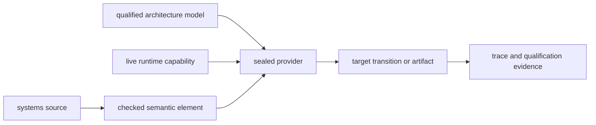

# Freestanding systems-profile semantics

## Formal text

### TOPAL-SYSTEMS-FEATURE-001 — Feature and artifact boundary

`systems` SHALL be a revisioned language feature selected through
`TOPAL-SYN-CONTEXT-001`. It SHALL add the sealed `lang systems` namespace and
SHALL add no grammar production. A source context selecting it SHALL be valid
only within one qualified freestanding systems root artifact. The same root
SHALL NOT use an ordinary hosted-process artifact profile.

A dependency which does not select `systems` SHALL retain its portable
semantics and vocabulary when composed into a systems artifact. Selection,
import, name lookup, or architecture-model access SHALL NOT itself grant
runtime authority.

### TOPAL-SYSTEMS-AUTHORITY-001 — Unforgeable systems authority

An entry, processor, privilege, address-space, mapping, interrupt, preemption,
fault-recovery, device, DMA, context, placement, or artifact capability SHALL
be an opaque resource identity constructed only by a qualified artifact or
provider transition. Ordinary or generated source SHALL NOT construct, copy,
widen, serialize, deserialize, compare for underlying identity, or derive such
authority from a numeric value, model fact, layout, or diagnostic projection.

Every systems operation SHALL consume or borrow the exact live capability for
its subject and SHALL record its effects, context, lifetime, failure, and
provider evidence. A target model SHALL establish legality facts only and
SHALL NOT satisfy runtime authority.

### TOPAL-SYSTEMS-VOCABULARY-001 — Initial sealed root construction

The initial systems source profile SHALL use ordinary application, function,
product, and binding syntax under the sealed `lang systems` namespace. A root
SHALL construct exactly one `lang systems artifact` whose `bootstrap-storage`
member is one `lang systems bounded-bootstrap-storage`, whose `bootstrap`
member is one `lang systems bootstrap-entry`, and whose `debug-break` member is
one `lang systems synchronous-exception-entry`, and whose
`local-notification` member is one `lang systems external-interrupt-entry`.
It SHALL also contain exactly one `deadline-notification` member constructed as
one `lang systems external-interrupt-entry`.
It SHALL also contain exactly one `kernel-thread` member constructed as one
`lang systems resumed-thread-entry`.
The storage constructor SHALL
contain exactly positive `capacity-bytes` and `alignment-bytes` natural-number
fields. Alignment SHALL be a power of two and SHALL NOT exceed capacity. The
bootstrap entry SHALL have one handler from `BootstrapContext` to
`BootstrapDisposition`; the debug-break entry SHALL have one handler from
`DebugBreakContext` to `DebugBreakDisposition`; and the local-notification
entry SHALL have one handler from `LocalNotificationInterruptContext` to
`LocalNotificationInterruptDisposition`; and the deadline-notification entry
SHALL have one handler from `DeadlineInterruptContext InitialMonotonicClock` to
`DeadlineInterruptDisposition InitialMonotonicClock`; and the kernel-thread
entry SHALL have one handler accepting `KernelThreadContext InitialProcessor`
and `SuspendedKernelContext InitialProcessor` and producing
`KernelThreadDisposition InitialProcessor`.

The only admitted initial handler operations SHALL be context-qualified
`console write`, `debug break`, local-notification completion,
deadline-notification completion, kernel-context terminal retirement, `resume`,
and `fatal`. Console write SHALL
borrow the live board console capability and this increment SHALL accept only a
static text value. Debug break SHALL borrow the bootstrap context and declare
one synchronous debug-break observation. Resume SHALL consume one live
completed entry context and resume exactly its interrupted continuation. Fatal
SHALL consume its live entry context and SHALL NOT return.

Every handler SHALL end in one disposition admitted by its context. The
context SHALL occur only as the receiver of an admitted operation, SHALL be
consumed exactly once by the final disposition, and SHALL NOT be rebound,
captured, stored, passed, returned, or used after consumption. Unknown
namespace members, extra artifact entries, mismatched handler classifiers,
duplicate roots, and ordinary-source use of any systems classifier or member
SHALL be rejected before lowering.

The bounded bootstrap pool SHALL be monotonic and SHALL NOT acquire a host
service. Each allocation request SHALL name a positive byte count, a
power-of-two alignment no greater than the pool alignment, and a closed
semantic placement. It SHALL return either one affine `BootstrapRegion` or one
sealed `BootstrapStorageErrorCode`: `invalid-request` for a malformed or
phase-invalid request and `exhausted` when aligned capacity is insufficient.
Releasing a region SHALL consume it without making its bytes available for a
later bootstrap allocation. Bootstrap completion SHALL require no live region
and SHALL make the complete pool reclaimable. No source operation SHALL expose
the model offset as a machine or physical address.

A live `BootstrapRegion` SHALL admit plain byte store and load only while
borrowed by its originating bootstrap execution. An access SHALL use a
zero-based offset strictly below the region byte count; a stored value SHALL be
a `Nat` no greater than 255, and a load SHALL return such a `Nat`. The initial
executable slice SHALL accept only statically known requests and offsets whose
alignment, capacity, value range, and bounds are proven before lowering.
Dynamic access SHALL remain unavailable until it carries a proof or an
explicitly specified failure result. It SHALL NOT be unchecked.

Allocation SHALL use the ordinary exhaustive `Result` decision, with an affine
region bound only in the `Ok` action and a sealed storage error bound only in
the `Error` action. Every reachable success action SHALL release its region
exactly once before the bootstrap context is consumed. Load and store SHALL
borrow rather than consume the region; release SHALL consume it. A region SHALL
NOT escape through return, storage, capture, message, task, foreign,
serialization, another entry, or an allocation-error action.

Plain region access SHALL NOT acquire volatile, atomic, device, DMA, firmware,
or user-memory semantics. Those domains SHALL require their separately typed
protocols. A provider MAY choose a target-specific concrete location and
instruction sequence only when it preserves the region's bounds, byte
contents, ownership, lifetime, and failure behavior without exposing its
address or allocation metadata to source.

The first semantic target profile SHALL record target
`x86_64-unknown-none`, board `topal-qemu-pc-q35-10.2`, and profile
`topal.systems.x86_64-qemu-pc-q35-10.2/1`. Executable qualification SHALL apply
only to the closed operation, provider, artifact, option, board, and physical-
evidence set recorded for that profile. Any unqualified extension SHALL fail
before producing an artifact.

### TOPAL-SYSTEMS-ENTRY-001 — Static special entry

`SystemEntry K` SHALL classify a static artifact declaration rather than an
ordinary callable function. `K` SHALL be one of `Bootstrap`, `SecondaryCpu`,
`SynchronousException`, `ExternalInterrupt`, `UserSyscall`,
`MachineCritical`, or `ResumeThread` in the initial profile.

An entry declaration SHALL identify one target profile, handler, opaque
context classifier, legal capability bundle, execution restrictions, and
closed disposition set. The context and capabilities SHALL be affine, SHALL
exist only for the dynamic entry extent, and SHALL NOT escape through return,
storage, capture, message, task, foreign, serialization, or another entry.

The backend SHALL own physical entry symbols, sections, alignment, machine
frames, stack transitions, saved state, security transitions, unwind/debug
information, and return sequences. Source SHALL NOT select or observe those
representations.

### TOPAL-SYSTEMS-DISPOSITION-001 — Complete entry disposition

An entry handler SHALL end in exactly one disposition admitted by its entry
kind. A disposition SHALL name the semantic continuation, such as resume,
return to validated user state, schedule, deliver a user exception, or fatal
transition. It SHALL consume the entry context and every outstanding affine
entry obligation.

The checker SHALL reject a disposition unless required interrupt
acknowledgement, masking/preemption restoration or transfer, address-space and
user-state validation, resource release/transfer, and recovery obligations are
proved. A disposition SHALL NOT be represented as an ordinary function return
in checked semantics.

### TOPAL-SYSTEMS-OBSERVATION-001 — Declared observation and linearization

A systems external observation SHALL have event
`Observe(s,q,p)`, where `s` is one live source capability, `q` is that source's
monotonic event identity, and `p` is a value or declared error satisfying its
selected layout. Its contract SHALL state ordering, duplication, loss,
acknowledgement, and completion rules.

A concurrent protocol MAY expose `Linearize(d,t)` for transition `t` in domain
`d` when several invariant-preserving transitions are enabled without an
ordering edge. Every permitted linearization SHALL preserve the protocol
invariant and external contract. The resulting events SHALL participate in the
observable trace and replay evidence.

Absent `Observe` or `Linearize` input/effects, systems code SHALL retain the
portable schedule-equivalence requirement. These events SHALL NOT authorize a
data race, arbitrary random choice, invented event, or removal, duplication,
merging, or speculation of a required observation.

### TOPAL-SYSTEMS-LOCAL-INTERRUPT-001 — Local-notification interrupt lifecycle

`local notification send` SHALL consume one admitted processor context and
produce one affine pending session with source identity `s`, the source's next
monotonic event identity `q`, and the exact prior local maskable-interrupt
state. The consumed context SHALL be invalid until the matching wait completes.
A second send, ordinary use of the consumed context, escape, duplication, or
ordinary completion while the session is live SHALL be rejected.

`local notification wait` SHALL consume that pending session. Successful wait
completion SHALL require, in order, `Observe(s,q)`, entry through the declared
local-notification external-interrupt entry, consumption of its completion
obligation, resumption of the interrupted continuation, and restoration of the
recorded prior maskable-interrupt state. Another event SHALL NOT satisfy the
wait. The provider MAY temporarily change local mask state inside the sealed
wait transition but source SHALL NOT observe or retain that state.

The external entry SHALL receive one affine
`LocalNotificationInterruptContext(s,q)`. `local notification complete` SHALL
consume it and produce one completed context admitting only the declared
resume or fatal disposition. Resume before completion, completion outside the
matching entry, duplicate completion, context escape, or ordinary return SHALL
be rejected. Completion SHALL discharge the target acknowledgement or pending-
state obligation; a zero-instruction completion SHALL require target evidence
that the complete obligation is otherwise satisfied.

The initial profile SHALL admit exactly one local-notification handler and one
send/wait event. It SHALL make no timer, bounded-latency, fairness, nested-entry,
SMP-delivery, shared-device-routing, or scheduler-disposition guarantee.

### TOPAL-SYSTEMS-MONOTONIC-CLOCK-001 — Monotonic-clock observation

The initial systems profile SHALL provide one opaque provider-created
`Clock InitialMonotonicClock` borrowed through each admitted processor context.
`monotonic clock now` SHALL borrow that context and clock and SHALL return one
immutable `Instant InitialMonotonicClock`. Neither authority SHALL be consumed
or widened by observation.

For clock identity `c`, its next observation identity `q`, and provider value
`t`, a successful observation SHALL record
`Observe(c,q,Instant(c,t))`. Observation identities SHALL increase in source
order. An accepted value SHALL be greater than or equal to the preceding value
accepted from `c`; equality SHALL be permitted. A decreasing value SHALL fail
closed and SHALL NOT be clamped, replaced, or exposed as an accepted instant.

Instants SHALL retain exact clock identity and SHALL NOT compare, subtract, or
substitute across clocks. The provider SHALL own counter selection, scale,
resolution, enablement, access, wrap extension, regression detection, and the
target state required for monotonicity. Source SHALL NOT observe a counter
address, register, instruction, width, frequency, calibration mechanism, or
wrap state. The compiler SHALL NOT invent, predict, merge, duplicate, remove,
or speculate a required clock observation.

The initial executable slice SHALL admit exactly two observations after its
local-notification wait and before its time-success marker. It SHALL make no
wall-clock, periodic-release, sleep, timeout,
bounded-latency, rate-accuracy, SMP, suspend, migration, userspace-ABI, or
real-time guarantee.

### TOPAL-SYSTEMS-DEADLINE-EVENT-001 — One-shot deadline event

Constructing `Deadline c` from `Instant c` and an exact positive `Duration`
SHALL preserve the absolute same-clock instant and SHALL fail on range
overflow. It SHALL NOT observe the clock. A deadline from another clock SHALL
NOT substitute, arm, or satisfy the event.

`deadline notification arm` SHALL borrow one admitted processor context,
consume one deadline, and produce one affine `ArmedDeadline c` with one new
monotonic event identity `q`. The deadline, armed event, and temporarily
consumed context SHALL NOT be duplicated, escaped, or used by another event.
`deadline notification wait` SHALL consume the armed event and return the
processor context only after the matching observation, typed entry, consuming
completion, and resumption have occurred.

Delivery SHALL record `DeadlineEvent(c,q,scheduled,observed)`, where scheduled
is the deadline's instant and observed is one newly accepted `Instant c`.
Observed SHALL be greater than or equal to scheduled. Late delivery SHALL
retain both values. If the deadline is already expired when armed, the event
SHALL become immediately deliverable against the original scheduled instant;
the provider SHALL NOT restart the relative duration.

The entry SHALL receive one affine `DeadlineInterruptContext(c,q,scheduled,
observed)`. `deadline notification complete` SHALL consume that context and
produce one completed context admitting only resume or fatal disposition.
Resume before completion, completion outside the matching entry, duplicate
completion, an early observation, or ordinary completion with a live deadline
authority SHALL be rejected.

The initial executable slice SHALL admit exactly one deadline constructed from
the second qualified monotonic observation and `1[ms]`, one arm/wait lifecycle,
and one declared handler. Comparator, timer, route, vector, controller,
acknowledgement, wait, frame, and return representation SHALL remain private to
the provider. Cancellation, rearming, periodic release, scheduler integration,
multiple outstanding events, bounded latency, rate accuracy, SMP delivery,
suspend/migration guarantees, and userspace timer ABI SHALL remain unavailable.

### TOPAL-SYSTEMS-MACHINE-001 — Closed machine-provider transition

A machine-provider operation SHALL have a stable closed identity and specify:
consumed and produced semantic state; privilege and resource identities;
legal execution contexts; fault and recovery behavior; ordering and visibility
relations; required architecture evidence; and an abstract model transition or
explicit unavailable-model result.

Only a language revision SHALL introduce a common machine-operation identity.
A common identity SHALL have one architecture-independent contract. A facility
without that contract SHALL use a target-qualified identity. No provider or
source package SHALL introduce an arbitrary instruction, register, clobber,
intrinsic, or opaque privileged transition.

### TOPAL-SYSTEMS-ADDRESS-001 — Disjoint address families

Systems address families SHALL include `Physical`, `KernelVirtual`,
`UserVirtual A`, `Device D`, `Dma I`, and `Firmware F`, each qualified by its
owning resource identity where shown. Numeric equality across families or
owners SHALL establish neither aliasing nor authority.

An address range SHALL record a target-qualified width and half-open
mathematical-natural interval whose endpoint calculation does not overflow
that width. Checked subrange and offset derivation SHALL preserve family,
owner, bounds, and no stronger authority. Decoding an external number SHALL
produce only an untrusted candidate until validated against one live range.
There SHALL be no general integer-to-address or cross-family cast.

### TOPAL-SYSTEMS-BOOT-MEMORY-001 — Affine boot-memory refinement

`describe memory` SHALL consume exactly one entered bootstrap context and its
opaque provider-private handoff. It SHALL be handled through an exhaustive
`Result` decision. The `Ok` action SHALL bind one `MemoryDescribedContext`; the
`Error` action SHALL bind one `BootMemoryFailureContext` which admits only a
fatal disposition. The consumed entered context SHALL be invalid on both
paths, and neither result context SHALL escape its entry extent.

A successful provider SHALL produce disjoint, nonempty, nonwrapping,
page-qualified `Physical` ranges classified as `Allocatable`, `Reclaimable`,
`Persistent`, `Reserved`, `Unusable`, or `Unknown`. Each range SHALL retain its
source classification and provider provenance. An unknown classification
SHALL NOT be allocatable. Overlapping claims SHALL be split and resolved so
that any non-allocatable claim prevents allocation and `Unusable` dominates.
Incomplete page-edge fragments SHALL remain reserved.

Before an `Allocatable` capability is produced, the provider SHALL subtract
every live bootstrap reservation, including applicable adapter, transition,
stack, kernel-image, bootstrap-storage, handoff, command-line, initramfs, and
firmware ranges. Each reservation SHALL retain an owner and reclamation
condition. Portable source SHALL NOT inspect a native handoff record, derive a
numeric physical address, or regain the entered context.

Malformed, overflowing, cyclic, contradictory, unsupported, or allocation-
empty input SHALL select the failure action. A provider SHALL NOT approximate
such input with host memory, fabricated RAM, or an unchecked range.

### TOPAL-SYSTEMS-FRAMES-001 — Affine physical-frame allocation

`create frame allocator` SHALL consume exactly one memory-described bootstrap
context through an exhaustive `Result` decision. Its `Ok` action SHALL bind one
`FrameAllocatorContext` retaining the preceding bootstrap capabilities and
exclusively owning the normalized allocatable-frame authority. Its `Error`
action SHALL bind one `FrameAllocatorFailureContext` which admits only a fatal
disposition. The consumed context SHALL be invalid on both paths, and neither
result context SHALL escape its entry extent.

An allocation SHALL borrow one live allocator and request a nonzero frame count
and power-of-two alignment in target-profile base-frame units. Success SHALL
produce one affine `PhysicalFrameExtent` carrying allocator identity, extent
identity, count, alignment, and provider provenance. Its base SHALL remain
opaque. The extent SHALL grant neither byte access nor mapping, device, DMA,
firmware, or user-memory authority. Malformed or exhausted allocation SHALL
select an explicit failure without invalidating the allocator.

Live extents SHALL NOT overlap each other, non-allocatable ranges, or retained
reservations. `release` SHALL consume an extent into exactly its originating
allocator. Cross-allocator release, double release, use after release, extent
escape, and a bootstrap disposition with a live extent SHALL be invalid.
Allocation choice and coalescing MAY vary only when success, failure, alignment,
non-overlap, ownership, and provenance observations remain equivalent.

The initial x86-64 executable profile SHALL admit only the static allocation
shapes `(frame-count: 1, alignment-frames: 1)`, `(frame-count: 2,
alignment-frames: 1)`, `(frame-count: 3, alignment-frames: 1)`, and
`(frame-count: 503, alignment-frames: 1)`. Every successful request SHALL
produce one indivisible extent and SHALL require release of that complete
extent. The profile SHALL reject every other count or alignment, a dynamic
request, extent splitting, and simultaneously live source-owned extents except
the exact refinements specified below before artifact publication.

### TOPAL-SYSTEMS-STATIC-ELF-FRAMES-001 — Exact static-image frame extent

The initial x86-64 root SHALL request the exact `(503, 1)` frame extent only
after releasing the preceding three-frame qualification extent. Success SHALL
return one opaque indivisible `PhysicalFrameExtent`. The provider SHALL derive
the complete byte extent with checked arithmetic and select it wholly inside
one normalized E820 RAM range, disjoint from the boot resource and retained
reservations, page aligned, and below the qualified first-GiB bootstrap mapping
ceiling.

Source SHALL emit exactly one `TOPAL_KERNEL_STATIC_ELF_FRAME_EXTENT_OK`
observation while the exact extent remains live and SHALL then release it whole
before any later bootstrap transition. The observation SHALL grant no access,
mapping, split, address, or reuse authority. A partial interval, wrong count or
alignment, overlap, arithmetic overflow, missing or duplicate observation,
release before observation, continuation before release, or recoverable
disposition with the extent live SHALL be invalid. This rule SHALL NOT map,
read, write, execute, or make the planned static image runtime-selectable.

### TOPAL-SYSTEMS-STATIC-ELF-MAPPING-RESOURCES-001 — Disjoint mapping resources

After the exact 503-frame static-ELF payload allocation and its required
payload observation, the initial x86-64 root SHALL keep that complete extent
live and MAY request exactly one `(1, 1)` translation-metadata extent. The
provider SHALL receive the complete opaque payload interval as exclusion
evidence and SHALL prove that the metadata interval is aligned and disjoint
from the payload, every retained reservation, the boot resource, and every
non-allocatable range before returning success. Both complete intervals SHALL
remain within the qualified first-GiB bootstrap mapping ceiling.

Success SHALL create two distinct affine owners and SHALL emit exactly one
`TOPAL_KERNEL_STATIC_ELF_MAPPING_RESOURCES_OK` observation while both remain
live. Source SHALL then release the complete metadata extent followed by the
complete payload extent before any later bootstrap transition. Either failure
SHALL select the fatal action. A hidden allocation, overlap, partial interval,
arithmetic overflow, wrong request order or shape, missing or duplicate
observation, reversed or partial release, extent combination or splitting, or
disposition while either owner remains live SHALL be invalid. This rule SHALL
grant no byte access, table-entry construction, mapping publication, target
address, or runtime image-selection authority.

### TOPAL-SYSTEMS-STATIC-ELF-LEAVES-001 — Initial inactive leaf publication

`static image construction prepare` SHALL consume the exact simultaneous
503-frame payload extent and one-frame metadata extent specified by
`TOPAL-SYSTEMS-STATIC-ELF-MAPPING-RESOURCES-001`. Success SHALL produce one
opaque affine `StaticImageConstruction` and SHALL leave neither input directly
releasable. The operation SHALL publish exactly 503 adjacent mappings in the
checked page-plan order such that payload frame ordinal `i` backs virtual page
ordinal `i`, every published mapping has semantic initial rights RW/NX, and all
unused capacity in the provider's bounded inactive translation object is
absent. No partial construction SHALL become observable.

The initial x86-64 provider SHALL realize this object using the separately
owned aligned metadata frame, 512 bounded leaf entries, 503 present/user/
writable/NX entries, and nine absent entries. It SHALL revalidate the complete
payload and metadata intervals, zero the complete metadata frame before use,
verify every constructed and absent entry, and complete target publication
ordering before returning success. The object SHALL remain unreachable from
every active address space in this increment.

Source SHALL emit exactly one
`TOPAL_KERNEL_STATIC_ELF_INITIAL_LEAVES_OK` observation while the construction
is live. `static image construction revoke metadata` SHALL clear and verify the
complete inactive object, complete target ordering, refine the construction to
revoked state, and return exactly the original metadata extent. Source SHALL
release that extent before `static image construction reclaim payload`
consumes the revoked owner and returns exactly the original indivisible
503-frame payload extent for whole release.

Wrong input or construction identity, wrong count, order, rights, or absent
capacity, arithmetic overflow, overlap, partial publication, missing or
duplicate observation, release before return, reclaim before complete
revocation and metadata release, duplicate revoke or reclaim, reversed return,
or disposition with any live construction state SHALL be invalid. This rule
SHALL grant no payload byte access, active-address-space attachment, final
permission, executable entry, or runtime image-selection authority.

The disjoint-live-extent refinement SHALL permit one exception to that last
restriction: after one `PreparedUserAddressSpace` owns the exact `(3, 1)`
extent, the same allocator MAY return one additional `(1, 1)` extent with fresh
identity. The complete returned interval SHALL be disjoint from the prepared
space's complete backing interval, all reservations, and all non-allocatable
ranges. The additional extent SHALL be released before user-state preparation.
No third live extent, alternative shape, split, address observation, or
recoverable disposition with the additional extent live SHALL be admitted.

The initial `PreparedUserAddressSpace` MAY consume that additional extent in
one `probe-guard` verification transaction. The transaction SHALL derive only
RW/NX user mapping authority, SHALL confirm one fixed byte store/load through
that mapping, SHALL revoke all derived access, SHALL complete the target
translation-invalidation contract, and SHALL return the exact input extent.
Success SHALL NOT be observable before revocation and completion. The prepared
address-space identity and backing SHALL remain unchanged, and user-state
preparation SHALL remain invalid until source releases the returned extent.

The affine refinement SHALL represent that transaction with four closed
operations. `user address space map` SHALL consume the additional extent and
produce one fresh opaque `LiveUserMapping`; `user mapping store byte` SHALL
consume it and produce `StoredUserMapping`; `user mapping load byte` SHALL
consume that refinement, compare the fixed byte, and produce
`VerifiedUserMapping`; and `user address space unmap` SHALL consume the
verified mapping and return exactly the original extent. Publication SHALL
complete before map success, and revocation plus target translation completion
SHALL precede unmap success. The prepared address-space identity and original
backing SHALL be invariant across all four operations.

Skipping, reordering, duplicating, or using a consumed refinement; releasing
the extent or preparing user state while a mapping is live; using another
address space, extent, layout, right, or byte; and recoverable disposition
after publication failure SHALL be invalid. The initial refinement SHALL admit
only the sealed `probe-guard` layout, RW/NX rights, and one fixed byte. A
bounded reuse refinement MAY admit exactly two explicit sequential lifecycles
over the same returned extent. Each map SHALL create a fresh opaque mapping
identity, and the second map SHALL begin only after first-generation revocation
and target translation completion. No first-generation access or refinement
SHALL survive or be accepted by the second generation. Release SHALL follow
the second unmap. Identity reuse, cross-generation substitution, release
between generations, a third generation, simultaneous mappings, and user-state
preparation before final release SHALL be invalid. The refinement SHALL expose
no address or descriptor value and SHALL NOT constitute a general user-mapping
or image-construction API.

The permission-tightening refinement SHALL insert `user mapping protect read
only` between store and load in each admitted generation. The operation SHALL
consume `StoredUserMapping` and SHALL produce a `ProtectedUserMapping` with the
same provider, address-space, mapping, backing, placement, memory-kind,
user-access, non-executable, and content identities but without write
authority. Revocation of writable authority and target translation completion
SHALL precede observable success. Load SHALL consume only that protected
refinement.

Store through protected authority, load or unmap through a stale stored
refinement, skipped or duplicate protection, permission widening, executable
authority, identity substitution, and recoverable failure after permission
publication begins SHALL be invalid. The initial profile SHALL admit only the
sealed RW/NX-to-RO/NX transition and SHALL expose no permission bit or
invalidation mechanism.

The executable-promotion refinement SHALL insert `user mapping permit execute`
between load verification and unmap in each admitted generation. The operation
SHALL consume `VerifiedUserMapping` and SHALL produce an
`ExecutableUserMapping` with the same provider, address-space, mapping,
backing, placement, memory-kind, user-access, content, and read-only identities
but with executable authority replacing non-executable authority. Executable
publication and target translation and instruction-observation completion
SHALL precede observable success. Unmap SHALL consume only that executable
refinement.

Promotion from writable, stored, protected, or otherwise unverified authority;
write-authority restoration; W+X authority; skipped or duplicate promotion;
stale refinement use; identity substitution; and recoverable failure after
publication begins SHALL be invalid. The initial profile SHALL admit only the
sealed RO/NX-to-RO/X transition and SHALL expose no permission bit, cache,
barrier, or invalidation mechanism.

The sealed image-role refinement SHALL classify generation one as
`ExecutableCodeMapping` through executable promotion. For generation two,
`user mapping seal immutable data` SHALL consume `VerifiedUserMapping` and
produce `ImmutableDataMapping` while preserving provider, address-space,
mapping, backing, placement, memory-kind, user-access, content, read-only, and
non-executable identities. The provider SHALL prove that no permission or
content changed. Unmap SHALL consume the exact role-specific final refinement.

Executable promotion of generation two, data sealing of generation one,
cross-role substitution, unclassified unmap, unauthorized write-authority
restoration, and W+X authority SHALL be invalid. The refinement SHALL expose no role encoding,
permission representation, or target validation mechanism.

The bounded resident-image refinement SHALL consume a separately allocated
two-frame extent and one-frame extent into distinct sealed `probe-code` and
`probe-data` mappings.
`ExecutableCodeMapping` SHALL remain live while the data mapping advances to
`ImmutableDataMapping` or `WritableDataMapping`; the provider SHALL prove the address-space backing and
both mapping extents are pairwise disjoint. The two finalized mappings SHALL
coexist with RO/X and role-appropriate RO/NX or RW/NX authority respectively.

Source SHALL unmap and release finalized data before unmapping and releasing
executable code. Each unmap SHALL revoke only its exact mapping, complete the
target-required observation boundary, and return its exact original extent.
User-context preparation SHALL require both mappings revoked and both extents
released. A third mapping, backing reuse, swapped placement or role, cross-role
unmap, code-first teardown, release while mapped, or recoverable exit with live
construction authority SHALL be invalid. This refinement SHALL NOT constitute
a general mapping collection, layout API, application image, or loader.

### TOPAL-SYSTEMS-MULTIPAGE-EXECUTABLE-001 — Bounded multipage executable role

The sealed `probe-code` mapping SHALL consume the exact `(2, 1)` physical-frame
extent as one affine object and SHALL publish two virtually adjacent base-page
leaves. Both leaves SHALL begin writable and non-executable for construction.
Complete external-segment copy SHALL precede removal of write authority from
both leaves; complete content verification SHALL precede executable promotion
of either leaf. Translation and instruction-observation completion for both
leaves SHALL precede observable promotion success. No leaf SHALL possess write
and execute authority concurrently.

The initial x86-64 executable segment SHALL have equal file and memory sizes,
eight-byte alignment, a size greater than 4096 and no greater than 8192 bytes,
and an entry contained in its second page. Its successful terminal
`exit_group` path SHALL execute from that page. After exact kernel-continuation
restoration, source SHALL emit exactly one
`TOPAL_KERNEL_USER_IMAGE_MULTIPAGE_EXEC_OK` observation before image teardown.

Unmap SHALL revoke both leaves, complete target observation for both virtual
pages, and return the exact original two-frame extent. Partial publication,
protection, verification, promotion, invalidation, revocation, or return;
nonadjacent placement; split backing ownership; out-of-extent entry; missing or
early observation; and W+X authority SHALL be invalid. This rule SHALL NOT
admit arbitrary segment counts or sizes, sparse mappings, demand paging,
relocations, or dynamic loading.

The resident-image readiness qualification SHALL emit exactly one
`TOPAL_KERNEL_USER_IMAGE_READY` console observation after
the generation-two data role is produced and before either finalized mapping is
unmapped. At emission, the exact generation-one `ExecutableCodeMapping` and
generation-two final data mapping SHALL both remain live. Emission SHALL
preserve their identities, backing, placements, contents, permissions, and
affine ownership and SHALL produce no mapping or access authority.

Emission before both mappings are finalized, after either unmap begins, with
substituted roles or identities, or with a missing, duplicate, or renamed
marker SHALL be invalid. The observation SHALL expose no address, permission
encoding, page-table representation, or target completion mechanism and SHALL
NOT imply readiness for user entry or constitute an application-image or
loader interface.

The bounded execution-residency refinement SHALL preserve the exact
generation-one `ExecutableCodeMapping` and generation-two
final data mapping across preparation, entry, syscall dispatch, contained
user-copy faults, terminal exit, and kernel-continuation restoration of the
sealed initial probe. Probe execution SHALL borrow but SHALL NOT consume,
duplicate, transfer, mutate, access, or execute either mapping.

After the probe returns, source SHALL emit exactly one
`TOPAL_KERNEL_USER_IMAGE_RETAINED` console observation while both finalized
mappings remain live. Source SHALL then unmap and release immutable data before
unmapping and releasing executable code. User-execution completion and address-
space reclaim SHALL require both mappings absent and both returned extents
released.

The provider SHALL prove that construction placements do not alias probe code,
stack, user-transfer candidates, or the deliberate fault-guard range. Entry
without both roles, teardown before exact return, mutation or substitution
during execution, missing or early retained-image observation, completion with
either mapping live, and recoverable exit with live construction authority
SHALL be invalid. This refinement SHALL NOT authorize execution of constructed
contents or define a loader or general process-image interface.

### TOPAL-SYSTEMS-STATIC-ELF-PLAN-001 — Bounded static ELF load plan

Before artifact construction consumes any supplied static-executable fact, the
x86-64 compiler SHALL validate a complete ELF64, little-endian, current-version
`ET_EXEC`/`EM_X86_64` header and its complete 56-byte program-header table.
The table SHALL contain at most 16 entries, exactly four ordered `PT_LOAD`
entries with final roles R, R/X, R, and R/W, no `PT_INTERP`, exactly one
non-executable `PT_GNU_STACK`, at most one `PT_TLS`, and at most one
`PT_GNU_RELRO`.

Every load entry SHALL have `p_filesz <= p_memsz`, an overflow-free file range
inside the complete input, an overflow-free user virtual range, power-of-two
alignment of at least 4096, congruent file and virtual offsets modulo 4096,
and a nonempty, disjoint page-rounded interval. No load role SHALL combine W
and X. Entry SHALL lie inside the R/X memory interval. A present TLS file and
memory interval SHALL lie inside the R/W load memory interval. A present RELRO
page interval SHALL be nonempty and lie inside the page-rounded R/W interval.
The combined x86-64 load span SHALL contain at most 512 pages and SHALL lie
inside one aligned 2 MiB leaf-table window.

Success SHALL produce an immutable plan containing only the validated header
identity, entry, four file/memory/page intervals and permission roles, total
page span, optional TLS extents, optional RELRO pages, and non-executable stack
fact. The plan SHALL contain no borrowed input pointer and SHALL grant no
allocation, mapping, copy, permission, entry, or source-visible address
authority. Any failed condition SHALL reject the complete plan before artifact
publication. This rule SHALL NOT make the image runtime-selectable or admit
PIE, relocation, dynamic loading, overlapping load pages, executable stacks,
or more than one leaf-table window.

### TOPAL-SYSTEMS-STATIC-ELF-PAGE-PLAN-001 — Bounded page realization

A bounded static-ELF page-realization plan SHALL consume only a successful
`TOPAL-SYSTEMS-STATIC-ELF-PLAN-001` result and SHALL NOT reparse input bytes.
The four page intervals SHALL be exactly adjacent and completely cover the
combined span. Success SHALL name one future affine physical-frame request
whose frame count equals the span page count and whose alignment is one frame,
plus exactly one ordered record for each virtual page with a distinct
zero-based frame ordinal.

Every page SHALL begin with RW/NX construction permission. Header and immutable
data pages SHALL finalize RO/NX, executable pages SHALL finalize RO/X, and
writable-data pages SHALL finalize RW/NX except that every RELRO page SHALL
finalize RO/NX. No initial or final permission SHALL combine W and X. The plan
SHALL require zeroing the complete frame extent before four ordered copies from
the exact validated file intervals to their corresponding memory starts.

Success SHALL retain the entry, TLS, RELRO, zero, copy, page-role, and extent
facts without borrowed input pointers. It SHALL grant no frame, mapping, copy,
permission-publication, entry, or source-visible address authority. Missing,
duplicate, unordered, uncovered, or multiply covered pages; nonadjacent roles;
wrong ordinals or request count; copy outside a declared role; RELRO outside
the writable role; and any W+X state SHALL reject the complete realization
before artifact publication. This rule SHALL NOT make the image runtime-
selectable or require one physically contiguous extent outside the current
x86-64 qualification profile.

### TOPAL-SYSTEMS-WRITABLE-DATA-001 — Verified writable user-data role

`user mapping permit writable data` SHALL consume only the generation-two
`VerifiedUserMapping` and SHALL produce one `WritableDataMapping`. Provider,
address-space, mapping, backing, placement, memory-kind, user-access, content,
and non-executable identities SHALL be unchanged. The transition SHALL restore
write authority only for the declared data role, and target translation
completion SHALL precede observable success.

The operation SHALL be invalid for generation one, a mapping which has not
passed the read-only verification boundary, a stale or substituted identity,
an executable mapping, or a transition that can produce W+X authority. Unmap
SHALL consume the exact writable-data refinement and return its original
backing only after revocation and target completion. Source SHALL observe no
permission bit, address, page-table representation, invalidation instruction,
or barrier.

The initial x86-64 qualification SHALL use `WritableDataMapping` for the ELF
`PF_R | PF_W` data/BSS segment. Constructed user code SHALL write and read back
one byte inside the memory-only BSS extent before terminal success. The exact
`TOPAL_KERNEL_USER_IMAGE_WRITABLE_DATA_OK` observation SHALL occur once after
successful user return and before retained-image teardown. A missing, renamed,
duplicate, early, or late observation SHALL be invalid.

### TOPAL-SYSTEMS-USER-WRITE-001 — Bounded initial standard output

The initial-process profile MAY dispatch Linux-compatible `write` for
descriptor one when the return continuation lies in the finalized executable
mapping, length is from one through 256 bytes, and the complete overflow-free
candidate extent lies in a provider-proved readable user mapping. Dispatch
SHALL reject invalid descriptor, length, or candidate with the personality's
Linux-compatible error before dereference or output.

For a valid request, dispatch SHALL copy the complete caller-selected extent
into private kernel staging before any byte becomes externally observable and
SHALL retain no user pointer after the copy. It SHALL publish exactly the staged
prefix through the target's checked console effect and return the requested
length to the same revalidated user continuation. The provider SHALL NOT
require a single embedded payload or call-site address. A wrong entry state,
non-executable return, cross-hole or wrapping extent, partial or faulted copy,
short result, early output, retained pointer, duplicate output, or output after
terminal disposition SHALL be invalid.

This rule SHALL NOT expose a syscall number, register convention, instruction,
address, serial mechanism, arbitrary descriptor, descriptor table, VFS object,
partial-write policy, or unbounded output interface to source.

### TOPAL-SYSTEMS-USER-READ-001 — Bounded initial standard input

The initial-process profile MAY dispatch Linux-compatible `read` for descriptor
zero when the return continuation lies in the finalized executable mapping,
length is from one through 256 bytes, and the complete overflow-free
destination extent lies in a provider-proved writable user mapping. Dispatch
SHALL reject an invalid descriptor, length, wrapped or cross-hole extent, or
read-only destination with the personality's Linux-compatible error before
input consumption or user-memory access.

For a valid request, dispatch SHALL receive exactly the requested bounded count
into private kernel staging before beginning user publication. It SHALL then
perform one fault-contained copy of the complete staged prefix, retain no user
pointer, and return the requested length to the same revalidated continuation.
The provider SHALL NOT require a single input value, candidate, or call-site
address. Constructed qualification code SHALL validate its deterministic bytes
and result before releasing its bounded stack region. Source SHALL emit exactly
one `TOPAL_KERNEL_USER_READ_OK` observation after exact terminal return and
before the constructed-image entry witness. Wrong state, non-executable return,
partial reception, early publication, faulted or partial transfer, short
result, retained pointer, unbalanced stack, or missing, duplicate, early,
renamed, or late witness SHALL be invalid.

This rule SHALL NOT expose a syscall number, register convention, instruction,
address, serial mechanism, arbitrary descriptor, end-of-file, partial-read or
signal policy, line discipline, terminal interface, or unbounded input buffer
interface to source.

### TOPAL-SYSTEMS-USER-CLOSE-001 — Initial standard-descriptor close

Before initial user entry, the Linux personality SHALL create exactly three
live process-private descriptor entries numbered zero through two. The source
dispatch policy SHALL name descriptor count three and Linux `EBADF` value nine.
Provider storage and encoding SHALL remain private and SHALL NOT be observable
as a Topal reference, address, register, bitset, or target object.

Linux-compatible `close` SHALL accept a live descriptor in the closed initial
set, atomically make that entry unavailable, and return zero. A negative,
out-of-range, or already closed descriptor SHALL return `-EBADF` without
changing any entry. The signal-free one-thread profile SHALL NOT fabricate
`EINTR` or an ambiguous post-close result. The bounded `read` and `write`
adapters SHALL consult the same state before input consumption, user-memory
access, staging, or external output and SHALL return `-EBADF` for a closed
entry without those effects.

The constructed ring-3 image SHALL preserve all prior calls, close descriptor
zero after its final successful input, require return zero, require `-EBADF`
from a following one-byte read without consuming input, require `-EBADF` from
repeated close, and then terminate normally. Process completion SHALL clear
the complete descriptor state before restoring the registered kernel
continuation, and source SHALL emit exactly one
`TOPAL_KERNEL_USER_CLOSE_OK` observation after exact return and before later
image-lifecycle witnesses.

The profile SHALL reject stateless close success, another initial bound or
error policy, missing initial entries, state change on failure, later I/O
through a closed entry, early input or memory access, missing or reordered
qualification calls, or live descriptor state after process return. This rule
SHALL NOT define `open`, `openat`, `dup`, `fcntl`, descriptor allocation,
open-file-description sharing, filesystem objects, sockets, pipes, polling,
close-on-exec, fork or exec inheritance, concurrent close, signals,
cancellation, device-specific release, or deferred writeback errors.

### TOPAL-SYSTEMS-USER-DUP-001 — Bounded initial descriptor duplication

The three-entry initial descriptor state SHALL refine each live entry into a
mapping to one fixed open-description identity and access mode. Initially,
descriptor zero SHALL reference a readable console-input description,
descriptor one SHALL reference a writable console-output description, and
descriptor two SHALL reference a distinct writable console-error description.
`read` and `write` SHALL authorize the referenced description rather than the
integer slot. Closing one mapping SHALL NOT invalidate another mapping to the
same description.

Linux-compatible `dup` SHALL return `-EBADF` for a negative, out-of-range, or
closed source without state change. Given a live source, it SHALL install the
same description in the lowest closed slot and return that slot, or return
`-EMFILE` with unchanged state when no slot is closed. Source SHALL name Linux
`EMFILE` value 24 in addition to the existing count and `EBADF` policy.

Linux-compatible `dup2` SHALL validate the source before modifying an existing
destination. An invalid or closed source or out-of-range destination SHALL
return `-EBADF` without changing any mapping. Equal live source and destination
SHALL return that number unchanged. Otherwise dispatch SHALL atomically replace
the destination mapping with the source description and return the destination
number. No allocation failure SHALL occur after validation in this fixed table.

The constructed ring-3 image SHALL prove `dup(1)` returns `-EMFILE` while the
table is full. After the existing close of zero, it SHALL require `dup(1)` to
return zero, close one, use `dup2(0, 1)` to restore the alias, and require a
read through zero to return `-EBADF` without consuming input because the shared
description is write-only. It SHALL then close zero, prove `dup2(-1, 0)` leaves
zero closed, install descriptor two at zero with `dup2(2, 0)`, close zero, and
terminate with only one and two live. Source SHALL emit exactly one
`TOPAL_KERNEL_USER_DUP_OK` observation after exact returns and before later
image-lifecycle witnesses. Terminal completion SHALL clear every mapping.

The profile SHALL reject a live-bit-only duplicate, non-lowest `dup` result,
destination mutation after invalid-source `dup2`, close of all aliases through
one slot, access-mode change, missing or reordered qualification calls, or a
mapping retained after process return. This rule SHALL NOT define `dup3`,
`fcntl`, close-on-exec, descriptors above two, dynamic open descriptions, VFS
paths, general reference counts, pipes, sockets, polling, fork or exec
inheritance, concurrent lookup/close, signals, cancellation, or final device
release.

### TOPAL-SYSTEMS-USER-FCNTL-001 — Bounded initial descriptor metadata

Each initial descriptor slot SHALL retain one private close-on-exec bit,
initially clear, separately from its optional open-description mapping.
Closing a slot SHALL clear both states. `dup` and non-identity `dup2` SHALL
clear the destination bit while preserving the source bit. Identity
`dup2(old, old)` SHALL preserve the bit because it changes no mapping.

Linux-compatible `fcntl` command `F_GETFD` SHALL return either zero or
`FD_CLOEXEC` for a live slot. `F_SETFD` SHALL set that bit from the argument
masked by `FD_CLOEXEC`, ignore every other argument bit, and return zero.
`F_GETFL` SHALL return `O_RDONLY` for the input open description and
`O_WRONLY` for the output and error descriptions, independent of the slot
number. A negative, out-of-range, or closed descriptor SHALL return `-EBADF`
before command decoding; an unsupported command on a live descriptor SHALL
return `-EINVAL` without changing state.

The constructed ring-3 image SHALL observe `O_WRONLY`, observe clear flags,
set and observe `FD_CLOEXEC`, and reject an unsupported command on output. Its
existing duplication sequence SHALL additionally prove the duplicate flag is
clear while the source remains set and that `dup2` clears the replaced
destination flag. A query after the final close of zero SHALL return `-EBADF`.
Source SHALL emit exactly one `TOPAL_KERNEL_USER_FCNTL_OK` observation after
exact returns and before later image-lifecycle witnesses. Terminal completion
SHALL require clear flags on the remaining live slots and clear all flag state.

The profile SHALL reject open-description-owned close-on-exec, slot-derived
access mode, copied flags on duplication, command-first error precedence,
unsupported-command mutation, or retained flag state. This rule SHALL NOT
define `F_DUPFD`, `F_DUPFD_CLOEXEC`, `F_SETFL`, status flags beyond access mode,
locks, leases, ownership, asynchronous notification, seals, pipe sizing, exec-
time close, fork inheritance, dynamically opened descriptions, or concurrent
`fcntl`.

### TOPAL-SYSTEMS-USER-FSTAT-001 — Bounded initial console metadata

The three fixed initial open descriptions SHALL reference one immutable console
device object with stable identity one, character-device kind, owner UID/GID
zero, permissions `0600`, link count one, zero size and allocated blocks,
preferred I/O size 4096, and zero access/modification/change timestamps. Every
alias SHALL publish the same object and special-device identity. Open access
mode SHALL remain separate and SHALL NOT alter permission bits.

The x86-64 personality SHALL encode that value as the complete native 144-byte
`struct stat`: `st_dev=0`, `st_ino=1`, `st_nlink=1`,
`st_mode=S_IFCHR|0600`, root UID/GID, zero padding, `st_rdev=0x4400` for Linux
ttyS0 major 4 minor 64, zero size, `st_blksize=4096`, zero blocks and timestamp
components, and three zero unused words.

Linux-compatible `fstat` SHALL look up a live descriptor before user access,
construct the complete native value in private staging, validate one overflow-
free writable 144-byte extent, and publish it completely under fault recovery.
Success SHALL return zero and retain no user pointer. Invalid or closed
descriptors SHALL return `-EBADF` without candidate access. Invalid, read-only,
wrapping, or cross-hole candidates SHALL return `-EFAULT` without partial
publication.

The constructed ring-3 image SHALL validate every defined field and padding
byte for output, duplicate that description into slot zero, and prove the
alias returns identical object/device/mode metadata. After closing the final
temporary alias, `fstat(0, …)` SHALL return `-EBADF`. Source SHALL emit exactly
one `TOPAL_KERNEL_USER_FSTAT_OK` observation after exact returns and before
later image-lifecycle witnesses.

The profile SHALL reject slot-derived object identity, regular-file kind,
access-mode-derived permissions, partial publication, lookup after memory
access, nonzero padding, host-derived timestamps, or retained user pointers.
This rule SHALL NOT define path lookup, `stat`, `lstat`, `newfstatat`, `statx`,
mounts, mutable inode metadata, terminal ioctls, dynamic device registration,
or general VFS state.

### TOPAL-SYSTEMS-USER-TCGETS-001 — Bounded initial console attributes

The console object shared by the three fixed initial open descriptions SHALL
own one immutable raw terminal-attribute value. Every description and alias
SHALL expose identical attributes independently of access mode and descriptor
flags.

The x86-64 personality SHALL implement Linux `ioctl` request `TCGETS=0x5401`
with the complete native 36-byte `struct termios`: zero input, output, and
local flag words; control flags `B38400|CS8|CREAD|CLOCAL` (`0x8bf`); line
discipline zero; and 19 control bytes all zero except `VMIN=1`. The value SHALL
describe the current exact-fill raw serial path and SHALL NOT advertise
canonical processing, echo, signal generation, or output conversion.

Dispatch SHALL look up a live descriptor before request decoding and decode
the request before candidate access. Invalid or closed descriptors SHALL
return `-EBADF`. Unsupported requests on the live console SHALL return
`-ENOTTY` without candidate access. `TCGETS` SHALL construct the whole value in
private staging, validate one overflow-free complete writable 36-byte extent,
publish it under fault recovery, return zero only after complete visibility,
and retain no user pointer. Invalid, read-only, wrapping, cross-hole, or
incomplete candidates SHALL return `-EFAULT` without partial publication.

The constructed ring-3 image SHALL query standard input and output into
disjoint writable extents, validate every byte, prove both values identical,
reject an unsupported live-console request with `-ENOTTY`, and reject `TCGETS`
on slot zero after its final close with `-EBADF`. Source SHALL emit exactly one
`TOPAL_KERNEL_USER_TCGETS_OK` observation after exact returns and before later
image-lifecycle witnesses.

The profile SHALL reject fabricated cooked flags, slot-derived terminal state,
command decoding before descriptor lookup, pointer access before accepted
request, partial publication, wrong errno, or retained user pointers. This
rule SHALL NOT define `TCSETS*`, `termios2`, window size, sessions, process
groups, job control, canonical input, echo, signal generation, ptys, polling,
dynamically opened ttys, or a general ioctl registry.

### TOPAL-SYSTEMS-USER-WINSIZE-001 — Bounded initial console geometry

The console object shared by the three fixed initial open descriptions SHALL
own one immutable window-size value shared by every description and alias.
Because the qualified serial transport provides no geometry source, rows,
columns, horizontal pixels, and vertical pixels SHALL each be zero, meaning
unspecified rather than a fabricated display size.

The x86-64 personality SHALL implement Linux `ioctl` request
`TIOCGWINSZ=0x5413` with the complete native eight-byte `struct winsize`: four
little-endian unsigned 16-bit zero values. Dispatch SHALL retain descriptor-
before-request-before-pointer precedence. Invalid or closed descriptors SHALL
return `-EBADF`; unsupported live-console requests SHALL retain `-ENOTTY`;
accepted requests with invalid, read-only, wrapping, cross-hole, or incomplete
eight-byte candidates SHALL return `-EFAULT` without partial publication.

A valid query SHALL construct the complete value in private staging, validate
one overflow-free complete writable extent, publish it under fault recovery,
return zero only after complete visibility, and retain no pointer. The ring-3
image SHALL query input and output into disjoint extents, validate every byte,
prove both values identical, and reject a query on slot zero after its final
close with `-EBADF`. Source SHALL emit exactly one
`TOPAL_KERNEL_USER_WINSIZE_OK` observation before later lifecycle witnesses.

The profile SHALL reject invented or host-derived geometry, slot-derived
values, pointer access before accepted request, partial publication, wrong
errno, or retained pointers. This rule SHALL NOT define `TIOCSWINSZ`, geometry
import, `SIGWINCH`, job control, ptys, displays, or a general ioctl registry.

### TOPAL-SYSTEMS-USER-LSEEK-001 — Bounded initial console seek classification

Every description and alias of the shared initial console SHALL have stream
semantics and SHALL own no file-position state. The Linux personality SHALL
implement `lseek` for the fixed initial descriptor table with descriptor-
before-mode-before-object precedence.

An invalid or closed descriptor SHALL return `-EBADF` before inspecting the
seek mode. For a live console description, an unsigned `whence` from
`SEEK_SET=0` through `SEEK_HOLE=4` SHALL return `-ESPIPE` independently of the
signed 64-bit offset. A live description with `whence` greater than four SHALL
return `-EINVAL` before object dispatch. No result path SHALL create, observe,
or mutate a file position.

The constructed ring-3 image SHALL require `-ESPIPE` for `SEEK_CUR` on input
and output, `-EINVAL` for an unsupported mode on live output, and `-EBADF` for
the same unsupported mode on slot zero after its final close. Source SHALL
emit exactly one `TOPAL_KERNEL_USER_LSEEK_OK` observation before later
lifecycle witnesses.

The profile SHALL reject zero-position success, offset-dependent results for
the console, mode validation before descriptor lookup, shared or per-slot
position state, wrong errno, or state surviving close. This rule SHALL NOT
define seekable files, shared offsets, positioned I/O, directories, block
devices, pipes, sockets, or a general VFS seek operation.

### TOPAL-SYSTEMS-USER-BRK-001 — Bounded initial program break

The initial-process profile MAY dispatch Linux-compatible `brk` when the user
context is live and the return continuation lies in the finalized executable
mapping. The provider SHALL derive the immutable initial break from the
validated runtime ELF data-memory extent and SHALL prove it lies within the
owned 4096-byte writable, non-executable data page. It SHALL zero the complete
page tail beginning at the runtime file-data end before user entry and SHALL
retain one current break in private process state.

A zero request SHALL return the current break without changing it. A byte-
granular request in the closed interval from initial break through data-page
end SHALL atomically become and return the new break. Any other request SHALL
leave state unchanged and return the prior break. Dispatch SHALL NOT return a
negative errno for an unsupported break. Data-role teardown SHALL clear the
private break before mapping revocation and backing release.

Compile-time initial-size authority, arithmetic wrap, page-tail allocator
residue, state publication before successful image construction, wrong entry
state, non-executable return, a result other than requested or prior break as
applicable, or live break state after data teardown SHALL be invalid. This rule
SHALL NOT expose a virtual address, page-table representation, state location,
syscall number, register convention, instruction, VMA collection, additional
page allocation, resource-limit policy, overcommit, `mmap`, `mprotect`, or
`munmap` interface to source.

### TOPAL-SYSTEMS-USER-IDENTITY-001 — Initial scalar identity coherence

The initial-process profile MAY dispatch Linux-compatible scalar process,
thread, parent, user, and group identity queries only while the user context is
live and the return continuation lies in the finalized executable mapping.
`getpid` and `gettid` SHALL return one, `getppid` SHALL return zero, and
`getuid`, `geteuid`, `getgid`, and `getegid` SHALL return zero. The credential
results SHALL agree with the initial `AT_UID`, `AT_EUID`, `AT_GID`, and
`AT_EGID` facts.

Dispatch SHALL retain no argument, pointer, or mutable identity state and SHALL
return to the same revalidated continuation. A missing family member, wrong or
incoherent result, wrong entry state, non-executable return, duplicate result,
or return after terminal disposition SHALL be invalid. This rule SHALL NOT
expose syscall numbers, register conventions, instructions, task structures,
namespace representations, credential storage, mutation, lookup, or general
process-management authority to source.

### TOPAL-SYSTEMS-X64-FS-BASE-001 — Initial x86-64 user FS base

The initial x86-64 profile MAY dispatch Linux-compatible
`arch_prctl(ARCH_SET_FS)` and `arch_prctl(ARCH_GET_FS)` only while the initial
user context is live and the return continuation lies in the finalized
executable mapping. `ARCH_SET_FS` SHALL accept zero or a canonical candidate whose
complete one-byte extent lies in an already-owned readable user mapping. On
success the provider SHALL retain that exact value as private thread state,
install it as the user FS base before return, and return zero.

`ARCH_GET_FS` SHALL accept only a complete writable eight-byte destination in
an already-owned user mapping, copy the retained value through a fault-
contained user-output scope, and return zero. Unsupported operation codes SHALL
return `-EINVAL`, an invalid base SHALL return `-EPERM`, and an invalid output
candidate SHALL return `-EFAULT`; these failures SHALL NOT change the retained
base. Data-role teardown SHALL clear private FS-base state before mapping
revocation and backing release.

Wrong set/get identity, noncanonical or unmapped bases, partial output, wrong
entry state, non-executable return, retained user pointers, duplicate result,
or live private state after teardown SHALL be invalid. This rule SHALL NOT
expose a syscall number, operation-code representation, instruction, register,
MSR, saved-frame layout, private state address, TLS layout, allocator, cloning,
or general architecture-control authority to source.

### TOPAL-SYSTEMS-USER-CLEAR-TID-001 — Initial thread exit word

The initial-process profile MAY dispatch Linux-compatible `set_tid_address`
only while the initial user context is live and its return continuation lies
in the finalized executable mapping. A nonnull candidate SHALL name a complete
writable four-byte extent in an already-owned user mapping; null SHALL disable
registration. Successful dispatch SHALL retain the candidate as private
thread state without dereference and SHALL return TID one.

Terminal user exit SHALL, for a nonnull retained candidate, write zero under a
fault-contained user-output scope. It SHALL clear private candidate state
after that store and before completing the user context or revoking any user
mapping. A clear fault SHALL fail closed. The one-thread profile SHALL NOT emit
a futex wake because no waiter can exist.

Invalid candidates, wrong results, retained user access outside terminal
clearing, partial stores, terminal transition before clear, duplicate result,
or live candidate state at mapping teardown SHALL be invalid. This rule SHALL
NOT expose a syscall number, user address, task structure, futex key or queue,
clone service, or general thread-lifecycle authority to source.

### TOPAL-SYSTEMS-USER-ROBUST-EMPTY-001 — Initial empty robust list

The initial-process profile MAY dispatch Linux-compatible `set_robust_list`
only while the initial user context is live and its return continuation lies
in the finalized executable mapping. The declared length SHALL equal the
native 24-byte head size and the candidate SHALL name a complete readable
24-byte extent in an already-owned user mapping. Successful dispatch SHALL
retain the candidate as private thread state without dereference and return
zero.

Terminal user exit SHALL copy the complete head into private staging under a
fault-contained user-input scope. The native list link SHALL equal the head
candidate and the pending-operation pointer SHALL be null. The provider MAY
ignore the opaque futex offset only because no entry is visited. It SHALL clear
private candidate state after validation and before completing the user context
or revoking a user mapping. A copy fault or nonempty state SHALL fail closed.

Wrong size, incomplete extent, registration-time access, partial copy,
nonempty terminal state, clearing before validation, duplicate result, or live
candidate state at mapping teardown SHALL be invalid. This rule SHALL NOT
expose a syscall number, user address, native field offset, futex word, list
walker, wake queue, clone service, or general robust-list authority to source.

### TOPAL-SYSTEMS-USER-AUXV-SECURE-001 — Non-secure initial execution

The sole initial process MAY receive one native `AT_SECURE` auxiliary-vector
entry. It SHALL follow the validated program-header fact group, SHALL precede
the unique `AT_NULL` terminator, and SHALL contain value zero. The value SHALL
agree with the sealed real/effective credential facts and the absence of any
set-user-ID, set-group-ID, file-capability, or security-module execution
transition.

The provider SHALL own the native tag, word layout, placement, and initial
stack construction. Constructed user code SHALL validate the exact ordered tag
and value, the following terminator, and complete bounded-block consumption
before continuing. Existing `argv[0]` and `AT_EXECFN` SHALL retain exact alias
identity after the stack layout grows.

A nonzero or missing value, wrong ordering, duplicate fact or terminator,
credential disagreement, broken alias, incomplete consumption, or unbounded
stack access SHALL be invalid. This rule SHALL NOT add privilege transitions,
capabilities, security modules, environment filtering, `AT_RANDOM`, or a
general auxiliary-vector builder.

### TOPAL-SYSTEMS-USER-AUXV-CLKTCK-001 — Userspace accounting tick rate

The sole initial process MAY receive one native `AT_CLKTCK` auxiliary-vector
entry. It SHALL immediately follow `AT_SECURE`, SHALL precede the unique
`AT_NULL` terminator, and SHALL contain Linux `USER_HZ` value 100. The value
SHALL NOT be derived from or interpreted as the qualified hardware clock period
or scheduler timer frequency.

The provider SHALL own the native tag, word layout, placement, and initial
stack construction. Constructed user code SHALL validate the exact ordered tag
and value, the following terminator, preserved `argv[0]`/`AT_EXECFN` alias, and
complete bounded-block consumption before continuing.

A missing, duplicate, reordered, or different value, confused clock identity,
broken alias, incomplete consumption, or unbounded access SHALL be invalid.
This rule SHALL NOT add process accounting, CPU-time clocks, interval timers,
scheduler ticks, `times`, or a general auxiliary-vector builder.

### TOPAL-SYSTEMS-USER-AUXV-PLATFORM-001 — Native platform string

The sole initial process MAY receive one native `AT_PLATFORM` auxiliary-vector
entry. It SHALL immediately follow `AT_CLKTCK`, SHALL precede the unique
`AT_NULL`, and SHALL point to a complete NUL-terminated platform string inside
the initialized bounded stack block. The initial x86-64 profile SHALL publish
exactly `x86_64`.

The platform string SHALL be a distinct object from the executable-name string.
`argv[0]` and `AT_EXECFN` SHALL retain exact alias identity only with the latter.
Constructed user code SHALL validate the tag, exact pointer, all platform bytes,
termination, following `AT_NULL`, alias separation, and complete bounded-block
consumption before continuing.

An invalid, cross-boundary, unterminated, aliased, missing, duplicate, or
reordered string, broken executable-name alias, incomplete consumption, or
using the fact to select a provider SHALL be invalid. This rule SHALL NOT add
hardware-capability masks, personalities, compatibility ABIs, runtime target
selection, or a general auxiliary-vector builder.

### TOPAL-SYSTEMS-USER-RLIMIT-STACK-001 — Initial stack-limit query

The initial-process profile MAY dispatch Linux-compatible
`getrlimit(RLIMIT_STACK)` and query-only
`prlimit64(self, RLIMIT_STACK, null, old-limit)` while the user context is live
and the return continuation lies in the finalized executable mapping. Self
SHALL admit PID zero or the sealed PID one. The old-limit candidate SHALL name
a complete writable 16-byte extent in an already-owned user mapping.

Both forms SHALL copy one native pair containing an 8 MiB soft limit and
`RLIM_INFINITY` hard limit through a fault-contained user-output scope, retain
no pointer, and return zero. Another process SHALL return `-ESRCH`; another
resource selector or a nonnull new-limit candidate SHALL return `-EINVAL`; an
invalid output candidate SHALL return `-EFAULT`, all without partial output.

Wrong values, partial publication, wrong entry state, non-executable return,
mutation acceptance, retained candidates, or duplicate result SHALL be
invalid. This rule SHALL NOT expose syscall numbers, selector encodings,
native field offsets, resource storage, accounting, enforcement, mutation,
inheritance, cgroups, or general resource-limit authority to source.

### TOPAL-SYSTEMS-USER-SIGNAL-MASK-001 — Initial thread signal mask

The initial-thread profile MAY dispatch Linux-compatible
`rt_sigprocmask(how, set, old-set, set-size)` while the user context is live
and the return continuation lies in the finalized executable mapping. Set size
SHALL be the native eight bytes. A nonnull set candidate SHALL name a complete
readable eight-byte extent and a nonnull old-set candidate SHALL name a
complete writable eight-byte extent in already-owned user mappings.

The private blocked-signal word SHALL begin at zero. For nonnull input the
adapter SHALL copy the complete word under fault recovery, remove the native
`SIGKILL` and `SIGSTOP` bits, and admit only block, unblock, or replacement.
It SHALL retain the prior word, commit the resulting private word atomically,
then publish the complete prior word through a nonnull old-set candidate under
fault recovery. Null input SHALL leave state unchanged and ignore `how`; null
output SHALL perform no user write. Terminal teardown SHALL clear private mask
state.

Wrong size or operation SHALL return `-EINVAL`; an invalid user extent SHALL
return `-EFAULT`. Partial input, partial output, wrong update ordering, failure
to remove either unblockable bit, state change after rejected input, wrong
entry state, non-executable return, retained candidates, or nonzero state at
mapping teardown SHALL be invalid. This rule SHALL NOT expose the syscall
number, operation encodings, bit positions, native layout, pending queues,
actions, delivery, signal frames, restart policy, or general signal authority
to source.

### TOPAL-SYSTEMS-USER-ANON-PAGE-001 — Bounded runtime anonymous page

`user address space reserve anonymous` SHALL consume one owned single-frame
extent and a matching prepared address-space authority, SHALL produce one
opaque affine reservation tied to both identities, and SHALL leave its
provider-selected user translation non-present. It SHALL NOT expose a numeric
address, target entry, page-table representation, or retained source copy of
the frame authority.

While the sole initial user context is live, the profile MAY admit
Linux-compatible `mmap` only for a null address, nonzero length no greater than
one base page, read-write protection, private anonymous flags, descriptor
minus one, and offset zero. If the reservation is non-present, the provider
SHALL zero the complete frame before ordered RW/NX publication, create one
fresh active generation, and return its page-aligned provider-selected user
address. Activation while already active SHALL return `-ENOMEM`; unsupported
arguments SHALL return `-EINVAL` without changing reservation state.

Matching Linux-compatible `munmap` with the selected address and nonzero
length no greater than one base page SHALL completely revoke an active
translation with ordered target completion and return zero. The same valid
call while non-present SHALL be a successful no-op. Terminal user completion
SHALL revoke any active generation. `user address space release anonymous`
SHALL require and consume the terminally non-present reservation, SHALL return
the exact original single-frame extent, and SHALL preserve the separately
owned address-space authority.

Pre-publication user access, incomplete zeroing, writable-and-executable
publication, overlapping active generations, stale access after revocation,
identity change, duplicate release, active release, or wrong frame return
SHALL be invalid. This rule SHALL NOT expose syscall numbers, native flags,
selected addresses, translation formats or instructions, VMA collections,
multiple pages, file backing, page-fault policy, sharing, overcommit,
concurrent edits, or general mapping authority to source.

### TOPAL-SYSTEMS-USER-ANON-PROTECT-001 — Bounded anonymous-page protection

While the sole initial user context is live and its bounded anonymous mapping
generation is active, the profile MAY admit Linux-compatible `mprotect` only
for the exact provider-selected page address, a nonzero length no greater than
one base page, and protection equal to none, read-only, or read-write. Any
executable or unsupported protection bit, different address, excessive or zero
length, or non-active reservation SHALL return the declared Linux error without
changing reservation, protection, or contents.

On success the provider SHALL replace the active translation with the requested
abstract permission, SHALL preserve the mapping generation and every backing
byte, SHALL retain non-executability, SHALL complete the target-qualified
publication and invalidation protocol before user return, SHALL record the new
private protection state, and SHALL return zero. None SHALL make the user
translation non-present while the reservation remains active; a later admitted
protection change SHALL restore access to the same generation and contents.

`munmap` and terminal cleanup SHALL revoke an active generation from any of the
three protection states. A second `mmap` while protection is none SHALL still
return `-ENOMEM`; only complete unmap makes the reservation available for a
fresh zero-filled generation.

Executable publication, writable-and-executable state, state or content change
after rejected input, access contradicting the recorded permission, generation
change, incomplete invalidation, duplicate result, or stale access SHALL be
invalid. This rule SHALL NOT expose syscall numbers, native protection bits,
selected addresses, page-table formats or instructions, protection keys,
multiple pages, partial splitting, concurrent edits, or general VMA authority
to source.

### TOPAL-SYSTEMS-USER-ANON-ADVISE-001 — Bounded anonymous-page advice

While the sole initial user context is live and its bounded anonymous mapping
generation is active, the profile MAY admit Linux-compatible `madvise` only
for the exact provider-selected page address, a nonzero length no greater than
one base page, and `MADV_DONTNEED`. A different address, excessive or zero
length, unsupported advice, or non-active reservation SHALL return the declared
Linux error without changing reservation, protection, or contents.

On success the provider SHALL zero every byte of the backing frame through
kernel authority, SHALL preserve the active generation and its current none,
read-only, or read-write non-executable protection, and SHALL return zero. The
operation SHALL remain valid while protection is none. A later admitted access
after restoring permission SHALL observe zero throughout the advised page.

Partial zeroing, generation or protection change, executable publication,
state or content change after rejected input, stale contents after success,
duplicate result, or dependence on user access SHALL be invalid. This rule
SHALL NOT expose syscall or advice numbers, backing addresses, zeroing
instructions, page-table formats, lazy faults, other advice classes, reclaim
pressure, or general VMA authority to source.

### TOPAL-SYSTEMS-USER-CLOCK-MONOTONIC-001 — Bounded monotonic clock query

While the sole initial user context is live and its return continuation lies in
the finalized executable mapping, the profile MAY admit Linux-compatible
`clock_gettime` only for `CLOCK_MONOTONIC` and one complete writable native
16-byte timespec in an already-owned user mapping.

The provider SHALL obtain exactly one observation from its qualified monotonic
source, convert it to nonnegative seconds and nanoseconds less than one billion,
publish the complete pair under fault recovery, retain no candidate, and return
zero. Successive successfully published pairs SHALL be lexicographically
nondecreasing. Unsupported clock identity SHALL return `-EINVAL`; an invalid
candidate SHALL return `-EFAULT` without reporting partial output as success.

Constant fabricated time, negative or unnormalized fields, regression, partial
publication, retained pointers, duplicate results, wrong lifecycle state, or
non-executable return SHALL be invalid. This rule SHALL NOT expose syscall or
clock encodings, counters, frequencies, MMIO, rollover state, realtime epochs,
vDSO, timers, adjustment, namespaces, or general clock authority to source.

### TOPAL-SYSTEMS-USER-CLOCK-RESOLUTION-001 — Bounded monotonic resolution

While the sole initial user context is live and its return continuation lies in
the finalized executable mapping, the profile MAY admit Linux-compatible
`clock_getres` only for `CLOCK_MONOTONIC`. A null result candidate SHALL return
zero without output. A nonnull candidate SHALL name a complete writable native
16-byte timespec in an already-owned user mapping.

The provider SHALL publish the exact normalized resolution of the same
qualified source used for monotonic observations, retain no candidate, and
return zero. The initial x86-64 Q35 profile SHALL publish zero seconds and ten
nanoseconds under fault recovery. Unsupported clock identity SHALL return
`-EINVAL`; invalid output SHALL return `-EFAULT` without reporting partial
output as success.

Inconsistent, negative, or unnormalized resolution, partial publication,
retained pointers, duplicate results, wrong lifecycle state, or non-executable
return SHALL be invalid. This rule SHALL NOT expose clock encodings, counters,
frequencies, MMIO, realtime policy, vDSO, timers, or adjustment to source.

### TOPAL-SYSTEMS-USER-ENOSYS-001 — Unsupported syscall fallback

While the sole initial user context is live and its return continuation lies in
the finalized executable mapping, any syscall number not selected by an
implemented dispatch arm SHALL return the native Linux `-ENOSYS` result through
the ordinary syscall return path.

The fallback SHALL NOT read or validate unused arguments, access user memory,
mutate kernel or process state, consume an observation, or terminate the user
context. After receiving the result, the same context SHALL remain able to
invoke an implemented syscall. Adding an implementation for a syscall SHALL
replace fallback selection for that number with the implementation's own
validated contract.

Success, a fabricated result, argument-dependent behavior, state mutation,
provider-owned syscall selection, non-executable return, or terminal
disposition SHALL be invalid. This rule SHALL NOT add syscall reflection,
seccomp, audit, tracing, or a general Topal error mechanism.

### TOPAL-SYSTEMS-USER-SCHED-YIELD-001 — Sole-runnable scheduling point

While the sole initial user context is live and its return continuation lies in
the finalized executable mapping, the profile MAY dispatch Linux-compatible
`sched_yield`. With no other eligible user context, dispatch SHALL preserve the
same context, address-space and thread identities and all private process state,
and SHALL return zero through the ordinary syscall continuation.

The syscall SHALL have an implemented dispatch arm and SHALL NOT be selected by
the unsupported-call fallback. The kernel SHALL own the no-peer scheduling
decision; the provider SHALL NOT fabricate a context transfer or result.

A nonzero result, state change, provider callback, terminal disposition,
fallback selection, wrong context identity, or non-executable return SHALL be
invalid. This rule SHALL NOT add runnable collections, priorities, affinity,
multiple user threads, preemption, migration, or SMP scheduling.

### TOPAL-SYSTEMS-MAPPING-001 — Linear mapping state

A location SHALL combine one live address range with layout, rights, lifetime,
supported access sizes/alignment, cache policy, and ordering domain. A mapping
SHALL be a linear resource relating source and destination ranges under page
layout, permissions, owner, lifetime, and translation-provider evidence.

Page-table editing SHALL require one exclusive builder. Activation,
permission change, unmapping, translation invalidation, and reuse SHALL follow
one declared state protocol and SHALL name every affected processor/scope.
Storage or address reuse SHALL be invalid until the provider's completion
contract establishes that no stale translation can authorize access.

`kernel map` SHALL borrow one live frame-allocator context and consume one
affine `PhysicalFrameExtent`. Success SHALL produce one affine
`KernelMapping` recording opaque source and provider-selected kernel-virtual
extents, rights, execution policy, memory kind, owner, lifetime, and provider
evidence without exposing either numeric base. Failure SHALL admit only the
declared context-preserving failure action or a consuming disposition; it
SHALL NOT duplicate or silently release the extent.

A live read-write, non-executable normal-memory mapping MAY authorize bounded
plain byte load and store. Such access SHALL NOT imply physical, user, device,
DMA, firmware, volatile, atomic, or executable authority. Writable execution,
out-of-bounds access, wrong-provider use, frame release while mapped, mapping
escape, use after unmap, and a disposition with a live mapping SHALL be
invalid.

`kernel unmap` SHALL consume the mapping, revoke its access authority, satisfy
the provider completion contract, and return exactly the original opaque frame
extent. Physical storage reuse SHALL remain invalid until this transition
completes. A provider MAY adopt a pre-existing sealed translation only when it
proves the same rights, lifetime, inaccessibility-after-unmap, and reuse
observations as a constructed translation.

Bootstrap translation replacement SHALL begin by borrowing one live allocator
and consuming provider-selected backing authority into one exclusive affine
`TranslationUpdate`. The initial request SHALL be exactly template
`bootstrap-equivalent` with page policy `provider-selected`. The update SHALL
retain a snapshot of the current qualified bootstrap coverage and access
observations without exposing backing addresses, table levels, entries, or
target state.

`translation commit` SHALL consume one live validated update into one inactive
affine `TranslationSpace`. `translation activate` SHALL consume that inactive
space and the current translation authority, perform the provider-required
publication, synchronization, activation, and completion relations, and
produce a refined bootstrap context owning the new active space. On activation
success, subsequent operations SHALL use only the refined context. On an
indeterminate activation result, the initial slice SHALL admit only fatal
termination.

The replacement SHALL preserve the existing bootstrap coverage and permissions
and SHALL NOT add user authority, widen access, or make physical and virtual
families interchangeable. Duplicate or escaped updates, use after commit,
activation before commit, wrong-provider activation, backing release while
owned by an update or space, reuse of the prior translation by ordinary source,
and disposition with a live inactive update or space SHALL be rejected before
lowering or fail closed.

An active translation edit SHALL consume one active context into one exclusive
affine `TranslationEdit`. While the edit is live, the prior context SHALL admit
no operation or disposition. The initial map request SHALL be exactly normal,
read-write, non-executable kernel memory with placement `provider-selected`.
Map SHALL consume one live frame extent into one provisional opaque
`KernelMapping`; that mapping SHALL admit no access before commit.

`translation commit` SHALL consume the edit, validate the complete candidate
state, publish the provider-private translation changes, perform the required
ordering and invalidation completion relations, and return a refined active
context. Commit failure with indeterminate target visibility SHALL admit only
fatal termination. On success, the provisional mapping SHALL become live and
bounded by its consumed extent.

Unmap in an exclusive edit SHALL consume the live mapping into a provisional
returned extent. That extent SHALL NOT be accessed, released, or remapped until
commit has removed the translation and completed the required invalidation
scope. After successful commit, the old mapping SHALL be unusable and the
returned extent SHALL regain ordinary frame ownership. Abandonment, duplicate
edit or mapping authority, access before map commit, access after unmap,
release before unmap commit, nested or concurrent edits, wrong-space commit,
and disposition with a live edit SHALL be rejected before lowering or fail
closed.

Source SHALL NOT observe or select a virtual address, granule, table level,
entry, address-space identifier, invalidation address, processor mask,
register, or instruction. The initial slice SHALL admit one live dynamic
mapping and SHALL leave user mappings, device memory, permission changes,
executable mappings, remote-processor shootdown, and provider-metadata
reclamation unsupported.

### TOPAL-SYSTEMS-RECOVERY-001 — Closed fault recovery and user transfer

A recovery scope SHALL name a finite fault class, admitted generated
operations, resource identities, result mapping, and cleanup. The backend
SHALL bind only generated fault sites in that scope to generated recovery
continuations. Source SHALL NOT observe, construct, or supply a faulting or
recovery instruction address.

A user transfer SHALL require one live `UserVirtual A` validation capability,
untrusted candidate range and maximum extent, direction, layout or byte policy,
kernel-owned storage, and partial-progress/interruption policy. It SHALL return
validated data, permitted partial progress, or a structured fault. Direct
source access through a user candidate SHALL be invalid.

The initial `copy_to_user` form SHALL derive exactly one opaque affine
`UserTransferScope P A T B I` from a live `UserSyscallContext P A T B I`.
Opening the scope SHALL suspend disposition of that entry. Each transfer SHALL
consume one scope and return exactly one refined successor with either
`Complete(copied = extent)` or `Fault(copied-prefix)`; reunion with the exact
successor SHALL be required before return or termination. Candidate overflow,
wrong identity, duplicate scope use, direct candidate access, and disposition
with a live scope SHALL be rejected before lowering or fail closed.

The initial executable x86-64 profile SHALL extend its generated probe with
native Linux syscall 63 (`uname`). One valid call SHALL receive a source-owned,
six-field, 65-byte-per-field `new_utsname` and result zero. One call whose
390-byte destination crosses from its writable user page into an unmapped
guard page SHALL enter only the generated page-fault recovery continuation and
return Linux `-EFAULT`. Prefix stores before fault MAY remain observable.
Unscoped or mismatched page faults SHALL remain fatal.

The initial `copy_from_user` form SHALL consume and return the same exact
entry-bound affine scope. Its destination staging SHALL remain inaccessible to
source unless the selected layout was copied completely and validated.
`Complete(value, copied = extent)` SHALL expose that value;
`Fault(copied-prefix)` SHALL expose no staging bytes or partial value.

The executable x86-64 profile SHALL then invoke native Linux syscall 35
(`nanosleep`) with a null remainder candidate. One call SHALL copy and validate
a native 16-byte `{ tv_sec = 0, tv_nsec = 0 }` and return zero without arming a
deadline. One call SHALL copy its first eight bytes before the final field
crosses into the unmapped guard page, recover only at the generated supervisor
read site, discard the staging value, and return Linux `-EFAULT`. A direction,
fault class, site, address, entry, extent, layout, or prefix mismatch SHALL
remain fatal or fail closed.

These initial forms SHALL NOT admit arbitrary extents or input layouts,
concurrent mapping changes, nonzero sleep, remainder output, interruption,
restart, general UTS namespaces, or core-language exception handling.

An unlisted fault, nested fault outside its own admitted scope,
machine-critical event, or corrupted entry/stack state SHALL NOT be caught by
this rule and SHALL follow its owning entry or fatal protocol.

### TOPAL-SYSTEMS-ATOMIC-001 — Atomic location and modification order

`AtomicLocation T D` SHALL be a live, aligned fixed-layout location for one
provider-supported scalar or tagged state `T` in synchronization domain `D`.
Its construction SHALL consume exclusive storage ownership; its destruction
SHALL prove that no atomic operation remains before returning storage to
non-atomic use or release.

For each atomic location `l`, all successful modifications SHALL have one
strict total modification order `mo_l` consistent with happens-before. Atomic
load, store, exchange, compare/exchange, and admitted read-modify-write SHALL
be indivisible and a read SHALL observe one value permitted by `mo_l` and the
operation's order. An atomic operation SHALL have an effect on `l` and `D`.

Plain conflicting access to live atomic storage SHALL be invalid. Atomicity
SHALL NOT grant access to overlapping storage, repair an invalid lifetime, or
imply device/DMA atomicity.

For the initial `atomic word` form, construction SHALL consume one live
ordinary region and select one naturally aligned provider-width unsigned word
wholly contained at the requested byte offset. The only admitted domain SHALL
be `cpu-shared`. The whole region SHALL remain unavailable for plain access or
release while the atomic location is live. `atomic end` SHALL consume the
location only when no operation remains in flight, retain its final word
contents, and return the same region identity and extent to plain ownership.

Initial compare/exchange SHALL return `Exchanged previous` exactly when the
observed value equals `expected`; that successful transition SHALL replace the
value with `desired` at one point in `mo_l`. Otherwise it SHALL return
`Observed actual` without modifying `l`. The source result SHALL be exhaustive,
and every ordinary continuation SHALL end the location before region release.
Source SHALL NOT observe a machine address, provider word spelling, register,
instruction, exclusive-monitor state, or retry attempt.

### TOPAL-SYSTEMS-ORDER-001 — Atomic and visibility relations

Atomic orders SHALL be:

- `AtomicOnly`: `mo_l` participation without an unrelated visibility edge;
- `Acquire`: `AtomicOnly` plus an edge from an observed release sequence to
  observations sequenced after the acquire;
- `Release`: `AtomicOnly` plus an edge from observations sequenced before it to
  an acquire which observes its release sequence;
- `AcquireRelease`: both relations for a modifying operation; and
- `Sequential`: `AcquireRelease` plus one strict total order over all
  sequential operations consistent with happens-before and each `mo_l`.

Compare/exchange SHALL declare success and failure orders separately; a
failure order SHALL be `AtomicOnly` or `Acquire`. A provider MAY strengthen an
implementation order but SHALL NOT expose a result forbidden by the selected
order.

The initial atomic-word increment SHALL admit `AcquireRelease` success and
`Acquire` failure for compare/exchange and `Acquire` for the following load.
These orders apply only to CPU-shared normal memory. Target implementations MAY
use one locked instruction, an architectural atomic extension, or a qualified
exclusive-reservation loop provided the observable result and progress
contract are preserved.

CPU memory, device/MMIO, DMA ownership, cache maintenance, instruction
synchronization, and translation maintenance SHALL be distinct relation
families. Each operation SHALL name direction, observations, agents, topology
scope, and completion. A zero-instruction lowering SHALL require evidence that
the target already guarantees the complete relation.

### TOPAL-SYSTEMS-CRITICAL-001 — Affine critical-state restoration

Entering a preemption or interrupt critical scope SHALL produce one affine
token containing processor identity, domain, nesting identity, and exact prior
state. The token SHALL be consumed exactly once by the matching restoration or
an admitted disposition transfer on every exit path. It SHALL NOT escape,
suspend, cross a processor, or be restored out of nesting order.

For the initial `local-maskable-interrupts` domain, `critical enter` SHALL
consume the current execution context and produce a context refined to that
domain plus opaque restoration authority for the exact immediately preceding
state. `critical restore` SHALL consume that refined context and authority and
produce the preceding context. A nested entry, where supported, SHALL allocate
a distinct nesting identity, and restoration SHALL consume identities in
last-in-first-out order. Completion, disposition, suspension, blocking, and
processor transfer with a live critical context SHALL be rejected.

Target interrupt flags, registers, controller masks, and instructions SHALL
NOT be source-observable values. A provider SHALL restore exactly the state
captured by the matching entry; it SHALL NOT unconditionally enable a domain
which was disabled before entry.

The exclusion established by a critical scope SHALL contain only the producers
named by its domain. Masking local interrupts SHALL NOT establish exclusion
from another processor, non-maskable event, device, or DMA agent. An operation
which may block SHALL be invalid in interrupt or machine-critical context.

### TOPAL-SYSTEMS-CONTEXT-001 — Linear execution-context transfer

A suspended execution context SHALL be an opaque linear resource owning its
kernel stack, saved target state, extended-state policy, thread identity, and
address-space relationship. It SHALL arise only from special entry,
initial-context construction, or prior qualified transfer.

Context transfer SHALL consume the running-context capability and exactly one
validated suspended context, perform its declared per-processor and
address-space transition, and resume exactly one continuation. It SHALL be
nonordinary control flow and SHALL NOT expose register slots, stack pointers,
or continuation instruction addresses to source. User/debug state SHALL use a
separate validated semantic view.

The initial executable slice SHALL construct exactly one
`SuspendedKernelContext InitialProcessor` by borrowing the admitted running
context and consuming one 16 KiB, 16-byte-aligned, bootstrap-reclaimable
ordinary region plus the static `kernel-thread` entry. Construction SHALL NOT
run the entry. The suspended context SHALL retain the originating pool,
region, processor, thread, address-space, entry, and extended-state-policy
identities without exposing their target representation.

The initial `kernel context transfer` SHALL consume the bootstrap running
context and that suspended context, suspend the caller at one typed
continuation, retain the active address-space identity, and resume the worker
on `InitialProcessor`. Local maskable interrupts SHALL be disabled at the
transfer boundary. The worker entry SHALL receive its running context and the
affine suspended caller.

`kernel context retire to caller` SHALL be a terminal worker disposition. It
SHALL be legal only with no live region, mapping, frame, atomic, critical,
interrupt, recovery, or cleanup obligation. It SHALL consume the worker and
suspended caller, mark the worker terminal, and resume exactly that caller.
The caller SHALL receive one affine `CompletedKernelContextTransfer
InitialProcessor` owning its restored running authority and the retired
worker's stack. `kernel context reclaim` SHALL consume that completion, return
the stack region to its originating monotonic pool, and produce the resumed
caller context. Use after transfer, duplicate transfer, wrong-processor or
wrong-entry use, retirement with a live obligation, ordinary worker return,
and disposition with a live suspended or completed context SHALL be rejected.

This slice SHALL NOT admit involuntary preemption, scheduler policy, run
queues, priority, timeslicing, blocking, general yield, arbitrary cancellation,
multiple threads, migration, SMP, address-space switching, user contexts,
floating-point or vector ownership, TLS/per-CPU switching, stack growth, or
unwinding across transfer. X86-64, AArch64, and RISC-V register and frame sets
SHALL remain provider evidence rather than portable source meaning.

### TOPAL-SYSTEMS-CONTEXT-002 — Cooperative context handoff

A qualified cooperative transfer SHALL consume one running context and one
matching suspended target. If the old continuation is later resumed, it SHALL
receive exactly one affine outcome which restores its running authority and
either returns the peer as suspended or owns the peer as terminal until
reclamation. An outcome SHALL retain provider, processor, address-space,
context, stack, entry, and continuation identities. Source SHALL NOT copy,
forge, widen, or reinterpret an outcome.

A closed entry protocol MAY statically refine the outcome when the checker can
prove whether that selected continuation hands off or retires. A mismatch
between the declared result classifier and the selected entry protocol SHALL
be rejected. `kernel context retire to target` SHALL consume the running
context and one matching suspended target at a transfer-safe point, mark the
running context terminal, and resume exactly the target with a
`CompletedKernelContextTransfer InitialProcessor`. Reclamation SHALL consume
the completion and return the retired stack to its originating pool.

The initial cooperative slice SHALL construct exactly two suspended contexts
from disjoint 16 KiB, 16-byte-aligned, bootstrap-reclaimable regions. Its
checked source order SHALL be cooperative-worker transfer and suspended
handoff, terminal-worker transfer and retirement/reclamation, cooperative-
worker resumption and retirement/reclamation, then bootstrap disposition with
no live context. The cooperative worker SHALL hand off exactly once before
retirement; the terminal worker SHALL retire on first entry. Target reuse,
wrong order, overlapping stack ownership, wrong result refinement, retirement
with a live obligation, and disposition with a live or unreclaimed context
SHALL be rejected.

Runnable selection SHALL remain source policy. The provider SHALL NOT own a
run queue or select the next context. This slice SHALL retain one processor,
one active address space, and disabled local maskable interrupts and SHALL NOT
admit involuntary preemption, blocking, dynamic run queues, priority,
timeslicing, cancellation, migration, SMP, user contexts, floating-point or
vector ownership, TLS/per-CPU switching, stack growth, guard pages, or
cross-transfer unwinding.

### TOPAL-SYSTEMS-CONTEXT-003 — Bounded affine runnable queue

A `BoundedKernelRunnableQueue P` SHALL be an opaque affine FIFO with retained
positive fixed capacity. It SHALL own each enqueued `SuspendedKernelContext P` and
retain the queue, provider, processor, active-address-space, context, and stack
identities needed for later selection. It SHALL NOT expose or confer access to
target context representation.

Enqueue SHALL consume the prior queue and one suspended context. Success SHALL
place that context at the tail; a full result SHALL return the unchanged queue
and context without copying or loss. Dequeue SHALL consume the prior queue. A
ready result SHALL return the oldest context and remaining queue; an empty
result SHALL return the unchanged queue. Static refinement of either result
SHALL require proof of the exact capacity and occupancy history.

A queue SHALL reject a running, retired, completed, duplicate,
wrong-processor, wrong-provider, or wrong-address-space context. Copying,
serialization, use after consumption, dropping a nonempty queue, and final
disposition with a live queue or queued context SHALL be rejected. Consuming
an empty queue SHALL discharge its final obligation.

The initial executable queue SHALL have capacity two. It SHALL enqueue the
cooperative context followed by the terminal context, dequeue the cooperative
context, enqueue its suspended handoff at the tail, then dequeue terminal and
cooperative in that order. Both terminal outcomes SHALL be reclaimed and the
empty queue SHALL be consumed before bootstrap disposition. The queue SHALL be
ordinary source policy and SHALL introduce no provider queue operation. This
slice SHALL NOT admit unbounded or dynamically allocated runnable storage,
preemption, blocking, wakeup, priorities, timeslicing, cancellation, migration,
SMP, or multiple address spaces.

### TOPAL-SYSTEMS-CONTEXT-004 — Deadline-preemptible context transfer

`kernel context transfer until deadline` SHALL consume one running dispatcher
context, one matching suspended kernel context, and one same-provider
`Deadline c`. Before interrupt delivery is admitted, it SHALL atomically bind
the dispatcher's exact suspended continuation as the sole preemption target
and arm one fresh event. The binding SHALL retain processor, provider,
address-space, clock, event, context, stack, and continuation identities. An
already-expired deadline SHALL become deliverable only after the target is
bound.

After consuming the matching deadline completion obligation,
`preempt current kernel context` SHALL consume the running selected context,
capture its exact interrupted continuation as one opaque suspended context,
and resume only the registered dispatcher. The dispatcher SHALL receive one
affine `PreemptedKernelContextTransfer P C` which restores its running
authority and owns that suspended context plus scheduled and observed delivery
evidence. Consuming the outcome SHALL return the suspended context for
source-owned enqueue. The outcome SHALL NOT be copied, dropped, forged,
widened, or reinterpreted as cooperative or terminal completion.

Preemption without a matching active transfer, before completion, for a wrong
clock, event, processor, provider, address space, context, or continuation, or
after resolution SHALL be rejected. The handler SHALL NOT inspect the
interrupted frame, access a runnable queue, choose another context, redirect
the disposition, or resume normally after selecting preemption. Later transfer
to the suspended target SHALL restore the exact interrupted machine
continuation and frozen affine source obligations. Before that restoration,
the provider SHALL bind the newly suspended dispatcher as the target's current
return continuation; terminal retirement SHALL NOT refer to the dispatcher
binding consumed by the earlier preemption.

The initial executable profile SHALL use one one-shot deadline to preempt the
first context selected from the capacity-two queue, enqueue that suspended
context at the tail, retire and reclaim the terminal context, then restore,
retire, and reclaim the preempted context before consuming the empty queue.
The first worker's sealed `kernel context await deadline preemption` operation
SHALL NOT return on initial entry. Matching deadline preemption SHALL suspend
it, and only later source-selected transfer to that exact context SHALL restore
the interrupted continuation and complete the operation. This operation SHALL
NOT define a general wait, sleep, blocking, or wakeup protocol.
It SHALL retain one processor and active address space and SHALL NOT admit
cancellation, rearming, periodic ticks, general timeslices, priority,
blocking, wakeup, nested preemption, migration, SMP, user contexts,
floating-point or vector ownership, TLS/per-CPU switching, stack growth, or
cross-transfer unwinding. Target interrupt frames, register sets, mask state,
stack-switch instructions, and interrupt-return mechanics SHALL remain
provider evidence.

### TOPAL-SYSTEMS-CONTEXT-005 — One-shot affine kernel completion

A one-shot `KernelCompletion P I` SHALL create exactly one affine wait endpoint
and one affine signal endpoint with matching fresh identity `I`. Neither
endpoint SHALL be copied, forged, serialized, substituted across processor,
provider, address-space, or completion identities, or survive completion.

A completion-bound transfer SHALL register the dispatcher's exact suspended
continuation before its selected worker may consume the wait endpoint. The
block and signal transitions SHALL have one declared linearization order. If
blocking linearizes first, the provider SHALL capture the exact worker as one
opaque `BlockedKernelContextTransfer P I` and resume only the registered
dispatcher. Consuming that outcome with the matching signal endpoint SHALL
produce one `SuspendedKernelContext P` for source-owned enqueue. Later transfer
to that context SHALL resume immediately after the block operation.

If signalling linearizes first, readiness SHALL persist and the matching block
operation SHALL complete without sleeping. Repeated wait, repeated signal,
wrong identity, wrong dispatcher, dropped blocked state, enqueue before wake,
and disposition with a live endpoint or blocked context SHALL be rejected.
The provider SHALL NOT select a runnable context or own a run queue.

The initial executable profile SHALL statically refine the block-first branch,
run and reclaim the terminal context, signal and enqueue the blocked worker,
then resume, retire, and reclaim it before consuming the empty runnable queue
and completion. It SHALL retain one processor, one active address space, one
waiter, and one signal and SHALL NOT admit multiple waiters, repeated signals,
predicate wait queues, spurious wakeups, timeouts, cancellation, process
signals, priority ordering, cross-processor wakeup, SMP, or user contexts.

### TOPAL-SYSTEMS-CONTEXT-006 — Affine user execution and syscall round trip

`ValidatedUserState A B` SHALL be opaque affine authority for one legal user
continuation in address space `A` under ABI personality `B`. A
`SuspendedUserContext P A T B` SHALL additionally retain processor `P` and
thread `T`. Source SHALL NOT inspect, construct, copy, serialize, or reinterpret
their instruction, stack, status, register, descriptor, privilege, frame, or
return representation.

Entering user execution SHALL consume one running kernel context and one
matching suspended user context. A syscall SHALL produce exactly one affine
`UserSyscallContext P A T B I` with fresh entry identity `I`. Its accessors
SHALL expose the ABI syscall number and six arguments only as untrusted
semantic machine words. The handler SHALL consume it through exactly one
closed disposition: `ReturnToUser(result)` SHALL encode one ABI result,
revalidate, and resume only the captured user continuation;
`TerminateUser(status)` SHALL consume that continuation and restore only its
registered kernel continuation with terminal status.

The backend SHALL own privilege transition, kernel entry stack, saved target
state, speculation/security sequence, result placement, return validation, and
legal fast or general return mechanics. A provider SHALL NOT select a syscall,
invent a result, expose its frame, or own Linux dispatch policy. Wrong
processor, address-space, thread, ABI, entry, or continuation identity;
duplicate entry or disposition; return after termination; and disposition with
a live syscall context SHALL be rejected.

Initial user-address-space preparation SHALL consume exactly one live
three-frame `PhysicalFrameExtent` and the sealed `initial-probe` layout into a
fresh opaque `PreparedUserAddressSpace A`. Initial user-state preparation SHALL
consume that exact space into its `SuspendedUserContext P A T B`. The user
context SHALL exclusively own the space and complete extent through every
entry, syscall return, and terminal transition.

Terminal completion SHALL revoke all mappings derived from the extent, satisfy
the provider translation-invalidation contract, and return exactly one opaque
`RevokedUserAddressSpace A`. Reclaim SHALL consume that revoked state and
return exactly the original indivisible extent. Wrong identity, reclaim before
revocation, duplicate transition, release, splitting, access, reuse, or
disposition while either address-space or user-execution state owns the extent
SHALL be invalid. Failure after publication begins SHALL be fatal-only in the
initial profile.

The initial executable x86-64 profile SHALL create one process/thread and one
generated ring-3 probe in allocator-backed validated RX and RW/NX user
mappings. The probe
SHALL invoke native Linux syscall 39 (`getpid`), verify the source-owned PID
result after one return to user mode, exercise syscall 63 (`uname`) through the
separately specified initial `copy_to_user` success and fault paths, exercise
syscall 35 (`nanosleep`) through the initial `copy_from_user` success and fault
paths, and invoke syscall 231 (`exit_group`) with status zero. Termination SHALL
restore the exact registered kernel continuation. The probe SHALL be
qualification evidence, not an executable format or loader. ELF, dynamic
linking, pointer-bearing syscalls other than sealed `uname` and zero-duration
`nanosleep`, general user copy, signals, restart, seccomp, audit, ptrace, TLS,
extended state, fork/clone, multiple processes or threads, user preemption,
migration, SMP, and the complete syscall table SHALL remain unavailable.

The initial profile SHALL admit one live `initial-probe` address space. It
SHALL NOT expose or admit source-selected virtual addresses, page-table levels
or entries, arbitrary permissions, ELF segments, dynamic stack construction,
concurrent address-space edits, multiple live spaces, or address-space
switching.

### TOPAL-SYSTEMS-DEVICE-001 — Register protocol access

A device location SHALL bind its layout to one live device session, permitted
access directions and widths, alignment, read/write side effects, reserved-bit
policy, ordering domain, and failure behavior. An access SHALL be an observable
effect and SHALL occur exactly as required by its protocol: it SHALL NOT be
invented, removed, duplicated, combined, or moved across a conflicting event.

Target-specific addressed-I/O facilities SHALL satisfy the same resource,
effect, context, and lifetime rules even when they are not MMIO. Knowledge of
an address or port number SHALL grant no session or access capability.

### TOPAL-SYSTEMS-PCI-CONFIG-001 — Bounded configuration observation

The bootstrap platform authority MAY derive one transaction-scoped PCI
configuration session for a checked dword observation. Its request SHALL carry
a segment in `0..65535`, bus in `0..255`, device in `0..31`, function in
`0..7`, register offset in `0..252` divisible by four, and expected
little-endian 32-bit value. Invalid or target-unrepresentable requests SHALL be
rejected before artifact generation.

The operation SHALL perform exactly one observable 32-bit configuration read,
consume the transaction session, and return the same bootstrap authority only
after equality with the expected value is proved. Access failure or mismatch
SHALL enter the fatal disposition. The read SHALL NOT be invented, removed,
duplicated, widened, combined, or reordered across a conflicting device event.

The provider SHALL own configuration-mechanism selection, access ordering,
serialization, privilege, and target fault behavior. Source and ordinary
kernel/library code SHALL own the PCI coordinates, register selection,
comparison, enumeration, matching, resource interpretation, and driver policy.
An x86 provider MAY use configuration mechanism 1; an ECAM provider MAY use a
qualified mapped window. Neither representation SHALL expose port or physical
addresses to source or grant device-register, BAR, interrupt, DMA, or virtio
authority.

The initial x86-64 Q35 profile SHALL admit only segment zero and the sealed
discovery sequence defined by `TOPAL-SYSTEMS-VIRTIO-PCI-DISCOVERY-001`. Its
first observation SHALL read register zero at `00:05.0` and expect the combined
modern virtio-rng device/vendor value `0x10441af4`.

### TOPAL-SYSTEMS-VIRTIO-PCI-DISCOVERY-001 — Bounded capability discovery

The initial x86-64 Q35 profile SHALL admit exactly the following ordered
configuration-dword observations for `0000:00:05.0`. Each tuple is
`(register-offset-bytes, expected-little-endian-value)`:

| Purpose | Required tuples |
| --- | --- |
| function identity | `(0x00, 0x10441af4)` |
| capability head and MSI-X link | `(0x34, 0x00000098)`, `(0x98, 0x00018411)` |
| virtio PCI-configuration-access capability | `(0x84, 0x05147009)`, `(0x88, 0x00000000)`, `(0x8c, 0x00000000)`, `(0x90, 0x00000000)` |
| virtio notification capability | `(0x70, 0x02146009)`, `(0x74, 0x00000004)`, `(0x78, 0x00003000)`, `(0x7c, 0x00001000)`, `(0x80, 0x00000004)` |
| virtio device-configuration capability | `(0x60, 0x04105009)`, `(0x64, 0x00000004)`, `(0x68, 0x00002000)`, `(0x6c, 0x00001000)` |
| virtio ISR capability | `(0x50, 0x03104009)`, `(0x54, 0x00000004)`, `(0x58, 0x00001000)`, `(0x5c, 0x00001000)` |
| virtio common-configuration capability | `(0x40, 0x01100009)`, `(0x44, 0x00000004)`, `(0x48, 0x00000000)`, `(0x4c, 0x00001000)` |

The model SHALL assign transaction identities 1 through 24 in source order.
It SHALL reject any omitted, duplicated, reordered, or substituted request.
The source/library interpretation SHALL own capability-link traversal,
vendor/type recognition, preferred-instance choice, capability-length checks,
BAR association, relative-region checks, and notification-multiplier policy.
The provider SHALL observe only independent checked PCI dword requests.

The sequence SHALL establish only the pinned transport layout. It SHALL NOT
grant or claim general PCI enumeration, assigned-BAR discovery or mapping,
bus mastering, device-register access, virtio feature negotiation, interrupts,
DMA, or entropy delivery.

### TOPAL-SYSTEMS-PCI-REGION-001 — Checked region-register access

The bootstrap platform authority MAY derive one transaction-scoped PCI region
session for one checked register read or write. A request SHALL carry a PCI
segment and BDF, selected PCI configuration-access capability offset, BAR index
in `0..5`, BAR-relative region offset and length, register-relative offset,
access width, direction, and expected or written value. The complete access
extent SHALL fit within the region without overflow. The value SHALL fit the
access width. Invalid or target-unrepresentable requests SHALL be rejected
before artifact generation.

An ordinary operation SHALL perform exactly one observable register access of
the specified width and direction. A bounded eventual read SHALL perform at
least one and no more than its operation-specific static bound, SHALL succeed
on the first value equal to the request, and SHALL enter the fatal disposition
if the bound is exhausted. Every operation SHALL consume the transaction
session and return the bootstrap authority only after completion. An ordinary
read SHALL prove equality or enter the fatal disposition. A write SHALL publish
exactly the supplied value. No access may be invented, removed, widened,
combined, or reordered across a conflicting event; repetition is permitted
only by the bounded eventual-read operation within its declared bound.

Source/library code SHALL own device identity, capability selection, BAR and
relative-region selection, register protocol, width, direction, value and
driver policy. The provider SHALL own configuration-gateway or opaque-mapping
realization, assigned-address resolution, ordering, serialization, privilege,
memory attributes, and fault behavior. Source SHALL NOT receive an assigned
BAR address, addressed-I/O port, or physical mapping token from this operation.

### TOPAL-SYSTEMS-VIRTIO-PCI-NEGOTIATION-001 — Bounded feature negotiation

The initial profile SHALL admit only region offset zero, length `0x1000`, BAR
4, configuration-access capability offset `0x84`, and function
`0000:00:05.0`. It SHALL perform exactly the following ordered accesses to the
virtio common configuration region. Tuples are
`(direction, register-offset-bytes, width-bytes, value)`:

| Phase | Required tuples |
| --- | --- |
| reset | `(write, 0x14, 1, 0)`, `(read, 0x14, 1, 0)` |
| acknowledge driver | `(write, 0x14, 1, 1)`, `(read, 0x14, 1, 1)`, `(write, 0x14, 1, 3)`, `(read, 0x14, 1, 3)` |
| observe device features | `(write, 0x00, 4, 0)`, `(read, 0x04, 4, 0x30000000)`, `(write, 0x00, 4, 1)`, `(read, 0x04, 4, 0x00000101)` |
| publish driver features | `(write, 0x08, 4, 0)`, `(write, 0x0c, 4, 0)`, `(write, 0x08, 4, 1)`, `(write, 0x0c, 4, 1)` |
| accept features | `(write, 0x14, 1, 11)`, `(read, 0x14, 1, 11)` |

The model SHALL assign transaction identities 1 through 16 in source order.
The selected driver feature words SHALL accept only
`VIRTIO_F_VERSION_1` from the exact observed device words. The read after
status value 11 SHALL establish that the device retained `FEATURES_OK`. The
profile SHALL leave `DRIVER_OK` clear until queue discovery, setup, and
population are complete. Any mismatch SHALL be fatal.

The profile SHALL NOT claim arbitrary register access, alternate features,
queue selection or setup, interrupt configuration, bus mastering, DMA,
notification, completion, entropy delivery, or failed-device recovery.

### TOPAL-SYSTEMS-VIRTIO-PCI-QUEUE-DISCOVERY-001 — Bounded queue discovery

After successful `TOPAL-SYSTEMS-VIRTIO-PCI-NEGOTIATION-001`, the initial
profile SHALL perform exactly the following ordered common-configuration
accesses. Tuples are `(direction, register-offset-bytes, width-bytes, value)`:

| Phase | Required tuples |
| --- | --- |
| observe queue count | `(read, 0x12, 2, 1)` |
| select queue zero | `(write, 0x16, 2, 0)` |
| observe selected queue | `(read, 0x18, 2, 8)`, `(read, 0x1c, 2, 0)`, `(read, 0x1e, 2, 0)` |

The model SHALL continue the PCI region transaction sequence with identities
17 through 21 in source order. The observations SHALL prove that queue zero exists, admits at
most eight descriptors, is disabled, and has notification identity zero. Each
access SHALL preserve exact two-byte semantics. Any mismatch SHALL be fatal.

The profile SHALL NOT derive a CPU or device-visible address, grant DMA
authority, resize or enable the queue, configure interrupts or bus mastering,
publish descriptors, notify or poll the device, deliver entropy, or set
`DRIVER_OK` from these facts.

### TOPAL-SYSTEMS-PCI-CONFIG-UPDATE-001 — Checked masked word update

The bootstrap platform authority MAY derive one transaction-scoped PCI
configuration-word update. A request SHALL identify segment and BDF, a
two-byte-aligned register offset in `0..254`, a nonzero 16-bit mask, expected
masked pre-state, and desired masked post-state. Expected and desired values
SHALL contain no bits outside the mask.

The provider SHALL serialize one exact-width read, pre-state comparison, one
exact-width write preserving every unmasked bit, and one exact-width readback
comparison. Failure of either comparison SHALL enter the fatal disposition.
The provider SHALL NOT widen the operation into an access that writes an
adjacent field.

After `TOPAL-SYSTEMS-VIRTIO-PCI-QUEUE-DISCOVERY-001`, the initial profile SHALL
admit exactly one request: segment zero, `00:05.0`, offset `0x04`, mask
`0x0004`, expected masked pre-state `0x0000`, and desired masked post-state
`0x0004`. This authorizes PCI bus mastering but SHALL NOT grant a DMA mapping,
device-visible address, buffer ownership, queue enablement, notification, or
`DRIVER_OK`.

### TOPAL-SYSTEMS-DMA-001 — DMA ownership protocol

A DMA buffer SHALL have exactly one of `CpuOwned`, `Prepared`, `DeviceOwned`,
`Completed`, `Failed`, or terminal reclaimed states. A transition SHALL name
direction, device and translation domains, mapping, cache/visibility work,
descriptor publication, notification, completion source, and failure/cleanup.

CPU access SHALL be invalid while ownership is `DeviceOwned`, except for an
explicitly modeled coherent shared protocol. Device notification SHALL require
completed preparation and descriptor visibility. Unmapping or reclamation
SHALL require completed/cancelled device ownership and every provider-specific
completion obligation. A coherent provider MAY perform no cache instruction
only with evidence preserving these same transitions.

### TOPAL-SYSTEMS-DMA-BUFFER-001 — Bounded CPU-owned DMA buffers

DMA-buffer creation SHALL identify a validated device, translation domain,
nonzero byte count, power-of-two alignment, transfer direction, visibility
policy, and semantic role. It SHALL derive a fresh opaque affine identity in
the `CpuOwned` state. Every live DMA buffer SHALL be disjoint from all other
live DMA, ordinary, user, bootstrap, and firmware allocations. Source SHALL
NOT observe its physical, virtual, bus, or I/O-virtual address.

After `TOPAL-SYSTEMS-PCI-CONFIG-UPDATE-001`, the initial profile SHALL create
exactly two buffers for device identity one and translation-domain identity
one, in order: identity one SHALL be a 4,096-byte, 4,096-byte-aligned
bidirectional `VirtqueueControl` buffer; identity two SHALL be a distinct
4,096-byte, 4,096-byte-aligned device-to-memory `EntropyPayload` buffer. Both
SHALL use provider-managed visibility and remain `CpuOwned` in this increment.

The provider SHALL prove storage capacity, alignment, disjointness, zeroed
initial contents, and compatibility with the selected device/translation
domain. Creation SHALL NOT prepare cache visibility, publish an address or
descriptor, grant device ownership, enable a queue, set `DRIVER_OK`, notify a
device, or report completion.

### TOPAL-SYSTEMS-DMA-CONSTRUCT-001 — CPU-owned DMA construction

An integer store SHALL name one `CpuOwned` DMA-buffer identity, byte offset,
width in one of 1, 2, 4, or 8 bytes, and fitting value. The range SHALL be in
bounds and naturally aligned. A DMA-reference binding SHALL name a `CpuOwned`
destination buffer and offset plus a referenced `CpuOwned` buffer and offset in
the same device and translation domain. It SHALL store the provider-selected
device-visible reference using the target's required representation without
returning that representation to source. Both operations SHALL preserve CPU
ownership.

After `TOPAL-SYSTEMS-DMA-BUFFER-001`, the initial profile SHALL perform exactly
five operations in order: bind control buffer one offset zero to payload buffer
two offset zero using an eight-byte reference; store 32 as a four-byte integer
at control offset 8; store `VIRTQ_DESC_F_WRITE` value 2 as a two-byte integer at
offset 12; store descriptor identity zero as a two-byte integer at available
slot offset 132; and store available index one as a two-byte integer at offset
130. The control buffer SHALL retain queue-size-eight split-ring offsets 0,
128, and 148, with all otherwise unwritten bytes remaining zero.

The available-index store SHALL occur after descriptor and slot construction.
Construction SHALL NOT perform preparation or cache maintenance, transfer
device ownership, publish queue addresses to transport registers, enable the
queue, set `DRIVER_OK`, notify the device, observe completion, or expose entropy.

### TOPAL-SYSTEMS-DMA-PREPARE-001 — DMA device preparation

`topal.systems.dma.buffer.prepare-device/1` SHALL consume one exclusively
`CpuOwned` DMA buffer and produce the same opaque identity in `DeviceOwned`
state. The request SHALL name and exactly match its nonzero buffer, device, and
translation-domain identities, direction, provider-managed visibility policy,
and semantic role. Preparation SHALL be permitted only after every required
CPU write and opaque reference binding for that buffer is complete.

Before the transition succeeds, the provider SHALL complete and order every
required mapping, pinning, cache clean/invalidate, bounce copy, translation
installation, and visibility action for the named direction and role. A
coherent no-instruction realization SHALL retain equivalent checked evidence.
After success, source SHALL NOT read, write, bind, prepare again, reclaim, or
otherwise exercise CPU authority over the buffer until a later typed
completion or failure transition returns ownership.

After `TOPAL-SYSTEMS-DMA-CONSTRUCT-001`, the initial profile SHALL prepare
exactly two buffers in order. It SHALL first prepare identity two for device-to-
memory access as `EntropyPayload`, then prepare identity one for bidirectional
access as `VirtqueueControl`. Both SHALL name device identity one, translation-
domain identity one, and provider-managed visibility. The referenced payload
therefore SHALL become device-accessible before control metadata that exposes
its reference.

Preparation SHALL NOT publish queue addresses to transport registers, enable a
queue, set `DRIVER_OK`, notify the device, observe completion, return CPU
ownership, or expose entropy.

### TOPAL-SYSTEMS-DMA-COMPLETE-001 — DMA completion for CPU

`topal.systems.dma.buffer.complete-cpu/1` SHALL consume one exclusively
`DeviceOwned` DMA buffer and produce the same opaque identity in `CpuOwned`
state. The request SHALL name and exactly match its nonzero buffer, device, and
translation-domain identities, direction, provider-managed visibility policy,
and semantic role. Completion SHALL require prior device completion evidence
for the submitted operation that owns the buffer.

Before the transition succeeds, the provider SHALL complete and order every
required mapping, cache invalidate, DMA synchronization, bounce copy, and
visibility action for the named direction and role. A coherent no-cache-
instruction realization SHALL retain equivalent checked ordering evidence.
After success, source MAY perform naturally aligned, in-bounds integer
read-equals operations of width 1, 2, 4, or 8 over the CPU-owned buffer. A
mismatch SHALL enter the fatal disposition. Neither completion nor a matching
read SHALL return ownership of another buffer or expose a provider-selected
address.

### TOPAL-SYSTEMS-ENTROPY-SAMPLE-001 — Opaque DMA entropy-sample capture

`topal.systems.entropy.sample.capture-dma/1` SHALL borrow one exclusively
`CpuOwned` DMA buffer and produce one fresh opaque raw-sample identity while
returning the same buffer in `CpuOwned` state. The request SHALL name the
nonzero sample and buffer identities, an in-bounds byte offset and nonzero byte
count, the buffer's device and translation-domain identities, direction,
provider-managed visibility policy, semantic role, and a credited-entropy bit
count no greater than the captured extent.

The provider SHALL copy every named byte exactly once from the completed CPU
view into distinct kernel-owned sample storage and SHALL fail closed rather
than return a partial sample. Source SHALL NOT observe the sample address or
bytes, compare or branch on its contents, serialize it, or convert it to an
integer. The sample identity SHALL remain affine and its credited-entropy fact
SHALL remain explicit. Capture SHALL NOT condition, mix, health-test, trust,
credit beyond the request, distribute, or destroy the source buffer.

### TOPAL-SYSTEMS-ENTROPY-QUALITY-001 — Explicit sample-quality attribution

`topal.systems.entropy.sample.assess-quality/1` SHALL consume one affine opaque
sample in the `Raw` state and return the same identity in the `Assessed` state.
The request SHALL name a nonzero sample identity, entropy-source identity,
nonforgeable trust-evidence identity, nonzero sample byte count, quality from
zero through 1024 parts per 1024, and a credited-entropy bit count.

The credited count SHALL equal
`floor(byte-count * 8 * quality-parts-per-1024 / 1024)` and SHALL NOT exceed
the sample extent. The named evidence SHALL authorize the exact source and
quality under the selected deployment profile. Assessment SHALL preserve the
sample bytes without observing or exposing them and SHALL be a kernel-policy
transition with no target-provider lowering. Device type, successful transport,
payload role, and provider selection SHALL NOT imply trust or choose quality.
Assessment SHALL NOT mix, condition, health-test, serialize, distribute, seed a
generator, or produce random output.

### TOPAL-SYSTEMS-ENTROPY-POOL-001 — Opaque affine entropy-pool creation

`topal.systems.entropy.pool.create/1` SHALL produce one fresh affine entropy
pool in the `Empty` state. The request SHALL name a nonzero pool identity, a
nonzero credited-entropy capacity in bits, and exactly zero initial credited
bits not exceeding that capacity.

Creation SHALL establish lifecycle identity only. It SHALL expose no address,
byte representation, implementation algorithm, or target-provider operation;
SHALL NOT borrow or consume an assessed sample; and SHALL NOT imply readiness.
The pool SHALL NOT be duplicated, substituted, or recreated while live.
Creation SHALL NOT mix material, transfer credit, perform health tests, seed a
generator, or produce random output.

### TOPAL-SYSTEMS-ENTROPY-MIX-001 — Opaque assessed-sample pool mixing

`topal.systems.entropy.pool.mix-sample/1` SHALL consume one affine pool in the
`Empty` state and one affine opaque sample in the `Assessed` state. The request
SHALL name nonzero pool, sample, conditioner, and contribution identities; a
nonzero sample byte count; and an untransferred credited-entropy contribution
not exceeding the sample extent or pool capacity.

Success SHALL return the same pool identity in a `MixedUncredited` state,
consume the sample identity, and produce one fresh affine contribution token.
The token SHALL retain the request's credit claim while the pool credited-bit
count remains unchanged. Source SHALL NOT observe any input, pool-state, or
intermediate byte or address.

The selected conditioner SHALL be fixed by the qualified profile and SHALL
have architecture-independent byte semantics. The provider SHALL completely
write the opaque pool state and wipe the consumed sample before success. It
SHALL fail closed rather than expose a partial state or retain sample material.
Mixing SHALL NOT transfer credit, imply readiness, seed a generator, or produce
random output.

### TOPAL-SYSTEMS-ENTROPY-CREDIT-001 — Affine contribution credit transfer

`topal.systems.entropy.pool.credit-contribution/1` SHALL consume one affine
pool in the `MixedUncredited` state and one affine untransferred contribution
token produced for that pool. The request SHALL name nonzero pool,
contribution, and conditioner-origin identities; the exact prior credited-bit
count, contribution-bit count, pool capacity, and resulting credited-bit
count. The result SHALL equal checked addition of prior and contribution bits
and SHALL NOT exceed capacity.

Success SHALL return the same opaque pool identity in a `Credited` state with
the resulting count and consume the contribution token. It SHALL preserve the
opaque pool state byte-for-byte and SHALL have no target-provider lowering.
Source SHALL NOT observe any pool-state, sample, digest, intermediate byte, or
address. The token SHALL NOT remain live, be duplicated, or be transferred
again.

Credit transfer SHALL NOT imply generator readiness, initialize or reseed a
generator, extract bytes, or authorize userspace delivery.

### TOPAL-SYSTEMS-ENTROPY-GENERATOR-001 — Opaque affine generator initialization

`topal.systems.entropy.generator.initialize/1` SHALL consume one affine pool in
the `Credited` state and produce one fresh affine generator in the `Ready`
state. The request SHALL name nonzero pool, generator, algorithm, and initial
generation identities; a nonzero key byte count; and exact required and
observed pool-credit counts. Observed credit SHALL meet the required threshold.

The qualified algorithm SHALL define architecture-independent key-byte
semantics. The provider SHALL transfer the complete opaque pool state into
distinct generator-key storage, verify the complete transfer, wipe the
consumed pool storage, and verify the complete wipe before success. It SHALL
fail closed rather than publish a partial key, retain the pool state, or expose
any byte or address. Source SHALL NOT observe the pool state, key, storage,
intermediate value, or target instruction.

Initialization SHALL NOT extract output, advance generation, perform fast key
erasure, reseed, or authorize interface delivery.

### TOPAL-SYSTEMS-ENTROPY-EXTRACT-001 — Opaque affine generator extraction

`topal.systems.entropy.generator.extract/1` SHALL consume one affine generator
in the `Ready` state and produce exactly one successor `Ready` generation plus
one fresh affine opaque output object. The request SHALL name nonzero generator,
algorithm, prior-generation, resulting-generation, and output identities; exact
block, output-offset, and output extents; and the qualified counter and nonce
identities. The resulting generation SHALL be the checked successor of the
prior generation.

The qualified algorithm SHALL define architecture-independent state,
arithmetic, byte encoding, split, and cleanup semantics. The provider SHALL
replace the complete persistent key before publishing any output byte, verify
the complete key and output publications, wipe and verify all temporary cipher
state, and fail closed rather than return partial state or output. Source SHALL
NOT observe a key, output byte, address, intermediate value, representation, or
target instruction. The prior generator generation SHALL NOT remain live.

Extraction SHALL NOT deliver the output object to a kernel or userspace
interface, perform another block, reseed, or authorize output reuse.

### TOPAL-SYSTEMS-ENTROPY-DELIVER-001 — Opaque affine output delivery

`topal.systems.entropy.output.deliver-initial-auxv-random/1` SHALL consume one
affine opaque output object and refine one prepared, not-yet-entered user
address space to an entry-ready state. The request SHALL name nonzero output,
address-space, and interface identities; source, selected, delivered, and
discarded extents that form one exact nonoverlapping partition; the qualified
interface tag; and single-use policy. The complete destination object SHALL be
within initialized writable user-stack storage before entry.

The provider SHALL copy and verify the complete selected output into the
interface object, then wipe and verify the entire consumed provider output
before success. It SHALL fail closed rather than publish a partial object,
retain reusable provider output, or permit premature user entry. Source SHALL
NOT observe an output byte, user or backing address, stack representation,
temporary value, or target instruction. Delivery SHALL NOT modify the ready
generator or imply another extraction.

### TOPAL-SYSTEMS-ENTROPY-RESERVE-001 — Opaque affine output reservation

`topal.systems.entropy.output.reserve-initial-user-random/1` SHALL consume one
affine opaque output object into one single-use user-random capability before
the named process first enters user context. The request SHALL name nonzero
output, process, interface, and service identities; exact source, selected,
maximum-delivery, and discarded extents that form one complete nonoverlapping
partition; supported and incompatible interface-flag masks; and single-use
policy. The selected extent SHALL begin at source offset zero and the maximum
delivery SHALL NOT exceed it.

The provider SHALL retain the output only in private storage governed by the
capability. It SHALL validate the complete writable user extent before a
nonempty delivery, preserve the capability on argument and range failure, and
on success copy and verify exactly the requested prefix, discard every
undelivered byte, wipe and verify the complete output storage, clear its private
reference, and consume the capability. Source SHALL NOT observe an output byte,
address, native interface number, register convention, copy mechanism,
temporary value, or target instruction. Reservation SHALL NOT modify the ready
generator, perform another extraction, or authorize output reuse.

The live reservation MAY instead be consumed before entry by
`topal.systems.entropy.user-random.bind-reusable/1` as specified by
`TOPAL-SYSTEMS-ENTROPY-USER-SERVICE-001`. After that consumption, direct
single-use delivery through the reservation is unavailable.

### TOPAL-SYSTEMS-ENTROPY-USER-SERVICE-001 — Reusable user-random service

`topal.systems.entropy.user-random.bind-reusable/1` SHALL consume one ready
affine generator and one compatible live user-random reservation into one
affine process-lifetime service before the named process first enters user
context. The request SHALL name matching nonzero generator, initial-output,
process, interface, and service identities; the exact ready generation, block
and per-call extents, flag policy, first-output policy, and reusable policy.
The maximum per-call delivery extent SHALL NOT exceed the provider-output
extent.

The service SHALL exclusively own the generator and reserved first output.
Zero and rejected calls SHALL NOT change either. Each successful nonempty call
SHALL validate its complete writable user extent before changing generator or
output state. The first success SHALL consume the reserved output. Before every
later success, the provider SHALL perform the qualified generator-extraction
transition with persistent-key replacement before output publication. Every
success SHALL copy and verify only the requested prefix, discard the complete
remainder, wipe and verify the complete output, and retain only the successor
generator in the service.

Process exit SHALL consume the service only after the provider wipes and
verifies any unused initial output, the live generator key, and private service
state. Source SHALL NOT observe a key, output byte, address, generation
representation, native interface number, register convention, copy or fault
mechanism, temporary value, or target instruction. This rule does not admit
concurrent callers, implicit reseeding, a device read, or a retained output
remainder.

### TOPAL-SYSTEMS-ENTROPY-USER-SMALL-REQUEST-001 — Bounded small-request service

`topal.systems.entropy.user-random.expand-small-requests/1` SHALL consume one
live affine reusable user-random service into one refined service before its
process enters user context. The request SHALL name matching nonzero process,
interface, service, and generator-algorithm identities; nonzero output extent,
maximum output count, and maximum delivery extent; and complete-request policy.
The maximum delivery SHALL equal output extent multiplied by maximum output
count. The transition SHALL NOT extract output or change generator state.

For every successful nonempty call, the provider SHALL validate the complete
writable range before changing service state, partition the exact request into
ordered chunks no larger than the output extent, and consume no more than the
named maximum output count. Each fresh chunk SHALL use the qualified generator
transition with persistent-key replacement before publication. Each chunk
SHALL be copied and verified at its exact request offset before the provider
wipes and verifies the complete output. The service SHALL retain no output
remainder and only the successor generator.

The call SHALL return its exact complete length and increment interface
delivery state once only after all chunks succeed. Zero and rejected calls
SHALL NOT extract, copy, consume output, increment delivery state, or otherwise
change the service. Internal extraction, copy, wipe, or accounting failure
SHALL fail closed rather than return fabricated partial success. Source SHALL
NOT observe a loop, key, output byte, address, chunk representation, native
interface number, register convention, copy or fault mechanism, temporary
value, or target instruction. This rule does not admit signals, concurrent
callers, partial progress, implicit reseeding, or an unbounded request.

### TOPAL-SYSTEMS-ENTROPY-USER-LARGE-REQUEST-001 — Bounded large-request service

`topal.systems.entropy.user-random.expand-large-requests/1` SHALL consume one
live affine small-request user-random service into one refined service before
its process enters user context. The request SHALL name matching nonzero
process, interface, service, and generator-algorithm identities; nonzero output
extent, maximum output count, and maximum delivery extent; and signal-free
complete-request policy. Maximum delivery SHALL equal output extent multiplied
by maximum output count and SHALL exceed the preceding small-request maximum.
The transition SHALL NOT extract output or change generator state.

Every successful nonempty call SHALL preserve the full-range validation,
ordered chunk partition, qualified fresh extraction, persistent-key
replacement, exact-offset copy and verification, complete-output wipe and
verification, no-remainder, and successor-generator obligations of
`TOPAL-SYSTEMS-ENTROPY-USER-SMALL-REQUEST-001`. It SHALL consume no more than
the raised maximum output count, return the exact complete request length, and
increment interface delivery state once only after all chunks succeed.

Zero and rejected calls SHALL NOT change the service. Internal extraction,
copy, wipe, or accounting failure SHALL fail closed rather than fabricate a
partial result. Source SHALL NOT observe a loop, key, output byte, address,
chunk representation, architecture page size, native interface number,
register convention, copy or fault mechanism, temporary value, or target
instruction. This rule does not admit signals, concurrent callers, partial
progress, implicit reseeding, or an unbounded request.

### TOPAL-SYSTEMS-DMA-PUBLISH-001 — Device-register DMA references

`topal.systems.device.pci-region.write-dma-reference/1` SHALL name one
validated PCI function, configuration-access capability, BAR-relative region,
register offset, reference width, `DeviceOwned` DMA-buffer identity and offset,
and matching device and translation-domain identities. The complete register
range SHALL be in bounds and valid for the region protocol. The buffer offset
SHALL be in bounds and the provider-selected reference plus offset SHALL be
representable at the requested width.

The provider SHALL write the device-visible reference using the target's
required representation and ordering without returning that representation to
source. It MAY decompose a logical reference write into smaller accesses only
when the qualified transport mechanism requires it and SHALL preserve low-to-
high publication order. The operation SHALL NOT grant CPU access, change DMA
ownership, or provide a general address/integer conversion.

After `TOPAL-SYSTEMS-DMA-PREPARE-001`, the initial profile SHALL perform
exactly three 64-bit publications to the pinned virtio common configuration in
order: control buffer one offset zero to `queue_desc` offset 32, buffer offset
128 to `queue_driver` offset 40, and buffer offset 148 to `queue_device` offset
48. Each SHALL name device identity one, translation-domain identity one,
segment zero, bus zero, device five, function zero, configuration-access
capability offset 132, BAR four, common-region offset zero, and common-region
length 4,096.

Publication SHALL NOT enable the queue, set `DRIVER_OK`, notify the device,
observe completion, return CPU ownership, or expose entropy.

### TOPAL-SYSTEMS-VIRTIO-PCI-QUEUE-ACTIVATE-001 — Bounded queue activation

After `TOPAL-SYSTEMS-DMA-PUBLISH-001`, the initial profile SHALL perform
exactly four ordered `TOPAL-SYSTEMS-PCI-REGION-001` transactions against the
pinned common configuration. It SHALL write value one with width two at
`queue_enable` offset 28, read back value one with width two at offset 28, write
value 15 with width one at `device_status` offset 20, and read back value 15
with width one at offset 20.

The final status SHALL equal `ACKNOWLEDGE | DRIVER | FEATURES_OK | DRIVER_OK`.
Each write SHALL precede and be confirmed by its corresponding read. Activation
SHALL require complete queue-address publication and SHALL preserve the
device-owned DMA buffers. The provider SHALL remain unaware of virtio queue and
status semantics.

Activation SHALL NOT notify the queue, observe completion, return CPU
ownership, consume entropy, reset the device, or define failure recovery.

### TOPAL-SYSTEMS-VIRTIO-PCI-QUEUE-NOTIFY-001 — Bounded queue notification

After `TOPAL-SYSTEMS-VIRTIO-PCI-QUEUE-ACTIVATE-001`, the initial profile SHALL
perform exactly one `TOPAL-SYSTEMS-PCI-REGION-001` write against the pinned
region described by notification capability at configuration offset 112,
through the separate configuration-access capability at offset 132. The
request SHALL name BAR 4, region offset 12,288, region length 4,096, register
offset zero, width two, and value zero. Value zero SHALL select queue zero,
whose previously observed notification offset is zero; the discovered
multiplier four therefore SHALL yield register offset zero.

The write SHALL occur only after both DMA buffers are device-owned, all three
queue references are published, queue enablement is confirmed, and final
`DRIVER_OK` status is confirmed. It SHALL represent an event and SHALL NOT
require or fabricate readback. The provider SHALL remain unaware of virtio
queue selection and notification semantics.

Notification SHALL NOT establish completion, permit CPU access to either DMA
buffer, inspect the used ring, consume entropy, reset the device, or define
failure recovery.

### TOPAL-SYSTEMS-VIRTIO-PCI-COMPLETION-SIGNAL-001 — Bounded completion signal

After `TOPAL-SYSTEMS-VIRTIO-PCI-QUEUE-NOTIFY-001`, the initial profile SHALL
perform exactly one `TOPAL-SYSTEMS-PCI-REGION-001` bounded
read-eventually-equals operation through the separate configuration-access
capability at offset 132 to the region described by the pinned ISR-status
capability at configuration offset 80. The request SHALL name BAR 4, region
offset 4,096, region length 4,096, register offset zero, width one, expected
value one, and an attempt bound of 1,000,000. The provider SHALL perform at
least one and at most 1,000,000 serialized one-byte reads, SHALL succeed on the
first value one, and SHALL enter the fatal disposition if the bound is
exhausted. Bit zero SHALL denote a used-buffer notification, and the matching
read SHALL acknowledge that signal.

The observation SHALL require the exact prior notification. It SHALL NOT imply
used-ring validity, completed length, payload validity, or CPU ownership of
either DMA buffer. The provider SHALL remain unaware of virtio interrupt,
queue, completion, and acknowledgement policy.

This refinement SHALL NOT configure asynchronous interrupt delivery, inspect
the used ring, return DMA ownership, consume entropy, reset the device, or
define failure recovery.

### TOPAL-SYSTEMS-VIRTIO-PCI-USED-RING-001 — Bounded used-ring validation

After `TOPAL-SYSTEMS-VIRTIO-PCI-COMPLETION-SIGNAL-001`, the initial profile
SHALL perform exactly one `TOPAL-SYSTEMS-DMA-COMPLETE-001` transition for
control buffer identity one. The request SHALL retain device identity one,
translation-domain identity one, bidirectional direction, provider-managed
visibility, and the `VirtqueueControl` role. Payload buffer identity two SHALL
remain `DeviceOwned`.

The profile SHALL then perform exactly four ordered DMA-buffer integer
read-equals operations over the CPU-owned control buffer: two-byte value zero
at absolute used-ring flags offset 148, two-byte value one at used index offset
150, four-byte descriptor identity zero at first used-element offset 152, and
four-byte completed length 32 at offset 156. The used ring begins at control
offset 148, so these are used-ring-relative offsets 0, 2, 4, and 8. These
observations SHALL prove only
that descriptor zero completed with the requested length. They SHALL NOT grant
CPU ownership of the payload or establish any payload-byte value.

This refinement SHALL NOT inspect entropy, return payload ownership, recycle or
renotify the queue, populate `AT_RANDOM`, implement `getrandom`, configure
asynchronous interrupt delivery, reset the device, or define failure recovery.

### TOPAL-SYSTEMS-VIRTIO-PCI-PAYLOAD-COMPLETE-001 — Bounded payload completion

After `TOPAL-SYSTEMS-VIRTIO-PCI-USED-RING-001`, the initial profile SHALL
perform exactly one `TOPAL-SYSTEMS-DMA-COMPLETE-001` transition for payload
buffer identity two. The request SHALL retain device identity one,
translation-domain identity one, device-to-memory direction, provider-managed
visibility, and the `EntropyPayload` role. Completion SHALL require the prior
proof that descriptor identity zero, which names payload buffer two offset
zero, completed with length 32.

The provider SHALL complete device-to-CPU visibility before producing the
`CpuOwned` payload identity. Control buffer identity one SHALL remain
`CpuOwned`. Neither transition SHALL read, compare, expose, interpret, or
assign entropy credit to a payload byte.

This refinement SHALL NOT create or seed an entropy pool, populate `AT_RANDOM`,
implement `getrandom`, recycle or renotify the queue, configure asynchronous
interrupt delivery, reset the device, or define failure recovery.

### TOPAL-SYSTEMS-VIRTIO-PCI-ENTROPY-CAPTURE-001 — Bounded raw sample capture

After `TOPAL-SYSTEMS-VIRTIO-PCI-PAYLOAD-COMPLETE-001`, the initial profile
SHALL perform exactly one `TOPAL-SYSTEMS-ENTROPY-SAMPLE-001` operation. It SHALL
create sample identity one from payload buffer identity two, offset zero, byte
count 32, device identity one, translation-domain identity one,
device-to-memory direction, provider-managed visibility, the `EntropyPayload`
role, and zero credited entropy bits.

The payload buffer SHALL remain `CpuOwned`. The sample SHALL remain opaque,
raw, affine, and uncredited. The profile SHALL reject another identity, range,
metadata, quality, omission, duplication, reordering, or capture before payload
completion.

This refinement SHALL NOT condition or mix the sample, perform health tests,
credit entropy, create a CRNG, populate `AT_RANDOM`, implement `getrandom`,
recycle or renotify the queue, configure asynchronous interrupt delivery,
reset the device, or define failure recovery.

### TOPAL-SYSTEMS-VIRTIO-PCI-ENTROPY-QUALITY-001 — Bounded sample assessment

After `TOPAL-SYSTEMS-VIRTIO-PCI-ENTROPY-CAPTURE-001`, the initial profile SHALL
perform exactly one `TOPAL-SYSTEMS-ENTROPY-QUALITY-001` operation. It SHALL
assess sample identity one with source identity one, trust-evidence identity
one, byte count 32, quality 1024 parts per 1024, and exactly 256 credited
entropy bits.

Trust-evidence identity one SHALL record the initial Q35 profile's explicit
trusted-host entropy assumption. It SHALL NOT be derivable from virtio device
identity or provider success. The operation SHALL preserve the opaque sample
bytes and identity, create no provider call, and reject another state,
identity, source, evidence, extent, quality, credit, omission, duplication,
reordering, or assessment before capture.

This refinement SHALL NOT mix or condition the sample, perform health tests,
create or seed an entropy pool or CRNG, populate `AT_RANDOM`, implement
`getrandom`, recycle or renotify the queue, configure asynchronous interrupt
delivery, reset the device, or define failure recovery.

### TOPAL-SYSTEMS-VIRTIO-PCI-ENTROPY-POOL-001 — Bounded empty pool creation

After `TOPAL-SYSTEMS-VIRTIO-PCI-ENTROPY-QUALITY-001`, the initial profile SHALL
perform exactly one `TOPAL-SYSTEMS-ENTROPY-POOL-001` operation. It SHALL create
pool identity one with a 256-bit credited-entropy capacity and exactly zero
initial credited bits.

The operation SHALL create no storage or provider call and SHALL reject
another identity, capacity, initial credit, omission, duplication, reordering,
or creation before sample assessment. The assessed sample SHALL remain live
and unchanged.

This refinement SHALL NOT mix or condition the sample, transfer entropy
credit, perform health tests, seed a CRNG, populate `AT_RANDOM`, implement
`getrandom`, recycle or renotify the queue, configure asynchronous interrupt
delivery, reset the device, or define failure recovery.

### TOPAL-SYSTEMS-VIRTIO-PCI-ENTROPY-MIX-001 — Bounded first pool mix

After `TOPAL-SYSTEMS-VIRTIO-PCI-ENTROPY-POOL-001`, the initial profile SHALL
perform exactly one `TOPAL-SYSTEMS-ENTROPY-MIX-001` operation. It SHALL name
pool identity one, assessed sample identity one, conditioner identity one,
contribution identity one, byte count 32, and 256 contribution bits.

Conditioner identity one SHALL compute BLAKE2s-256 over the exact 32 sample
bytes with the eight-byte BLAKE2s personalization `TopalRNG`. The provider
SHALL publish the complete 32-byte digest as opaque pool state, wipe all 32 raw
sample-storage bytes, and return success only after both actions. The pool
SHALL retain zero credited bits and the contribution token SHALL retain 256
untransferred bits.

The profile SHALL reject another identity, extent, conditioner, contribution,
credit, pre-state, omission, duplication, reordering, partial pool write,
incomplete wipe, or mix before empty-pool creation. This refinement SHALL NOT
transfer credit, declare readiness, seed or expose a CRNG, populate
`AT_RANDOM`, implement `getrandom`, recycle or renotify the queue, configure
asynchronous interrupt delivery, reset the device, or define failure recovery.

### TOPAL-SYSTEMS-VIRTIO-PCI-ENTROPY-CREDIT-001 — Bounded first credit transfer

After `TOPAL-SYSTEMS-VIRTIO-PCI-ENTROPY-MIX-001`, the initial profile SHALL
perform exactly one `TOPAL-SYSTEMS-ENTROPY-CREDIT-001` operation. It SHALL name
pool identity one, contribution identity one, conditioner-origin identity one,
prior credit zero, transferred credit 256, pool capacity 256, and resulting
credit 256.

The operation SHALL consume contribution identity one, return pool identity
one in the `Credited` state, preserve its complete 32-byte opaque mixed state,
and emit no provider operation. The profile SHALL reject another identity,
origin, prior value, contribution, capacity, result, pre-state, omission,
duplication, reordering, overflow, reuse, or transfer before successful mixing.

This refinement SHALL NOT declare readiness, initialize, seed, reseed, or
expose a CRNG, populate `AT_RANDOM`, implement `getrandom`, recycle or renotify
the queue, configure asynchronous interrupt delivery, reset the device, or
define failure recovery.

### TOPAL-SYSTEMS-VIRTIO-PCI-ENTROPY-GENERATOR-001 — Bounded initial CRNG seeding

After `TOPAL-SYSTEMS-VIRTIO-PCI-ENTROPY-CREDIT-001`, the initial profile SHALL
perform exactly one `TOPAL-SYSTEMS-ENTROPY-GENERATOR-001` operation. It SHALL
name pool identity one, generator identity one, ChaCha20 algorithm identity
one, generation one, key extent 32, required credit 256, and observed credit
256.

The provider SHALL move all 32 bytes of the opaque BLAKE2s-conditioned pool
state without byte transformation into distinct generator-key storage, verify
all 32 destination bytes, wipe all 32 pool-state bytes, and verify the wipe.
Success SHALL consume the pool and publish only generator identity one in the
`Ready` state.

The profile SHALL reject another identity, algorithm, generation, extent,
credit, pre-state, omission, duplication, reordering, partial copy, retained
pool byte, or initialization before credit transfer. This refinement SHALL NOT
construct a ChaCha20 block, produce output, perform fast key erasure, reseed,
populate `AT_RANDOM`, implement `getrandom`, recycle or renotify the queue,
configure asynchronous interrupt delivery, reset the device, or define failure
recovery.

### TOPAL-SYSTEMS-VIRTIO-PCI-ENTROPY-EXTRACT-001 — Bounded first CRNG extraction

After `TOPAL-SYSTEMS-VIRTIO-PCI-ENTROPY-GENERATOR-001`, the initial profile
SHALL perform exactly one first-output `TOPAL-SYSTEMS-ENTROPY-EXTRACT-001`
operation. It SHALL name generator and ChaCha20 algorithm identity one, prior
generation one, resulting generation two, output identity one, block extent
64, output offset 32, output extent 32, counter zero, and nonce identity zero.

The provider SHALL construct the standard 20-round ChaCha20 state using the
eight 32-bit little-endian key words, zero 32-bit counter, and zero 96-bit
nonce. It SHALL replace the persistent key with block bytes 0 through 31 before
publishing block bytes 32 through 63 as opaque output identity one, verify both
complete publications, and wipe and verify the complete temporary input and
output state before success. Success SHALL consume generation one and publish
only ready generator generation two plus the affine opaque output.

The profile SHALL reject another identity, algorithm, generation, output,
extent, split, counter, nonce, pre-state, omission, duplication, reordering,
partial publication, retained temporary byte, or extraction before readiness.
This refinement SHALL NOT populate `AT_RANDOM`, implement `getrandom` or
`/dev/random`, deliver to a kernel consumer, compute another block, reseed,
recycle or renotify the queue, configure asynchronous interrupt delivery,
reset the device, or define failure recovery.

### TOPAL-SYSTEMS-USER-AUXV-RANDOM-001 — Bounded initial `AT_RANDOM`

After `TOPAL-SYSTEMS-VIRTIO-PCI-ENTROPY-EXTRACT-001` and before initial user-
context entry, the initial profile SHALL perform exactly one
`TOPAL-SYSTEMS-ENTROPY-DELIVER-001` operation. It SHALL name output identity
one, address-space and Linux-interface identity one, source extent 32, selected
offset zero and extent 16, discarded offset 16 and extent 16, auxiliary tag 25,
and single-use delivery.

The x86-64 provider SHALL add one native `AT_RANDOM` entry before `AT_NULL`
whose value points to a distinct complete 16-byte object inside the initialized
bounded stack. It SHALL copy and verify output bytes 0 through 15 into that
object, wipe and verify all 32 provider-output bytes, and publish the address
space as `RandomizedEntryReady`. The constructed user image SHALL validate the
ordered tag, exact provider pointer, complete readable object, nonoverlap with
the vector and strings, unchanged strings, exact terminator, and complete
enlarged-block consumption.

The profile SHALL reject another identity, interface, tag, extent, partition,
pre-state, omission, duplication, reordering, partial copy, retained output,
reuse, or user entry before delivery. This refinement SHALL NOT implement
`getrandom` or `/dev/random`, return a remainder object, compute another block,
reseed, recycle or renotify the queue, configure asynchronous interrupt
delivery, reset the device, or define failure recovery.

### TOPAL-SYSTEMS-USER-GETRANDOM-001 — Bounded initial `getrandom`

After `TOPAL-SYSTEMS-USER-AUXV-RANDOM-001` and before initial user-context
entry, the initial profile SHALL freshly perform
`TOPAL-SYSTEMS-ENTROPY-EXTRACT-001` from ready generator generation two to
generation three with output identity two, followed exactly once by
`TOPAL-SYSTEMS-ENTROPY-RESERVE-001`. The reservation SHALL name process,
Linux-interface, and user-random service identity one; source extent 32;
selected offset zero and maximum-delivery extent 16; discarded offset 16 and
extent 16; supported flag mask 7; incompatible flag mask 6; and single-use
policy.

The x86-64 provider SHALL map the service privately to native syscall 318. It
SHALL return zero for a zero-length request without consumption; `-EINVAL` for
an unknown flag bit, any combination containing mask 6, or a length greater
than 16 without consumption; and `-EFAULT` when the complete requested writable
user extent is invalid without consumption. Current valid flags SHALL NOT alter
the result after CRNG readiness. The first valid nonempty request of 1 through
16 bytes SHALL copy and verify the requested prefix, discard its selected
suffix and source bytes 16 through 31, wipe and verify all 32 provider-output
bytes, clear the private reservation reference, return the exact requested
length, and consume the reservation.

The constructed ring-3 image SHALL initially exercise, in order, zero length, an unknown
flag bit, the incompatible `GRND_RANDOM | GRND_INSECURE` combination, a
complete-range fault, and one successful 16-byte request, and SHALL read both
returned qwords without comparing them with a constant. The profile SHALL
reject another identity, generation, extent, flag policy, process, service,
pre-state, omission, duplication, reordering, partial copy, incomplete wipe,
reuse, or a live reservation at process teardown. This rule does not by itself
require another successful nonempty call, a request larger than 16 bytes,
pre-readiness blocking, signal interruption, `/dev/random`, `/dev/urandom`,
vDSO delivery, multi-block generation, reseeding, per-processor generators,
queue recycling, asynchronous interrupt delivery, reset, or recovery.

### TOPAL-SYSTEMS-USER-GETRANDOM-REPEATED-001 — Repeated process `getrandom`

After `TOPAL-SYSTEMS-USER-GETRANDOM-001` reserves output identity two and
before initial user-context entry, the initial profile SHALL perform exactly
one `TOPAL-SYSTEMS-ENTROPY-USER-SERVICE-001` binding. The binding SHALL consume
ready generator identity one at generation three and the live reservation for
process, Linux-interface, and user-random service identity one. It SHALL name
initial output identity two, ChaCha20 block extent 64, provider output extent
32, maximum per-call delivery extent 16, supported flag mask 7, incompatible
flag mask 6, reserved-first-output policy, and reusable policy.

The x86-64 provider SHALL continue to map the service privately to native
syscall 318. The first valid nonempty call SHALL use reserved output two. Every
later valid nonempty call SHALL first replace the live generator key and create
one fresh 32-byte output using the extraction contract of
`TOPAL-SYSTEMS-ENTROPY-EXTRACT-001`. Complete argument and writable-range
validation SHALL precede the later extraction. Each successful call SHALL
return 1 through 16 copied and verified bytes, discard all unselected bytes,
wipe and verify the complete output, and retain the successor generator. Zero,
`-EINVAL`, and `-EFAULT` results SHALL NOT advance the generator or change an
available output.

The constructed ring-3 image SHALL retain the existing four non-consuming
probes and then complete two consecutive 16-byte requests. It SHALL read all
four returned qwords without constraining their values. Process exit SHALL
wipe and verify an unused first output when present, the current 32-byte
generator key, the 32-byte output storage, and private service state before it
clears the process binding and returns to the kernel continuation. The profile
SHALL reject a mismatched generator, reservation, process, interface, service,
generation, extent, flag policy, pre-state, omitted or duplicate binding,
extraction before validation, partial key replacement, incomplete copy or
wipe, retained output remainder, service reuse after teardown, or live secret
state at process return. This refinement SHALL NOT provide requests larger
than 16 bytes, pre-readiness blocking, signal interruption, concurrent
callers, fork or exec inheritance, `/dev/random`, `/dev/urandom`, vDSO
delivery, reseeding, per-processor generators, batching, queue recycling,
asynchronous interrupt delivery, reset, or recovery.

### TOPAL-SYSTEMS-USER-GETRANDOM-FULL-OUTPUT-001 — Full-output process `getrandom`

The current initial profile SHALL refine
`TOPAL-SYSTEMS-USER-GETRANDOM-REPEATED-001` by binding the same generator,
reservation, process, Linux interface, and user-random service identities with
maximum per-call delivery extent 32, equal to the qualified provider-output
extent. All other identities, extents, flag masks, ownership policies, and
teardown obligations SHALL remain unchanged.

The preceding `TOPAL-SYSTEMS-ENTROPY-RESERVE-001` request SHALL likewise name
maximum delivery extent 32, selected offset zero, discarded offset 32, and
discarded extent zero. It SHALL remain a live single-use reservation until the
reusable binding consumes it; the larger partition SHALL NOT permit direct
delivery after binding.

Each successful nonempty call SHALL consume exactly one reserved or freshly
extracted 32-byte output, copy and verify exactly 1 through 32 requested bytes,
wipe and verify all 32 output bytes, retain no remainder, and preserve only the
successor generator. A request larger than 32 SHALL return `-EINVAL`; zero,
`-EINVAL`, and `-EFAULT` results SHALL NOT extract, consume output, increment
the delivery count, or otherwise change service state. Complete argument and
writable-range validation SHALL precede each later extraction.

The constructed ring-3 image SHALL retain the four non-consuming probes and
two 16-byte successes, then complete one 32-byte request after a fresh
extraction. It SHALL read all four returned qwords without constraining their
values. The profile SHALL reject another maximum, a multi-output request,
partial copy, incomplete verification or wipe, retained suffix, premature
advance, wrong delivery count, or changed teardown behavior. This refinement
SHALL NOT provide requests larger than one output, partial completion,
pre-readiness blocking, signal interruption, concurrent callers, fork or exec
inheritance, `/dev/random`, `/dev/urandom`, vDSO delivery, reseeding,
per-processor generators, batching, queue recycling, asynchronous interrupt
delivery, reset, or recovery.

### TOPAL-SYSTEMS-USER-GETRANDOM-SMALL-001 — Bounded small process `getrandom`

After `TOPAL-SYSTEMS-USER-GETRANDOM-FULL-OUTPUT-001` binds the reusable service
and before initial user entry, the current profile SHALL perform exactly one
`TOPAL-SYSTEMS-ENTROPY-USER-SMALL-REQUEST-001` refinement. It SHALL preserve
process, Linux-interface, user-random service, and ChaCha20 algorithm identities
one; name output extent 32, maximum output count eight, maximum delivery extent
256, and complete-request policy; and perform no extraction during refinement.

The x86-64 provider SHALL map the refined service to native syscall 318. It
SHALL return `-EINVAL` for lengths above 256 without state change. For each
valid 1-through-256-byte request, it SHALL validate the complete writable range
before the first extraction, use at most eight ordered 32-byte outputs, replace
the persistent key before each fresh output is published, copy and verify every
selected chunk, wipe and verify every complete output, retain no suffix, return
the exact requested length, and increment the delivery count exactly once.

The constructed ring-3 image SHALL preserve all preceding probes and successes,
then complete one 256-byte request using eight fresh outputs. It SHALL read the
first and last returned qwords without constraining their values. The profile
SHALL reject another identity, extent, count, maximum, policy, pre-state,
omitted or duplicate refinement, extraction before full-range validation, more
than eight outputs, partial copy, incomplete wipe, retained output, short
success, per-output delivery counting, or changed teardown. This refinement
SHALL NOT provide larger requests, partial progress, pre-readiness blocking,
signal interruption, concurrent callers, fork or exec inheritance,
`/dev/random`, `/dev/urandom`, vDSO delivery, reseeding, per-processor
generators, batching, queue recycling, asynchronous interrupt delivery, reset,
or recovery.

### TOPAL-SYSTEMS-USER-GETRANDOM-LARGE-001 — Bounded large process `getrandom`

After `TOPAL-SYSTEMS-USER-GETRANDOM-SMALL-001` refines the reusable service and
before initial user entry, the current profile SHALL perform exactly one
`TOPAL-SYSTEMS-ENTROPY-USER-LARGE-REQUEST-001` refinement. It SHALL preserve
process, Linux-interface, user-random service, and ChaCha20 algorithm identities
one; name output extent 32, maximum output count 16, maximum delivery extent
512, and signal-free complete-request policy; and perform no extraction
during refinement.

The x86-64 provider SHALL continue to map the service to native syscall 318. It
SHALL return `-EINVAL` for lengths above 512 without state change. For each
valid 1-through-512-byte request in this signal-free profile, it SHALL
validate the complete writable range before the first extraction, use at most
16 ordered 32-byte outputs, replace the persistent key before each fresh
output is published, copy and verify every selected chunk, wipe and verify
every complete output, retain no suffix, return the exact requested length, and
increment the delivery count exactly once.

The constructed ring-3 image SHALL preserve all preceding probes and successes,
then complete one 512-byte request using 16 fresh outputs. It SHALL read the
first and last returned qwords without constraining their values. The profile
SHALL reject another identity, extent, count, maximum, policy, pre-state,
omitted or duplicate refinement, extraction before full-range validation, more
than 16 outputs, partial copy, incomplete wipe, retained output, short success,
per-output delivery counting, architecture-page-size coupling, or changed
teardown. This refinement SHALL NOT provide larger requests, partial progress,
pre-readiness blocking, signal interruption, concurrent callers, fork or exec
inheritance, `/dev/random`, `/dev/urandom`, vDSO delivery, reseeding,
per-processor generators, batching, queue recycling, asynchronous interrupt
delivery, reset, or recovery.

### TOPAL-SYSTEMS-STORAGE-001 — Allocation and semantic placement

A systems allocation SHALL be fallible and SHALL name one live pool/region,
alignment, address family, context legality, reclaim policy, and physical/DMA
constraints. Bootstrap allocation SHALL remain within its bounded artifact-
provided resource. No allocation or cleanup path SHALL acquire a host service
implicitly.

An ordinary kernel-owned region SHALL support bounds-checked plain byte load
and store while borrowed. Release SHALL consume the region, after which no
access is valid. Region access SHALL expose neither a machine address nor
provider allocation metadata and SHALL NOT be used for volatile, atomic,
device, DMA, firmware, or user memory.

Static placement SHALL use closed semantic requirements, including special
entry text, read-only or mutable data, per-processor template,
bootstrap-reclaimable data, page-aligned table, and boot-adapter input. Source
SHALL NOT name an object section, linker directive, or physical register. The
artifact provider SHALL prove that its concrete placement satisfies every
requirement.

### TOPAL-SYSTEMS-ARTIFACT-001 — Validated freestanding publication

A systems artifact SHALL record a distinct target profile, architecture model,
provider revisions, data layout, object format, relocation/code model, entry
set, placement plan, link inputs, debug/unwind identity, and provenance. It
SHALL contain no implicit host syscall, allocator, process startup, libc,
dynamic loader, foreign runtime, or ordinary process-termination path.

Linking and structural inspection SHALL complete before atomic publication of
the kernel, debug, map, and provenance outputs. Boot packaging SHALL be a
separately qualified adapter which records its boot/firmware contract and input
artifact digest. A fatal disposition SHALL enter a nonreturning provider whose
minimal path requires no general allocation, blocking lock, scheduler,
filesystem, or userspace service.

### TOPAL-SYSTEMS-QUALIFY-001 — Qualification and fail-closed support

Each systems element SHALL have semantic, context, authority, lifetime,
ordering, target, and unsupported-provider tests; an abstract model transition
or explicit model limitation; artifact inspection where lowering is physical;
and emulator or hardware evidence for each executable-qualified provider.

A common element SHALL be reviewed against x86-64, AArch64, and RISC-V before
admission. This review SHALL NOT executable-qualify those targets. A compiler,
interpreter, or provider missing applicable qualification SHALL reject the
feature, operation, target, or artifact before producing partial output and
SHALL NOT substitute a host mechanism.

## Graphical presentation

## Explanatory notes

The systems profile exposes machine interaction without making representation
the source model. A target may use an instruction sequence, runtime table,
generated entry stub, or no instruction at all when each refines the same
semantic transition.

Atomic and external-observation rules extend the execution relation only in a
selected systems context. They do not weaken ordinary Topal race rejection or
permit an optimizer to choose an application-visible interleaving.
